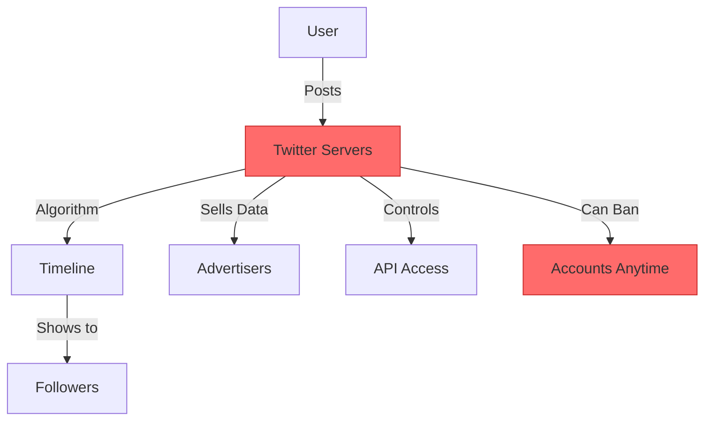
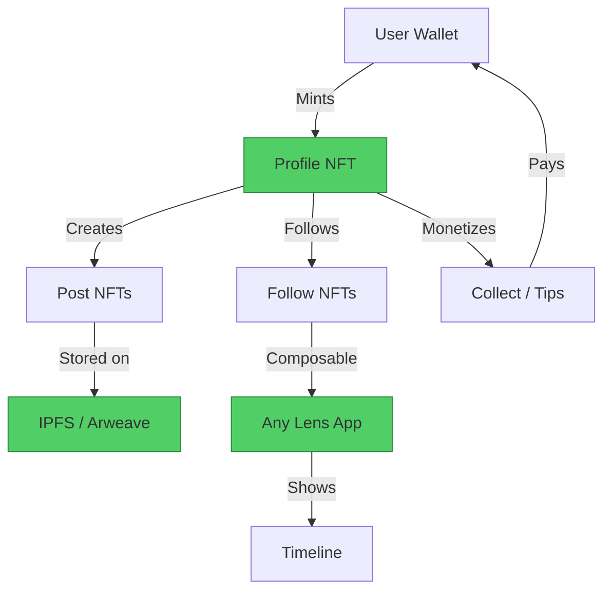

#  Twitter → Lens Protocol Migration Guide

> **Web2 Service:** Twitter (X)
> **Web3 Alternative:** Lens Protocol
> **Difficulty:** ⭐⭐⭐ (Intermediate)
> **Time to Migrate:** 2-4 weeks for a small platform

---

## 🎯 Overview

Twitter controls your audience, your content, and your revenue. One algorithm change or account suspension can destroy years of work overnight. **Lens Protocol** gives you ownership of your social graph as NFTs, making it portable, monetizable, and censorship-resistant.

This guide shows you how to migrate from a centralized social media model to a decentralized, user-owned social graph.

---

## ❌ The Web2 Problem: Twitter

### Key Issues

| Problem | Impact |
|---------|--------|
| **Algorithmic Control** | Twitter decides what your followers see, not you |
| **Account Bans** | Permanent loss of audience with no recourse or appeal |
| **Data Ownership** | Your tweets, followers, and DMs belong to Twitter |
| **Monetization** | Twitter takes 100% of ad revenue; creators get crumbs |
| **API Restrictions** | Developers locked out after policy changes (2023) |
| **Bot Problems** | Fake accounts inflate metrics and spread misinformation |
| **Content Shadowban** | Reduced reach without notification or explanation |

### Real-World Example

In 2023, Twitter restricted API access and killed hundreds of third-party apps (Tweetbot, Twitterific, Fenix). Developers lost businesses overnight. In 2021, permanent bans of high-profile accounts showed that no one is safe from centralized control.

---

## ✅ The Web3 Solution: Lens Protocol

### What is Lens Protocol?

Lens Protocol is a **composable and decentralized social graph** built on Polygon. Your profile, followers, posts, and comments are NFTs you truly own. Any app can build on top of Lens, giving you freedom to switch interfaces without losing your audience.

### Key Benefits

| Benefit | How Lens Solves It |
|---------|-------------------|
| **True Ownership** | Profile = NFT in your wallet; you control it |
| **Portability** | Use your graph on any Lens app (Hey, Tape, Orb) |
| **Monetization** | Collect posts, tips, subscriptions — you keep 100% |
| **Censorship Resistance** | No central authority can ban or shadowban you |
| **Open API** | Anyone can build on Lens; no API keys needed |
| **Composability** | Mix with DeFi, NFTs, and other Web3 protocols |
| **Transparent Algorithm** | You choose what to see; no opaque ranking |

---

## 🏗️ Architecture Comparison

### Twitter Architecture (Centralized)



### Lens Protocol Architecture (Decentralized)



---

## 🛠️ Step-by-Step Migration

### Step 1: Set Up Your Wallet

Install a Web3 wallet (MetaMask, Rainbow, or WalletConnect) and fund it with a small amount of MATIC for gas fees on Polygon.

```javascript
// Install wagmi + viem for React
npm install wagmi viem @wagmi/core

// Connect wallet component
import { useAccount, useConnect, useDisconnect } from 'wagmi'

function ConnectButton() {
  const { address, isConnected } = useAccount()
  const { connect, connectors } = useConnect()
  const { disconnect } = useDisconnect()

  if (isConnected) {
    return (
      <div>
        <p>Connected: {address.slice(0, 6)}...{address.slice(-4)}</p>
        <button onClick={() => disconnect()}>Disconnect</button>
      </div>
    )
  }

  return (
    <button onClick={() => connect({ connector: connectors[0] })}>
      Connect Wallet
    </button>
  )
}
```

### Step 2: Create a Lens Profile

Each Lens profile is an NFT with a unique handle (e.g., `alice.lens`).

```javascript
import { LensClient, production } from '@lens-protocol/client'
import { createWalletClient, custom } from 'viem'
import { polygon } from 'viem/chains'

const client = new LensClient({ environment: production })

// Check handle availability
const availability = await client.profile.handleAvailability({
  handle: 'alice'
})

if (availability.result) {
  console.log('Handle is available!')
}

// Create profile (requires wallet signature)
const walletClient = createWalletClient({
  chain: polygon,
  transport: custom(window.ethereum)
})

const [address] = await walletClient.getAddresses()

const result = await client.profile.create({
  handle: 'alice',
  to: address
})

console.log('Profile creation hash:', result.hash)
```

### Step 3: Publish Your First Post

Posts on Lens are NFTs stored on IPFS, with metadata following the Lens Metadata Standard.

```javascript
import { MetadataV3, PublicationType } from '@lens-protocol/metadata'
import { uploadToIPFS } from './ipfs'

// Create post metadata
const metadata = MetadataV3.create({
  content: 'Hello Web3 world! This is my first decentralized post. 🌍',
  locale: 'en-US',
  mainContentFocus: PublicationType.TEXT_ONLY,
  tags: ['web3', 'lens', 'decentralized', 'migration'],
})

// Upload metadata to IPFS
const uri = await uploadToIPFS(metadata)

// Publish on Lens
const publicationResult = await client.publication.createOnchain({
  contentURI: uri,
  onchain: {
    post: {
      profileId: '0x01'
    }
  }
})

console.log('Post published:', publicationResult.hash)
```

### Step 4: Build a Decentralized Feed

Fetch and display posts from the Lens social graph.

```javascript
import { useState, useEffect } from 'react'

function Feed() {
  const [posts, setPosts] = useState([])

  useEffect(() => {
    async function loadFeed() {
      const result = await client.feed.fetch({
        where: { for: '0x01' }
      })
      setPosts(result.items)
    }
    loadFeed()
  }, [])

  return (
    <div>
      {posts.map(post => (
        <PostCard
          key={post.id}
          author={post.by.handle}
          content={post.metadata.content}
          stats={{
            likes: post.stats.upvotes,
            comments: post.stats.comments,
            mirrors: post.stats.mirrors,
            collects: post.stats.collects
          }}
        />
      ))}
    </div>
  )
}
```

### Step 5: Monetize with Collect Modules

Charge followers to collect (save) your posts as NFTs.

```solidity
// Simple Collect Module on Lens
interface ISimpleCollectModule {
    function processCollect(
        uint256 referrerProfileId,
        address collector,
        uint256 pubId,
        bytes data
    ) external returns (bytes memory);
}

// Configuration for paid collect
struct PaidCollectParams {
    uint256 amount;       // 10 USDC per collect
    address currency;     // USDC token address on Polygon
    address recipient;    // Your wallet
    uint16 referralFee;   // 10% to mirrors
    bool followOnly;      // Must follow to collect
}
```

```javascript
// Example: Create a paid post
const paidPostResult = await client.publication.createOnchain({
  contentURI: uri,
  onchain: {
    post: {
      profileId: '0x01',
      collectModule: {
        simpleCollectModule: {
          amount: {
            currency: '0x2791Bca1f2de4661ED88A30C99A7a9449Aa84174',
            value: '10.0'
          },
          recipient: '0xYourWalletAddress',
          referralFee: 10.0,
          followerOnly: true
        }
      }
    }
  }
})
```

### Step 6: Migrate Your Twitter Followers

Use tools like **Hey.xyz** or **Lenster** to import your Twitter followers and notify them of your new Lens profile.

```javascript
// Example: Batch follow notification
const followersToNotify = [
  '0x02', '0x03', '0x04'
]

for (const profileId of followersToNotify) {
  await client.profile.follow({
    profileId: profileId,
    followerProfileId: '0x01'
  })
  console.log(`Followed profile ${profileId}`)
}
```

---

##  Full Migration Script

```javascript
// complete-migration.js
import { LensClient, production } from '@lens-protocol/client'
import { createWalletClient, custom } from 'viem'
import { polygon } from 'viem/chains'

class TwitterToLensMigrator {
  constructor() {
    this.client = new LensClient({ environment: production })
    this.walletClient = createWalletClient({
      chain: polygon,
      transport: custom(window.ethereum)
    })
  }

  async migrate(handle, posts) {
    console.log(`Starting migration for @${handle}...`)

    const profile = await this.createProfile(handle)
    console.log(`Profile created: ${profile.handle}`)

    for (const post of posts) {
      await this.migratePost(profile.id, post)
      console.log(`Migrated post: ${post.id}`)
    }

    console.log('Migration complete!')
  }

  async createProfile(handle) {
    // Implementation...
  }

  async migratePost(profileId, post) {
    const metadata = MetadataV3.create({
      content: post.content,
      locale: 'en-US',
      mainContentFocus: PublicationType.TEXT_ONLY,
    })

    const uri = await uploadToIPFS(metadata)

    await this.client.publication.createOnchain({
      contentURI: uri,
      onchain: { post: { profileId } }
    })
  }
}

// Usage
const migrator = new TwitterToLensMigrator()
await migrator.migrate('alice', twitterPosts)
```

---

## ⚖️ Trade-offs

| Aspect | Twitter | Lens Protocol |
|--------|---------|---------------|
| **User Experience** | Instant, familiar, polished | Requires wallet, learning curve |
| **Cost** | Free to use | Gas fees (Polygon ≈ $0.01) |
| **Speed** | Milliseconds | ~2 seconds (block confirmation) |
| **Scale** | 500M+ daily users | ~100K profiles (growing) |
| **Features** | Mature (DMs, Spaces, Lists) | Growing (no native DMs yet) |
| **Ownership** | None — Twitter owns everything | Full ownership via NFTs |
| **Censorship** | High risk — arbitrary bans | Resistant — decentralized |
| **Monetization** | Platform takes ~100% of ad revenue | Creator keeps 100% |
| **API Access** | Restricted, expensive | Open, permissionless |
| **Data Portability** | Locked in | Fully portable |

---

## 🌍 Real-World Examples

### Apps Built on Lens Protocol

1. **Hey.xyz** — Twitter-like interface, most popular Lens app
2. **Tape.xyz** — YouTube-like video platform on Lens
3. **Orb.club** — Mobile-first Lens client
4. **Buttrfly.app** — Multi-protocol social aggregator
5. **Lenster.xyz** — Original Lens frontend (open source)

### Migration Success Stories

- **@Stani.lens** (Aave founder): 50K+ followers migrated from Twitter
- **@LensTeam**: Official Lens account with 100K+ followers
- **Independent creators**: Earning $500-$5,000/month through collect modules
- **Developers**: Building entire businesses on Lens API without restrictions

---

##  Security Considerations

1. **Private Key Management**: Lost wallet = lost profile forever. Use hardware wallets for high-value accounts.
2. **Smart Contract Risk**: Lens Protocol contracts are audited by OpenZeppelin and Trail of Bits, but risks remain.
3. **Content Moderation**: Decentralization makes it hard to remove illegal or harmful content.
4. **Sybil Attacks**: Cheap to create multiple profiles; reputation systems still evolving.
5. **Gas Costs**: Users need MATIC for transactions; UX friction for non-crypto natives.
6. **Phishing Risks**: Fake Lens apps can steal signatures; always verify contract addresses.
7. **Data Permanence**: Content on IPFS/Arweave is hard to delete; think before posting.

---

##  Resources

### Official Documentation
- [Lens Protocol Documentation](https://docs.lens.xyz/)
- [Lens API Reference](https://api.lens.dev/)
- [Lens Metadata Standard](https://docs.lens.xyz/docs/publication-metadata)

### Developer Tools
- [Lens SDK](https://github.com/lens-protocol/lens-sdk)
- [Lens Examples GitHub](https://github.com/lens-protocol/examples)
- [Hey.xyz Source Code](https://github.com/heyxyz/hey)

### Community
- [Lens Protocol Discord](https://discord.gg/lensprotocol)
- [Lens Builders Telegram](https://t.me/lensbuilders)
- [Lens Ecosystem Map](https://lens.xyz/ecosystem)

### Migration Tools
- [Hey.xyz](https://hey.xyz/) — Web frontend
- [Orb](https://orb.club/) — Mobile app
- [Tape](https://tape.xyz/) — Video platform

---

## 🎓 Key Takeaways

1. **Ownership is everything**: On Lens, your profile, posts, and followers are NFTs you control. No one can take them away.
2. **Composability wins**: Build once on Lens, and your content works across every app in the ecosystem.
3. **UX is the main challenge**: Wallet onboarding and gas fees remain friction points for mainstream adoption.
4. **Monetization is direct**: Collect modules, tips, and subscriptions let you earn without intermediaries.
5. **Community matters**: The Lens ecosystem is small but growing fast; early adopters have significant advantages.
6. **Don't burn bridges**: Maintain your Twitter presence during migration; use it to drive followers to Lens.
7. **Think long-term**: Web3 social is still early; patience and persistence pay off.

---

*Guide by [@Elvatar](https://github.com/Elvatar2) | Last updated: 2026*
*Part of the Web2 → Web3 Migration Guide series*
