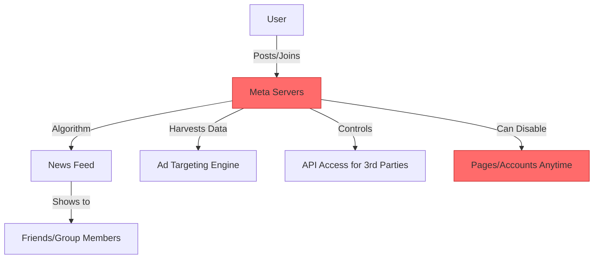
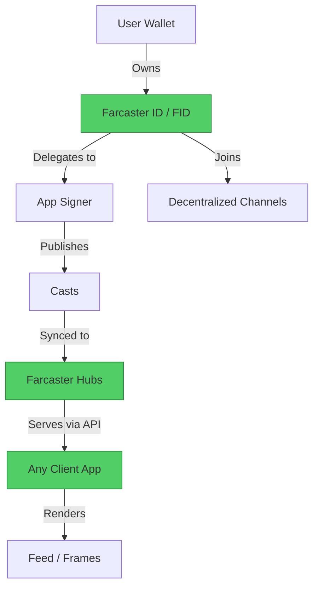

#  Facebook → Farcaster Migration Guide

> **Web2 Service:** Facebook (Meta)
> **Web3 Alternative:** Farcaster
> **Difficulty:** ⭐⭐⭐ (Intermediate)
> **Time to Migrate:** 3-6 weeks for community/platform migration

---

## 🎯 Overview

Facebook controls your social graph, group dynamics, and community data. Algorithmic changes, arbitrary page takedowns, and privacy scandals have repeatedly shown the risks of centralized social networking. **Farcaster** provides a decentralized social protocol where users own their identity (Farcaster ID), data is portable across clients, and "Frames" enable interactive, mini-app experiences directly within the social feed.

This guide shows you how to migrate from a centralized social network model to a decentralized, user-owned, and highly composable social protocol.

---

## ❌ The Web2 Problem: Facebook

### Key Issues

| Problem | Impact |
|---------|--------|
| **Algorithmic Manipulation** | Meta decides what your community sees, prioritizing engagement over value |
| **Arbitrary Takedowns** | Pages and groups can be permanently disabled with opaque or no appeal processes |
| **Data Exploitation** | Your social graph, interactions, and personal data are harvested and sold for ads |
| **Monetization Gatekeeping** | Meta takes a massive cut of creator revenue and controls payout eligibility |
| **API Shutdowns** | Third-party tools and community bots frequently lose access due to policy changes |
| **Group Lock-in** | Community data and member lists cannot be exported or migrated to other platforms |
| **Privacy Scandals** | Historical breaches (e.g., Cambridge Analytica) highlight systemic data risks |

### Real-World Example

In 2018, the Cambridge Analytica scandal exposed how Facebook allowed third-party apps to harvest data from millions of users without explicit consent. More recently, Facebook Pages and Groups have been permanently disabled overnight due to automated moderation errors, destroying years of community building with zero recourse for the admins.

---

## ✅ The Web3 Solution: Farcaster

### What is Farcaster?

Farcaster is a **sufficiently decentralized social protocol** built on Optimism (Ethereum L2). It separates the identity layer (on-chain) from the data storage layer (off-chain Hubs). Your identity is tied to your wallet, your posts (Casts) are signed cryptographically, and you can use any client app (like Warpcast) without losing your followers or content.

### Key Benefits

| Benefit | How Farcaster Solves It |
|---------|-------------------------|
| **True Ownership** | Your Farcaster ID (FID) is linked to your Ethereum wallet; you own it |
| **Portability** | Switch between clients (Warpcast, Supercast, Yop) without losing your graph |
| **Composability (Frames)** | Turn any Cast into an interactive mini-app (mint NFTs, play games, subscribe) |
| **Censorship Resistance** | No central authority can delete your FID or censor your casts at the protocol level |
| **Open API** | Permissionless access to the social graph via open Hubs or services like Neynar |
| **Community Control** | Decentralized "Channels" replace locked-in Facebook Groups |
| **Transparent Economics** | Direct monetization via crypto, NFTs, and Frames without platform middlemen |

---

## 🏗️ Architecture Comparison

### Facebook Architecture (Centralized)



### Farcaster Architecture (Decentralized)



---

## 🛠️ Step-by-Step Migration

### Step 1: Set Up Wallet and Farcaster Client

Install a Web3 wallet (e.g., MetaMask, Coinbase Wallet) and fund it with a small amount of ETH on the Optimism network. Download a Farcaster client like **Warpcast** to create your account.

```javascript
// Install Farcaster/Neynar SDK for backend integration
npm install @neynar/nodejs-sdk

// Initialize Neynar client (Neynar provides indexed Farcaster data)
import { NeynarClient } from "@neynar/nodejs-sdk";

const neynar = new NeynarClient("YOUR_NEYNAR_API_KEY");
```

### Step 2: Register a Farcaster ID (FID)

While Warpcast handles this via UI, developers can automate or integrate FID creation using the Farcaster contracts or Neynar's managed signer flow.

```javascript
// Example: Creating a managed signer for a user via Neynar
async function createFarcasterSigner() {
  try {
    const response = await neynar.createSigner();
    console.log("Signer created. Please approve in Warpcast:");
    console.log("Deep link:", response.signer.approve_url);
    console.log("Signer UUID:", response.signer.uuid);
    return response.signer.uuid;
  } catch (error) {
    console.error("Error creating signer:", error);
  }
}
```

### Step 3: Publish Your First Cast

Casts are the fundamental unit of content in Farcaster (similar to posts or tweets).

```javascript
async function publishCast(signerUuid, text) {
  try {
    const cast = await neynar.publishCast({
      signerUuid: signerUuid,
      text: text,
      embeds: [{ url: "https://your-website.com" }] // Optional: embed a link or Frame
    });
    console.log("Cast published successfully:", cast.cast.hash);
    return cast.cast.hash;
  } catch (error) {
    console.error("Failed to publish cast:", error);
  }
}

// Usage
// await publishCast("your-signer-uuid", "Hello Farcaster! Migrating our community from Facebook. 🌐");
```

### Step 4: Build a Decentralized Feed (Channel or User)

Fetch casts for a specific Farcaster Channel (the decentralized equivalent of a Facebook Group).

```javascript
async function getChannelFeed(channelId) {
  try {
    const response = await neynar.fetchFeed({
      feedType: "filter",
      filterType: "channel",
      channelId: channelId,
      limit: 20
    });

    return response.casts.map(cast => ({
      author: cast.author.username,
      text: cast.text,
      hash: cast.hash,
      replies: cast.replies.count,
      recasts: cast.recasts.count
    }));
  } catch (error) {
    console.error("Error fetching feed:", error);
  }
}

// Usage: Fetch feed for the "web3" channel
// const feed = await getChannelFeed("web3");
```

### Step 5: Create an Interactive "Frame"

Frames allow you to embed interactive, stateful mini-apps directly inside a Cast. This replaces Facebook's embedded links with rich, on-chain experiences.

```html
<!-- Example: Basic Frame Meta Tags for a Cast -->
<meta property="fc:frame" content="vNext" />
<meta property="fc:frame:image" content="https://your-domain.com/image.png" />
<meta property="fc:frame:button:1" content="Join Community" />
<meta property="fc:frame:button:1:action" content="link" />
<meta property="fc:frame:button:1:target" content="https://warpcast.com/~/channel/yourchannel" />
<meta property="fc:frame:button:2" content="Mint Welcome NFT" />
<meta property="fc:frame:button:2:action" content="mint" />
<meta property="fc:frame:button:2:target" content="eip155:10:0xYourContractAddress" />
```

### Step 6: Migrate Facebook Groups to Farcaster Channels

1. Announce the migration in your Facebook Group with a clear call-to-action.
2. Create a dedicated Farcaster Channel (e.g., `yourbrand`).
3. Use a bot or script to notify early adopters.
4. Incentivize the move (e.g., "First 100 members to cast in our channel get a commemorative NFT via Frame").

```javascript
// Example: Automating a welcome message to new channel members
async function welcomeNewMembers(channelId) {
  const feed = await neynar.fetchFeed({
    feedType: "filter",
    filterType: "channel",
    channelId: channelId,
    limit: 10
  });

  for (const cast of feed.casts) {
    if (cast.text.toLowerCase().includes("joined")) {
      await neynar.postReply({
        signerUuid: "your-signer-uuid",
        castId: { hash: cast.hash, fid: cast.author.fid },
        text: `Welcome to the decentralized community! 🎉 Check out our welcome Frame below.`
      });
    }
  }
}
```

---

## 📜 Full Migration Script

```javascript
// migrate-facebook-to-farcaster.js
import { NeynarClient } from "@neynar/nodejs-sdk";

class FacebookToFarcasterMigrator {
  constructor(apiKey, signerUuid) {
    this.neynar = new NeynarClient(apiKey);
    this.signerUuid = signerUuid;
  }

  async migrateWelcomePost(fbPostData) {
    console.log(`Migrating post: ${fbPostData.id}...`);

    const farcasterText = `${fbPostData.title}\n\n${fbPostData.content}\n\nWe are now decentralized! Join our Farcaster channel: /ourcommunity`;

    const cast = await this.neynar.publishCast({
      signerUuid: this.signerUuid,
      text: farcasterText,
      embeds: fbPostData.images.map(img => ({ url: img }))
    });

    console.log(`Successfully migrated to Cast: ${cast.cast.hash}`);
    return cast.cast.hash;
  }

  async announceMigration(channelId) {
    const announcement = `🚨 Big News! We are migrating our community from Facebook to Farcaster.
    Why? True ownership, no algorithms, and interactive Frames.
    Join us at /${channelId} and mint your founder badge below! 👇`;

    await this.neynar.publishCast({
      signerUuid: this.signerUuid,
      text: announcement,
      embeds: [{ url: "https://your-domain.com/founder-badge-frame" }]
    });
    console.log("Migration announcement published.");
  }
}

// Usage
// const migrator = new FacebookToFarcasterMigrator("YOUR_API_KEY", "YOUR_SIGNER_UUID");
// await migrator.announceMigration("ourcommunity");
```

---

## ⚖️ Trade-offs

| Aspect | Facebook | Farcaster |
|--------|----------|-----------|
| **User Experience** | Extremely polished, familiar to billions | Slight learning curve (wallets, signers), but Warpcast is very smooth |
| **Cost** | Free for users (paid with data) | ~$5/year for Hub storage rent (paid in ETH) |
| **Speed** | Instant (centralized DB) | Near-instant (Hubs sync every few seconds) |
| **Scale** | ~3 Billion monthly active users | ~500K+ registered users (rapidly growing) |
| **Features** | Mature (Events, Marketplace, complex Groups) | Emerging (Frames are revolutionary, but no native complex event management yet) |
| **Ownership** | Meta owns all data and the graph | Users own their FID, data is portable |
| **Censorship** | High risk (automated bans, political bias) | Resistant (protocol-level censorship is practically impossible) |
| **Monetization** | Ad revenue share, heavily restricted | Direct (tips, NFT mints via Frames, subscriptions) |
| **API Access** | Heavily restricted, expensive, rate-limited | Open, permissionless, affordable (via Neynar or direct Hubs) |

---

## 🌍 Real-World Examples

### Apps Built on Farcaster
1. **Warpcast** — The most popular, polished Farcaster client (iOS/Android/Web).
2. **Supercast** — Feature-rich client with advanced filtering and power-user tools.
3. **Yop** — Minimalist, web-first Farcaster client.
4. **Paragraph** — Newsletter platform deeply integrated with Farcaster for distribution.
5. **Zora** — NFT protocol heavily utilizing Farcaster Frames for seamless minting.

### Migration Success Stories
- **Independent Creators**: Moving their email lists and Facebook groups to Farcaster Channels, achieving higher engagement rates without algorithmic suppression.
- **Web3 Communities**: Projects like *Aave* and *Zora* use Farcaster as their primary community hub, replacing Discord and Facebook Groups with interactive Frames.
- **Developers**: Building standalone mini-apps (games, polls, minting experiences) that go viral directly inside the Warpcast feed via Frames.

---

## 🔒 Security Considerations

1. **Wallet Security**: Your FID is tied to your wallet. Use a hardware wallet (Ledger/Trezor) for the recovery address, and a separate "burner" wallet for the daily App Signer.
2. **Signer Revocation**: If a client app is compromised, you can revoke its signer permissions from your recovery address without losing your FID.
3. **Frame Phishing**: Malicious Frames can request wallet signatures. Always verify the domain and action of a Frame before interacting.
4. **Hub Centralization**: While the protocol is decentralized, most users currently rely on a small number of public Hubs. Running your own Hub increases resilience.
5. **Data Permanence**: Casts synced to Hubs are difficult to fully erase. Treat all on-chain or Hub-stored data as permanent.

---

## 📚 Resources

### Official Documentation
- [Farcaster Official Docs](https://docs.farcaster.xyz/)
- [Farcaster Protocol Specifications](https://github.com/farcasterxyz/protocol)
- [Frames Specification](https://docs.farcaster.xyz/reference/frames/spec)

### Developer Tools
- [Neynar SDK](https://docs.neynar.com/) — Industry standard for Farcaster API and indexing
- [Farcaster Hubs](https://github.com/farcasterxyz/hub-monorepo) — Run your own data hub
- [OnchainKit (by Coinbase)](https://onchainkit.xyz/) — Best-in-class React components for building Frames

### Community
- [Farcaster Discord](https://discord.gg/farcaster)
- [/farcaster Channel](https://warpcast.com/~/channel/farcaster) — Core protocol discussions
- [/build Channel](https://warpcast.com/~/channel/build) — Developer coordination

---

## 🎓 Key Takeaways

1. **Identity is yours**: Your Farcaster ID is an asset tied to your wallet, not a rented account on Meta's servers.
2. **Frames are the future**: They transform static social feeds into interactive, composable application layers.
3. **Portability is power**: If you dislike a client app, you can switch to another without rebuilding your audience.
4. **Community > Platform**: Decentralized Channels foster genuine community ownership compared to walled-garden Facebook Groups.
5. **UX is improving rapidly**: Tools like Warpcast and Passkeys are making Web3 social onboarding as easy as Web2.
6. **Early mover advantage**: Building an audience and developer tools on Farcaster now positions you at the forefront of the next social paradigm.
7. **Hybrid transition**: Don't delete Facebook immediately. Use it as a funnel to drive your most engaged members to your Farcaster Channel.

---

*Guide by [@Elvatar](https://github.com/Elvatar2) | Last updated: 2026*
*Part of the Web2 → Web3 Migration Guide series*