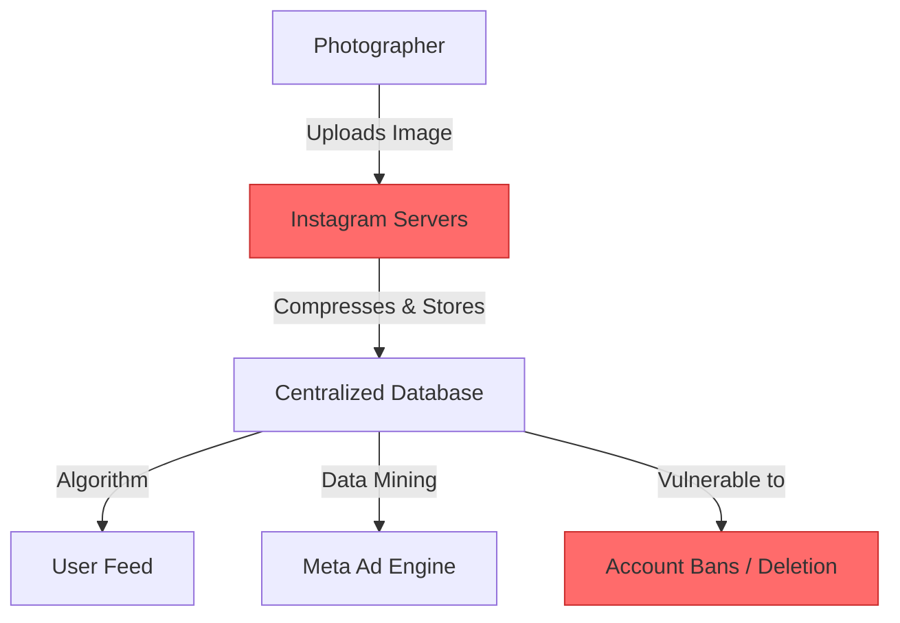
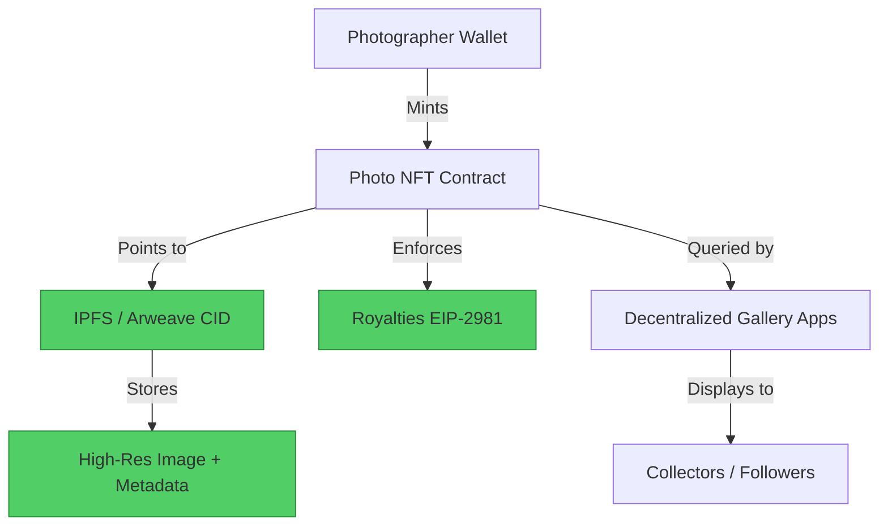

#  Instagram → Photo Protocol Migration Guide

> **Web2 Service:** Instagram (Meta)
> **Web3 Alternative:** Photo Protocol (Decentralized Media & IPFS/Arweave)
> **Difficulty:** ⭐⭐ (Beginner to Intermediate)
> **Time to Migrate:** 2-4 weeks for portfolio and audience migration

---

## 🎯 Overview

Instagram controls your visual portfolio, compresses your image quality, and dictates who sees your work through opaque algorithms. Creators build massive audiences but capture almost zero direct value, while facing constant risks of account suspension or content theft. **Photo Protocol** (and similar decentralized media protocols) shifts the paradigm by storing high-resolution media on decentralized storage (IPFS/Arweave) and representing ownership, licensing, and royalties via smart contracts (NFTs).

This guide shows you how to migrate from a centralized, algorithm-driven photo-sharing model to a decentralized, creator-owned visual media ecosystem.

---

## ❌ The Web2 Problem: Instagram

### Key Issues

| Problem | Impact |
|---------|--------|
| **Aggressive Compression** | Image and video quality are heavily degraded, ruining professional portfolios |
| **Algorithmic Suppression** | Reach is artificially throttled unless you pay for ads or chase viral trends |
| **Zero Direct Monetization** | No native way to sell prints, licenses, or collect royalties; reliance on external brand deals |
| **Content Theft** | Easy for others to download, re-upload, and claim your work without attribution or compensation |
| **Account Vulnerability** | Automated moderation can permanently disable accounts with no human recourse |
| **Data Lock-in** | Your followers, likes, and portfolio are trapped within Meta's ecosystem |
| **Privacy & Data Mining** | Meta tracks user behavior, location, and interactions to build ad profiles |

### Real-World Example

Professional photographers frequently complain about Instagram's aggressive JPEG compression, which introduces artifacts and destroys color grading. Furthermore, countless artists have had their accounts permanently disabled due to false-positive AI moderation flags, losing years of portfolio building and client connections overnight.

---

## ✅ The Web3 Solution: Photo Protocol

### What is Photo Protocol?

Photo Protocol represents a class of decentralized media-sharing protocols that combine **decentralized storage** (IPFS, Arweave, or Filecoin) with **on-chain ownership** (ERC-721/ERC-1155 NFTs). Your photos are minted as verifiable digital assets with embedded metadata, licensing terms, and automated royalty splits (EIP-2981).

### Key Benefits

| Benefit | How Photo Protocol Solves It |
|---------|------------------------------|
| **True Ownership** | You hold the private key to the NFT representing your photo's provenance |
| **Lossless Quality** | Original high-resolution files are stored on IPFS/Arweave, untouched by compression |
| **Automated Royalties** | Smart contracts enforce secondary sale royalties (e.g., 10% on every resale) |
| **Verifiable Provenance** | Cryptographic proof of creation date and authorship, deterring theft |
| **Censorship Resistance** | Content stored on Arweave/IPFS cannot be unilaterally deleted by a central authority |
| **Composable Licensing** | Embed machine-readable licenses (e.g., Creative Commons or commercial rights) in metadata |
| **Direct Monetization** | Sell limited editions, open editions, or subscription access directly to collectors |

---

## 🏗️ Architecture Comparison

### Instagram Architecture (Centralized)



### Photo Protocol Architecture (Decentralized)



---

## 🛠️ Step-by-Step Migration

### Step 1: Set Up Wallet and Storage

Install a Web3 wallet (e.g., MetaMask, Rainbow) and fund it with a small amount of ETH or MATIC. Set up an IPFS pinning service (like Web3.Storage, Pinata, or an Arweave bundler like Irys) for reliable, permanent storage.

```javascript
// Install dependencies
npm install viem ipfs-http-client dotenv

// Initialize IPFS client (e.g., via Pinata or local node)
import { create } from 'ipfs-http-client';
const ipfs = create({ url: 'https://api.pinata.cloud/ipfs/api/v0' }); // Replace with your endpoint
```

### Step 2: Upload High-Res Photo and Metadata

Separate the media file from its metadata. Upload the image to IPFS, then create a JSON metadata file that includes the image CID, title, description, and licensing info.

```javascript
import fs from 'fs';

async function preparePhotoAsset(imagePath, title, description, license) {
  // 1. Upload image to IPFS
  const imageFile = fs.readFileSync(imagePath);
  const imageUpload = await ipfs.add(imageFile);
  const imageCid = imageUpload.cid.toString();
  const imageUrl = `ipfs://${imageCid}`;

  // 2. Create Metadata (following ERC-721/1155 standards)
  const metadata = {
    name: title,
    description: description,
    image: imageUrl,
    attributes: [
      { trait_type: "License", value: license },
      { trait_type: "Resolution", value: "High-Res Original" },
      { trait_type: "Year", value: "2026" }
    ],
    properties: {
      files: [{ uri: imageUrl, type: "image/jpeg" }]
    }
  };

  // 3. Upload metadata to IPFS
  const metadataUpload = await ipfs.add(JSON.stringify(metadata));
  return metadataUpload.cid.toString();
}
```

### Step 3: Mint the Photo with Royalties

Use a smart contract to mint the photo as an NFT, ensuring the royalty information (EIP-2981) is embedded for future secondary sales.

```javascript
import { createWalletClient, custom, http } from 'viem';
import { polygon } from 'viem/chains';
import { photoProtocolABI } from './abi.js'; // Your protocol's ABI

const walletClient = createWalletClient({
  chain: polygon,
  transport: custom(window.ethereum)
});

async function mintPhoto(metadataCid, royaltyBps = 1000) { // 1000 = 10%
  const [address] = await walletClient.getAddresses();

  const hash = await walletClient.writeContract({
    address: '0xYourPhotoProtocolContractAddress',
    abi: photoProtocolABI,
    functionName: 'mintPhoto',
    args: [
      address,
      `ipfs://${metadataCid}`,
      royaltyBps, // Royalty basis points
      address     // Royalty recipient
    ],
    account: address
  });

  console.log(`Photo minted! Transaction hash: ${hash}`);
  return hash;
}
```

### Step 4: Build or Use a Decentralized Gallery

Instead of the Instagram grid, use or build a decentralized frontend that reads from the blockchain and IPFS to display your portfolio.

```javascript
// Example: Fetching a user's photo gallery from a decentralized indexer
async function fetchCreatorGallery(creatorAddress) {
  // Using a subgraph or protocol-specific indexer
  const response = await fetch(`https://api.thegraph.com/subgraphs/name/photo-protocol/photos`, {
    method: 'POST',
    headers: { 'Content-Type': 'application/json' },
    body: JSON.stringify({
      query: `
        query {
          photos(where: { creator: "${creatorAddress.toLowerCase()}" }, orderBy: createdAt, orderDirection: desc) {
            id
            tokenURI
            price
            royaltyBps
          }
        }
      `
    })
  });
  const data = await response.json();
  return data.data.photos;
}
```

### Step 5: Migrate Your Audience

1. **Watermark Transition**: Add your Web3 handle (e.g., `@yourname.eth` or `yourname.lens`) to new Instagram posts.
2. **Link in Bio**: Update your Instagram bio to point to your decentralized gallery (e.g., `yourname.vercel.app` or a dedicated Web3 portfolio site).
3. **Exclusive Drops**: Announce an "Instagram Followers Exclusive" free or discounted mint on your Photo Protocol gallery to incentivize the move.

---

## 📜 Full Migration Script

```javascript
// migrate-instagram-portfolio.js
import { create } from 'ipfs-http-client';
import { createWalletClient, custom } from 'viem';
import { polygon } from 'viem/chains';
import fs from 'fs';
import path from 'path';

const ipfs = create({ url: 'https://api.pinata.cloud/ipfs/api/v0' });

class InstagramToPhotoProtocolMigrator {
  constructor(contractAddress, abi) {
    this.contractAddress = contractAddress;
    this.abi = abi;
    this.walletClient = createWalletClient({
      chain: polygon,
      transport: custom(window.ethereum)
    });
  }

  async migrateFolder(folderPath) {
    const [address] = await this.walletClient.getAddresses();
    console.log(`Starting migration for wallet: ${address}`);

    const files = fs.readdirSync(folderPath).filter(f => f.endsWith('.jpg') || f.endsWith('.png'));

    for (const file of files) {
      console.log(`Processing: ${file}`);
      const filePath = path.join(folderPath, file);

      // 1. Upload Image
      const imageFile = fs.readFileSync(filePath);
      const imgRes = await ipfs.add(imageFile);

      // 2. Create Metadata
      const metadata = {
        name: file.replace(/\.[^/.]+$/, ""),
        description: "Migrated from Instagram to Decentralized Photo Protocol",
        image: `ipfs://${imgRes.cid.toString()}`,
        attributes: [{ trait_type: "Source", value: "Instagram Migration" }]
      };
      const metaRes = await ipfs.add(JSON.stringify(metadata));

      // 3. Mint
      const hash = await this.walletClient.writeContract({
        address: this.contractAddress,
        abi: this.abi,
        functionName: 'mintPhoto',
        args: [address, `ipfs://${metaRes.cid.toString()}`, 1000, address],
        account: address
      });

      console.log(`✅ Minted ${file}: ${hash}`);
    }
    console.log("🎉 Portfolio migration complete!");
  }
}

// Usage
// const migrator = new InstagramToPhotoProtocolMigrator('0xContract...', photoABI);
// await migrator.migrateFolder('./my-instagram-export');
```

---

## ⚖️ Trade-offs

| Aspect | Instagram | Photo Protocol |
|--------|-----------|----------------|
| **User Experience** | Frictionless, highly polished, universal | Requires wallet setup, understanding of gas/IPFS |
| **Cost** | Free (paid with data and attention) | Gas fees for minting + IPFS pinning costs |
| **Image Quality** | Heavily compressed, algorithm-altered | Lossless, original high-resolution files preserved |
| **Scale** | ~2 Billion+ monthly active users | Niche, growing community of Web3 natives/collectors |
| **Discovery** | Powerful (but manipulated) algorithmic feed | Relies on curation, social sharing, and community hubs |
| **Ownership** | Meta owns the platform and your data | You own the asset, the metadata, and the revenue |
| **Monetization** | Indirect (brand deals, driving traffic elsewhere) | Direct (primary sales, secondary royalties, licensing) |
| **Censorship** | High risk (shadowbans, TOS violations) | Resistant (immutable storage, decentralized hosting) |

---

## 🌍 Real-World Examples

### Platforms & Protocols
1. **Phaver**: A Web3 social app (built on Lens) heavily focused on photo sharing and creator rewards.
2. **Arweave-based Portfolios**: Photographers using Arweave for permanent, one-time-fee storage of high-res galleries.
3. **Zora**: Widely used by visual artists to create open editions and collectible photo drops with built-in royalties.
4. **Foundation / SuperRare**: Curated platforms for high-end photographic art as NFTs.

### Migration Success Stories
- **Independent Photographers**: Transitioned from chasing Instagram likes to building a dedicated collector base of 500–2,000 true fans, generating sustainable income via limited edition drops.
- **Photo Collectives**: Decentralized Autonomous Organizations (DAOs) formed by photographers to collectively govern exhibitions and share revenue, impossible to replicate on Instagram.

---

## 🔒 Security Considerations

1. **Private Key Management**: Losing your wallet means losing access to your minted photos and revenue. Use a hardware wallet for the main holding address.
2. **IPFS Pinning**: Uploading to IPFS is not enough; the data must be *pinned* by a reliable service (or yourself), otherwise it may be garbage-collected and become inaccessible.
3. **Smart Contract Risk**: Ensure the minting contract is audited. Malicious contracts could drain funds or lock your NFTs.
4. **Metadata Mutability**: If the metadata URI is not immutable (e.g., not using `ipfs://` or `ar://`), a malicious actor could change the image linked to your NFT after the fact.
5. **Phishing**: Be wary of fake "minting" or "gallery" sites that request wallet signatures to drain assets. Always verify URLs.

---

## 📚 Resources

### Official Documentation
- [IPFS Documentation](https://docs.ipfs.tech/)
- [Arweave Documentation](https://docs.arweave.org/)
- [EIP-2981: NFT Royalty Standard](https://eips.ethereum.org/EIPS/eip-2981)

### Developer Tools
- **Pinata**: User-friendly IPFS pinning and management.
- **Irys (formerly Bundlr)**: Fast, scalable, and permanent data uploads to Arweave.
- **Thirdweb**: Pre-built smart contracts for NFT drops and royalty management.
- **Wagmi / Viem**: Best-in-class React hooks and TypeScript libraries for Ethereum interactions.

### Community
- [NFT Photography Discord Communities](https://discord.gg/nftphotography)
- [Web3 Creators on Farcaster/Lens](https://warpcast.com/)

---

## 🎓 Key Takeaways

1. **Quality matters**: Decentralized storage preserves the artistic integrity of your high-resolution work.
2. **Ownership is revenue**: Embedding royalties ensures you benefit from the future success of your art.
3. **Community over algorithm**: 100 true collectors on Web3 are more valuable than 10,000 passive scrollers on Instagram.
4. **Permanence is a feature**: Arweave and pinned IPFS ensure your portfolio outlives any single company or platform.
5. **Start hybrid**: Keep your Instagram as a marketing funnel, but move the actual high-value interactions, sales, and high-res viewing to your Web3 gallery.
6. **Metadata is your canvas**: Use the NFT metadata fields to encode rich licensing terms, provenance, and artistic statements.
7. **Tooling is maturing**: With services like Thirdweb and Pinata, the technical barrier to entry for photographers is lower than ever.

---

*Guide by [@Elvatar](https://github.com/Elvatar2) | Last updated: 2026*
*Part of the Web2 → Web3 Migration Guide series*
