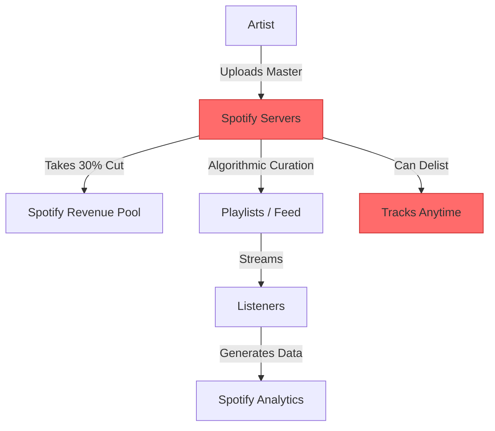
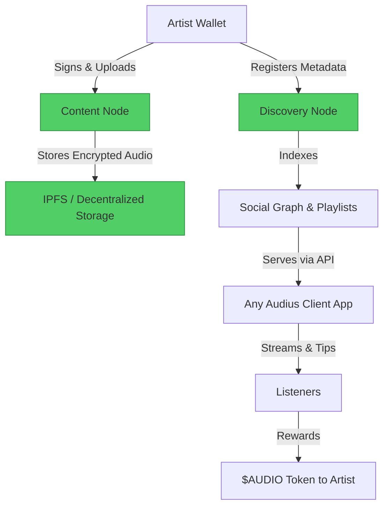

#  Spotify → Audius Migration Guide

> **Web2 Service:** Spotify
> **Web3 Alternative:** Audius Protocol
> **Difficulty:** ⭐⭐⭐ (Intermediate)
> **Time to Migrate:** 4-8 weeks for catalog migration and audience building

---

## 🎯 Overview

Spotify controls music discovery, takes a massive ~30% cut of revenue, and pays artists fractions of a cent per stream. Independent musicians build audiences but remain at the mercy of opaque algorithms and playlist gatekeepers. **Audius** is a decentralized, community-owned music streaming protocol that returns control, ownership, and economics directly to creators.

This guide shows you how to migrate from a centralized, extractive streaming model to a decentralized, artist-first music ecosystem where you own your master recordings, fan relationships, and revenue streams.

---

## ❌ The Web2 Problem: Spotify

### Key Issues

| Problem | Impact |
|---------|--------|
| **Abysmal Payouts** | Artists earn ~$0.003–$0.005 per stream; requires millions of plays to make minimum wage |
| **Platform Tax** | Spotify takes ~30% of all revenue before it even reaches rights holders |
| **Algorithmic Gatekeeping** | Discovery is controlled by proprietary algorithms and curated playlist editors |
| **No Direct Fan Connection** | Artists cannot easily message, reward, or build direct economic relationships with listeners |
| **Opaque Analytics** | Limited demographic data; artists don't truly "own" their listener data |
| **Arbitrary Takedowns** | Tracks can be delisted due to automated copyright claims or shifting platform policies |
| **Metadata Rigidity** | Difficult to update credits, remix info, or alternative versions once published |

### Real-World Example

Countless independent artists have gone viral on Spotify, only to earn less than $100 from millions of streams due to the pro-rata payout model. Furthermore, Spotify's sudden changes to its royalty policy in 2024 (requiring 1,000+ annual streams to generate *any* payout) devastated ambient, classical, and niche independent creators.

---

## ✅ The Web3 Solution: Audius

### What is Audius?

Audius is a **decentralized music streaming protocol** built on Solana and Ethereum. It separates the application layer from the infrastructure layer. Audio files are stored on decentralized Content Nodes, while metadata and social graphs are handled by Discovery Nodes. Artists retain 100% of their rights, earn $AUDIO tokens for engagement, and can enable direct fan tipping and exclusive content drops.

### Key Benefits

| Benefit | How Audius Solves It |
|---------|----------------------|
| **Artist-First Economics** | Artists keep ~90%+ of revenue; listeners can tip directly in crypto |
| **True Ownership** | You upload your masters; no exclusive licensing deals required |
| **Direct Fan Relationships** | Built-in messaging, follower exports, and exclusive "gated" content for top fans |
| **Transparent Discovery** | Open algorithms; community-driven trending charts instead of black-box curation |
| **Censorship Resistance** | Decentralized storage makes arbitrary, unilateral takedowns practically impossible |
| **Composability** | Your tracks can be integrated into any Web3 app, metaverse, or game that supports Audius |
| **Rich Metadata** | Flexible, on-chain metadata supporting unlimited collaborators, remixes, and stems |

---

## 🏗️ Architecture Comparison

### Spotify Architecture (Centralized)



### Audius Architecture (Decentralized)



---

## 🛠️ Step-by-Step Migration

### Step 1: Set Up Wallet and Audius Account

Install a Web3 wallet (e.g., Phantom for Solana or MetaMask for Ethereum). Create an Audius account via the official web or mobile app, linking your wallet to claim your unique artist handle (e.g., `@yourartistname`).

```javascript
// Install the official Audius SDK
npm install @audius/sdk

// Initialize the SDK
import { Audius, Configuration } from '@audius/sdk';

const audius = Audius({
  appName: 'My Migration App',
  apiKeys: {
    // Get your API key from the Audius developer portal
    signature: 'YOUR_API_KEY'
  }
});
```

### Step 2: Upload Your Track (Audio + Metadata)

Audius requires both the audio file and a rich metadata object. The SDK handles uploading the file to a decentralized Content Node and registering the metadata with a Discovery Node.

```javascript
import fs from 'fs';

async function uploadTrack(audioFilePath, metadata) {
  // 1. Read the audio file
  const audioBuffer = fs.readFileSync(audioFilePath);
  const audioFile = new File([audioBuffer], 'track.mp3', { type: 'audio/mpeg' });

  // 2. Define track metadata
  const trackMetadata = {
    title: metadata.title,
    description: metadata.description,
    genre: metadata.genre || 'Electronic',
    mood: metadata.mood || 'Chill',
    isrc: metadata.isrc, // Optional: Link to your Web2 ISRC
    upc: metadata.upc,   // Optional: Link to your Web2 UPC
    releaseDate: new Date().toISOString(),
    trackCid: null // Will be populated by the upload
  };

  // 3. Upload to Audius
  const response = await audius.tracks.upload({
    userId: 'YOUR_AUDIUS_USER_ID',
    trackFile: audioFile,
    metadata: trackMetadata
  });

  console.log(`Track uploaded successfully! ID: ${response.trackId}`);
  return response.trackId;
}
```

### Step 3: Enable Direct Monetization (Tipping & Rewards)

Unlike Spotify, Audius allows fans to tip artists directly. Ensure your wallet is properly linked in your Audius settings to receive $AUDIO tokens and USDC tips.

```javascript
// Example: Fetching your current $AUDIO balance and tips
async function checkArtistEarnings(userId) {
  const user = await audius.users.getUser({ id: userId });

  console.log(`Artist: ${user.name}`);
  console.log(`Total Plays: ${user.playCount}`);
  console.log(`Total Tips Received: ${user.tipCount}`);

  // Note: Actual token balances are queried directly from the Solana/Ethereum blockchain
  // using the wallet address linked to the Audius account.
}
```

### Step 4: Build a Custom Decentralized Player (Optional)

If you have your own website, you can embed an Audius player or build a custom one using the SDK, bypassing the need for Spotify embed widgets.

```javascript
// Fetch a track's stream URL for a custom HTML5 audio player
async function getStreamUrl(trackId) {
  const track = await audius.tracks.get({ id: trackId });

  // The SDK resolves the best available Content Node for streaming
  const streamInfo = await audius.tracks.getStreamInfo({ id: trackId });

  console.log(`Stream URL: ${streamInfo.url}`);
  return streamInfo.url;
}

// Usage in frontend:
// const audio = new Audio(await getStreamUrl('TRACK_ID'));
// audio.play();
```

### Step 5: Migrate Your Audience

1. **Watermark & Announce**: Add your Audius handle to your Spotify Canvas, Instagram, and YouTube descriptions.
2. **Exclusive Content**: Upload a bonus track, alternate mix, or acapella version *only* available on Audius.
3. **Incentivize Follows**: Announce a giveaway (e.g., free merch or a private Discord role) for the first 100 fans who follow you on Audius and send a tip.

---

## 📜 Full Migration Script

```javascript
// migrate-spotify-to-audius.js
import { Audius } from '@audius/sdk';
import fs from 'fs';
import path from 'path';

class SpotifyToAudiusMigrator {
  constructor(apiKey, userId) {
    this.audius = Audius({
      appName: 'Catalog Migrator',
      apiKeys: { signature: apiKey }
    });
    this.userId = userId;
  }

  async migrateCatalog(folderPath) {
    console.log(`Starting migration for User ID: ${this.userId}`);

    const files = fs.readdirSync(folderPath).filter(f => f.endsWith('.mp3') || f.endsWith('.wav'));

    for (const file of files) {
      const filePath = path.join(folderPath, file);
      const trackName = file.replace(/\.(mp3|wav)$/, '');

      console.log(`\n⏳ Processing: ${trackName}`);

      const audioBuffer = fs.readFileSync(filePath);
      const audioFile = new File([audioBuffer], file, { type: 'audio/mpeg' });

      const metadata = {
        title: trackName,
        description: `Migrated from Spotify. Stream and support directly! 🎵`,
        genre: 'Independent',
        mood: 'Energetic',
        releaseDate: new Date().toISOString()
      };

      try {
        const response = await this.audius.tracks.upload({
          userId: this.userId,
          trackFile: audioFile,
          metadata: metadata
        });
        console.log(`✅ Successfully uploaded: ${trackName} (ID: ${response.trackId})`);
      } catch (error) {
        console.error(`❌ Failed to upload ${trackName}:`, error.message);
      }
    }

    console.log('\n🎉 Catalog migration complete! Update your social links to point to your Audius profile.');
  }
}

// Usage
// const migrator = new SpotifyToAudiusMigrator('YOUR_API_KEY', 'YOUR_USER_ID');
// migrator.migrateCatalog('./my-mastered-tracks');
```

---

## ⚖️ Trade-offs

| Aspect | Spotify | Audius |
|--------|---------|--------|
| **User Experience** | Flawless, ubiquitous, highly polished | Very good, but requires minor Web3 onboarding for full features |
| **Cost to Artist** | ~30% platform cut + distributor fees | Free to upload; optional node operator costs (handled by network) |
| **Payout Rate** | ~$0.003 per stream (pro-rata pool) | Direct tips + $AUDIO rewards (significantly higher per-engagement value) |
| **Scale** | 500M+ monthly active listeners | ~1M+ monthly active users (rapidly growing Web3 niche) |
| **Discovery** | Powerful but opaque algorithmic playlists | Community-driven, transparent, and creator-controlled |
| **Ownership** | Spotify/Distributors control the pipeline | Artist retains 100% of rights and master ownership |
| **Features** | Mature (Podcasts, Audiobooks, AI DJ) | Focused on music, direct fan interaction, and exclusive drops |
| **Analytics** | Opaque, delayed, aggregated | Transparent, real-time, and wallet-linked |

---

## 🌍 Real-World Examples

### Artists & Labels on Audius
1. **deadmau5**: Early adopter who released exclusive tracks and engaged directly with fans via the platform.
2. **RAC**: Grammy-winning artist who actively champions decentralized music and uses Audius for exclusive community drops.
3. **3LAU**: Pioneered Web3 music monetization, using platforms like Audius and Royal to tokenize fan experiences.
4. **Independent Electronic Producers**: Thousands of niche artists use Audius as their primary streaming hub to avoid Spotify's pro-rata penalty.

### Migration Success Stories
- **Direct-to-Fan Revenue**: Independent artists report that 100 dedicated fans tipping $1 on Audius generates more revenue than 100,000 passive streams on Spotify.
- **Community Building**: Artists use Audius's native messaging and follower tools to convert casual listeners into paying community members (e.g., for Discord access or vinyl pre-orders).

---

## 🔒 Security Considerations

1. **Wallet Security**: Your Audius account is tied to your crypto wallet. Use a hardware wallet (Ledger/Trezor) for the primary holding address, and keep your seed phrase offline.
2. **Content Redundancy**: While Audius uses decentralized Content Nodes, ensure you always maintain local, offline backups of your master WAV/FLAC files.
3. **Phishing**: Beware of fake "Audius Support" DMs or websites asking for your wallet seed phrase. The official team will never ask for it.
4. **Smart Contract Risk**: If interacting with advanced features (e.g., token-gated tracks), verify the smart contract addresses to avoid malicious clones.
5. **Metadata Immutability**: Once a track is finalized and widely distributed, changing core metadata (like ISRC) can be complex. Double-check before publishing.

---

## 📚 Resources

### Official Documentation
- [Audius Developer Documentation](https://docs.audius.org/)
- [Audius SDK Reference](https://docs.audius.org/sdk)
- [Audius Content Node Specs](https://docs.audius.org/protocol/content-node)

### Developer Tools
- **Audius SDK**: Official JavaScript/TypeScript library for interacting with the protocol.
- **Phantom Wallet**: Recommended Solana wallet for seamless Audius integration.
- **Metaplex**: For advanced artists looking to tie their Audius tracks to Solana NFTs.

### Community
- [Audius Discord](https://discord.gg/audius)
- [Audius Community Forum](https://community.audius.org/)
- [/Audius on Farcaster/Lens](https://warpcast.com/) for Web3 music creator networking

---

## 🎓 Key Takeaways

1. **Economics are inverted**: Audius is designed to maximize artist revenue, whereas Spotify is designed to maximize shareholder profit.
2. **Own your masters**: Uploading to Audius does not require signing away your distribution rights. You remain in full control.
3. **Direct connection is the new marketing**: A small, highly engaged fanbase that tips and buys directly is more sustainable than a large, passive streaming audience.
4. **Hybrid strategy works best**: Keep your music on Spotify for broad, passive discovery, but use Audius as your primary hub for superfans, exclusive releases, and direct monetization.
5. **Web3 music is maturing**: With improved mobile apps, faster Solana transactions, and better SDKs, the technical friction of Web3 music is nearly gone.
6. **Metadata is powerful**: Use the flexible metadata fields to credit all collaborators transparently, something traditional DSPs struggle with.
7. **Be an early builder**: Engaging with the Audius community now gives you disproportionate visibility and influence as the platform scales.

---

*Guide by [@Elvatar](https://github.com/Elvatar2) | Last updated: 2026*
*Part of the Web2 → Web3 Migration Guide series*