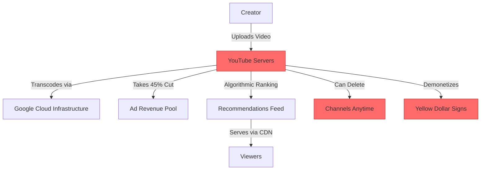
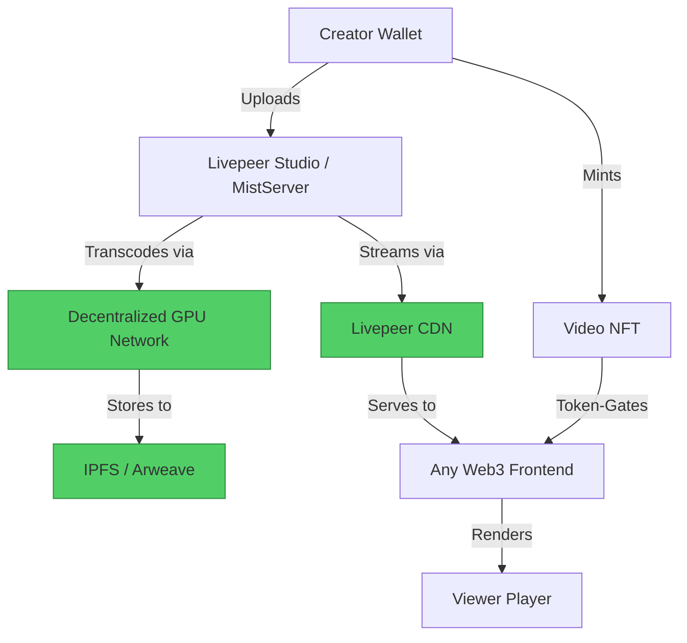

#  YouTube → Livepeer Migration Guide

> **Web2 Service:** YouTube (Google/Alphabet)
> **Web3 Alternative:** Livepeer (MistServer + Livepeer Studio)
> **Difficulty:** ⭐⭐⭐⭐ (Advanced)
> **Time to Migrate:** 4-8 weeks for infrastructure setup and audience transition

---

## 🎯 Overview

YouTube dominates video streaming but extracts massive value through demonetization, opaque algorithms, 45% revenue cuts, and arbitrary content takedowns. Creators invest years building audiences, only to face sudden bans or suppressed reach with no recourse. **Livepeer** is a decentralized video transcoding and streaming infrastructure protocol built on Ethereum (Arbitrum). It provides cost-effective, censorship-resistant video infrastructure where creators own their content, their revenue, and their distribution pipeline.

This guide shows you how to migrate from a centralized, algorithm-controlled video platform to a decentralized, creator-owned video streaming stack using Livepeer, IPFS/Arweave, and Web3 native frontends.

---

## ❌ The Web2 Problem: YouTube

### Key Issues

| Problem | Impact |
|---------|--------|
| **Massive Revenue Cut** | YouTube takes 45% of ad revenue; creators get only 55% (and less with MCNs) |
| **Demonetization** | Arbitrary "yellow dollar" flags destroy income overnight with opaque appeals |
| **Algorithmic Suppression** | Reach is throttled unless you chase trends, clickbait, or pay for promotion |
| **Content Ownership Illusion** | YouTube can delete your channel permanently for minor or mistaken TOS violations |
| **Copyright Claim Abuse** | False Content ID claims drain revenue and suppress legitimate content |
| **Data Lock-in** | Your audience, comments, and analytics are trapped in Google's ecosystem |
| **Censorship & Shadowbans** | Political, controversial, or niche content is silently suppressed |
| **Expensive Infrastructure** | Building YouTube alternatives requires massive transcoding/CDN budgets |

### Real-World Example

In 2024, thousands of educational and independent creators faced mass demonetization due to automated "reused content" flags, with appeal processes taking months or resulting in generic rejections. High-profile creators have had entire channels (millions of subscribers) deleted overnight for alleged policy violations, with no human review available.

---

## ✅ The Web3 Solution: Livepeer

### What is Livepeer?

Livepeer is a **decentralized video transcoding and streaming protocol** that replaces expensive cloud video infrastructure (like AWS MediaConvert or Mux) with a global network of GPU-powered node operators. Creators and apps pay only for transcoding (often 10x cheaper than AWS) and can build their own streaming platforms without platform risk. When combined with IPFS/Arweave for VOD storage and Web3 identity (Lens/ENS), it becomes a full YouTube alternative stack.

### Key Benefits

| Benefit | How Livepeer Solves It |
|---------|------------------------|
| **10x Cheaper Infrastructure** | Decentralized GPU network reduces transcoding costs dramatically |
| **Full Revenue Ownership** | No 45% platform tax; keep 100% of tips, subscriptions, and NFT sales |
| **Censorship Resistance** | Store content on Arweave/IPFS; no central entity can delete your videos |
| **No Algorithmic Gatekeeping** | Build your own discovery feed or use open social graphs (Lens/Farcaster) |
| **Verifiable Ownership** | Mint videos as NFTs with on-chain provenance and royalty splits |
| **Composable Monetization** | Integrate token-gating, tipping, and subscriptions directly in the player |
| **Open Infrastructure** | Any developer can build a YouTube alternative on Livepeer |

---

## 🏗️ Architecture Comparison

### YouTube Architecture (Centralized)



### Livepeer Architecture (Decentralized)



---

## 🛠️ Step-by-Step Migration

### Step 1: Set Up Livepeer Studio Account

Create a Livepeer Studio account (the hosted version of Livepeer) to access transcoding and streaming APIs. For fully self-hosted setups, deploy MistServer with Livepeer integration.

```javascript
// Install Livepeer JS SDK
npm install livepeer @livepeer/core

// Initialize Livepeer client
import { Livepeer } from 'livepeer';

const livepeer = new Livepeer({
  apiKey: process.env.LIVEPEER_API_KEY,
});
```

### Step 2: Upload and Transcode Video

Upload your video file to Livepeer, which will automatically transcode it into multiple adaptive bitrate (ABR) renditions for optimal streaming.

```javascript
import fs from 'fs';

async function uploadAndTranscode(videoPath, title) {
  const fileData = fs.readFileSync(videoPath);
  const file = new File([fileData], 'video.mp4', { type: 'video/mp4' });

  // 1. Request upload URL
  const { asset, tusEndpoint } = await livepeer.asset.requestUpload({
    name: title,
  });

  // 2. Upload via TUS protocol (resumable)
  const tus = await import('tus-js-client');
  await new Promise((resolve, reject) => {
    const upload = new tus.Upload(file, {
      endpoint: tusEndpoint,
      retryDelays: [0, 3000, 5000, 10000, 20000],
      onError: reject,
      onSuccess: resolve,
    });
    upload.start();
  });

  // 3. Wait for transcoding to complete
  let assetStatus = await livepeer.asset.get(asset.id);
  while (assetStatus.status.phase !== 'ready') {
    await new Promise(r => setTimeout(r, 5000));
    assetStatus = await livepeer.asset.get(asset.id);
  }

  console.log(`✅ Video ready! Playback URL: ${assetStatus.playbackUrl}`);
  return assetStatus;
}
```

### Step 3: Archive to Decentralized Storage

For censorship resistance, archive the transcoded video to IPFS or Arweave using services like Pinata or Irys.

```javascript
import { create } from 'ipfs-http-client';
const ipfs = create({ url: process.env.IPFS_ENDPOINT });

async function archiveToIPFS(videoUrl, metadata) {
  // Download transcoded video
  const response = await fetch(videoUrl);
  const buffer = await response.arrayBuffer();

  // Upload to IPFS
  const result = await ipfs.add(buffer);
  const videoCid = result.cid.toString();

  // Create metadata JSON
  const metadataObj = {
    name: metadata.title,
    description: metadata.description,
    video: `ipfs://${videoCid}`,
    creator: metadata.creatorAddress,
    license: metadata.license || 'CC-BY-4.0',
    createdAt: new Date().toISOString(),
  };

  const metaResult = await ipfs.add(JSON.stringify(metadataObj));
  return {
    videoCid,
    metadataCid: metaResult.cid.toString(),
  };
}
```

### Step 4: Build a Token-Gated Player

Use the Livepeer React SDK to embed a player that requires NFT ownership (e.g., a "Patron Pass") to view premium content.

```javascript
import { Player } from '@livepeer/react';
import { useAccount } from 'wagmi';
import { readContract } from '@wagmi/core';

function TokenGatedPlayer({ playbackId, nftContract, requiredTokenId }) {
  const { address } = useAccount();
  const [hasAccess, setHasAccess] = useState(false);

  useEffect(() => {
    async function checkAccess() {
      if (!address) return;

      const balance = await readContract({
        address: nftContract,
        abi: erc721Abi,
        functionName: 'balanceOf',
        args: [address],
      });

      setHasAccess(balance > 0n);
    }
    checkAccess();
  }, [address, nftContract]);

  if (!hasAccess) {
    return (
      <div className="gate-message">
        <p>🔒 This video is exclusive to NFT holders.</p>
        <button>Mint Patron Pass (0.05 ETH)</button>
      </div>
    );
  }

  return (
    <Player
      title="Decentralized Video"
      playbackId={playbackId}
      autoPlay={false}
      showPipButton
      showFullscreenButton
    />
  );
}
```

### Step 5: Enable Live Streaming

For live streams (YouTube Live alternative), use Livepeer's low-latency streaming API with RTMP ingest.

```javascript
async function createLiveStream(name) {
  const stream = await livepeer.stream.create({
    name: name,
    record: true, // Auto-record to decentralized storage
    profiles: [
      { name: '720p', bitrate: 2000000, fps: 30, width: 1280, height: 720 },
      { name: '480p', bitrate: 1000000, fps: 30, width: 854, height: 480 },
      { name: '360p', bitrate: 500000, fps: 30, width: 640, height: 360 },
    ],
  });

  console.log('🔴 Live stream created!');
  console.log(`RTMP Ingest URL: rtmp://rtmp.livepeer.com/live/${stream.streamKey}`);
  console.log(`Playback URL: https://lvpr.tv/v1/${stream.playbackId}`);

  return stream;
}

// Use OBS Studio to stream to the RTMP URL with your stream key
```

### Step 6: Migrate Your YouTube Audience

1. **Embed Web3 Player**: Add your Livepeer-powered player to your website with a "Subscribe with Wallet" button.
2. **Exclusive Content**: Release a "YouTube Subscribers Only" video (password-gated or token-gated) on your Web3 platform.
3. **Cross-Posting**: Continue posting teasers on YouTube, but link to the full, uncensored version on your Web3 site.
4. **Direct Tipping**: Integrate USDC/ETH tipping directly in the player, bypassing YouTube's Super Chat 30% cut.

---

## 📜 Full Migration Script

```javascript
// migrate-youtube-to-livepeer.js
import { Livepeer } from 'livepeer';
import { create } from 'ipfs-http-client';
import fs from 'fs';
import path from 'path';

class YouTubeToLivepeerMigrator {
  constructor(livepeerApiKey, ipfsEndpoint) {
    this.livepeer = new Livepeer({ apiKey: livepeerApiKey });
    this.ipfs = create({ url: ipfsEndpoint });
  }

  async migrateVideoFolder(folderPath) {
    console.log('🚀 Starting YouTube → Livepeer migration...\n');

    const files = fs.readdirSync(folderPath)
      .filter(f => f.endsWith('.mp4') || f.endsWith('.mov') || f.endsWith('.mkv'));

    for (const file of files) {
      const filePath = path.join(folderPath, file);
      const videoTitle = file.replace(/\.(mp4|mov|mkv)$/, '');

      console.log(`\n📹 Processing: ${videoTitle}`);

      try {
        // 1. Upload & transcode via Livepeer
        const fileData = fs.readFileSync(filePath);
        const fileObj = new File([fileData], file, { type: 'video/mp4' });

        const { asset, tusEndpoint } = await this.livepeer.asset.requestUpload({
          name: videoTitle,
        });

        const tus = await import('tus-js-client');
        await new Promise((resolve, reject) => {
          const upload = new tus.Upload(fileObj, {
            endpoint: tusEndpoint,
            retryDelays: [0, 3000, 5000, 10000],
            onError: reject,
            onSuccess: resolve,
          });
          upload.start();
        });

        // 2. Wait for ready status
        let status = await this.livepeer.asset.get(asset.id);
        while (status.status.phase !== 'ready') {
          await new Promise(r => setTimeout(r, 5000));
          status = await this.livepeer.asset.get(asset.id);
        }

        // 3. Archive to IPFS
        const videoRes = await fetch(status.playbackUrl);
        const videoBuf = await videoRes.arrayBuffer();
        const ipfsResult = await this.ipfs.add(videoBuf);

        // 4. Create metadata
        const metadata = {
          name: videoTitle,
          description: 'Migrated from YouTube to decentralized video infrastructure',
          video: `ipfs://${ipfsResult.cid.toString()}`,
          livepeerPlaybackId: status.playbackId,
          migratedAt: new Date().toISOString(),
        };
        const metaRes = await this.ipfs.add(JSON.stringify(metadata));

        console.log(`✅ ${videoTitle} successfully migrated!`);
        console.log(`   🔗 Livepeer Player: https://lvpr.tv/?v=${status.playbackId}`);
        console.log(`   📦 IPFS Metadata: ipfs://${metaRes.cid.toString()}`);

      } catch (error) {
        console.error(`❌ Failed to migrate ${videoTitle}:`, error.message);
      }
    }

    console.log('\n🎉 Migration complete! Update your website with new Livepeer-powered players.');
  }
}

// Usage
// const migrator = new YouTubeToLivepeerMigrator(
//   process.env.LIVEPEER_API_KEY,
//   'https://api.pinata.cloud/ipfs/api/v0'
// );
// await migrator.migrateVideoFolder('./my-youtube-backup');
```

---

## ⚖️ Trade-offs

| Aspect | YouTube | Livepeer Stack |
|--------|---------|----------------|
| **User Experience** | Flawless, familiar to billions | Good, but requires building or using Web3-native frontends |
| **Cost** | Free upload; transcoding/CDN included | Pay per transcoding minute (~$0.005/min) + storage |
| **Revenue** | 55% of ads after MCN cuts | 100% of tips, subscriptions, NFT sales |
| **Discovery** | Massive built-in audience (but algorithm-dependent) | Build your own audience via Web3 social (Lens/Farcaster) |
| **Infrastructure Control** | Zero — fully Google-controlled | Full control — own transcoding, storage, and player |
| **Censorship** | High risk of demonetization and takedowns | Resistant — store on Arweave, stream via Livepeer |
| **Live Streaming** | Excellent (low latency, massive scale) | Very good (RTMP + WebRTC via Livepeer, slightly higher setup) |
| **Monetization** | Ads, Super Chat, Memberships (30% cut) | Direct crypto tips, token-gating, NFTs |
| **Scale** | ~2.5B monthly active users | Growing Web3 ecosystem, smaller but highly engaged |

---

## 🌍 Real-World Examples

### Platforms Built on Livepeer
1. **Lens Tube**: Decentralized YouTube alternative built on Lens Protocol + Livepeer.
2. **Orb**: Mobile-first social app using Livepeer for video streaming.
3. **Bonfire**: Creator platform using Livepeer for video content + NFT drops.
4. **EthGlobal Events**: Major Web3 conferences use Livepeer for live streaming.
5. **Huddle01**: Decentralized video conferencing using Livepeer infrastructure.

### Migration Success Stories
- **Independent Educators**: Moved premium courses from YouTube Memberships to token-gated Livepeer videos, increasing revenue per subscriber by 5-10x.
- **Live Event Organizers**: Web3 conferences replaced YouTube live streams with Livepeer, gaining full viewer data and direct tipping capabilities.
- **Documentary Filmmakers**: Used Livepeer + Arweave to distribute censorship-resistant documentaries that were previously banned on YouTube.

---

## 🔒 Security Considerations

1. **API Key Protection**: Your Livepeer API key grants control over transcoding and streaming. Store it in environment variables, never in client-side code.
2. **Stream Key Secrecy**: RTMP stream keys are like passwords — anyone with the key can broadcast to your channel. Rotate keys regularly.
3. **Storage Redundancy**: IPFS content can be garbage-collected if not pinned. Use multiple pinning services (Pinata, Filebase, nft.storage).
4. **Smart Contract Risk**: If using token-gating, ensure your NFT contract is audited. Malicious contracts could drain viewer wallets.
5. **Content Moderation**: Full decentralization means no one can remove illegal content. Implement community reporting on your frontend.
6. **DDoS Protection**: Livepeer's CDN has built-in protection, but self-hosted MistServer instances should use Cloudflare or similar.

---

## 📚 Resources

### Official Documentation
- [Livepeer Documentation](https://docs.livepeer.org/)
- [Livepeer Studio API Reference](https://docs.livepeer.org/reference/api)
- [Livepeer React SDK](https://docs.livepeer.org/guides/react-sdk)

### Developer Tools
- **Livepeer Studio**: Hosted transcoding and streaming (easiest start).
- **MistServer**: Open-source streaming server with Livepeer integration (self-hosted).
- **OBS Studio**: Free live streaming software for RTMP ingest.
- **Pinata / Irys**: IPFS and Arweave pinning services for video storage.

### Community
- [Livepeer Discord](https://discord.gg/livepeer)
- [Livepeer Forum](https://forum.livepeer.org/)
- [/livepeer on Farcaster](https://warpcast.com/) for Web3 video creator networking

### Example Projects
- [Lens Tube GitHub](https://github.com/lens-protocol/lens-tube)
- [Livepeer Examples](https://github.com/livepeer/livepeer-studio)

---

## 🎓 Key Takeaways

1. **Infrastructure = Independence**: Owning your video pipeline (Livepeer + IPFS) frees you from YouTube's 45% tax and arbitrary bans.
2. **Cost is lower than you think**: Livepeer transcoding costs ~10x less than AWS MediaConvert, making it viable even for small creators.
3. **Hybrid is smart**: Use YouTube for broad discovery, but funnel dedicated fans to your Web3 platform for premium content and direct support.
4. **Token-gating is powerful**: NFTs enable subscription models YouTube can't match — with 0% platform fees and true ownership.
5. **Live streaming is ready**: RTMP + Livepeer provides broadcast-quality live streams with Web3 native features.
6. **Archive everything**: Always keep local backups and archive to IPFS/Arweave for permanent, censorship-resistant storage.
7. **Build your audience on-chain**: Use Lens or Farcaster to build a social graph that travels with you, independent of any single platform.

---

*Guide by [@Elvatar](https://github.com/Elvatar2) | Last updated: 2026*
*Part of the Web2 → Web3 Migration Guide series*