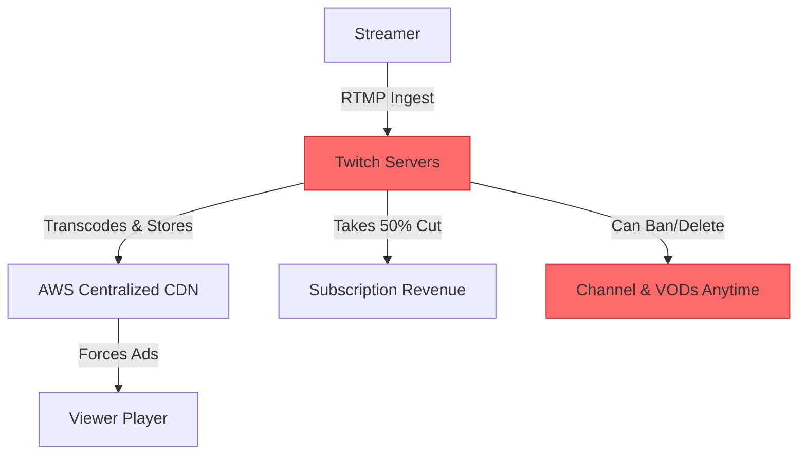
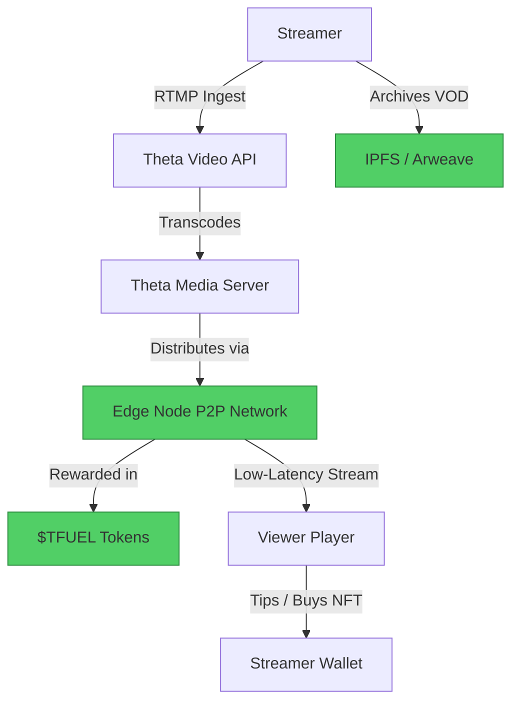

#  Twitch → Theta Network Migration Guide

> **Web2 Service:** Twitch (Amazon)
> **Web3 Alternative:** Theta Network (Theta Video API + Theta Drop)
> **Difficulty:** ⭐⭐⭐⭐ (Advanced)
> **Time to Migrate:** 4-8 weeks for infrastructure setup and community transition

---

## 🎯 Overview

Twitch dominates live streaming but has become increasingly hostile to creators through aggressive 50/50 (or worse) revenue splits, arbitrary DMCA takedowns, unpredictable ad-injection, and sudden account bans. Streamers build massive communities but remain tenants on Amazon's infrastructure. **Theta Network** offers a decentralized video delivery and streaming ecosystem. By leveraging a peer-to-peer (P2P) Content Delivery Network (CDN) and blockchain-based incentives, Theta reduces bandwidth costs, eliminates platform monopolies, and introduces new monetization avenues via $THETA and $TFUEL tokens, as well as NFT integrations.

This guide shows you how to migrate from a centralized, extractive live-streaming platform to a decentralized, creator-owned video infrastructure using Theta.

---

## ❌ The Web2 Problem: Twitch

### Key Issues

| Problem | Impact |
|---------|--------|
| **Predatory Revenue Splits** | Standard 50/50 split on subscriptions, with recent pushes toward even less favorable terms for mid-tier creators |
| **Arbitrary Bans & DMCA** | Automated copyright strikes and vague TOS violations can permanently delete years of VODs and community history overnight |
| **Ad Injection Fatigue** | Twitch forces unskippable ads, degrading viewer experience and driving audiences to ad-blockers |
| **Zero VOD Ownership** | Past broadcasts are deleted after 14–60 days; creators cannot easily port their archive elsewhere |
| **Discoverability Illusion** | The algorithm heavily favors already-established streamers, making organic growth nearly impossible for newcomers |
| **Platform Lock-in** | Chat communities, channel points, and follower graphs are entirely walled within Twitch |
| **High Bandwidth Costs** | If creators try to self-host, centralized CDN egress fees are prohibitively expensive |

### Real-World Example

In recent years, top Twitch streamers have publicly left the platform due to the 50% subscription revenue split and lack of transparency. Simultaneously, thousands of smaller creators have faced permanent bans due to automated "hate speech" or DMCA detection algorithms, with no human appeal process available, instantly wiping out their livelihood.

---

## ✅ The Web3 Solution: Theta Network

### What is Theta Network?

Theta is a **decentralized video delivery network and blockchain ecosystem** purpose-built for streaming. It replaces traditional, expensive CDN infrastructure with a P2P mesh network of "Edge Nodes" run by users. Streamers can use the **Theta Video API** to broadcast high-quality video, while viewers and node operators earn $TFUEL tokens for sharing bandwidth. Creators can monetize directly through crypto tipping, token-gated streams, and exclusive NFT drops via **Theta Drop**.

### Key Benefits

| Benefit | How Theta Solves It |
|---------|---------------------|
| **Lower Infrastructure Costs** | P2P Edge Node caching reduces centralized CDN egress fees by up to 50-80% |
| **True Revenue Ownership** | Keep ~90-100% of direct tips, subscriptions, and NFT sales (minus standard network gas fees) |
| **Censorship Resistance** | Decentralized storage and delivery make arbitrary takedowns significantly harder |
| **Viewer Incentives** | Viewers can earn $TFUEL for watching and sharing bandwidth, increasing retention |
| **VOD Permanence** | Archive streams to Arweave/IPFS via Theta's ecosystem, retaining permanent ownership |
| **Composable Monetization** | Integrate NFT ticketing, token-gated chat, and direct crypto tipping natively |
| **Transparent Analytics** | On-chain metrics provide verifiable viewership data for sponsors |

---

## 🏗️ Architecture Comparison

### Twitch Architecture (Centralized)



### Theta Network Architecture (Decentralized)



---

## 🛠️ Step-by-Step Migration

### Step 1: Set Up Theta Wallet and Video API

Create a Theta Wallet (to hold $THETA and $TFUEL) and sign up for a **Theta Video API** developer account to get your API keys for streaming infrastructure.

```javascript
// Install Theta Video API SDK
npm install @thetacloud/video-api

// Initialize the client
const { ThetaVideoAPI } = require('@thetacloud/video-api');

const thetaClient = new ThetaVideoAPI({
  apiKey: process.env.THETA_VIDEO_API_KEY,
  apiSecret: process.env.THETA_VIDEO_API_SECRET,
});
```

### Step 2: Create a Live Stream Ingest

Generate a unique stream key and ingest URL to connect your broadcasting software (like OBS Studio) to Theta's infrastructure.

```javascript
async function createLiveStream(streamName) {
  try {
    const stream = await thetaClient.streams.create({
      name: streamName,
      resolution: '1080p',
      protocol: 'rtmp',
      autoRecord: true, // Automatically save VOD to decentralized storage
    });

    console.log('🔴 Live Stream Created!');
    console.log(`Ingest URL: rtmp://ingest.theta.tv/live`);
    console.log(`Stream Key: ${stream.streamKey}`);
    console.log(`Playback URL: ${stream.playbackUrl}`);

    return stream;
  } catch (error) {
    console.error('Failed to create stream:', error);
  }
}
```

### Step 3: Configure OBS Studio

1. Open OBS Studio → Settings → Stream.
2. Set Service to "Custom".
3. Paste the Theta RTMP Ingest URL.
4. Paste the Stream Key generated in Step 2.
5. Set your bitrate (e.g., 6000 Kbps for 1080p60) and start streaming.

### Step 4: Integrate Token-Gated Access or Tipping

Use Web3 libraries to allow viewers to tip in $TFUEL or require an NFT to access a premium stream.

```javascript
import { ethers } from 'ethers';

// Example: Viewer tipping the streamer in TFUEL
async function tipStreamer(streamerAddress, amountTFUEL) {
  // TFUEL contract address on Theta Mainnet
  const tfuelContractAddress = '0x38892A01Cd4f98E6e5105e12A27c47990b6C4915';
  const tfuelABI = [
    "function transfer(address to, uint256 amount) returns (bool)"
  ];

  const provider = new ethers.BrowserProvider(window.ethereum);
  const signer = await provider.getSigner();
  const contract = new ethers.Contract(tfuelContractAddress, tfuelABI, signer);

  const tx = await contract.transfer(streamerAddress, ethers.parseUnits(amountTFUEL, 18));
  await tx.wait();

  console.log(`✅ Successfully tipped ${amountTFUEL} TFUEL!`);
}
```

### Step 5: Archive VODs to Decentralized Storage

Ensure your past broadcasts are permanently stored and owned by you, not deleted after 14 days.

```javascript
async function archiveVODToLocalAndIPFS(vodUrl, title) {
  const { create } = require('ipfs-http-client');
  const ipfs = create({ url: 'https://api.pinata.cloud/ipfs/api/v0' });

  // Fetch the recorded VOD from Theta
  const response = await fetch(vodUrl);
  const videoBuffer = await response.arrayBuffer();

  // Upload to IPFS
  const result = await ipfs.add(videoBuffer);
  const cid = result.cid.toString();

  console.log(`✅ VOD "${title}" permanently archived at: ipfs://${cid}`);
  return cid;
}
```

### Step 6: Migrate Your Audience

1. **Announce the Move**: Use your Twitch panels, chat bot, and social media to announce your new decentralized streaming home.
2. **Exclusive Incentives**: Offer a limited-edition "Founder" NFT on Theta Drop to the first 100 viewers who tune into your new stream.
3. **Hybrid Streaming**: Initially, simulcast to both Twitch and Theta, but make the Theta stream the "director's cut" with no mid-roll ads and active crypto giveaways.

---

## 📜 Full Migration Script

```javascript
// migrate-twitch-to-theta.js
const { ThetaVideoAPI } = require('@thetacloud/video-api');
const { create } = require('ipfs-http-client');
const fs = require('fs');

class TwitchToThetaMigrator {
  constructor(apiKey, apiSecret) {
    this.theta = new ThetaVideoAPI({ apiKey, apiSecret });
    this.ipfs = create({ url: 'https://api.pinata.cloud/ipfs/api/v0' });
  }

  async migrateVODArchive(localVideoFolder) {
    console.log('🚀 Starting Twitch VOD Migration to Theta + IPFS...\n');

    const files = fs.readdirSync(localVideoFolder).filter(f => f.endsWith('.mp4'));

    for (const file of files) {
      const filePath = `${localVideoFolder}/${file}`;
      console.log(`📁 Processing: ${file}`);

      try {
        // 1. Upload to Theta Video API for optimized playback
        const uploadJob = await this.theta.vod.create({
          name: file.replace('.mp4', ''),
          file: fs.createReadStream(filePath),
        });

        // 2. Archive to IPFS for permanent, censorship-resistant storage
        const videoBuffer = fs.readFileSync(filePath);
        const ipfsResult = await this.ipfs.add(videoBuffer);

        console.log(`   ✅ Theta VOD ID: ${uploadJob.id}`);
        console.log(`   📦 IPFS CID: ipfs://${ipfsResult.cid.toString()}`);

      } catch (error) {
        console.error(`   ❌ Failed to migrate ${file}:`, error.message);
      }
    }
    console.log('\n🎉 VOD Archive migration complete!');
  }

  async setupNewLiveChannel(channelName) {
    console.log(`\n🔴 Setting up new live channel: ${channelName}`);
    const stream = await this.theta.streams.create({
      name: channelName,
      autoRecord: true,
    });

    console.log(`   Ingest: rtmp://ingest.theta.tv/live`);
    console.log(`   Key: ${stream.streamKey}`);
    return stream;
  }
}

// Usage
// const migrator = new TwitchToThetaMigrator(process.env.THETA_API_KEY, process.env.THETA_API_SECRET);
// await migrator.setupNewLiveChannel('MyDecentralizedStream');
// await migrator.migrateVODArchive('./twitch-vod-backups');
```

---

## ⚖️ Trade-offs

| Aspect | Twitch | Theta Network |
|--------|--------|---------------|
| **User Experience** | Polished, zero-setup for viewers, ubiquitous | Requires mild Web3 onboarding for full features (wallets) |
| **Revenue Split** | 50/50 (or worse) on subs; ad revenue is opaque | ~90-100% of direct tips, NFT sales, and subscriptions |
| **Infrastructure Cost** | Free for streamer (Amazon absorbs cost) | Low cost via Theta Video API; heavily subsidized by P2P network |
| **Discoverability** | Massive built-in audience, but highly saturated | Smaller audience; relies on external marketing and Web3 communities |
| **Censorship** | High risk (DMCA, arbitrary TOS bans) | Resistant (decentralized delivery and storage) |
| **VOD Ownership** | Deleted after 14–60 days | Permanent if archived to IPFS/Arweave |
| **Monetization** | Subs, Bits, Ads (platform takes large cut) | Direct crypto tips, NFT drops, token-gated access |
| **Chat & Community** | Mature, feature-rich, but walled garden | Requires integrating third-party Web3 chat (e.g., XMTP or Lens) |

---

## 🌍 Real-World Examples

### Platforms & Integrations
1. **ThetaDrop**: Official NFT marketplace where streamers and creators drop exclusive content, directly integrated with the Theta ecosystem.
2. **Theta EdgeNode**: Desktop application allowing viewers to share spare bandwidth and earn $TFUEL, directly supporting the streamer's CDN.
3. **Sliver.tv**: Esports and streaming platform built on Theta, offering rewarded viewing experiences.
4. **World Poker Tour (WPT)**: Major traditional entity that partnered with Theta to stream events and release NFTs, proving enterprise-grade scalability.

### Migration Success Stories
- **Independent Streamers**: Creators frustrated by Twitch's 50% split have migrated their "superfan" audiences to Theta, using NFT subscriptions to generate higher revenue from a smaller, more dedicated viewer base.
- **Esports Organizations**: Leveraging Theta's low-latency, decentralized CDN to stream tournaments globally without incurring massive AWS egress fees.

---

## 🔒 Security Considerations

1. **Stream Key Security**: Treat your Theta RTMP stream key like a password. If leaked, anyone can broadcast to your channel. Rotate it immediately if compromised.
2. **Wallet Management**: Use a dedicated "streaming" wallet for receiving tips and interacting with dApps. Keep your main $THETA holdings in a cold hardware wallet.
3. **Smart Contract Audits**: If deploying custom token-gating or NFT contracts for your stream, ensure they are audited to prevent drain exploits.
4. **API Key Protection**: Never expose your Theta Video API Secret in frontend code. Always use a secure backend proxy.
5. **Content Moderation**: Decentralization means you are responsible for your content. Implement basic chat moderation tools to comply with local laws.

---

## 📚 Resources

### Official Documentation
- [Theta Network Documentation](https://docs.thetatoken.org/)
- [Theta Video API Reference](https://www.thetavideoapi.com/docs)
- [Theta EdgeNode Guide](https://www.theta.tv/edgenode)

### Developer Tools
- **OBS Studio**: Free, open-source broadcasting software (compatible with Theta RTMP).
- **ThetaDrop**: Platform for creating and minting creator NFTs.
- **IPFS / Pinata**: For permanent, decentralized archiving of VODs.
- **XMTP**: Decentralized messaging protocol to build Web3-native chat for your stream.

### Community
- [Theta Network Discord](https://discord.gg/theta)
- [Theta Community Forum](https://community.thetatoken.org/)
- [Theta Developers Telegram](https://t.me/thetadev)

---

## 🎓 Key Takeaways

1. **Infrastructure independence is freedom**: Using Theta Video API frees you from Amazon's walled garden and arbitrary rule changes.
2. **Your audience is your asset**: By migrating to a Web3 stack, you own the relationship with your viewers, not a corporation.
3. **Hybrid transitions work best**: Don't abandon Twitch overnight. Use it as a top-of-funnel discovery tool while slowly migrating your most loyal fans to your Theta channel via exclusive NFT drops.
4. **P2P is the future of CDN**: Theta's Edge Node network proves that decentralized bandwidth sharing can deliver enterprise-grade video at a fraction of the cost.
5. **Monetization is composable**: Combine live tipping, token-gated streams, and VOD NFTs to create revenue streams Twitch simply cannot offer.
6. **Archive everything**: Take control of your VODs. Download them and pin them to IPFS to ensure your content history is never deleted by a platform.
7. **Early adopter advantage**: The Web3 streaming space is nascent. Building your brand and technical stack now positions you as a pioneer in the next generation of live entertainment.

---

*Guide by [@Elvatar](https://github.com/Elvatar2) | Last updated: 2026*
*Part of the Web2 → Web3 Migration Guide series*