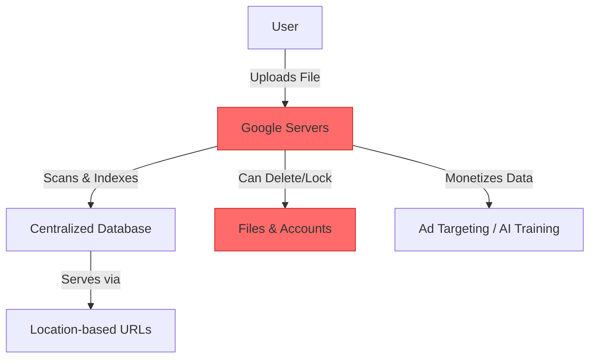
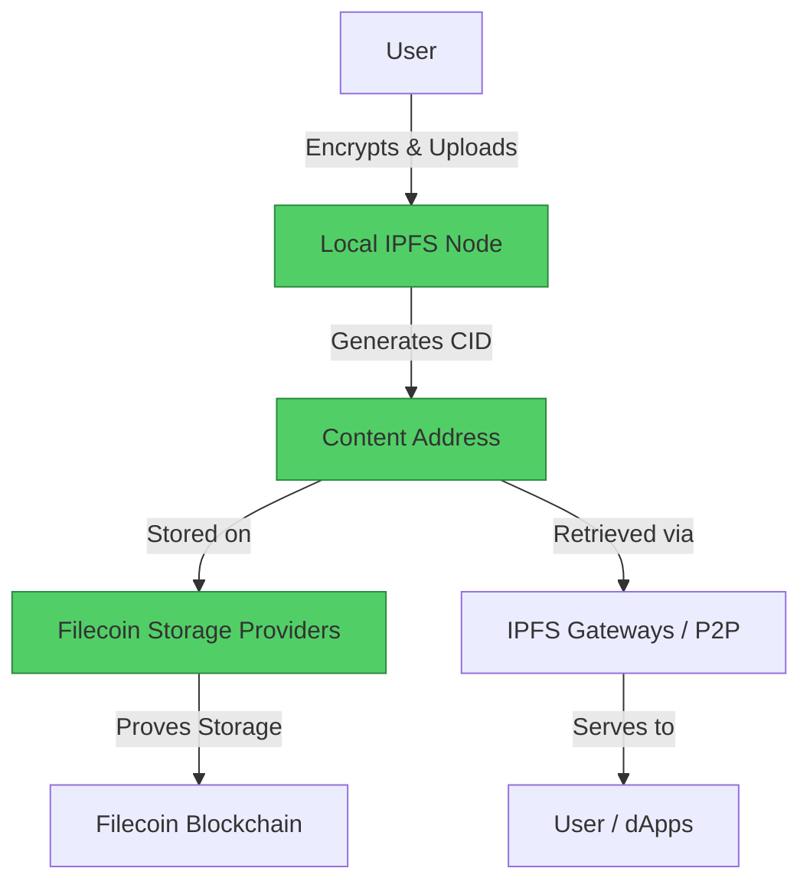

#  Google Drive → IPFS / Filecoin / Arweave Migration Guide

> **Web2 Service:** Google Drive (Alphabet)
> **Web3 Alternative:** IPFS (InterPlanetary File System) + Filecoin / Arweave
> **Difficulty:** ⭐⭐ (Beginner to Intermediate)
> **Time to Migrate:** 1-3 weeks for personal or small team data migration

---

## 🎯 Overview

Google Drive offers convenient cloud storage, but it comes with severe trade-offs: Google scans your files, account suspensions can result in total data loss (including Gmail and Photos), and you pay recurring subscription fees for data you don't truly control. **IPFS** (InterPlanetary File System), combined with incentive layers like **Filecoin** (decentralized storage market) and **Arweave** (permanent, pay-once storage), shifts the paradigm to content-addressed, censorship-resistant, and user-owned data storage.

This guide shows you how to migrate from a centralized, privacy-invasive cloud storage model to a decentralized, verifiable, and permanent data storage stack.

---

## ❌ The Web2 Problem: Google Drive

### Key Issues

| Problem | Impact |
|---------|--------|
| **Privacy Invasion** | Google scans your files for hashes, metadata, and content to train AI and serve ads |
| **Account Lockouts** | A single Terms of Service violation (even a false positive) can permanently lock your entire Google ecosystem (Drive, Gmail, Photos) |
| **Recurring Costs** | You rent storage space monthly; if you stop paying, your data is deleted |
| **Centralized Failure** | Server outages or regional internet shutdowns can block access to your files |
| **Data Lock-in** | Exporting massive amounts of data via Google Takeout is slow, fragmented, and cumbersome |
| **Censorship & Takedowns** | Google can remotely delete or block access to specific files hosted on your Drive |
| **Location Addressing** | Files are tied to a specific server path; if the server moves or changes, links break |

### Real-World Example

In 2021, thousands of users had their Google accounts permanently disabled due to automated, opaque policy enforcement regarding "circumventing systems" or copyright flags. Users lost access to years of personal documents, business files, and irreplaceable photos overnight, with customer support offering no recourse. Furthermore, investigative journalists have had their Google accounts targeted and locked by state-sponsored actors.

---

## ✅ The Web3 Solution: IPFS + Filecoin / Arweave

### What is the Decentralized Storage Stack?

**IPFS** is a peer-to-peer protocol that stores data using **content addressing** (files are identified by their cryptographic hash, or CID, rather than their location). **Filecoin** is a decentralized storage network built on IPFS where users pay storage providers in $FIL to keep data available. **Arweave** is an alternative blockchain that offers "pay once, store forever" permanent storage. Together, they provide a robust, censorship-resistant alternative to centralized cloud drives.

### Key Benefits

| Benefit | How Web3 Storage Solves It |
|---------|----------------------------|
| **True Privacy & Ownership** | You hold the encryption keys; no central entity can scan or read your files |
| **No Account Bans** | Data is distributed across thousands of nodes; no single company can delete your account |
| **Permanent Availability** | Arweave guarantees storage for decades; Filecoin uses cryptographic proofs to ensure nodes keep your data |
| **Cost Efficiency** | Filecoin storage is significantly cheaper than AWS/Google Cloud; Arweave is a one-time fee |
| **Verifiable Data** | CIDs guarantee that the file you download is exactly the file that was uploaded (no silent corruption) |
| **Censorship Resistance** | Content-addressing makes it practically impossible for any authority to block access to a specific file |
| **Composability** | Files stored on IPFS can be directly referenced by smart contracts, dApps, and NFTs |

---

## 🏗️ Architecture Comparison

### Google Drive Architecture (Centralized)



### IPFS / Filecoin Architecture (Decentralized)



---

## 🛠️ Step-by-Step Migration

### Step 1: Set Up IPFS and a Pinning Service

While you can run a local IPFS node (Kubo), using a pinning service like **Pinata** or **Web3.Storage** ensures your files remain available even when your local computer is off. We will use the modern `@web3-storage/w3up-client` which automatically stores data on IPFS and Filecoin.

```javascript
// Install the Web3.Storage client
npm install @web3-storage/w3up-client

// Initialize the client
import { create } from '@web3-storage/w3up-client';

async function initClient() {
  // In a real app, load your saved agent data
  const client = await create();

  // Register and create a space (only needed once)
  await client.register('your-email@example.com');
  const space = await client.createSpace('my-drive-migration');
  await client.setCurrentSpace(space.did());

  console.log('✅ Web3.Storage client initialized!');
  return client;
}
```

### Step 2: Encrypt Files Before Uploading (CRITICAL)

**IPFS is public by default.** If you upload a file without encrypting it, anyone who knows the CID can read it. You must encrypt files locally before uploading them to Web3 storage.

```javascript
import crypto from 'crypto';
import fs from 'fs';

function encryptFile(inputPath, outputPath, password) {
  const algorithm = 'aes-256-gcm';
  const salt = crypto.randomBytes(16);
  const key = crypto.pbkdf2Sync(password, salt, 100000, 32, 'sha512');
  const iv = crypto.randomBytes(12);

  const cipher = crypto.createCipheriv(algorithm, key, iv);
  const input = fs.createReadStream(inputPath);
  const output = fs.createWriteStream(outputPath);

  input.pipe(cipher).pipe(output);

  return new Promise((resolve, reject) => {
    output.on('finish', () => {
      // Save salt and IV to decrypt later (store securely!)
      const meta = { salt: salt.toString('hex'), iv: iv.toString('hex') };
      fs.writeFileSync(outputPath + '.meta', JSON.stringify(meta));
      resolve();
    });
    output.on('error', reject);
  });
}
```

### Step 3: Upload Encrypted Files to IPFS/Filecoin

Upload the encrypted files to the decentralized network. The network will generate a Content Identifier (CID) for each file.

```javascript
import { filesFromPaths } from 'files-from-path';

async function uploadToWeb3Storage(client, encryptedFilePath) {
  const files = filesFromPaths([encryptedFilePath]);

  console.log('📤 Uploading to IPFS & Filecoin...');
  const rootCid = await client.uploadDirectory(files);

  console.log(`✅ Upload complete!`);
  console.log(`🔗 IPFS Gateway: https://w3s.link/ipfs/${rootCid}`);
  console.log(`🆔 CID: ${rootCid}`);

  return rootCid.toString();
}
```

### Step 4: Access and Decrypt Files

Retrieve the file using any public IPFS gateway (like Cloudflare, Pinata, or the native Brave browser) and decrypt it locally.

```javascript
async function downloadAndDecrypt(cid, password, metaPath, outputPath) {
  // 1. Fetch encrypted file from IPFS gateway
  const response = await fetch(`https://ipfs.io/ipfs/${cid}`);
  const encryptedBuffer = Buffer.from(await response.arrayBuffer());

  // 2. Load encryption metadata
  const meta = JSON.parse(fs.readFileSync(metaPath, 'utf-8'));
  const salt = Buffer.from(meta.salt, 'hex');
  const iv = Buffer.from(meta.iv, 'hex');
  const key = crypto.pbkdf2Sync(password, salt, 100000, 32, 'sha512');

  // 3. Decrypt
  const algorithm = 'aes-256-gcm';
  const decipher = crypto.createDecipheriv(algorithm, key, iv);

  const decrypted = Buffer.concat([
    decipher.update(encryptedBuffer),
    decipher.final()
  ]);

  fs.writeFileSync(outputPath, decrypted);
  console.log(`✅ File decrypted and saved to ${outputPath}`);
}
```

### Step 5: Build a Decentralized Drive Frontend (Optional)

Create a simple web interface to manage your encrypted files, using React and the Web3.Storage client.

```javascript
import React, { useState, useEffect } from 'react';
import { create } from '@web3-storage/w3up-client';

function DecentralizedDrive() {
  const [files, setFiles] = useState([]);
  const [client, setClient] = useState(null);

  useEffect(() => {
    async function load() {
      const c = await create();
      setClient(c);
      // Fetch stored CIDs from your local database or smart contract
    }
    load();
  }, []);

  const handleUpload = async (e) => {
    const file = e.target.files[0];
    // 1. Encrypt file locally
    // 2. Upload to client.uploadDirectory()
    // 3. Save CID to your app's database
  };

  return (
    <div className="drive-ui">
      <h2>My Decentralized Drive</h2>
      <input type="file" onChange={handleUpload} />
      <ul>
        {files.map(f => (
          <li key={f.cid}>
            <a href={`https://w3s.link/ipfs/${f.cid}`} target="_blank" rel="noopener noreferrer">
              {f.name} (Encrypted)
            </a>
          </li>
        ))}
      </ul>
    </div>
  );
}
```

### Step 6: Migrate Existing Google Drive Data

1. Use **Google Takeout** to export your Drive data as a ZIP file.
2. Extract the ZIP and organize your files.
3. Run a batch script to encrypt and upload each file to IPFS/Filecoin.
4. Store the mapping of `Original Filename -> CID + Decryption Meta` in a secure, local database or an encrypted smart contract.

---

## 📜 Full Migration Script

```javascript
// migrate-gdrive-to-ipfs.js
import { create } from '@web3-storage/w3up-client';
import { filesFromPaths } from 'files-from-path';
import crypto from 'crypto';
import fs from 'fs';
import path from 'path';

class GDriveToIPFSMigrator {
  constructor(password) {
    this.password = password;
    this.client = null;
    this.manifest = []; // Maps original names to CIDs
  }

  async init() {
    this.client = await create();
    console.log('✅ Web3.Storage client ready.');
  }

  encryptFile(inputPath) {
    const algorithm = 'aes-256-gcm';
    const salt = crypto.randomBytes(16);
    const key = crypto.pbkdf2Sync(this.password, salt, 100000, 32, 'sha512');
    const iv = crypto.randomBytes(12);

    const cipher = crypto.createCipheriv(algorithm, key, iv);
    const input = fs.createReadStream(inputPath);
    const outputPath = inputPath + '.enc';
    const output = fs.createWriteStream(outputPath);

    return new Promise((resolve, reject) => {
      input.pipe(cipher).pipe(output);
      output.on('finish', () => {
        resolve({
          encPath: outputPath,
          salt: salt.toString('hex'),
          iv: iv.toString('hex')
        });
      });
      output.on('error', reject);
    });
  }

  async migrateFolder(folderPath) {
    await this.init();
    const files = fs.readdirSync(folderPath).filter(f => !f.endsWith('.enc'));

    for (const file of files) {
      const filePath = path.join(folderPath, file);
      if (fs.statSync(filePath).isDirectory()) continue;

      console.log(`\n🔒 Encrypting: ${file}`);
      const { encPath, salt, iv } = await this.encryptFile(filePath);

      console.log(`📤 Uploading to IPFS/Filecoin...`);
      const uploadFiles = filesFromPaths([encPath]);
      const cid = await this.client.uploadDirectory(uploadFiles);

      this.manifest.push({
        originalName: file,
        cid: cid.toString(),
        salt,
        iv
      });

      // Clean up encrypted temp file
      fs.unlinkSync(encPath);
      console.log(`✅ Uploaded! CID: ${cid}`);
    }

    // Save manifest securely
    fs.writeFileSync('drive-manifest.json', JSON.stringify(this.manifest, null, 2));
    console.log('\n🎉 Migration complete! Manifest saved to drive-manifest.json');
  }
}

// Usage
// const migrator = new GDriveToIPFSMigrator('YOUR_SUPER_STRONG_PASSWORD');
// migrator.migrateFolder('./google-takeout-export');
```

---

## ⚖️ Trade-offs

| Aspect | Google Drive | IPFS / Filecoin / Arweave |
|--------|--------------|---------------------------|
| **User Experience** | Seamless, integrated with Gmail/Docs, real-time collaboration | Requires manual encryption, understanding of CIDs, and separate dApps |
| **Cost** | ~$2/month for 100GB (recurring) | Filecoin: ~$0.05/GB/month; Arweave: ~$1.00/GB (one-time forever) |
| **Privacy** | Google scans all unencrypted files | 100% private if encrypted locally; network only sees ciphertext |
| **Speed** | Instant access, optimized global CDN | Retrieval depends on gateway/node availability; can be slower for cold data |
| **Collaboration** | Native real-time co-editing (Docs/Sheets) | Not natively supported; requires complex Web3 collaborative editors |
| **Data Loss Risk** | High if account is banned or payment fails | Near zero if pinned correctly; Arweave guarantees permanence |
| **Search** | Instant, full-text search across all files | Impossible on encrypted data; requires local decryption and indexing |
| **Ownership** | Google controls the infrastructure | You control the keys and the data location |

---

## 🌍 Real-World Examples

### Platforms & Tools
1. **Fleek**: User-friendly platform for deploying and hosting encrypted files and sites on IPFS/Filecoin.
2. **Pinata**: The most popular IPFS pinning service, offering a great UI and API for managing files.
3. **ArDrive**: A decentralized alternative to Google Drive built directly on the Arweave network (handles encryption natively).
4. **Filecoin Station**: Desktop app allowing anyone to run a retrieval node and earn $FIL.

### Migration Success Stories
- **Archivists & Journalists**: Organizations like the Internet Archive and independent journalists use IPFS/Arweave to store sensitive documents that cannot be deleted by authoritarian regimes.
- **DAOs**: Decentralized Autonomous Organizations store their governance documents, treasuries, and legal wrappers on IPFS to ensure immutable, verifiable records.
- **dApp Developers**: Frontend code for decentralized apps is hosted on IPFS so the UI cannot be taken down by centralized hosting providers.

---

## 🔒 Security Considerations

1. **Encryption is Mandatory**: IPFS is a public network. If you upload unencrypted files, they are globally accessible. Always encrypt data locally before uploading.
2. **Key Management**: If you lose your encryption password or the salt/IV metadata, your data is gone forever. There is no "forgot password" button in Web3.
3. **Pinning Redundancy**: Data on IPFS is garbage-collected if no one is "pinning" it. Use multiple pinning services (e.g., Pinata + Filecoin deal making) to ensure persistence.
4. **Manifest Security**: The `drive-manifest.json` containing your salts and IVs is highly sensitive. Store it in a password manager or a hardware wallet, not in plain text.
5. **Gateway Trust**: When downloading via public gateways (like `ipfs.io`), the gateway could theoretically serve you a modified file. Always verify the CID matches what you expect.

---

## 📚 Resources

### Official Documentation
- [IPFS Documentation](https://docs.ipfs.tech/)
- [Filecoin Documentation](https://docs.filecoin.io/)
- [Arweave Documentation](https://docs.arweave.org/)
- [Web3.Storage Docs](https://web3.storage/docs/)

### Developer Tools
- **Kubo (Go-IPFS)**: The standard Go implementation of IPFS for running a local node.
- **Pinata SDK**: Excellent for managing IPFS pins and API keys.
- **Irys (formerly Bundlr)**: The fastest way to upload data to Arweave.
- **Ceramic Network**: For building decentralized, mutable databases on top of IPFS.

### Community
- [IPFS Discord](https://discord.gg/ipfs)
- [Filecoin Slack](https://filecoin.io/slack)
- [Arweave Discord](https://discord.gg/arweave)

---

## 🎓 Key Takeaways

1. **Content Addressing is Revolutionary**: Files are found by *what* they are (their hash), not *where* they are. This eliminates broken links and enables verifiable data.
2. **Privacy requires Encryption**: Web3 storage is transparent by default. You must take responsibility for encrypting your data before it touches the network.
3. **Pinning equals Persistence**: Uploading to IPFS isn't enough; you must ensure the data is "pinned" by nodes, or it will eventually disappear from the network.
4. **Arweave vs. Filecoin**: Use Filecoin for large, frequently accessed, cost-effective storage. Use Arweave for critical, immutable, "store-it-forever" data.
5. **No Native Search**: Because your data is encrypted, you lose Google's instant search. You must build or use local indexing tools to search your decentralized drive.
6. **Hybrid Workflows**: Keep highly collaborative, daily-working files in Google Drive/Notion, but archive final versions, sensitive documents, and backups to IPFS/Arweave.
7. **True Ownership**: By holding the encryption keys and the CIDs, you possess absolute, unrevocable ownership of your digital life.

---

*Guide by [@Elvatar](https://github.com/Elvatar2) | Last updated: 2026*
*Part of the Web2 → Web3 Migration Guide series*