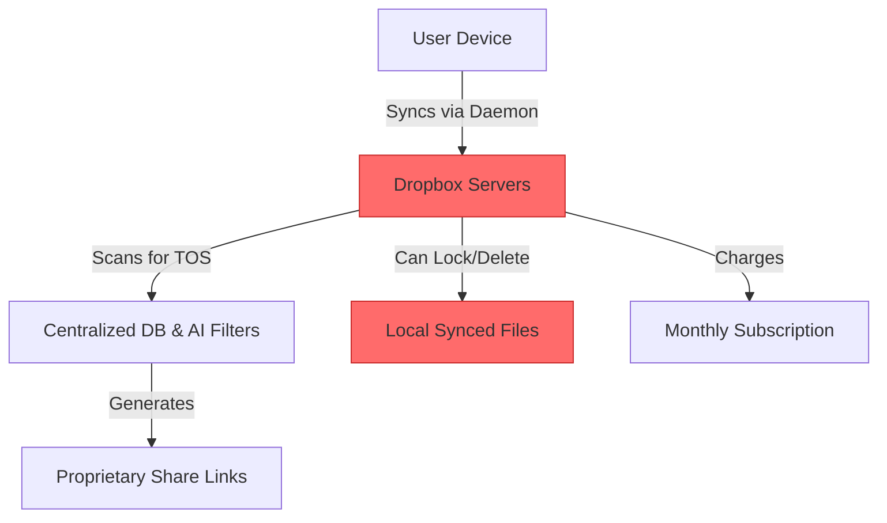
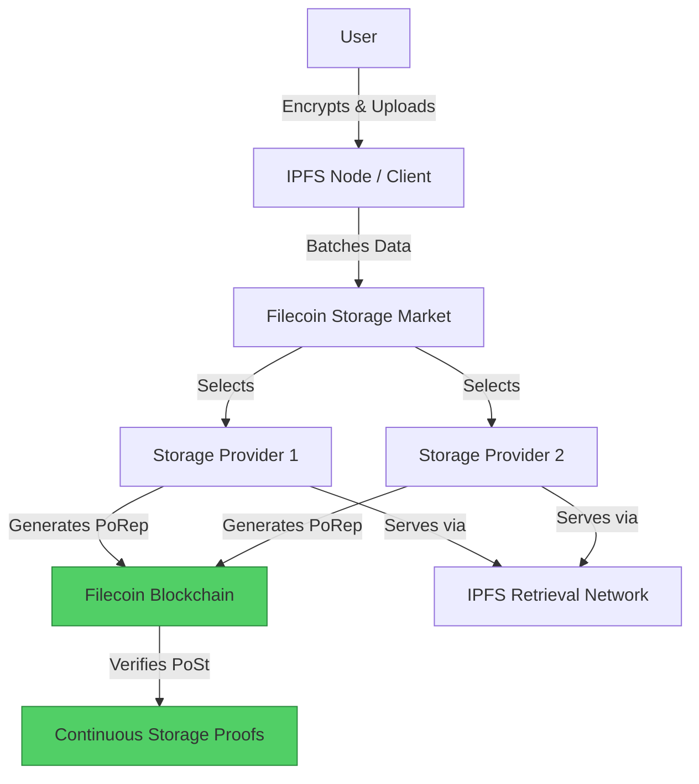

#  Dropbox → Filecoin Migration Guide

> **Web2 Service:** Dropbox
> **Web3 Alternative:** Filecoin (via IPFS & w3up)
> **Difficulty:** ⭐⭐⭐ (Intermediate)
> **Time to Migrate:** 2-4 weeks for personal or enterprise data archiving

---

## 🎯 Overview

Dropbox revolutionized file synchronization, but it operates as a centralized walled garden. It scans your files for policy violations, becomes prohibitively expensive at the terabyte scale, and can lock you out of your own account (and local synced files) if you trigger an automated Terms of Service flag. **Filecoin** shifts the paradigm from "trusting a company" to "verifiable, cryptographic storage." By leveraging a decentralized market of storage providers and on-chain proofs, Filecoin ensures your data is stored redundantly, cheaply at scale, and completely outside the control of any single corporation.

This guide shows you how to migrate from a centralized, sync-and-share cloud drive to a verifiable, decentralized, and market-driven storage network using Filecoin.

---

## ❌ The Web2 Problem: Dropbox

### Key Issues

| Problem | Impact |
|---------|--------|
| **Privacy & Scanning** | Dropbox scans file hashes and metadata to enforce copyright and TOS, compromising absolute privacy |
| **Account Lockouts** | Triggering an automated TOS violation can disable your account, locking you out of local synced files |
| **Scaling Costs** | Pricing is steep for large datasets; enterprise plans cost thousands per month for multi-TB storage |
| **Sync Conflicts** | The local daemon struggles with large files, leading to "sync conflicts" and corrupted local copies |
| **Vendor Lock-in** | Your sharing links, permissions, and folder structures are entirely dependent on Dropbox's proprietary ecosystem |
| **Centralized Failure** | If Dropbox's servers go down or your region's connection to them is throttled, your files are inaccessible |
| **Data Deletion** | Dropbox can remotely delete or block access to specific files in your synced folder if deemed "inappropriate" |

### Real-World Example

Freelance videographers and researchers frequently face issues where Dropbox's automated systems flag large video files or sensitive research data as "copyrighted" or "inappropriate." This results in the file being silently removed from the cloud and the user's account being suspended, sometimes preventing access to the local desktop client until the "violation" is resolved.

---

## ✅ The Web3 Solution: Filecoin

### What is Filecoin?

Filecoin is a **decentralized storage network** built on top of IPFS. Unlike IPFS (which is a protocol for locating data), Filecoin is the economic layer that incentivizes nodes (Storage Providers) to actually keep the data online. It uses cryptographic **Proofs of Replication (PoRep)** and **Proofs of Spacetime (PoSt)** to mathematically guarantee that your data is stored exactly as you uploaded it, across multiple independent providers, without you ever needing to trust them.

### Key Benefits

| Benefit | How Filecoin Solves It |
|---------|------------------------|
| **Verifiable Storage** | Cryptographic proofs guarantee your data is physically stored on the network; no blind trust required |
| **Massive Scale Economics** | Storage costs drop dramatically at the Terabyte/Petabyte scale compared to Dropbox's linear pricing |
| **Absolute Data Sovereignty** | No central server scans your files; Storage Providers only see encrypted ciphertext |
| **No Account Bans** | There is no "account" to ban; your data is secured by your private keys and cryptographic CIDs |
| **Redundancy by Design** | You can require data to be stored across multiple geographically distinct Storage Providers |
| **Open Market** | Storage providers compete on price and reliability; you aren't locked into a single vendor's pricing |
| **Permanent Archiving** | Ideal for long-term, cold/warm storage of critical datasets, backups, and media archives |

---

## 🏗️ Architecture Comparison

### Dropbox Architecture (Centralized)



### Filecoin Architecture (Decentralized)



---

## 🛠️ Step-by-Step Migration

### Step 1: Set Up Web3.Storage (The Bridge to Filecoin)

Interacting directly with the Filecoin storage market requires complex deal-making. For developers, **Web3.Storage** (using the `w3up` client) is the standard bridge: it handles IPFS pinning and automatically aggregates your data into Filecoin storage deals.

```javascript
// Install the w3up client
npm install @web3-storage/w3up-client

// Initialize the client
import { create } from '@web3-storage/w3up-client';

async function initFilecoinClient() {
  // Load existing agent or create a new one
  const client = await create();

  // Register your email and create a storage space (one-time setup)
  await client.register('your-email@example.com');
  const space = await client.createSpace('dropbox-migration-archive');
  await client.setCurrentSpace(space.did());

  console.log('✅ Filecoin/IPFS client initialized!');
  return client;
}
```

### Step 2: Encrypt Your Dropbox Export

Filecoin Storage Providers are pseudonymous and could theoretically inspect unencrypted data. **Always encrypt locally** before uploading.

```javascript
import crypto from 'crypto';
import fs from 'fs';

function encryptFile(inputPath, outputPath, password) {
  const algorithm = 'aes-256-gcm';
  const salt = crypto.randomBytes(16);
  const key = crypto.pbkdf2Sync(password, salt, 100000, 32, 'sha512');
  const iv = crypto.randomBytes(12);

  const cipher = crypto.createCipheriv(algorithm, key, iv);
  const input = fs.createReadStream(inputPath);
  const output = fs.createWriteStream(outputPath);

  input.pipe(cipher).pipe(output);

  return new Promise((resolve, reject) => {
    output.on('finish', () => {
      resolve({
        salt: salt.toString('hex'),
        iv: iv.toString('hex')
      });
    });
    output.on('error', reject);
  });
}
```

### Step 3: Upload and Trigger Filecoin Deals

Upload the encrypted files. The `w3up` client will store them on IPFS immediately, and background workers will automatically make storage deals with Filecoin Storage Providers.

```javascript
import { filesFromPaths } from 'files-from-path';

async function uploadToFilecoin(client, encryptedFilePath, fileName) {
  const files = filesFromPaths([encryptedFilePath]);

  console.log('📤 Uploading to IPFS & queuing for Filecoin...');
  const rootCid = await client.uploadDirectory(files);

  console.log(`✅ Upload complete!`);
  console.log(`🔗 IPFS Gateway: https://w3s.link/ipfs/${rootCid}`);
  console.log(`🆔 CID: ${rootCid}`);
  console.log(`⏳ Filecoin deals will be made automatically in the background.`);

  return rootCid.toString();
}
```

### Step 4: Verify Filecoin Storage Proofs

Unlike Dropbox, where you just "trust" it's there, with Filecoin you can mathematically verify your data is stored on the network using a block explorer.

```javascript
async function verifyFilecoinDeal(cid) {
  // Query the Filfox API to check storage deal status
  const response = await fetch(`https://filfox.info/api/v1/deal/findByCid/${cid}`);
  const deals = await response.json();

  if (deals && deals.length > 0) {
    console.log(`\n🔍 Verification for CID: ${cid}`);
    deals.forEach((deal, index) => {
      console.log(`   Deal ${index + 1}:`);
      console.log(`   - Provider: ${deal.provider}`);
      console.log(`   - Status: ${deal.state}`);
      console.log(`   - Expiration Epoch: ${deal.endEpoch}`);
    });
  } else {
    console.log('⏳ Deals are still being matched. Check back in a few hours.');
  }
}
```

### Step 5: Retrieve and Decrypt

Fetch the file from the IPFS network (served by Filecoin Storage Providers or retrieval nodes) and decrypt it locally.

```javascript
async function retrieveAndDecrypt(cid, password, saltHex, ivHex, outputPath) {
  console.log(`📥 Retrieving ${cid} from IPFS/Filecoin network...`);
  const response = await fetch(`https://ipfs.io/ipfs/${cid}`);
  const encryptedBuffer = Buffer.from(await response.arrayBuffer());

  const salt = Buffer.from(saltHex, 'hex');
  const iv = Buffer.from(ivHex, 'hex');
  const key = crypto.pbkdf2Sync(password, salt, 100000, 32, 'sha512');

  const decipher = crypto.createDecipheriv('aes-256-gcm', key, iv);
  const decrypted = Buffer.concat([decipher.update(encryptedBuffer), decipher.final()]);

  fs.writeFileSync(outputPath, decrypted);
  console.log(`✅ File decrypted and saved to ${outputPath}`);
}
```

### Step 6: Migrate Existing Dropbox Data

1. Use the Dropbox desktop app or web interface to download your entire archive as a ZIP.
2. Extract the files to a local directory.
3. Run the migration script to encrypt and upload the files to Filecoin.
4. Uninstall the Dropbox daemon to prevent local sync conflicts.

---

## 📜 Full Migration Script

```javascript
// migrate-dropbox-to-filecoin.js
import { create } from '@web3-storage/w3up-client';
import { filesFromPaths } from 'files-from-path';
import crypto from 'crypto';
import fs from 'fs';
import path from 'path';

class DropboxToFilecoinMigrator {
  constructor(password) {
    this.password = password;
    this.client = null;
    this.manifest = [];
  }

  async init() {
    this.client = await create();
    console.log('✅ Web3.Storage (Filecoin) client ready.');
  }

  async encryptAndUpload(filePath, originalName) {
    const algorithm = 'aes-256-gcm';
    const salt = crypto.randomBytes(16);
    const key = crypto.pbkdf2Sync(this.password, salt, 100000, 32, 'sha512');
    const iv = crypto.randomBytes(12);

    const cipher = crypto.createCipheriv(algorithm, key, iv);
    const input = fs.createReadStream(filePath);
    const encPath = filePath + '.enc';
    const output = fs.createWriteStream(encPath);

    await new Promise((resolve, reject) => {
      input.pipe(cipher).pipe(output);
      output.on('finish', resolve);
      output.on('error', reject);
    });

    console.log(`📤 Uploading to Filecoin network...`);
    const uploadFiles = filesFromPaths([encPath]);
    const cid = await this.client.uploadDirectory(uploadFiles);

    // Clean up local encrypted temp file
    fs.unlinkSync(encPath);

    return {
      originalName,
      cid: cid.toString(),
      salt: salt.toString('hex'),
      iv: iv.toString('hex')
    };
  }

  async migrateDropboxExport(folderPath) {
    await this.init();
    const files = fs.readdirSync(folderPath).filter(f => !f.endsWith('.enc'));

    for (const file of files) {
      const filePath = path.join(folderPath, file);
      if (fs.statSync(filePath).isDirectory()) continue;

      console.log(`\n🔒 Processing: ${file}`);
      const result = await this.encryptAndUpload(filePath, file);
      this.manifest.push(result);

      console.log(`✅ Uploaded! CID: ${result.cid}`);
    }

    // Save manifest securely (Keep this file safe!)
    fs.writeFileSync('filecoin-manifest.json', JSON.stringify(this.manifest, null, 2));
    console.log('\n🎉 Migration complete! Manifest saved to filecoin-manifest.json');
    console.log('⚠️  Remember: Filecoin deals will finalize in the background over the next few hours.');
  }
}

// Usage
// const migrator = new DropboxToFilecoinMigrator('YOUR_SUPER_STRONG_PASSWORD');
// migrator.migrateDropboxExport('./dropbox-export-folder');
```

---

## ⚖️ Trade-offs

| Aspect | Dropbox | Filecoin (via w3up) |
|--------|---------|---------------------|
| **Primary Use Case** | Real-time sync, collaboration, quick sharing | Long-term archiving, massive datasets, verifiable backup |
| **User Experience** | Seamless local folder syncing, drag-and-drop | Requires manual upload scripts or specialized Web3 UIs |
| **Cost at Scale** | Expensive ($20+/mo for 2TB) | Extremely cheap for large data (~$0.05/GB/mo on Filecoin) |
| **Cost for Small Data** | Free tier available (2GB) | Minimum deal sizes make it inefficient for tiny files |
| **Retrieval Speed** | Instant (optimized global CDN) | Can be slow (seconds to minutes) depending on retrieval nodes |
| **Privacy** | Scans files for TOS/AI training | 100% private if encrypted; network only sees ciphertext |
| **Verifiability** | None (must trust Dropbox) | Cryptographic proofs (PoRep/PoSt) verify exact storage |
| **Collaboration** | Native real-time co-editing | Not supported natively; requires separate Web3 tools |

---

## 🌍 Real-World Examples

### Platforms & Tools
1. **Web3.Storage**: The easiest bridge for developers to store data on IPFS and Filecoin without managing raw storage deals.
2. **Lighthouse**: Decentralized storage protocol focusing on permanent storage and token-gated access.
3. **Slate**: A beautiful, open-source file-sharing network built on Filecoin (often called the "Web3 Dropbox").
4. **Filfox / Filscan**: Block explorers to verify your Filecoin storage deals and provider performance.

### Migration Success Stories
- **AI Researchers**: Storing massive, multi-terabyte training datasets on Filecoin for a fraction of the cost of AWS S3, with cryptographic proof of data availability.
- **Film Archives**: Independent studios archiving raw 4K/8K footage on Filecoin, ensuring the media is preserved permanently without recurring enterprise cloud fees.
- **DAOs**: Storing governance proposals, legal documents, and treasury records on Filecoin to ensure immutable, verifiable, and censorship-resistant access.

---

## 🔒 Security Considerations

1. **Encryption is Mandatory**: Filecoin Storage Providers are pseudonymous. If you upload unencrypted files, they can be read by the nodes storing them.
2. **Manifest Security**: The `filecoin-manifest.json` contains your encryption salts and IVs. If lost, your data is unrecoverable. Store it offline in a secure vault or hardware wallet.
3. **Retrieval Latency**: Filecoin is optimized for *storage*, not *instant retrieval*. Retrieving a file can take time as the network locates the Storage Provider holding the piece.
4. **Provider Selection**: While w3up handles this automatically, if making direct deals, ensure you select Storage Providers with high "Power" and good uptime reputations.
5. **Deal Expiration**: Filecoin deals have an end epoch (usually 1-5 years). You must renew your storage deals before they expire, or the data may be garbage-collected.

---

## 📚 Resources

### Official Documentation
- [Filecoin Documentation](https://docs.filecoin.io/)
- [Web3.Storage (w3up) Docs](https://web3.storage/docs/)
- [IPFS Documentation](https://docs.ipfs.tech/)

### Developer Tools
- **@web3-storage/w3up-client**: The official JS/TS client for interacting with the Filecoin/IPFS network.
- **Filfox API**: For querying storage deal status and provider information programmatically.
- **Slate**: For a user-friendly, visual interface to manage Filecoin storage without coding.

### Community
- [Filecoin Slack](https://filecoin.io/slack)
- [Filecoin Discord](https://discord.gg/filecoin)
- [IPFS Discord](https://discord.gg/ipfs)

---

## 🎓 Key Takeaways

1. **Verifiability is the Killer Feature**: You don't just "hope" your data is stored; you mathematically prove it via on-chain cryptographic proofs.
2. **Filecoin is for Archiving, Not Syncing**: Don't try to replace the real-time, local folder sync of Dropbox. Use Filecoin for secure, scalable, long-term backups and archives.
3. **Economics Favor Scale**: Filecoin becomes drastically cheaper than Dropbox once you pass the 1TB threshold.
4. **Encryption is Your Responsibility**: Web3 storage networks are transparent. You must encrypt your data locally before it ever touches the network.
5. **Deal Management**: Understand that Filecoin storage deals expire. Set up automated renewals or use services like Web3.Storage that handle deal lifecycle management for you.
6. **Hybrid Workflows**: Use a local encrypted volume (like Veracrypt) for daily work, and periodically sync that encrypted volume to Filecoin for immutable, off-site backup.
7. **True Data Sovereignty**: By removing the central authority, you eliminate the risk of arbitrary account bans, TOS violations, and corporate data scanning.

---

*Guide by [@Elvatar](https://github.com/Elvatar2) | Last updated: 2026*
*Part of the Web2 → Web3 Migration Guide series*
