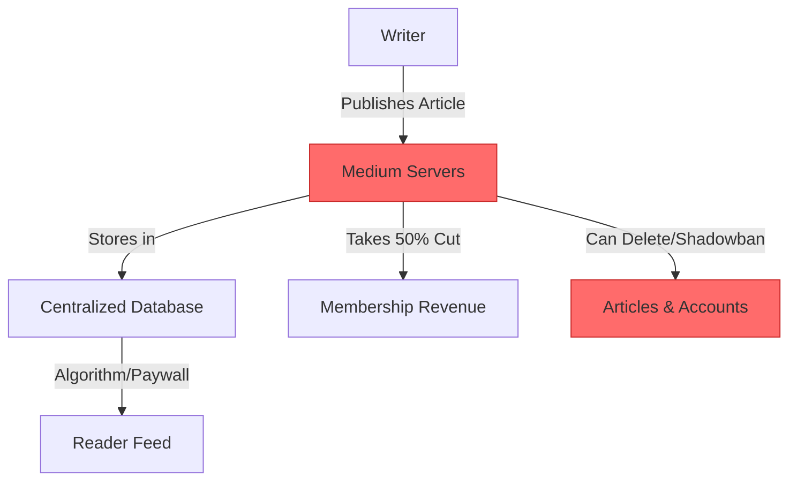
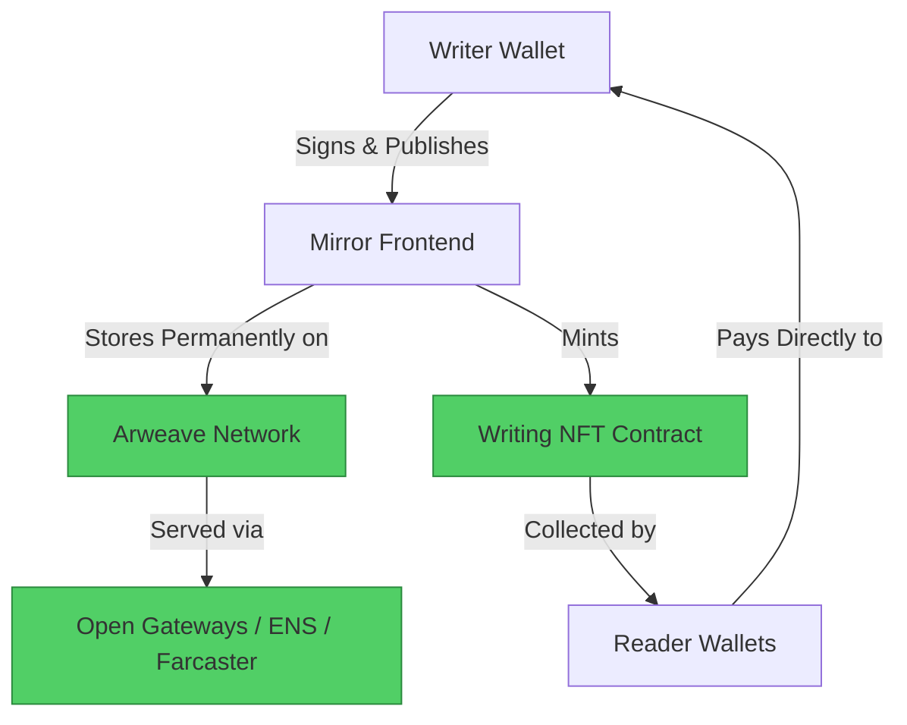

#  Medium → Mirror.xyz Migration Guide

> **Web2 Service:** Medium (A Medium Corporation)
> **Web3 Alternative:** Mirror.xyz (Decentralized Publishing & Writing NFTs)
> **Difficulty:** ⭐⭐⭐ (Intermediate)
> **Time to Migrate:** 2-4 weeks for catalog migration and audience transition

---

## 🎯 Overview

Medium popularized long-form web writing but operates as a centralized walled garden. It takes a 50% cut of membership revenue, suppresses reach via opaque algorithms, and can silently delete or demonetize your articles. Writers build audiences but do not truly own their distribution or monetization layers. **Mirror.xyz** shifts the paradigm by treating every article as an on-chain asset. Content is stored permanently on decentralized storage (Arweave/IPFS), and writers can crowdfund, collect, and compose their work directly with their audience without platform interference.

This guide shows you how to migrate from a centralized, platform-dependent publishing model to a decentralized, creator-owned, and financially composable writing ecosystem.

---

## ❌ The Web2 Problem: Medium

### Key Issues

| Problem | Impact |
|---------|--------|
| **Revenue Extraction** | Medium takes 50% of all membership revenue; writers only earn from the "Partner Program" pool |
| **Algorithmic Suppression** | Reach is dictated by Medium's curation team and proprietary algorithms, not your actual audience |
| **Platform Lock-in** | Your followers, claps, and comments are trapped in Medium's database; no native export for your graph |
| **Arbitrary Takedowns** | Articles can be shadowbanned, demonetized, or removed for vague TOS violations with no human appeal |
| **Paywall Friction** | The hard paywall blocks search engines and casual readers, severely limiting organic discovery |
| **Zero Composability** | Your writing cannot be natively integrated into other Web3 apps, games, or DAOs |
| **Data Ownership** | Medium owns the platform, the data, and the right to change the rules at any time |

### Real-World Example

In 2023, Medium abruptly changed its paywall rules and algorithm, causing many independent writers to lose 70% of their readership and income overnight. Furthermore, writers in certain geopolitical regions or writing about controversial (but legal) topics have frequently found their accounts suspended or articles hidden, destroying years of SEO and audience building without recourse.

---

## ✅ The Web3 Solution: Mirror.xyz

### What is Mirror?

Mirror is a **decentralized publishing platform** built on Ethereum (Optimism). It allows writers to publish articles that are permanently stored on Arweave. Every post can be minted as a "Writing NFT" (ERC-721), allowing readers to collect the article, directly funding the writer. Mirror is fully composable, meaning your writing can be read via ENS profiles, Farcaster frames, or custom smart contracts, completely bypassing centralized gatekeepers.

### Key Benefits

| Benefit | How Mirror Solves It |
|---------|----------------------|
| **100% Revenue Ownership** | Keep 100% of Writing NFT sales, tips, and crowdfunding campaigns (minus gas fees) |
| **Permanent Storage** | Articles are stored on Arweave; they can never be deleted, censored, or lost |
| **Direct Audience Funding** | Readers collect your posts as NFTs, creating a direct, transparent financial relationship |
| **No Algorithmic Gatekeeping** | Your audience sees your work via open social graphs (Farcaster/Lens) and direct subscriptions |
| **Composability** | Your articles can be embedded in DAO proposals, ENS profiles, and Web3 apps natively |
| **Crowdfunding** | Launch tokenized writing campaigns to fund books, research, or projects directly from readers |
| **True Ownership** | You own your publishing domain (via ENS) and your content's cryptographic provenance |

---

## 🏗️ Architecture Comparison

### Medium Architecture (Centralized)



### Mirror Architecture (Decentralized)



---

## 🛠️ Step-by-Step Migration

### Step 1: Set Up Wallet and ENS Identity

To publish on Mirror, you need an Ethereum wallet and ideally an ENS (Ethereum Name Service) domain (e.g., `yourname.eth`), which acts as your decentralized publishing handle.

```javascript
// Install dependencies
npm install viem @ensdomains/ensjs

import { createWalletClient, custom } from 'viem';
import { mainnet } from 'viem/chains';

const walletClient = createWalletClient({
  chain: mainnet,
  transport: custom(window.ethereum)
});

// Check ENS availability and register (simplified)
async function setupENSIdentity(name) {
  console.log(`Setting up identity: ${name}.eth`);
  // In production, use ENSjs to commit and register the name
  // This ties your publishing identity permanently to your wallet
}
```

### Step 2: Export Your Medium Content

Medium does not have a native "Export All" button for your own posts in a clean format. You will need to use a scraping tool or Medium's data export (which provides a messy HTML/JSON dump) to extract your articles.

```javascript
import fs from 'fs';

// Example: Parsing a Medium JSON export
function parseMediumExport(exportPath) {
  const rawData = fs.readFileSync(exportPath, 'utf-8');
  const data = JSON.parse(rawData);

  const articles = data.posts.map(post => ({
    title: post.title,
    slug: post.slug,
    content: post.content.bodyModel, // Medium's internal JSON format
    createdAt: post.createdAt,
    tags: post.virtuals.tags
  }));

  console.log(`Found ${articles.length} articles to migrate.`);
  return articles;
}
```

### Step 3: Convert and Upload to Arweave

Mirror uses Arweave for permanent storage. You must convert Medium's internal format to standard Markdown/HTML and upload it to Arweave using a bundler like Irys (formerly Bundlr) or via Mirror's native API.

```javascript
import { Irys } from '@irys/sdk';
import { marked } from 'marked';

async function uploadToArweave(article) {
  // Convert Medium JSON to Markdown (simplified)
  const markdown = `# ${article.title}\n\n${convertMediumBodyToMarkdown(article.content)}`;
  const html = marked.parse(markdown);

  // Initialize Irys client for Arweave
  const irys = new Irys({
    url: "https://node1.irys.xyz",
    token: "arweave",
    key: process.env.ARWEAVE_KEY // Requires AR tokens
  });

  // Upload to Arweave
  const receipt = await irys.upload(html);

  console.log(`✅ Uploaded "${article.title}" to Arweave: https://arweave.net/${receipt.id}`);
  return receipt.id; // The Arweave Transaction ID
}
```

### Step 4: Publish and Mint as Writing NFTs

Once the content is on Arweave, you publish it to Mirror. If you enable "Writing NFTs", readers can collect the article, sending ETH/USDC directly to your wallet.

```javascript
// Mirror provides an API and SDK for developers to manage entries
import { MirrorClient } from '@mirrorxyz/client';

const mirror = new MirrorClient({
  apiKey: process.env.MIRROR_API_KEY
});

async function publishToMirror(arweaveTxId, title, enableNFT) {
  const entry = await mirror.entries.create({
    title: title,
    body: `ar://${arweaveTxId}`, // Mirror resolves Arweave transactions natively
    publish: true,
    // Optional: Configure Writing NFT collection
    nft: enableNFT ? {
      price: '0.01', // 0.01 ETH per collect
      limit: 100,    // Max 100 editions
      recipient: '0xYourWalletAddress'
    } : null
  });

  console.log(`📝 Published to Mirror: https://mirror.xyz/${entry.digest}`);
  return entry.digest;
}
```

### Step 5: Build a Decentralized Reading Experience

Instead of relying solely on Mirror's frontend, you can build a custom reader that pulls from your Arweave data and ENS profile, creating a fully owned publishing domain.

```javascript
import { useState, useEffect } from 'react';

function DecentralizedBlog({ ensName }) {
  const [posts, setPosts] = useState([]);

  useEffect(() => {
    async function fetchPosts() {
      // Query Mirror's subgraph or API for entries by ENS name
      const response = await fetch(`https://api.mirror.xyz/entries?author=${ensName}`);
      const data = await response.json();
      setPosts(data.entries);
    }
    fetchPosts();
  }, [ensName]);

  return (
    <div className="web3-blog">
      <h1>Articles by {ensName}</h1>
      {posts.map(post => (
        <article key={post.digest}>
          <h2><a href={`https://mirror.xyz/${post.digest}`}>{post.title}</a></h2>
          <p>Collected {post.nft?.totalSupply || 0} times</p>
        </article>
      ))}
    </div>
  );
}
```

### Step 6: Migrate Your Medium Audience

1. **Cross-Posting**: Continue posting on Medium, but add a canonical link to your Mirror article at the bottom.
2. **Collect to Read**: Offer your best premium content *only* on Mirror as a free Writing NFT collection, forcing Medium readers to connect their wallets to read.
3. **Crowdfunding**: Launch a Mirror crowdfunding campaign for your next big project (book, research) and use the proceeds to incentivize readers to migrate their attention.

---

## 📜 Full Migration Script

```javascript
// migrate-medium-to-mirror.js
import { Irys } from '@irys/sdk';
import { marked } from 'marked';
import fs from 'fs';

class MediumToMirrorMigrator {
  constructor(arweaveKey, mirrorApiKey) {
    this.irys = new Irys({
      url: "https://node1.irys.xyz",
      token: "arweave",
      key: arweaveKey
    });
    this.mirrorApiKey = mirrorApiKey;
  }

  convertMediumToMarkdown(mediumBody) {
    // Simplified conversion logic
    return mediumBody.paragraphs.map(p => {
      if (p.type === 1) return p.text; // Normal text
      if (p.type === 3) return `# ${p.text}`; // H1
      if (p.type === 4) return `## ${p.text}`; // H2
      if (p.type === 6) return `> ${p.text}`; // Blockquote
      if (p.type === 10) return `\`\`\`\n${p.text}\n\`\`\``; // Code block
      return p.text;
    }).join('\n\n');
  }

  async migrateArticle(article) {
    console.log(`\n📝 Migrating: ${article.title}`);

    // 1. Convert to Markdown
    const markdown = `# ${article.title}\n\n${this.convertMediumToMarkdown(article.content)}`;
    const html = marked.parse(markdown);

    // 2. Upload to Arweave
    const receipt = await this.irys.upload(html);
    console.log(`   ✅ Uploaded to Arweave: ar://${receipt.id}`);

    // 3. Publish to Mirror (using REST API as example)
    const mirrorResponse = await fetch('https://api.mirror.xyz/entries', {
      method: 'POST',
      headers: {
        'Content-Type': 'application/json',
        'Authorization': `Bearer ${this.mirrorApiKey}`
      },
      body: JSON.stringify({
        title: article.title,
        body: `ar://${receipt.id}`,
        publish: true
      })
    });

    const entry = await mirrorResponse.json();
    console.log(`   📝 Published to Mirror: https://mirror.xyz/${entry.digest}`);

    return {
      title: article.title,
      arweaveId: receipt.id,
      mirrorDigest: entry.digest
    };
  }

  async migrateAllArticles(exportPath) {
    const articles = parseMediumExport(exportPath);
    const results = [];

    for (const article of articles) {
      const result = await this.migrateArticle(article);
      results.push(result);
    }

    // Save migration manifest
    fs.writeFileSync('mirror-migration-manifest.json', JSON.stringify(results, null, 2));
    console.log(`\n🎉 Migration complete! ${results.length} articles migrated.`);
    console.log('📋 Manifest saved to mirror-migration-manifest.json');
  }
}

// Usage
// const migrator = new MediumToMirrorMigrator(
//   process.env.ARWEAVE_KEY,
//   process.env.MIRROR_API_KEY
// );
// migrator.migrateAllArticles('./medium-export/posts.json');
```

---

## ⚖️ Trade-offs

| Aspect | Medium | Mirror.xyz |
|--------|--------|------------|
| **User Experience** | Polished, familiar, built-in audience | Requires Web3 onboarding; smaller native audience |
| **Cost to Writer** | Free (paid with data and revenue share) | Gas fees for minting + Arweave upload costs (~$1-5 per article) |
| **Revenue Model** | 50% cut via Partner Program | 100% of NFT sales, tips, and crowdfunding |
| **Discovery** | Massive built-in audience + SEO | Relies on social graphs (Farcaster/Lens) and external marketing |
| **Permanence** | Can be deleted or shadowbanned | Permanent on Arweave; immutable and censorship-resistant |
| **Ownership** | Medium owns the platform and data | Writer owns content, identity (ENS), and distribution |
| **Monetization** | Membership paywall (platform takes 50%) | Direct NFT collections, crowdfunding, tips |
| **Composability** | None — walled garden | Fully composable with Web3 apps, DAOs, and social protocols |
| **Analytics** | Opaque, platform-controlled | Transparent, on-chain collection data |

---

## 🌍 Real-World Examples

### Writers & Projects on Mirror
1. **Vitalik Buterin**: Published many Ethereum research posts on Mirror, demonstrating its viability for technical writing.
2. **The Gitcoin Blog**: Uses Mirror for decentralized grant announcements and community updates.
3. **DAO Governance Proposals**: Many DAOs (like MakerDAO, Uniswap) publish governance proposals on Mirror for transparent, permanent records.
4. **Independent Researchers**: Web3 researchers use Mirror to crowdfund their work directly from readers via Writing NFTs.

### Migration Success Stories
- **Independent Writers**: Transitioned from Medium's Partner Program (earning ~$200/month) to Mirror Writing NFTs (earning $1,000+/month from 50-100 dedicated collectors).
- **Research Collectives**: DAOs migrated their research archives from Google Docs/Medium to Mirror, ensuring permanent, verifiable, and composable access to their work.
- **Authors**: Launched book chapters as serialized Writing NFTs on Mirror, raising $50K+ in crowdfunding before the book was even published.

---

## 🔒 Security Considerations

1. **Wallet Security**: Your Mirror identity is tied to your Ethereum wallet. Use a hardware wallet (Ledger/Trezor) for your primary ENS and publishing address.
2. **Arweave Key Management**: If uploading directly to Arweave (not via Mirror's UI), keep your Arweave key secure. Anyone with the key can upload data on your behalf.
3. **Smart Contract Risk**: If interacting with Writing NFT contracts, verify the contract addresses to avoid malicious clones or drain exploits.
4. **Content Permanence**: Once published on Arweave, content cannot be deleted. Double-check for errors or sensitive information before publishing.
5. **Phishing**: Beware of fake Mirror websites asking for wallet signatures. Always verify you're on `mirror.xyz` before connecting your wallet.
6. **Gas Fees**: Publishing and minting on Ethereum mainnet can be expensive. Consider using Layer 2s (Optimism, where Mirror is deployed) to reduce costs.

---

## 📚 Resources

### Official Documentation
- [Mirror Documentation](https://docs.mirror.xyz/)
- [Mirror API Reference](https://docs.mirror.xyz/api)
- [Arweave Documentation](https://docs.arweave.org/)

### Developer Tools
- **Irys (formerly Bundlr)**: Fast, scalable uploads to Arweave.
- **ENSjs**: For managing ENS domains programmatically.
- **Mirror SDK**: Official JavaScript/TypeScript client for interacting with Mirror.
- **Arweave Gateway**: For retrieving and verifying Arweave transactions.

### Community
- [Mirror Discord](https://discord.gg/mirror)
- [/mirror on Farcaster](https://warpcast.com/~/channel/mirror) for Web3 writer networking
- [Mirror Blog](https://mirror.xyz/blog) for platform updates and announcements

---

## 🎓 Key Takeaways

1. **Ownership is everything**: On Mirror, your content, identity (ENS), and revenue streams are yours. No platform can take them away.
2. **Permanence is a feature**: Arweave ensures your writing outlives any company or platform. Once published, it's immutable.
3. **Direct funding > Platform cuts**: Writing NFTs and crowdfunding let you earn directly from your audience, bypassing Medium's 50% tax.
4. **Composability unlocks new possibilities**: Your articles can be embedded in DAO proposals, ENS profiles, and Web3 apps, creating new distribution channels.
5. **Audience migration is gradual**: Don't abandon Medium overnight. Use it as a top-of-funnel discovery tool while migrating your most engaged readers to Mirror.
6. **Web3 publishing is still early**: The native Mirror audience is smaller than Medium's, but the engagement and revenue per reader are significantly higher.
7. **Think long-term**: Web3 publishing is about building a sustainable, owner-operated writing career, not chasing viral hits on a centralized platform.

---

*Guide by [@Elvatar](https://github.com/Elvatar2) | Last updated: 2026*
*Part of the Web2 → Web3 Migration Guide series*