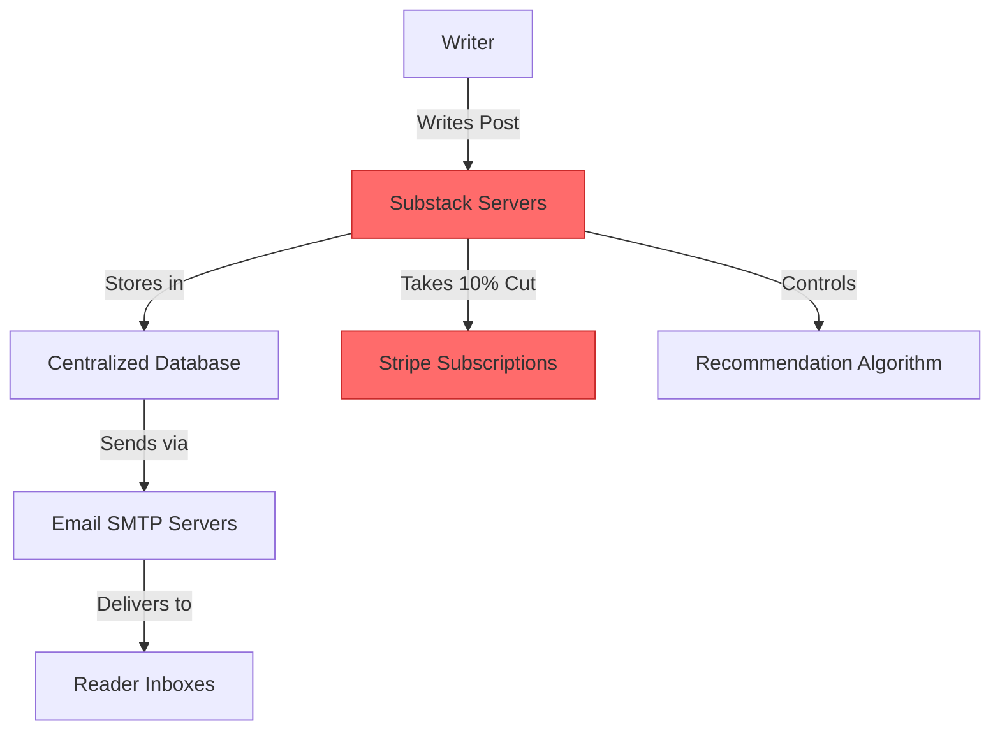
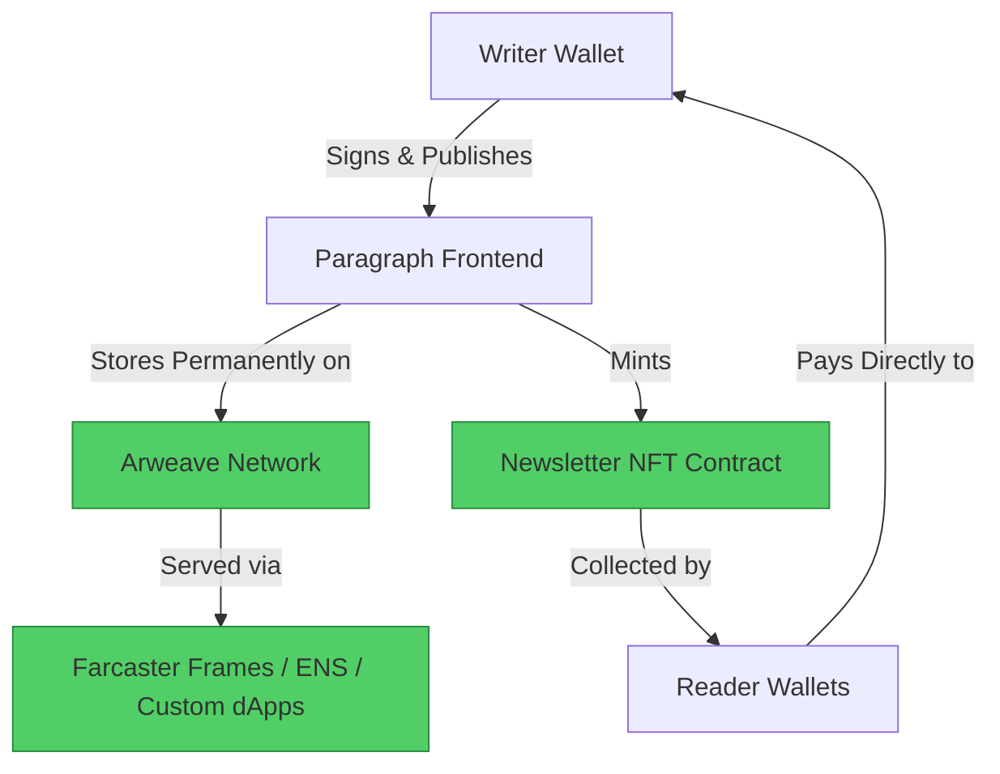

#  Substack → Paragraph Migration Guide

> **Web2 Service:** Substack
> **Web3 Alternative:** Paragraph (Decentralized Newsletter & Writing NFTs)
> **Difficulty:** ⭐⭐⭐ (Intermediate)
> **Time to Migrate:** 2-4 weeks for catalog migration and audience transition

---

## 🎯 Overview

Substack revolutionized the newsletter economy, allowing writers to monetize directly via paid subscriptions. However, it operates as a centralized walled garden: it takes a 10% cut of all revenue, owns your email list (making true portability difficult), and lacks composability with the broader Web3 ecosystem. **Paragraph** shifts the paradigm by treating newsletters as on-chain, composable assets. Built on Ethereum (Optimism), Paragraph allows writers to mint posts as NFTs, token-gate premium content, and distribute directly through decentralized social graphs like Farcaster, all while taking a 0% platform cut.

This guide shows you how to migrate from a centralized, email-dependent newsletter platform to a decentralized, wallet-native, and financially composable publishing ecosystem.

---

## ❌ The Web2 Problem: Substack

### Key Issues

| Problem | Impact |
|---------|--------|
| **Revenue Extraction** | Substack takes a 10% cut of all paid subscription revenue, forever |
| **Platform Lock-in** | Your subscriber list is tied to Substack's email infrastructure; exporting is clunky |
| **Email Dependency** | Reach is limited by email open rates and spam filters; no native social feed distribution |
| **Zero Composability** | Newsletters cannot be natively embedded, collected, or interacted with inside Web3 apps |
| **Opaque Discovery** | Substack's "Recommendations" algorithm dictates growth, creating dependency on the platform |
| **Arbitrary Takedowns** | Substack can ban accounts or remove content for TOS violations, cutting off your revenue instantly |
| **No True Ownership** | You are renting space on Substack's servers; they control the infrastructure and the rules |

### Real-World Example

In 2023, Substack faced backlash for its handling of controversial writers, leading to internal staff resignations and public disputes. While Substack generally defends free speech, the platform retains the ultimate power to deplatform writers, freeze their Stripe payouts, or change its recommendation algorithm, instantly crippling a writer's income and reach with no technical recourse.

---

## ✅ The Web3 Solution: Paragraph

### What is Paragraph?

Paragraph is a **Web3-native newsletter and publishing platform** that combines the best of email newsletters with the power of smart contracts. Every post can be minted as a collectible NFT, allowing readers to directly fund the writer. Content is permanently stored on Arweave, and distribution is deeply integrated with decentralized social protocols like Farcaster (via Frames) and Lens. Writers keep 100% of their revenue and truly own their audience via wallet addresses.

### Key Benefits

| Benefit | How Paragraph Solves It |
|---------|-------------------------|
| **0% Platform Tax** | Keep 100% of NFT sales, token-gated subscriptions, and tips (minus standard gas/network fees) |
| **Permanent Storage** | Newsletters are stored on Arweave; they can never be deleted, censored, or lost |
| **Wallet-Native Audience** | Your subscribers are wallet addresses, not email strings; portable across Web3 apps |
| **Composability (Frames)** | Readers can mint, tip, or interact with your newsletter directly inside their Farcaster feed |
| **Token-Gating** | Restrict access to premium content based on NFT ownership, token balances, or DAO membership |
| **Direct Crypto Payments** | Receive funds instantly in ETH/USDC; no Stripe delays, chargebacks, or 10% cuts |
| **True Ownership** | You own your publishing identity (ENS) and your content's cryptographic provenance |

---

## 🏗️ Architecture Comparison

### Substack Architecture (Centralized)



### Paragraph Architecture (Decentralized)



---

## 🛠️ Step-by-Step Migration

### Step 1: Set Up Wallet and ENS Identity

To publish on Paragraph, you need an Ethereum wallet and an ENS domain (e.g., `yourname.eth`), which acts as your decentralized publishing handle and subscriber identity.

```javascript
// Install dependencies
npm install viem @ensdomains/ensjs

import { createWalletClient, custom } from 'viem';
import { mainnet } from 'viem/chains';

const walletClient = createWalletClient({
  chain: mainnet,
  transport: custom(window.ethereum)
});

// Setup ENS Identity (simplified)
async function setupENSIdentity(name) {
  console.log(`Setting up publishing identity: ${name}.eth`);
  // In production, use ENSjs to commit and register the name
  // This ties your newsletter identity permanently to your wallet
}
```

### Step 2: Export Your Substack Content

Substack allows you to export your posts. Go to Settings -> Import/Export -> Export your content. This provides a ZIP file containing HTML files and a CSV mapping your posts.

```javascript
import fs from 'fs';
import path from 'path';
import { JSDOM } from 'jsdom';
import { TurndownService } from 'turndown';

const turndownService = new TurndownService();

function parseSubstackExport(exportDir) {
  const files = fs.readdirSync(exportDir).filter(f => f.endsWith('.html'));
  const posts = [];

  for (const file of files) {
    const html = fs.readFileSync(path.join(exportDir, file), 'utf-8');
    const dom = new JSDOM(html);
    const doc = dom.window.document;

    // Extract title and content (selectors may vary based on Substack's current HTML structure)
    const title = doc.querySelector('h1')?.textContent || 'Untitled';
    const contentEl = doc.querySelector('.body.markup') || doc.querySelector('article');
    const contentHtml = contentEl ? contentEl.innerHTML : '';
    const markdown = turndownService.turndown(contentHtml);

    posts.push({ title, markdown, slug: file.replace('.html', '') });
  }

  console.log(`Found ${posts.length} Substack posts to migrate.`);
  return posts;
}
```

### Step 3: Upload to Arweave

Paragraph uses Arweave for permanent storage. You must upload your Markdown/HTML content to Arweave using a bundler like Irys.

```javascript
import { Irys } from '@irys/sdk';

async function uploadToArweave(markdownContent, title) {
  const irys = new Irys({
    url: "https://node1.irys.xyz",
    token: "arweave",
    key: process.env.ARWEAVE_KEY // Requires AR tokens
  });

  const tags = [
    { name: "Content-Type", value: "text/markdown" },
    { name: "Title", value: title }
  ];

  const receipt = await irys.upload(markdownContent, { tags });

  console.log(`✅ Uploaded "${title}" to Arweave: ar://${receipt.id}`);
  return receipt.id;
}
```

### Step 4: Publish to Paragraph and Enable NFT Minting

Once the content is on Arweave, you publish it to Paragraph via their API. You can configure it as a free newsletter or enable "Collect" (Writing NFT) functionality.

```javascript
import axios from 'axios';

async function publishToParagraph(arweaveTxId, title, enableCollect) {
  const response = await axios.post('https://api.paragraph.xyz/v1/posts', {
    title: title,
    contentUri: `ar://${arweaveTxId}`,
    publish: true,
    // Optional: Configure NFT collection
    collect: enableCollect ? {
      price: '0.01', // 0.01 ETH per collect
      limit: 50,     // Max 50 editions
      recipient: '0xYourWalletAddress'
    } : null
  }, {
    headers: {
      'Authorization': `Bearer ${process.env.PARAGRAPH_API_KEY}`
    }
  });

  console.log(`📝 Published to Paragraph: ${response.data.url}`);
  return response.data.slug;
}
```

### Step 5: Create a Farcaster Frame for Distribution

Leverage Paragraph's deep integration with Farcaster by creating a Frame that allows users to read or collect your newsletter directly from their social feed.

```javascript
// Example: Basic Frame Meta Tags for a Farcaster Cast
const frameHtml = `
<!DOCTYPE html>
<html>
<head>
  <meta property="fc:frame" content="vNext" />
  <meta property="fc:frame:image" content="https://your-domain.com/newsletter-cover.png" />
  <meta property="fc:frame:button:1" content="Read Newsletter" />
  <meta property="fc:frame:button:1:action" content="link" />
  <meta property="fc:frame:button:1:target" content="https://paragraph.xyz/@yourname/your-post" />
  <meta property="fc:frame:button:2" content="Collect for 0.01 ETH" />
  <meta property="fc:frame:button:2:action" content="mint" />
  <meta property="fc:frame:button:2:target" content="eip155:10:0xParagraphContractAddress" />
</head>
<body>
  <h1>Read my latest newsletter on Farcaster!</h1>
</body>
</html>
`;
```

### Step 6: Migrate Your Substack Audience

1. **Email to Wallet Transition**: Send a final Substack email asking readers to connect their wallets on your Paragraph site to "claim" their subscriber status (e.g., via a free NFT airdrop).
2. **Cross-Posting**: Continue posting on Substack, but add a clear call-to-action at the top: "Subscribe with your wallet on Paragraph to support directly and get exclusive Web3 content."
3. **Token-Gated Exclusives**: Move your premium, paid-tier content exclusively to Paragraph, token-gating it so only NFT holders or specific wallet addresses can read it.

---

## 📜 Full Migration Script

```javascript
// migrate-substack-to-paragraph.js
import { Irys } from '@irys/sdk';
import fs from 'fs';
import path from 'path';
import { JSDOM } from 'jsdom';
import { TurndownService } from 'turndown';
import axios from 'axios';

const turndownService = new TurndownService();

class SubstackToParagraphMigrator {
  constructor(arweaveKey, paragraphApiKey) {
    this.irys = new Irys({
      url: "https://node1.irys.xyz",
      token: "arweave",
      key: arweaveKey
    });
    this.paragraphApiKey = paragraphApiKey;
  }

  async migratePost(htmlPath) {
    const html = fs.readFileSync(htmlPath, 'utf-8');
    const dom = new JSDOM(html);
    const doc = dom.window.document;

    const title = doc.querySelector('h1')?.textContent || 'Untitled';
    const contentEl = doc.querySelector('.body.markup') || doc.querySelector('article');
    const contentHtml = contentEl ? contentEl.innerHTML : '';
    const markdown = turndownService.turndown(contentHtml);

    console.log(`\n📝 Migrating: ${title}`);

    // 1. Upload to Arweave
    const tags = [{ name: "Content-Type", value: "text/markdown" }];
    const receipt = await this.irys.upload(markdown, { tags });
    console.log(`   ✅ Uploaded to Arweave: ar://${receipt.id}`);

    // 2. Publish to Paragraph
    const response = await axios.post('https://api.paragraph.xyz/v1/posts', {
      title: title,
      contentUri: `ar://${receipt.id}`,
      publish: true
    }, {
      headers: { 'Authorization': `Bearer ${this.paragraphApiKey}` }
    });

    console.log(`   📝 Published to Paragraph: ${response.data.url}`);
    return { title, arweaveId: receipt.id, paragraphUrl: response.data.url };
  }

  async migrateAll(exportDir) {
    const files = fs.readdirSync(exportDir).filter(f => f.endsWith('.html'));
    const results = [];

    for (const file of files) {
      const result = await this.migratePost(path.join(exportDir, file));
      results.push(result);
    }

    fs.writeFileSync('paragraph-migration-manifest.json', JSON.stringify(results, null, 2));
    console.log(`\n🎉 Migration complete! ${results.length} posts migrated.`);
  }
}

// Usage
// const migrator = new SubstackToParagraphMigrator(
//   process.env.ARWEAVE_KEY,
//   process.env.PARAGRAPH_API_KEY
// );
// migrator.migrateAll('./substack-export');
```

---

## ⚖️ Trade-offs

| Aspect | Substack | Paragraph |
|--------|----------|-----------|
| **User Experience** | Extremely polished, familiar email interface | Requires Web3 onboarding; wallet-native UX |
| **Cost to Writer** | Free (paid with 10% revenue cut) | 0% platform cut; pays Arweave upload costs (~$0.50/post) |
| **Audience Type** | Email subscribers (Web2 natives) | Wallet addresses (Web3 natives, crypto holders) |
| **Discovery** | Substack network, email recommendations, SEO | Farcaster/Lens feeds, Web3 social graphs, Frames |
| **Permanence** | Hosted on Substack servers; can be deleted | Permanent on Arweave; immutable and censorship-resistant |
| **Ownership** | Substack controls the email list and platform | Writer owns content, identity (ENS), and subscriber wallets |
| **Monetization** | 90% of fiat subscriptions via Stripe | 100% of NFT collects, crypto tips, and token-gated access |
| **Composability** | None — walled garden | Fully composable with Web3 apps, DAOs, and social protocols |

---

## 🌍 Real-World Examples

### Writers & Projects on Paragraph
1. **Derek Hsiao**: Prominent Web3 writer who migrated his newsletter to Paragraph, leveraging Farcaster Frames for massive distribution.
2. **Bankless**: While they use multiple platforms, their Web3-native content is heavily integrated with Paragraph for token-gated community access.
3. **DAO Governance Updates**: Many DAOs use Paragraph to publish immutable, verifiable governance updates and research reports.
4. **Independent Researchers**: Web3 researchers use Paragraph to crowdfund their work directly from readers via NFT collects.

### Migration Success Stories
- **Crypto Educators**: Transitioned from Substack's 10% cut to Paragraph's 0% cut, increasing net revenue by 10% while gaining direct crypto payments.
- **Community Builders**: Used Paragraph's token-gating to create exclusive, NFT-held newsletters, fostering a highly engaged, financially aligned community.
- **Farcaster Creators**: Leveraged Paragraph's native Farcaster integration to grow their subscriber base directly through social feed Frames, bypassing email entirely.

---

## 🔒 Security Considerations

1. **Wallet Security**: Your Paragraph identity and subscriber list are tied to your Ethereum wallet. Use a hardware wallet for your primary ENS and publishing address.
2. **Arweave Key Management**: Keep your Arweave key secure. Anyone with the key can upload data on your behalf and drain your AR balance.
3. **Smart Contract Risk**: If interacting with Paragraph's NFT contracts or custom token-gating logic, verify the contract addresses to avoid malicious clones.
4. **Content Permanence**: Once published on Arweave, content cannot be deleted. Double-check for errors or sensitive information before publishing.
5. **Phishing**: Beware of fake Paragraph websites asking for wallet signatures. Always verify you're on `paragraph.xyz` before connecting your wallet.
6. **Gas Fees**: Publishing and minting on Ethereum mainnet can be expensive. Paragraph is deployed on Optimism to minimize these costs, but users still need a small amount of ETH for gas.

---

## 📚 Resources

### Official Documentation
- [Paragraph Documentation](https://docs.paragraph.xyz/)
- [Paragraph API Reference](https://docs.paragraph.xyz/api)
- [Arweave Documentation](https://docs.arweave.org/)

### Developer Tools
- **Irys (formerly Bundlr)**: Fast, scalable uploads to Arweave.
- **Paragraph SDK**: Official JavaScript/TypeScript client for interacting with Paragraph.
- **OnchainKit**: Coinbase's React components for building Farcaster Frames and Web3 UIs.
- **Arweave Gateway**: For retrieving and verifying Arweave transactions.

### Community
- [Paragraph Discord](https://discord.gg/paragraph)
- [/paragraph on Farcaster](https://warpcast.com/~/channel/paragraph) for Web3 writer networking
- [Paragraph Blog](https://paragraph.xyz/blog) for platform updates and announcements

---

## 🎓 Key Takeaways

1. **Ownership is everything**: On Paragraph, your content, identity (ENS), and subscriber wallets are yours. No platform can take them away or charge a 10% tax.
2. **Permanence is a feature**: Arweave ensures your newsletters outlive any company or platform. Once published, they are immutable.
3. **Wallets > Emails**: Wallet addresses are the new email list. They are portable, verifiable, and enable direct crypto monetization.
4. **Composability unlocks new distribution**: Farcaster Frames allow your newsletters to be read, collected, and interacted with directly inside social feeds, bypassing the inbox.
5. **Audience migration is gradual**: Don't abandon Substack overnight. Use it as a top-of-funnel discovery tool while migrating your most engaged, crypto-native readers to Paragraph.
6. **Web3 publishing is still early**: The native Paragraph audience is smaller than Substack's, but the engagement, revenue per reader, and composability are significantly higher.
7. **Think long-term**: Web3 publishing is about building a sustainable, owner-operated writing career, not chasing viral hits on a centralized platform.

---

*Guide by [@Elvatar](https://github.com/Elvatar2) | Last updated: 2026*
*Part of the Web2 → Web3 Migration Guide series*