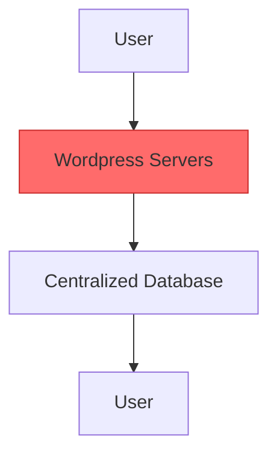
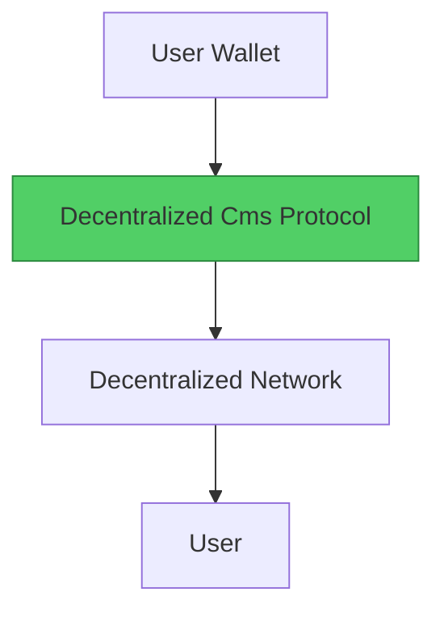

#  Wordpress → Decentralized Cms

> **Web2 Service:** Wordpress
> **Web3 Alternative:** Decentralized Cms
> **Difficulty:** ⭐⭐⭐ (To be determined)
> **Time to Migrate:** TBD

---

## 🎯 Overview

[Write a brief overview of this migration guide. What problem does it solve? Why is this migration important?]

---

## ❌ The Web2 Problem

### Key Issues

| Problem | Impact |
|---------|--------|
| [Issue 1] | [Impact] |
| [Issue 2] | [Impact] |
| [Issue 3] | [Impact] |

### Real-World Example

[Describe a real incident that highlights the problem with Wordpress]

---

## ✅ The Web3 Solution

### What is Decentralized Cms?

[Brief description of the Web3 alternative]

### Key Benefits

| Benefit | How It Solves the Problem |
|---------|---------------------------|
| [Benefit 1] | [Solution] |
| [Benefit 2] | [Solution] |
| [Benefit 3] | [Solution] |

---

## 🏗️ Architecture Comparison

### Wordpress Architecture (Centralized)



### Decentralized Cms Architecture (Decentralized)



---

## ️ Step-by-Step Migration

### Step 1: [Setup]

[Description]

```bash
# Code example
```

### Step 2: [Configuration]

[Description]

```javascript
// Code example
```

### Step 3: [Migration]

[Description]

```solidity
// Code example
```

### Step 4: [Testing]

[Description]

```javascript
// Code example
```

### Step 5: [Launch]

[Description]

---

## ⚖️ Trade-offs

| Aspect | Wordpress | Decentralized Cms |
|--------|----------------|-------------------|
| **Ownership** | [Web2] | [Web3] |
| **Cost** | [Web2] | [Web3] |
| **Speed** | [Web2] | [Web3] |
| **Privacy** | [Web2] | [Web3] |
| **Control** | [Web2] | [Web3] |

---

## 🌍 Real-World Examples

- [Example 1]
- [Example 2]
- [Example 3]

---

## 🔒 Security Considerations

1. [Security concern 1]
2. [Security concern 2]
3. [Security concern 3]

---

## 📚 Resources

- [Official Documentation](#)
- [GitHub Repository](#)
- [Community Forum](#)
- [Tutorial](#)

---

##  Key Takeaways

1. [Takeaway 1]
2. [Takeaway 2]
3. [Takeaway 3]

---

*Guide by [@Elvatar](https://github.com/Elvatar2) | Status: Draft*
*Part of the Web2 → Web3 Migration Guide series*
