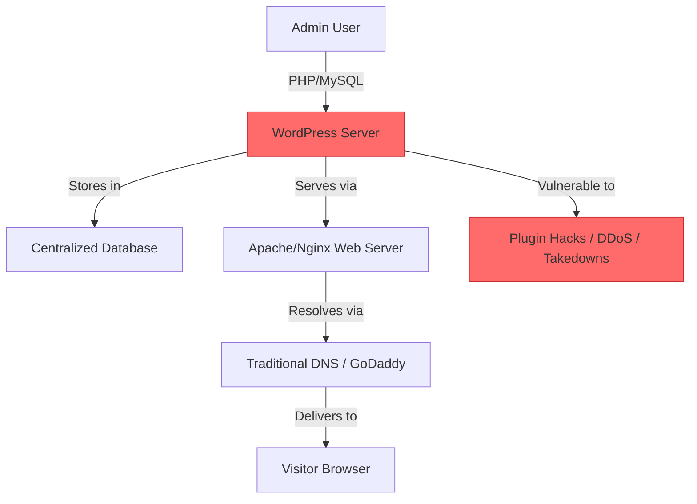
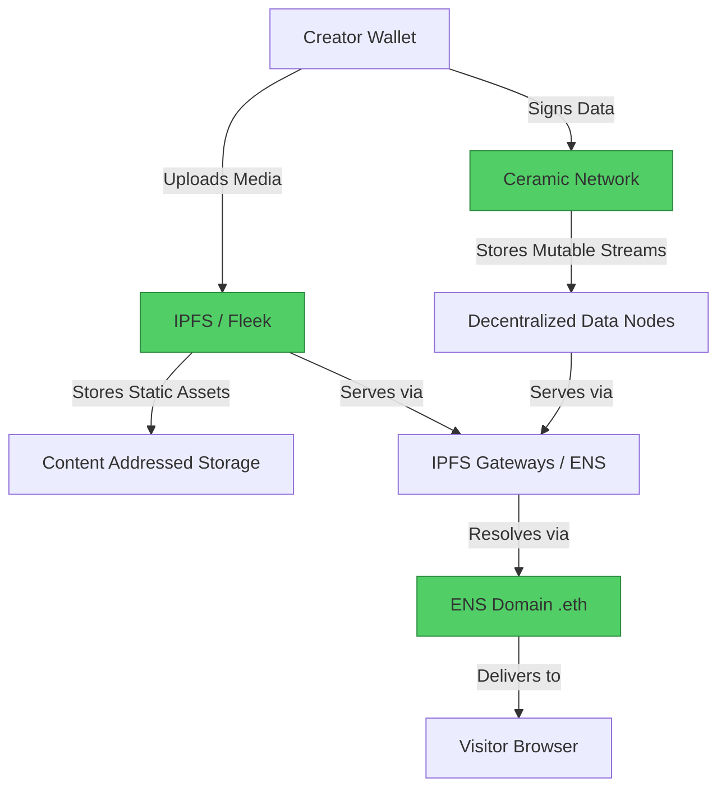

#  WordPress → Decentralized CMS (Ceramic + IPFS) Migration Guide

> **Web2 Service:** WordPress (Automattic / Self-Hosted)
> **Web3 Alternative:** Decentralized CMS (Ceramic Network + IPFS/Fleek + ENS)
> **Difficulty:** ⭐⭐⭐⭐ (Advanced)
> **Time to Migrate:** 4-8 weeks for full infrastructure rebuild and content migration

---

## 🎯 Overview

WordPress powers over 40% of the web, but it comes with significant centralized burdens: you must manage servers, deal with database vulnerabilities, fight spam, pay for hosting and premium plugins, and rely on centralized domain registrars. A single compromised plugin or a DDoS attack can take your site offline. **Decentralized CMS architectures** shift this paradigm by using **Ceramic Network** for mutable, user-owned data (posts, comments, profiles), **IPFS/Fleek** for static assets and media, and **ENS** for censorship-resistant domain resolution. This creates a website that is truly owned by the creator, impossible to take down, and free from server maintenance.

This guide shows you how to migrate from a traditional, server-dependent WordPress site to a fully decentralized, composable, and user-owned Web3 content management stack.

---

## ❌ The Web2 Problem: WordPress

### Key Issues

| Problem | Impact |
|---------|--------|
| **Server Maintenance** | You are responsible for uptime, security patches, SSL certificates, and database backups |
| **Plugin Vulnerabilities** | 3rd-party plugins are the #1 vector for WordPress hacks, malware, and data breaches |
| **Centralized Hosting Risk** | Your hosting provider can suspend your account, shut down your server, or be targeted by DDoS attacks |
| **Database Lock-in** | Your content is trapped in a MySQL database; migrating requires complex XML exports and broken shortcodes |
| **Spam & Moderation** | Constant battle with comment spam, requiring heavy plugins like Akismet that slow down your site |
| **Domain Vulnerability** | Traditional DNS and domain registrars (GoDaddy, Namecheap) can be seized or suspended by authorities |
| **Performance Bloat** | Themes and plugins inject massive amounts of JavaScript and CSS, destroying Core Web Vitals |
| **Recurring Costs** | Premium themes, plugins, managed hosting, and security services cost hundreds per month |

### Real-World Example

In 2023, a massive supply-chain attack compromised a popular WordPress plugin, injecting malware into over 100,000 websites overnight. Site owners spent days cleaning databases, restoring backups, and rebuilding trust. Similarly, independent journalists in restrictive regimes frequently have their WordPress hosting accounts suspended or their domains seized by registrars complying with government takedown requests.

---

## ✅ The Web3 Solution: Decentralized CMS (Ceramic + IPFS)

### What is a Decentralized CMS?

A Web3 CMS replaces the traditional LAMP (Linux, Apache, MySQL, PHP) stack with a decentralized data and storage layer. **Ceramic Network** provides a decentralized, mutable data stream (like a blockchain database) where you own your content and access control is managed via cryptographic keys. **IPFS** (via Fleek or Pinata) stores your images, videos, and static HTML/CSS. **ENS** (Ethereum Name Service) replaces traditional DNS, resolving your `.eth` domain directly to your IPFS hash.

### Key Benefits

| Benefit | How Web3 CMS Solves It |
|---------|------------------------|
| **Zero Server Maintenance** | No servers to patch, no databases to back up; the network handles infrastructure |
| **Unhackable Architecture** | No central database to SQL-inject; no PHP to exploit; content is cryptographically signed |
| **True Uptime** | Content served via IPFS gateways globally; impossible to DDoS a single point of failure |
| **User-Owned Data** | Your posts, comments, and profiles are tied to your wallet, not a MySQL database |
| **Censorship Resistance** | ENS domains cannot be seized; IPFS content cannot be deleted by a central authority |
| **Composability** | Your content can be natively embedded in other dApps, DAOs, or social protocols |
| **Zero Recurring Hosting Costs** | Pay once for IPFS pinning and ENS registration; no monthly hosting bills |

---

## 🏗️ Architecture Comparison

### WordPress Architecture (Centralized)



### Decentralized CMS Architecture (Ceramic + IPFS)



---

## 🛠️ Step-by-Step Migration

### Step 1: Set Up ENS Domain and IPFS Hosting

Purchase an ENS domain (e.g., `yourblog.eth`) and set up an IPFS pinning service like Fleek to host your static frontend (React/Next.js or simple HTML).

```javascript
// Install dependencies
npm install @ensdomains/ensjs viem @fleekhq/fleek-sdk

import { createWalletClient, custom } from 'viem';
import { mainnet } from 'viem/chains';

const walletClient = createWalletClient({
  chain: mainnet,
  transport: custom(window.ethereum)
});

// Point ENS to your IPFS hash
async function setENSRecord(ensName, ipfsHash) {
  console.log(`Setting ${ensName} to ipfs://${ipfsHash}`);
  // Use ENSjs to set the contenthash record
  // tx = await ens.setContenthash(ensName, `ipfs://${ipfsHash}`)
}
```

### Step 2: Initialize Ceramic Network for Content Streams

Ceramic allows you to create "Streams" (mutable documents) that are anchored to the blockchain. Your blog posts will be Ceramic streams.

```javascript
import { CeramicClient } from '@ceramicnetwork/http-client';
import { EthereumAuthProvider } from '@ceramicnetwork/blockchain-utils-linking';

// Initialize Ceramic client (using public testnet/mainnet node)
const ceramic = new CeramicClient('https://ceramic-clay.3boxlabs.com');

// Authenticate with Ethereum wallet
async function authenticateCeramic() {
  const ethProvider = window.ethereum;
  const addresses = await ethProvider.request({ method: 'eth_requestAccounts' });
  const authProvider = new EthereumAuthProvider(ethProvider, addresses[0]);

  await ceramic.setDID(await DID.create({
    provider: authProvider,
    // ... DID resolver configuration
  }));

  console.log('✅ Authenticated with Ceramic DID:', ceramic.did.id);
}
```

### Step 3: Define Your Blog Post Data Model

In Ceramic, you define a "Model" (schema) for your data. This ensures all blog posts follow a consistent structure.

```javascript
import { Model } from '@ceramicnetwork/stream-model';

async function createBlogPostModel() {
  const modelDefinition = {
    name: 'BlogPost',
    description: 'A decentralized blog post',
    schema: {
      type: 'object',
      properties: {
        title: { type: 'string', maxLength: 200 },
        content: { type: 'string', maxLength: 100000 },
        publishedAt: { type: 'integer' },
        tags: { type: 'array', items: { type: 'string' } }
      },
      required: ['title', 'content', 'publishedAt']
    }
  };

  const model = await Model.create(ceramic, modelDefinition);
  console.log('✅ Blog Post Model created:', model.id.toString());
  return model.id;
}
```

### Step 4: Publish a Blog Post to Ceramic

Create a new document (Stream) in Ceramic using your Model. This document is mutable—you can update it later, and the changes are cryptographically verified.

```javascript
import { ModelInstanceDocument } from '@ceramicnetwork/stream-model-instance';

async function publishPost(modelId, title, content, tags) {
  const postData = {
    title,
    content,
    publishedAt: Math.floor(Date.now() / 1000),
    tags
  };

  const doc = await ModelInstanceDocument.create(ceramic, postData, modelId);
  console.log(`📝 Published post "${title}" to Ceramic: ${doc.id.toString()}`);
  return doc.id.toString();
}

// Update an existing post
async function updatePost(docId, newContent) {
  const doc = await ModelInstanceDocument.load(ceramic, docId);
  await doc.replace({ ...doc.content, content: newContent });
  console.log(`✅ Updated post ${docId}`);
}
```

### Step 5: Fetch and Render Posts on Your Frontend

Your static frontend (hosted on IPFS) queries Ceramic to fetch the latest posts and renders them dynamically in the browser.

```javascript
import { useState, useEffect } from 'react';

function DecentralizedBlog({ modelId }) {
  const [posts, setPosts] = useState([]);

  useEffect(() => {
    async function fetchPosts() {
      // Query Ceramic for all documents of this model
      const edges = await ceramic.index.query({
        first: 10,
        filters: { model: modelId }
      });

      const fetchedPosts = edges.edges.map(edge => ({
        id: edge.node.id.toString(),
        ...edge.node.content
      }));

      setPosts(fetchedPosts.sort((a, b) => b.publishedAt - a.publishedAt));
    }
    fetchPosts();
  }, [modelId]);

  return (
    <div className="web3-blog">
      <h1>My Decentralized Blog</h1>
      {posts.map(post => (
        <article key={post.id}>
          <h2>{post.title}</h2>
          <div dangerouslySetInnerHTML={{ __html: post.content }} />
          <p>Tags: {post.tags.join(', ')}</p>
        </article>
      ))}
    </div>
  );
}
```

### Step 6: Migrate Existing WordPress Content

Export your WordPress content via the native XML exporter, parse it, and batch-upload the posts to Ceramic and media to IPFS.

```javascript
import { parseStringPromise } from 'xml2js';
import fs from 'fs';

async function migrateWordPressXML(xmlPath) {
  const xml = fs.readFileSync(xmlPath, 'utf-8');
  const result = await parseStringPromise(xml);

  const items = result.rss.channel[0].item || [];

  for (const item of items) {
    const title = item.title[0];
    const content = item['content:encoded'][0];
    const tags = item.category?.map(c => c._) || [];

    // Upload embedded images to IPFS and replace URLs (simplified)
    const processedContent = await processImagesInContent(content);

    // Publish to Ceramic
    await publishPost(modelId, title, processedContent, tags);
  }
}
```

---

## 📜 Full Migration Script

```javascript
// migrate-wordpress-to-web3-cms.js
import { CeramicClient } from '@ceramicnetwork/http-client';
import { Model } from '@ceramicnetwork/stream-model';
import { ModelInstanceDocument } from '@ceramicnetwork/stream-model-instance';
import { parseStringPromise } from 'xml2js';
import fs from 'fs';

class WordPressToWeb3CMSMigrator {
  constructor(ceramicUrl) {
    this.ceramic = new CeramicClient(ceramicUrl);
    this.modelId = null;
    this.migrationLog = [];
  }

  async initModel() {
    const modelDefinition = {
      name: 'BlogPost',
      schema: {
        type: 'object',
        properties: {
          title: { type: 'string' },
          content: { type: 'string' },
          publishedAt: { type: 'integer' },
          tags: { type: 'array', items: { type: 'string' } }
        },
        required: ['title', 'content', 'publishedAt']
      }
    };

    const model = await Model.create(this.ceramic, modelDefinition);
    this.modelId = model.id;
    console.log(`✅ Model initialized: ${this.modelId}`);
  }

  async migratePost(wpItem) {
    const title = wpItem.title[0];
    const content = wpItem['content:encoded'][0];
    const tags = wpItem.category?.map(c => c._) || [];
    const pubDate = new Date(wpItem.pubDate[0]).getTime() / 1000;

    console.log(`\n📝 Migrating: ${title}`);

    const doc = await ModelInstanceDocument.create(
      this.ceramic,
      { title, content, publishedAt: pubDate, tags },
      this.modelId
    );

    this.migrationLog.push({
      wpTitle: title,
      ceramicStreamId: doc.id.toString(),
      migratedAt: new Date().toISOString()
    });

    console.log(`   ✅ Ceramic Stream: ${doc.id.toString()}`);
  }

  async migrateAll(xmlPath) {
    await this.initModel();
    const xml = fs.readFileSync(xmlPath, 'utf-8');
    const result = await parseStringPromise(xml);
    const items = result.rss.channel[0].item || [];

    for (const item of items) {
      if (item['wp:post_type'][0] === 'post' && item['wp:status'][0] === 'publish') {
        await this.migratePost(item);
      }
    }

    fs.writeFileSync('web3-cms-migration-log.json', JSON.stringify(this.migrationLog, null, 2));
    console.log(`\n🎉 Migration complete! ${this.migrationLog.length} posts migrated to Ceramic.`);
  }
}

// Usage
// const migrator = new WordPressToWeb3CMSMigrator('https://ceramic-clay.3boxlabs.com');
// migrator.migrateAll('./wordpress-export.xml');
```

---

## ⚖️ Trade-offs

| Aspect | WordPress | Decentralized CMS (Ceramic + IPFS) |
|--------|-----------|------------------------------------|
| **User Experience** | Extremely polished, massive plugin ecosystem, WYSIWYG editors | Requires Web3 wallet, custom frontend development, less mature tooling |
| **Setup Complexity** | 5-minute install on any shared host | Requires understanding of Ceramic models, IPFS, and ENS |
| **Maintenance** | High (updates, security, backups) | Zero (network handles infrastructure) |
| **Cost** | $10-$100+/month (hosting, plugins, themes) | One-time costs (ENS, IPFS pinning, gas for anchoring) |
| **Performance** | Can be slow (PHP, database queries, plugin bloat) | Fast static frontend; dynamic data loaded client-side via Ceramic |
| **SEO** | Excellent (server-side rendering, established tools) | Challenging (requires SSG/SSR workarounds for IPFS hosting) |
| **Censorship** | Low (host/domain can be seized) | Extremely High (ENS + IPFS + Ceramic = untakeable) |
| **Data Ownership** | Locked in MySQL database | Fully owned by user's DID (wallet) |

---

## 🌍 Real-World Examples

### Platforms & Tools
1. **Orbis (by Ceramic)**: A decentralized social protocol and CMS framework built directly on Ceramic Network.
2. **Fleek**: The easiest way to deploy static sites and IPFS functions, often used as the frontend host for Web3 CMS.
3. **CyberConnect**: Another decentralized social graph protocol that can be used for user-owned content management.
4. **Unstoppable Domains / ENS**: Provide the censorship-resistant domain layer for Web3 sites.

### Migration Success Stories
- **Independent Journalists**: Migrated from WordPress to IPFS + ENS to ensure their reporting could never be taken down by state actors or hosting providers.
- **DAO Documentation**: Decentralized organizations moved their wikis and governance docs from WordPress to Ceramic, ensuring immutable, verifiable, and community-owned records.
- **Web3 Native Creators**: Built fully decentralized personal websites where all content, comments, and analytics are owned by the creator's DID, not a hosting company.

---

## 🔒 Security Considerations

1. **DID Security**: Your Ceramic data is controlled by your DID (Decentralized Identifier), which is tied to your wallet. If you lose your wallet, you lose the ability to update your content.
2. **Content Permanence**: While Ceramic streams are mutable by the owner, the history of changes is permanently recorded on the network. Be careful what you publish.
3. **Frontend Vulnerabilities**: While your data is decentralized, your static frontend (hosted on IPFS) can still have XSS vulnerabilities if you render user-generated content unsafely.
4. **IPFS Pinning**: Ensure your frontend and media are pinned by a reliable service (like Fleek or Pinata), otherwise they may disappear from the IPFS network.
5. **Smart Contract Risk**: If you add custom token-gating or Web3 features to your CMS, ensure all associated smart contracts are audited.

---

## 📚 Resources

### Official Documentation
- [Ceramic Network Documentation](https://developers.ceramic.network/)
- [IPFS Documentation](https://docs.ipfs.tech/)
- [ENS Documentation](https://docs.ens.domains/)
- [Fleek Documentation](https://docs.fleek.xyz/)

### Developer Tools
- **@ceramicnetwork/http-client**: Official JS/TS client for interacting with Ceramic.
- **Fleek SDK**: For seamless IPFS pinning and decentralized site deployment.
- **ENSjs**: For managing ENS domains programmatically.
- **Thirdweb**: For adding Web3 authentication and token-gating to your CMS frontend.

### Community
- [Ceramic Discord](https://discord.gg/ceramic)
- [IPFS Discord](https://discord.gg/ipfs)
- [ENS Discord](https://discord.gg/ens)

---

## 🎓 Key Takeaways

1. **Infrastructure independence is the ultimate goal**: By removing servers, databases, and traditional DNS, you eliminate 99% of the maintenance and security risks of WordPress.
2. **Ceramic is the missing link**: IPFS is great for static files, but Ceramic provides the mutable, user-owned database layer required for a true CMS.
3. **UX is the main hurdle**: The Web3 CMS stack is powerful, but the tooling (editors, themes) is not yet as polished as WordPress. You will need to build or customize your frontend.
4. **SEO requires workarounds**: Since IPFS sites are static and client-rendered, you must use SSG (Static Site Generation) or decentralized SEO tools to ensure discoverability.
5. **Hybrid is smart**: Keep your WordPress site for broad SEO and discovery, but mirror your most critical, censorship-sensitive content to your Web3 CMS.
6. **True ownership**: With a Decentralized CMS, your content, your domain, and your audience relationships are cryptographically yours, forever.
7. **Early adopter advantage**: The Web3 CMS space is nascent. Building your technical stack and audience now positions you as a pioneer in the post-platform web.

---

*Guide by [@Elvatar](https://github.com/Elvatar2) | Last updated: 2026*
*Part of the Web2 → Web3 Migration Guide series*
