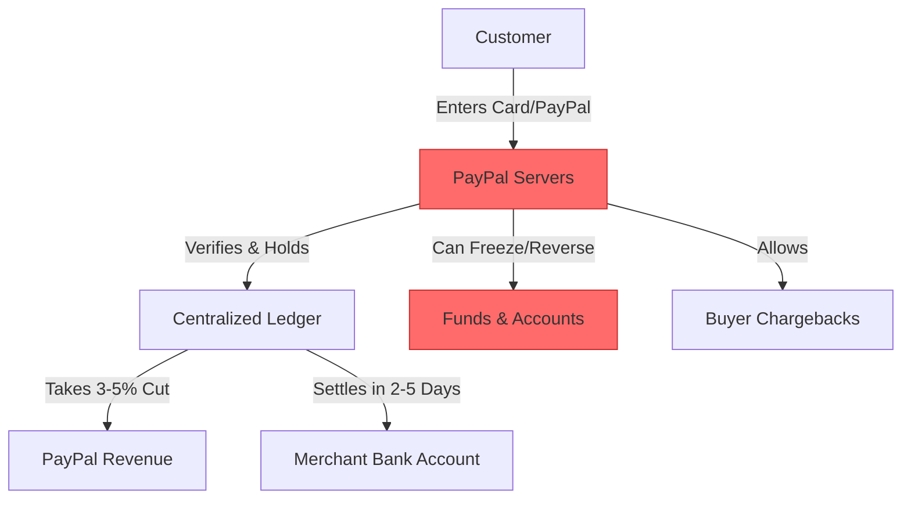
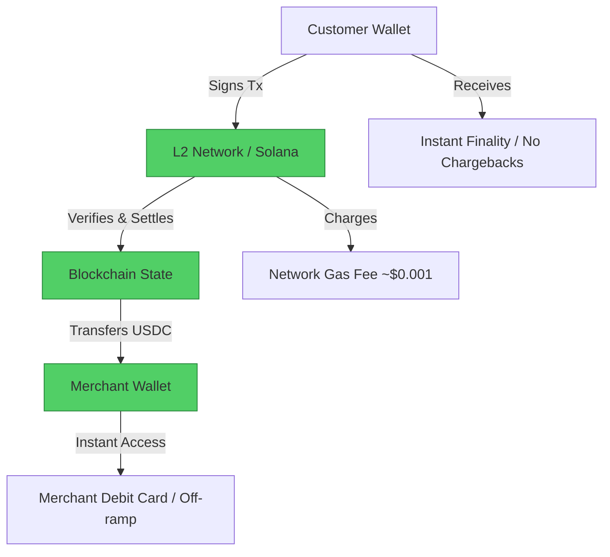

#  PayPal → Crypto Payments Migration Guide

> **Web2 Service:** PayPal
> **Web3 Alternative:** Crypto Wallets + Stablecoins (USDC) + L2 Networks (Base, Arbitrum, Solana)
> **Difficulty:** ⭐⭐⭐ (Intermediate)
> **Time to Migrate:** 2-4 weeks for checkout integration and accounting transition

---

## 🎯 Overview

PayPal revolutionized digital payments but operates as a centralized financial gatekeeper. It freezes merchant accounts without warning, holds funds for days, charges exorbitant cross-border fees (up to 8-10%), and takes a ~3-5% cut of every transaction. Furthermore, the threat of fraudulent chargebacks forces merchants to build complex risk-mitigation systems. **Crypto Payments** (using self-custodial wallets and stablecoins like USDC on Layer 2 networks) shift the paradigm to borderless, instant, and self-sovereign transactions. Merchants receive funds directly in their wallets, settle in seconds, and pay fractions of a cent in network fees, completely bypassing the traditional banking and PayPal monopolies.

This guide shows you how to migrate from a centralized, high-fee payment processor to a decentralized, direct-to-wallet stablecoin payment stack.

---

## ❌ The Web2 Problem: PayPal

### Key Issues

| Problem | Impact |
|---------|--------|
| **Account Freezes & Holds** | PayPal can freeze your funds for 180+ days based on automated risk algorithms, crippling cash flow |
| **Exorbitant Fees** | ~3.5% + fixed fee per transaction; cross-border fees can spike to 8-10% |
| **Fraudulent Chargebacks** | Buyers can reverse transactions months later, leaving merchants out of pocket (and paying a chargeback fee) |
| **Cross-Border Friction** | International payments require currency conversion, high fees, and multi-day settlement times |
| **Platform Lock-in** | Your customer payment data and transaction history are trapped in PayPal's ecosystem |
| **Arbitrary Takedowns** | PayPal can terminate your account for vague "Acceptable Use Policy" violations, cutting off your revenue |
| **Banking Dependency** | Requires linking to traditional bank accounts, subjecting you to banking hours and regional restrictions |

### Real-World Example

Countless e-commerce store owners and freelancers have had their PayPal accounts abruptly limited or permanently banned right after a spike in sales (e.g., during a viral product launch or holiday season). PayPal holds the funds for 180 days to "cover potential chargebacks," effectively bankrupting small businesses that rely on that cash flow to fulfill orders. Additionally, freelancers working with international clients lose 5-8% of their income to PayPal's currency conversion and cross-border transfer fees.

---

## ✅ The Web3 Solution: Crypto Payments (Stablecoins + L2s)

### What is the Web3 Payment Stack?

The Web3 payment stack replaces PayPal's centralized ledger with public blockchains. By using **Stablecoins** (like USDC or USDT) pegged to the US Dollar, merchants avoid crypto volatility. By using **Layer 2 Networks** (like Base, Arbitrum, Optimism) or **Solana**, transaction fees are reduced to fractions of a cent ($0.001 - $0.01), and settlements are final in seconds. Payments are sent directly from the customer's wallet to the merchant's wallet, requiring no intermediary, no KYC, and no account approvals.

### Key Benefits

| Benefit | How Web3 Payments Solve It |
|---------|----------------------------|
| **Zero Account Freezes** | You hold the private keys; no central entity can freeze your wallet or hold your funds |
| **Fraction-of-a-Cent Fees** | L2 networks (Base/Arbitrum) and Solana cost ~$0.001 per transaction, saving 3-5% on every sale |
| **Instant Global Settlement** | Funds arrive in seconds, anywhere in the world, 24/7/365, with no banking holidays |
| **No Chargebacks** | Blockchain transactions are irreversible; once confirmed, the funds are yours (eliminates friendly fraud) |
| **True Ownership** | You own the transaction data, the customer wallet addresses, and the settlement flow |
| **Borderless Commerce** | No currency conversion fees; a customer in Japan pays the exact same USDC amount as a customer in the US |
| **Programmable Money** | Integrate smart contracts for automatic escrow, revenue splitting, or token-gated discounts |

---

## 🏗️ Architecture Comparison

### PayPal Architecture (Centralized)



### Web3 Payment Architecture (Decentralized)



---

## 🛠️ Step-by-Step Migration

### Step 1: Set Up Merchant Wallet and L2 Infrastructure

Create a dedicated, secure hardware wallet (e.g., Ledger or Trezor) to act as your merchant treasury. Generate a receiving address on a low-fee network like Base, Arbitrum, or Solana.

```javascript
// Install viem for Ethereum/L2 interactions
npm install viem

import { createWalletClient, http, createPublicClient } from 'viem';
import { base } from 'viem/chains';
import { privateKeyToAccount } from 'viem/accounts';

// Initialize Public Client (for reading blockchain state)
const publicClient = createPublicClient({
  chain: base,
  transport: http(),
});

// Initialize Wallet Client (for signing/sending, though mostly you just receive)
const account = privateKeyToAccount(process.env.MERCHANT_PRIVATE_KEY);
const walletClient = createWalletClient({
  account,
  chain: base,
  transport: http(),
});

console.log(`Merchant Address: ${account.address}`);
```

### Step 2: Generate Payment Invoices (USDC on Base)

Instead of PayPal's checkout buttons, generate dynamic payment requests. You can use the Request Network protocol for accounting, or simply generate a unique amount and memo for each order.

```javascript
// USDC Contract Address on Base
const USDC_ADDRESS = '0x833589fCD6eDb6E08f4c7C32D4f71b54bdA02913';

function generatePaymentRequest(orderId, amountUSDC) {
  // In a real app, save this mapping to your database
  const paymentRequest = {
    orderId: orderId,
    amount: amountUSDC, // e.g., '49.99'
    currency: 'USDC',
    network: 'Base',
    merchantAddress: account.address,
    status: 'PENDING',
    createdAt: new Date().toISOString()
  };

  console.log(`🧾 Invoice Generated for Order ${orderId}: ${amountUSDC} USDC`);
  return paymentRequest;
}
```

### Step 3: Listen for On-Chain Payments (Webhook Replacement)

PayPal uses IPN (Instant Payment Notification) webhooks to tell your server a payment succeeded. In Web3, your backend listens directly to the blockchain for USDC `Transfer` events to your merchant address.

```javascript
import { parseAbiItem, parseUnits } from 'viem';

const transferEventAbi = parseAbiItem('event Transfer(address indexed from, address indexed to, uint256 value)');

async function listenForPayments() {
  console.log('👂 Listening for USDC payments on Base...');

  const unwatch = publicClient.watchEvent({
    address: USDC_ADDRESS,
    event: transferEventAbi,
    args: { to: account.address }, // Only watch transfers TO our merchant wallet
    onLogs: (logs) => {
      for (const log of logs) {
        const from = log.args.from;
        const amountRaw = log.args.value;
        const amountUSDC = Number(amountRaw) / 1e6; // USDC has 6 decimals

        console.log(`💰 Received ${amountUSDC} USDC from ${from} (Tx: ${log.transactionHash})`);

        // Match to open order in your database
        matchPaymentToOrder(from, amountUSDC, log.transactionHash);
      }
    },
  });

  return unwatch;
}
```

### Step 4: Handle Order Matching and Finality

Since blockchain transactions are irreversible, you must wait for the transaction to be fully confirmed before shipping goods. On L2s like Base, this takes about 2-5 seconds.

```javascript
async function matchPaymentToOrder(payerAddress, amount, txHash) {
  // 1. Fetch pending orders from your database
  const pendingOrders = await db.orders.findPending();

  // 2. Find a match (exact amount, or allow slight overpayment)
  const matchedOrder = pendingOrders.find(order =>
    Math.abs(order.amount - amount) < 0.01
  );

  if (matchedOrder) {
    // 3. Verify transaction finality (wait for 1-2 confirmations)
    const receipt = await publicClient.waitForTransactionReceipt({ hash: txHash });

    if (receipt.status === 'success') {
      await db.orders.update(matchedOrder.id, {
        status: 'PAID',
        txHash: txHash,
        payerWallet: payerAddress
      });
      console.log(`✅ Order ${matchedOrder.id} marked as PAID. Trigger fulfillment.`);

      // Trigger shipping/fulfillment API
      await triggerFulfillment(matchedOrder.id);
    }
  } else {
    console.log(`⚠️ Received ${amount} USDC but no matching pending order found. Flagging for manual review.`);
  }
}
```

### Step 5: Implement Smart Contract Escrow (For High-Ticket Items)

Because crypto transactions are irreversible, customers might hesitate to pay for expensive items upfront. You can deploy a simple Escrow Smart Contract that holds the USDC until the customer confirms receipt of the goods, mimicking PayPal's buyer protection without a central company.

```solidity
// Simple Escrow Contract (Solidity)
pragma solidity ^0.8.20;

import "@openzeppelin/contracts/token/ERC20/IERC20.sol";

contract SimpleEscrow {
    address public buyer;
    address public seller;
    IERC20 public token;
    uint256 public amount;
    bool public isReleased;

    constructor(address _buyer, address _seller, address _token, uint256 _amount) {
        buyer = _buyer;
        seller = _seller;
        token = IERC20(_token);
        amount = _amount;
    }

    function fund() external {
        require(msg.sender == buyer, "Only buyer can fund");
        token.transferFrom(buyer, address(this), amount);
    }

    function release() external {
        require(msg.sender == buyer, "Only buyer can release");
        token.transfer(seller, amount);
        isReleased = true;
    }
}
```

### Step 6: Migrate Your Checkout Flow

1. **Add "Pay with Crypto" Button**: Integrate a Web3 modal (like Coinbase Wallet SDK or WalletConnect) at checkout.
2. **Offer Incentives**: Offer a 5-10% discount for crypto payments to offset the 3.5% you used to pay PayPal, passing the savings to the customer.
3. **Use Payment Gateways (Optional)**: If you don't want to build the backend listener yourself, use **Coinbase Commerce** or **Request Network**, which provide Web2-like dashboards and webhooks for Web3 payments.

---

## 📜 Full Migration Script

```javascript
// migrate-paypal-to-crypto-backend.js
import { createPublicClient, http, parseAbiItem } from 'viem';
import { base } from 'viem/chains';

class PayPalToCryptoPaymentProcessor {
  constructor(merchantAddress, usdcAddress) {
    this.merchantAddress = merchantAddress;
    this.usdcAddress = usdcAddress;
    this.publicClient = createPublicClient({
      chain: base,
      transport: http(),
    });
    this.pendingOrders = new Map(); // In-memory DB for demo
  }

  createInvoice(orderId, amountUSDC) {
    this.pendingOrders.set(orderId, { amount: amountUSDC, status: 'PENDING' });
    console.log(`🧾 Invoice ${orderId} created for ${amountUSDC} USDC`);
    return `base:${this.merchantAddress}?value=${amountUSDC}&token=USDC`;
  }

  async startListening() {
    const transferEvent = parseAbiItem('event Transfer(address indexed from, address indexed to, uint256 value)');

    console.log(`👂 Listening for USDC on Base to ${this.merchantAddress}...`);

    this.publicClient.watchEvent({
      address: this.usdcAddress,
      event: transferEvent,
      args: { to: this.merchantAddress },
      onLogs: async (logs) => {
        for (const log of logs) {
          const amount = Number(log.args.value) / 1e6;
          const txHash = log.transactionHash;
          await this.processPayment(log.args.from, amount, txHash);
        }
      }
    });
  }

  async processPayment(from, amount, txHash) {
    // Find matching order
    let matchedOrderId = null;
    for (const [id, order] of this.pendingOrders.entries()) {
      if (order.status === 'PENDING' && Math.abs(order.amount - amount) < 0.01) {
        matchedOrderId = id;
        break;
      }
    }

    if (matchedOrderId) {
      console.log(`🔍 Verifying Tx ${txHash} for Order ${matchedOrderId}...`);
      const receipt = await this.publicClient.waitForTransactionReceipt({ hash: txHash });

      if (receipt.status === 'success') {
        this.pendingOrders.set(matchedOrderId, { status: 'PAID', txHash, payer: from });
        console.log(`✅ Order ${matchedOrderId} PAID. Fulfilling...`);
        // this.fulfillOrder(matchedOrderId);
      }
    } else {
      console.log(`⚠️ Unmatched payment: ${amount} USDC from ${from}`);
    }
  }
}

// Usage
// const processor = new PayPalToCryptoPaymentProcessor(
//   '0xYourMerchantWalletAddress',
//   '0x833589fCD6eDb6E08f4c7C32D4f71b54bdA02913' // USDC on Base
// );
// processor.createInvoice('ORD-1001', 49.99);
// processor.startListening();
```

---

## ⚖️ Trade-offs

| Aspect | PayPal | Crypto Payments (Stablecoins + L2) |
|--------|--------|------------------------------------|
| **User Experience** | Frictionless for buyers (1-click checkout) | Requires buyer to have a wallet and USDC (UX friction) |
| **Transaction Fees** | ~3.5% + fixed fee | ~$0.001 - $0.05 (Network gas fees) |
| **Settlement Time** | 2-5 business days to bank | 2-5 seconds (Finality on L2/Solana) |
| **Chargebacks** | High risk (buyer can reverse) | Zero risk (transactions are irreversible) |
| **Account Risk** | High (freezes, bans, holds) | Zero (self-custodial, no one can freeze your wallet) |
| **Global Reach** | Restricted by country/banking | 100% global, anyone with internet can pay |
| **Buyer Protection** | Built-in (favors buyer heavily) | None natively (requires custom escrow smart contracts) |
| **Accounting** | Native fiat integration | Requires crypto-to-fiat off-ramping or crypto accounting tools |

---

## 🌍 Real-World Examples

### Platforms & Gateways
1. **Coinbase Commerce**: The easiest bridge for merchants. Provides a Web2-like dashboard, webhook integrations (Shopify, WooCommerce), and auto-converts crypto to fiat.
2. **Request Network**: A decentralized invoice and payment request protocol. Excellent for B2B and freelancers needing on-chain accounting.
3. **Solana Pay**: Ultra-low latency, near-zero fee payments optimized for point-of-sale (POS) and e-commerce.
4. **BTCPay Server**: Open-source, self-hosted payment processor for Bitcoin (and Lightning), completely bypassing third-party gateways.

### Migration Success Stories
- **Digital Creators**: Independent course creators and digital artists switched to USDC on Base, saving $5,000+/month in fees and eliminating chargeback fraud.
- **Global Freelancers**: Developers in Latin America and Asia use stablecoins to receive instant payments from US/EU clients, avoiding 8% PayPal forex fees and multi-day bank delays.
- **E-commerce Brands**: Niche apparel and electronics brands offer a 5% discount for crypto checkout, migrating 20-30% of their volume to Web3 and drastically improving cash flow.

---

## 🔒 Security Considerations

1. **Private Key Management**: Your merchant wallet holds the funds. Use a hardware wallet (Ledger/Trezor) for the main treasury, and only keep minimal "hot wallet" funds for operational gas fees.
2. **Irreversibility**: Unlike PayPal, you cannot reverse a transaction if you send funds to the wrong address. Double-check all smart contract interactions and withdrawal addresses.
3. **Stablecoin De-peg Risk**: While USDC and USDT are highly liquid, they carry counterparty risk. Diversify treasury holdings if storing large amounts long-term.
4. **Phishing & Malware**: Merchant wallets are high-value targets. Ensure the backend server listening for payments is secure, and never expose private keys in environment variables without proper vault management.
5. **Smart Contract Risk**: If using custom escrow or token-gating contracts, ensure they are audited. A bug could lock customer funds permanently.

---

## 📚 Resources

### Official Documentation
- [Base Documentation](https://docs.base.org/)
- [Arbitrum Documentation](https://docs.arbitrum.io/)
- [Solana Pay Documentation](https://docs.solanapay.com/)
- [USDC (Circle) Documentation](https://developers.circle.com/)

### Developer Tools
- **Viem / Ethers.js**: Best-in-class libraries for reading blockchain state and listening to events.
- **Coinbase Commerce API**: For merchants who want Web3 payments with Web2 webhook simplicity.
- **Request Network SDK**: For generating and tracking decentralized invoices.
- **Alchemy / QuickNode**: Reliable RPC providers for high-throughput event listening.

### Community
- [Ethereum Discord](https://discord.gg/ethereum)
- [Base Discord](https://discord.gg/base)
- [Solana Tech Discord](https://discord.gg/solana)

---

## 🎓 Key Takeaways

1. **Fees are profit**: Moving from PayPal's 3.5% to L2 gas fees of $0.001 instantly increases your net margin on every transaction.
2. **Cash flow is king**: Instant settlement means you can fulfill orders and pay suppliers immediately, without waiting 5 days for PayPal to release funds.
3. **Eliminate friendly fraud**: Irreversible transactions completely eliminate the nightmare of fraudulent chargebacks, saving you revenue and dispute fees.
4. **Self-custody is non-negotiable**: Never use a custodial payment gateway if you want true censorship resistance. Run your own listener or use open-source tools like BTCPay.
5. **UX is the bottleneck**: The technology is ready, but requiring customers to use a Web3 wallet is still a friction point. Use incentives (discounts) to drive adoption.
6. **Stablecoins are the bridge**: Don't price in volatile assets like ETH or BTC unless you want to. Use USDC/USDT to maintain fiat-equivalent pricing and accounting.
7. **Hybrid checkout is smart**: Keep PayPal/Stripe for traditional customers, but add a "Pay with Crypto" option. Let the market dictate the transition speed.

---

*Guide by [@Elvatar](https://github.com/Elvatar2) | Last updated: 2026*
*Part of the Web2 → Web3 Migration Guide series*