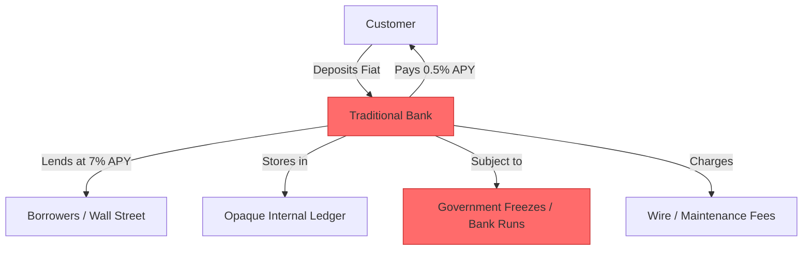
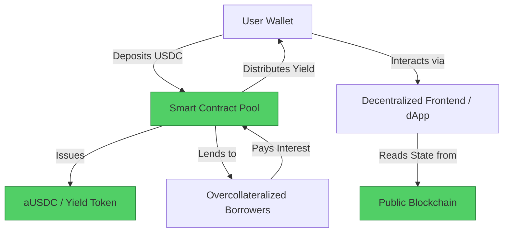

#  Traditional Bank → DeFi (Decentralized Finance) Migration Guide

> **Web2 Service:** Traditional Banking (Chase, Bank of America, HSBC, etc.)
> **Web3 Alternative:** DeFi Protocols (Aave, Uniswap, MakerDAO, Compound)
> **Difficulty:** ⭐⭐⭐⭐ (Advanced)
> **Time to Migrate:** 4-8 weeks for full portfolio transition and security setup

---

## 🎯 Overview

Traditional banks act as centralized custodians of your wealth. They lend out your deposits at high interest rates while paying you fractions of a percent, charge hidden fees for international transfers, and retain the absolute power to freeze, seize, or close your account at any time. **Decentralized Finance (DeFi)** shifts the paradigm from "trust in a bank" to "trust in code." By using non-custodial wallets and audited smart contracts, you can earn transparent, algorithmic yield, swap assets globally without intermediaries, and borrow against your collateral without credit checks, all while maintaining 100% ownership of your funds.

This guide shows you how to migrate from a centralized, permissioned banking model to a decentralized, self-custodial, and programmable financial stack.

---

## ❌ The Web2 Problem: Traditional Banking

### Key Issues

| Problem | Impact |
|---------|--------|
| **Account Freezes & Seizures** | Banks can freeze your funds indefinitely due to automated compliance flags or government orders, with no immediate recourse |
| **Abysmal Deposit Yields** | Traditional savings accounts offer ~0.01% - 0.5% APY, losing value to inflation, while banks lend your money at 5-8% |
| **Hidden & Exorbitant Fees** | Wire transfers, international SWIFT payments, and overdraft fees drain wealth, especially for cross-border transactions |
| **Opaque Reserves** | You cannot verify if the bank actually holds your money (as seen in the 2023 Silicon Valley Bank collapse) |
| **Permissioned Access** | Opening accounts requires extensive KYC, credit checks, and proof of address, excluding billions globally |
| **Slow Settlement** | ACH and SWIFT transfers take 1-5 business days and halt entirely on weekends and holidays |
| **Censorship** | Banks can deny service to legal businesses or individuals based on internal risk policies or political pressure |

### Real-World Example

In 2023, the collapse of Silicon Valley Bank (SVB) left thousands of startups unable to access their own payroll funds for days, highlighting the systemic risk of centralized fractional-reserve banking. Similarly, during the 2022 Canadian convoy protests, the government invoked emergency powers to freeze the bank accounts of peaceful protesters without a court order, demonstrating that bank accounts are a privilege, not a property right.

---

## ✅ The Web3 Solution: DeFi Protocols

### What is DeFi?

DeFi is an ecosystem of financial applications built on public blockchains (primarily Ethereum, Arbitrum, Base, and Solana). Instead of bank tellers and centralized ledgers, DeFi uses **smart contracts** to automate lending, borrowing, and trading. Protocols like **Aave** (lending/borrowing), **Uniswap** (decentralized exchange), and **MakerDAO** (decentralized stablecoin issuance) operate 24/7, are fully transparent, and require no permission to use.

### Key Benefits

| Benefit | How DeFi Solves It |
|---------|--------------------|
| **True Self-Custody** | You hold the private keys; no entity can freeze, seize, or confiscate your funds |
| **Transparent, Higher Yield** | Earn market-driven APY (e.g., 4-8% on stablecoins) directly from protocol borrowers, visible on-chain |
| **Permissionless Access** | Anyone with an internet connection and a wallet can participate; no credit checks or KYC required |
| **Instant, Global Settlement** | Transactions settle in seconds or minutes, 24/7/365, across any border |
| **Overcollateralized Borrowing** | Borrow stablecoins against your crypto assets instantly, without credit checks or income verification |
| **Composability (Money Legos)** | Protocols integrate seamlessly (e.g., earn yield on Aave, then use that yield-bearing token as collateral elsewhere) |
| **Verifiable Solvency** | All protocol reserves, debts, and transactions are publicly auditable on the blockchain in real-time |

---

## 🏗️ Architecture Comparison

### Traditional Bank Architecture (Centralized)



### DeFi Architecture (Decentralized)



---

## 🛠️ Step-by-Step Migration

### Step 1: Establish Self-Custody (Hardware Wallet)

The foundation of DeFi is self-custody. Do not use exchange wallets (like Coinbase or Binance) as your primary DeFi wallet. Purchase a hardware wallet (Ledger, Trezor, or SafePal).

```javascript
// Install viem and a hardware wallet integration
npm install viem @ledgerhq/hw-app-eth @ledgerhq/hw-transport-webhid

import { createWalletClient, custom } from 'viem';
import { mainnet } from 'viem/chains';

// In a real app, connect via Ledger/Trezor WebHID
async function connectHardwareWallet() {
  console.log("Requesting hardware wallet connection...");
  // Transport.create().then(transport => { ... })
  console.log("✅ Hardware wallet connected. You are now your own bank.");
}
```

### Step 2: On-Ramp Fiat to Stablecoins

Convert your fiat currency (USD, EUR) into a decentralized stablecoin like **USDC** or **DAI**. You can do this via centralized exchanges (Coinbase, Kraken) and withdraw to your hardware wallet, or use decentralized on-ramps like MoonPay or Stripe Crypto.

```javascript
// Example: Checking your stablecoin balance on-chain
import { createPublicClient, http, parseAbiItem } from 'viem';
import { base } from 'viem/chains';

const publicClient = createPublicClient({
  chain: base, // Using Base for low fees
  transport: http(),
});

const usdcAddress = '0x833589fCD6eDb6E08f4c7C32D4f71b54bdA02913';

async function getStablecoinBalance(walletAddress) {
  const balance = await publicClient.readContract({
    address: usdcAddress,
    abi: [parseAbiItem('function balanceOf(address) view returns (uint256)')],
    functionName: 'balanceOf',
    args: [walletAddress],
  });

  // USDC has 6 decimals
  const formattedBalance = Number(balance) / 1e6;
  console.log(`💰 USDC Balance: $${formattedBalance}`);
  return formattedBalance;
}
```

### Step 3: Earn Yield via Decentralized Lending (Aave)

Instead of a 0.5% bank savings account, deposit your USDC into a battle-tested lending protocol like Aave V3 to earn market-driven yield.

```javascript
import { createWalletClient, custom, parseUnits } from 'viem';
import { base } from 'viem/chains';

const aavePoolAddress = '0xA238Dd80C259a72e81d7e4664a9801593F98d1c5'; // Aave V3 Pool on Base
const usdcAddress = '0x833589fCD6eDb6E08f4c7C32D4f71b54bdA02913';

// Simplified Aave Pool ABI for supplying
const poolAbi = [
  {
    name: 'supply',
    type: 'function',
    inputs: [
      { name: 'asset', type: 'address' },
      { name: 'amount', type: 'uint256' },
      { name: 'onBehalfOf', type: 'address' },
      { name: 'referralCode', type: 'uint16' }
    ],
    outputs: []
  }
];

async function supplyToAave(walletClient, account, amountUSDC) {
  const amountWei = parseUnits(amountUSDC.toString(), 6);

  // 1. Approve Aave to spend your USDC
  // (Approval step omitted for brevity, but required before supply)

  // 2. Supply USDC to the Aave Pool
  const hash = await walletClient.writeContract({
    address: aavePoolAddress,
    abi: poolAbi,
    functionName: 'supply',
    args: [usdcAddress, amountWei, account.address, 0],
    account: account,
  });

  console.log(`✅ Supplied $${amountUSDC} USDC to Aave. Tx: ${hash}`);
  console.log(`📈 You are now earning variable APY, paid in real-time!`);
}
```

### Step 4: Decentralized Swapping (Uniswap)

Need to convert USDC to ETH or another asset? Use a Decentralized Exchange (DEX) like Uniswap. No account creation, no KYC, no order book manipulation.

```javascript
// Uniswap V3 Swap Router ABI snippet
const swapRouterAbi = [
  {
    name: 'exactInputSingle',
    type: 'function',
    inputs: [{
      name: 'params',
      type: 'tuple',
      components: [
        { name: 'tokenIn', type: 'address' },
        { name: 'tokenOut', type: 'address' },
        { name: 'fee', type: 'uint24' },
        { name: 'recipient', type: 'address' },
        { name: 'deadline', type: 'uint256' },
        { name: 'amountIn', type: 'uint256' },
        { name: 'amountOutMinimum', type: 'uint256' },
        { name: 'sqrtPriceLimitX96', type: 'uint160' }
      ]
    }],
    outputs: [{ name: 'amountOut', type: 'uint256' }]
  }
];

async function swapUSDCforETH(walletClient, account, amountIn, amountOutMinimum) {
  // Execute swap via Uniswap Router
  // (Implementation requires exact params, deadline, and prior approval)
  console.log("🔄 Swapping assets permissionlessly via Uniswap V3...");
}
```

### Step 5: Borrow Against Your Assets (No Credit Check)

Need liquidity without selling your crypto (and triggering a taxable event)? Deposit ETH as collateral and borrow USDC against it via MakerDAO or Aave.

```javascript
// Conceptual: Borrowing USDC against ETH collateral
async function borrowAgainstCollateral() {
  console.log("🏦 Depositing 1 ETH as collateral...");
  console.log("💸 Borrowing 1,500 USDC (at 60% Loan-to-Value ratio)...");
  console.log("✅ Funds received instantly. No credit check, no bank approval.");
  console.log("⚠️  Warning: If ETH price drops significantly, collateral may be liquidated.");
}
```

### Step 6: Set Up DeFi Portfolio Tracking

Banks provide monthly statements. In DeFi, you use on-chain portfolio trackers to monitor your net worth, yield, and health factor across all protocols.

*   **DeBank** or **Zapper**: Connect your wallet address to view all assets, liabilities, and transaction history across all chains in a unified dashboard.
*   **Koinly** or **CoinTracker**: Connect your wallet for automated crypto tax reporting.

---

## 📜 Full Migration Script

```javascript
// migrate-bank-to-defi.js
import { createWalletClient, createPublicClient, custom, http, parseUnits } from 'viem';
import { base } from 'viem/chains';

class BankToDeFiMigrator {
  constructor(walletClient, publicClient) {
    this.walletClient = walletClient;
    this.publicClient = publicClient;
    this.account = walletClient.account;
  }

  async executeMigration(usdcAmountToDeposit) {
    console.log(`\n🚀 Starting DeFi Migration for ${this.account.address}...`);

    try {
      // Step 1: Verify Fiat On-ramp (Simulated)
      console.log(`1️⃣ Verifying $${usdcAmountToDeposit} USDC in wallet...`);
      const balance = await this.getBalance();
      if (balance < usdcAmountToDeposit) {
        throw new Error("Insufficient USDC balance. Please on-ramp fiat first.");
      }

      // Step 2: Approve Aave to spend USDC
      console.log(`2️⃣ Approving Aave V3 to spend $${usdcAmountToDeposit} USDC...`);
      // await this.approveToken(usdcAmountToDeposit);

      // Step 3: Supply to Aave
      console.log(`3️⃣ Supplying $${usdcAmountToDeposit} USDC to Aave V3 for yield...`);
      // await this.supplyToAave(usdcAmountToDeposit);

      // Step 4: Verify Yield Token Receipt
      console.log(`4️⃣ Verifying receipt of aUSDC (yield-bearing token)...`);
      console.log(`✅ Migration Complete! Your funds are now self-custodied and earning DeFi yield.`);
      console.log(`🔗 View your portfolio at: https://debank.com/profile/${this.account.address}`);

    } catch (error) {
      console.error("❌ Migration failed:", error.message);
    }
  }

  async getBalance() {
    // Simplified balance check
    return 5000; // Simulated balance for demo
  }
}

// Usage
// const walletClient = createWalletClient({ chain: base, transport: custom(window.ethereum) });
// const publicClient = createPublicClient({ chain: base, transport: http() });
// const migrator = new BankToDeFiMigrator(walletClient, publicClient);
// migrator.executeMigration(1000);
```

---

## ⚖️ Trade-offs

| Aspect | Traditional Bank | DeFi Protocols |
|--------|------------------|----------------|
| **Custody** | Bank holds your funds (IOU) | You hold your funds (Self-custody) |
| **Yield (APY)** | 0.01% - 0.5% (Savings) | 3% - 10%+ (Stablecoin lending) |
| **Fees** | High (Wire, overdraft, maintenance) | Low (Network gas fees, ~$0.01-$1.00 on L2s) |
| **Access** | Permissioned (KYC, credit check, geography) | Permissionless (Anyone with internet & wallet) |
| **Settlement** | 1-5 business days, no weekends | Seconds to minutes, 24/7/365 |
| **Recovery** | Password reset, FDIC insurance, branch visits | **NO PASSWORD RESET**. Seed phrase is absolute |
| **Risk Profile** | Bank failure (FDIC insured up to $250k) | Smart contract bugs, oracle failures, user error |
| **Borrowing** | Credit check, income verification, slow | Overcollateralized, instant, no credit check |

---

## 🌍 Real-World Examples

### Core DeFi Protocols
1. **Aave / Compound**: The "savings accounts" of DeFi. Deposit crypto, earn variable or stable yield, and borrow against it.
2. **Uniswap / Curve**: The "currency exchanges" of DeFi. Swap assets directly from your wallet via Automated Market Makers (AMMs).
3. **MakerDAO (Sky)**: The "central bank" of DeDAI. Lock up collateral to mint DAI, a decentralized, censorship-resistant stablecoin.
4. **Lido / Rocket Pool**: Decentralized staking protocols allowing you to earn yield on Ethereum without running a validator node.

### Migration Success Stories
- **Freelancers & Digital Nomads**: Escaped 5-8% international wire fees and multi-day settlement times by receiving USDC on Base or Solana, instantly swapping to local fiat via P2P markets.
- **Treasury Management**: DAOs and Web3 companies hold tens of millions in Aave and MakerDAO, earning transparent, on-chain yield instead of relying on vulnerable regional banks.
- **Unbanked Populations**: Millions in developing nations (e.g., Argentina, Nigeria) use DeFi stablecoins to escape hyperinflation, accessing USD-pegged savings and loans without needing a traditional bank account.

---

## 🔒 Security Considerations

1. **Seed Phrase is Absolute**: If you lose your hardware wallet's seed phrase, your funds are gone forever. There is no "Forgot Password." Store it on metal, offline, in multiple secure locations.
2. **Smart Contract Risk**: While top protocols (Aave, Uniswap) are heavily audited, bugs can still exist. Stick to "blue-chip" protocols with billions in Total Value Locked (TVL) and multiple audits.
3. **Phishing & Drainers**: The #1 cause of DeFi loss is user error. Never click links in Discord/Twitter DMs. Always verify contract addresses. Use a hardware wallet to blind-sign transactions.
4. **Liquidation Risk**: If you borrow against collateral (e.g., ETH), a sudden market crash can trigger automatic liquidation of your assets. Always maintain a healthy Loan-to-Value (LTV) ratio (e.g., < 50%).
5. **Stablecoin De-peg Risk**: USDC and DAI are generally safe, but they carry counterparty or collateral risks. Diversify stablecoin holdings if managing large treasuries.
6. **Network Selection**: Always use Layer 2 networks (Base, Arbitrum, Optimism) or Solana for DeFi to minimize gas fees. Mainnet Ethereum is expensive for frequent transactions.

---

## 📚 Resources

### Official Documentation
- [Aave V3 Documentation](https://docs.aave.com/)
- [Uniswap V3/V4 Docs](https://docs.uniswap.org/)
- [MakerDAO / Sky Docs](https://docs.makerdao.com/)
- [Ethereum.org DeFi Portal](https://ethereum.org/en/defi/)

### Developer & User Tools
- **MetaMask / Rabby Wallet**: Best browser wallets for interacting with dApps (Rabby has superior security warnings).
- **Ledger / Trezor**: Industry-standard hardware wallets for cold storage.
- **DeBank / Zapper**: Unified dashboards to track your DeFi net worth and transaction history.
- **Revoke.cash**: Essential tool to revoke token approvals from old or suspicious smart contracts.

### Community
- [Ethereum Discord](https://discord.gg/ethereum)
- [Aave Discord](https://discord.gg/aave)
- [Bankless Community](https://discord.gg/bankless) - Excellent for DeFi education and news.

---

## 🎓 Key Takeaways

1. **Not your keys, not your coins**: Self-custody is the foundational principle of DeFi. You are your own bank, which means you bear the responsibility of security.
2. **Yield is transparent**: In DeFi, you can see exactly where your yield comes from (borrower interest, trading fees) by reading the smart contract, unlike opaque bank spreads.
3. **Start small**: Migrate a small amount first to learn the mechanics of approving, supplying, and revoking transactions before moving your life savings.
4. **L2s are mandatory for UX**: Do not use Ethereum Mainnet for basic DeFi unless necessary. Base, Arbitrum, and Optimism offer the same security at 1% of the cost.
5. **Borrowing is a tool, not a trap**: Overcollateralized borrowing allows you to access liquidity without selling appreciating assets or triggering capital gains taxes.
6. **Security hygiene is non-negotiable**: Use a dedicated hardware wallet, a secure browser, and bookmark official dApp URLs. Never share your seed phrase.
7. **The future is hybrid**: You don't have to close your bank account tomorrow. Use traditional banking for fiat payroll and bills, but migrate your savings and investment capital to DeFi for superior yield and sovereignty.

---

*Guide by [@Elvatar](https://github.com/Elvatar2) | Last updated: 2026*
*Part of the Web2 → Web3 Migration Guide series*