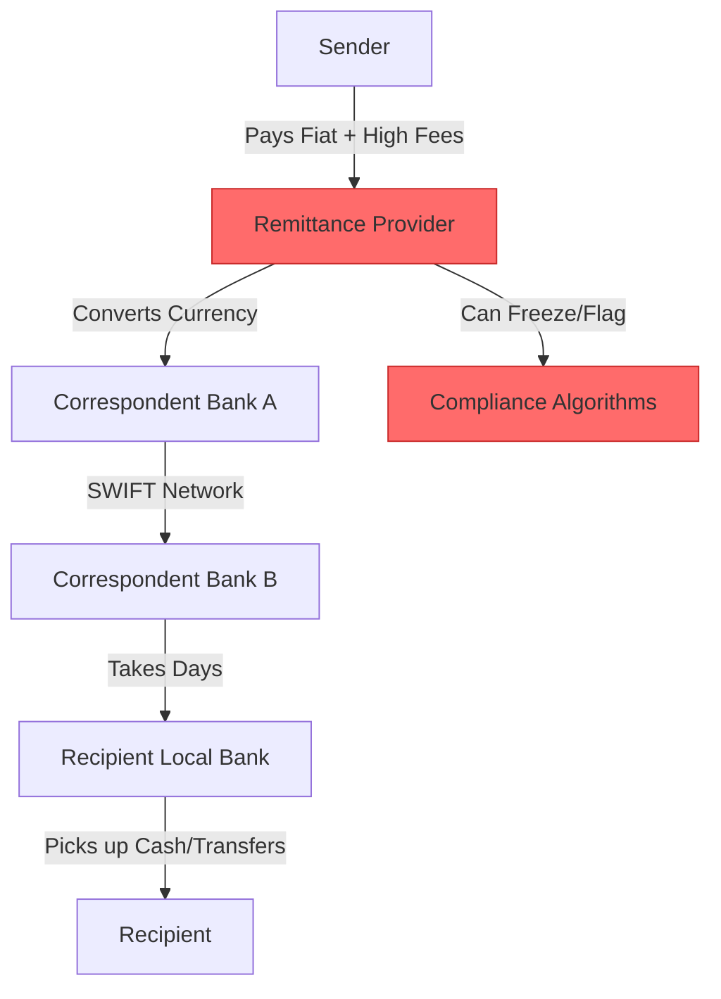
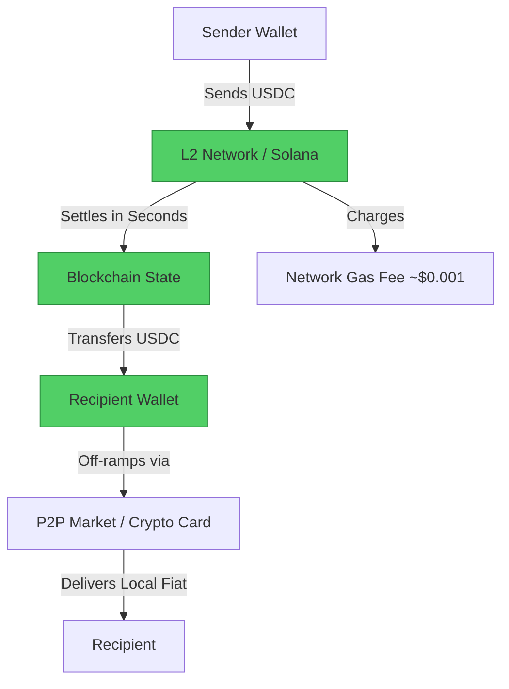

#  Remittance (Western Union / MoneyGram) → Stablecoins Migration Guide

> **Web2 Service:** Traditional Remittance (Western Union, MoneyGram, Wise, SWIFT)
> **Web3 Alternative:** Stablecoins (USDC / USDT) on L2 Networks (Base, Arbitrum) & Solana
> **Difficulty:** ⭐⭐⭐ (Intermediate)
> **Time to Migrate:** 1-2 weeks for user onboarding and P2P off-ramp setup

---

## 🎯 Overview

Traditional remittance services act as expensive, slow tollbooths on the global flow of money. Migrant workers sending money home to their families lose anywhere from 5% to 15% of their transfer to hidden fees, terrible exchange rate spreads, and intermediary bank charges. Transfers can take 3 to 5 business days, and recipients often need a local bank account or must travel to a physical agent location. **Stablecoins** (like USDC) on low-cost Layer 2 networks (Base, Arbitrum) or Solana shift this paradigm entirely. They enable borderless, instant, and near-zero-fee value transfer to anyone with a smartphone, completely bypassing the legacy correspondent banking system (SWIFT).

This guide shows you how to migrate from an extractive, multi-day remittance corridor to a decentralized, instant, and self-custodial stablecoin transfer stack.

---

## ❌ The Web2 Problem: Traditional Remittance

### Key Issues

| Problem | Impact |
|---------|--------|
| **Exorbitant Fees** | Average global remittance fee is ~6.2%, but corridors like Africa or Latin America can exceed 10-15% |
| **Hidden Exchange Rate Spreads** | Services advertise "zero fees" but hide a 3-5% markup in the foreign exchange rate |
| **Slow Settlement** | SWIFT and correspondent banking take 3-5 business days; weekends and holidays halt transfers |
| **Banking Exclusion** | Recipients often need a traditional bank account, excluding the unbanked populations who need it most |
| **Physical Friction** | Senders or receivers may need to visit physical agent locations, show IDs, and wait in line |
| **Opaque Tracking** | Once money enters the SWIFT network, tracking its exact location is nearly impossible for the user |
| **Arbitrary Freezes** | Compliance algorithms frequently flag and freeze cross-border transfers for days for manual review |

### Real-World Example

A worker in the UK sending £500 a month to their family in Nigeria via a traditional provider might pay £35 in upfront fees, plus lose another £20 to a poor exchange rate. The family receives the equivalent of £445, and it takes 4 days to arrive. If the transfer is flagged for "compliance review," the family could go without essential funds for over a week.

---

## ✅ The Web3 Solution: Stablecoins on L2s

### What is the Web3 Remittance Stack?

The Web3 remittance stack replaces the SWIFT network and money transmitters with public blockchains. By using **Stablecoins** (USDC or USDT) pegged to the US Dollar, senders and receivers avoid crypto volatility. By using **Layer 2 Networks** (Base, Arbitrum) or **Solana**, transaction fees are reduced to fractions of a cent ($0.001 - $0.01), and settlements are final in seconds. The recipient only needs a non-custodial wallet (like MetaMask or Phantom) and can cash out to local fiat via decentralized P2P markets or crypto debit cards.

### Key Benefits

| Benefit | How Web3 Remittance Solves It |
|---------|-------------------------------|
| **Near-Zero Fees** | Network gas fees on Base/Solana are ~$0.001, saving 95%+ compared to Western Union |
| **Instant Settlement** | Funds arrive in seconds, 24/7/365, regardless of weekends or banking holidays |
| **Financial Inclusion** | Recipients only need a smartphone and internet; no bank account or credit history required |
| **No Exchange Rate Abuse** | 1 USDC always equals 1 USD. No hidden spreads or arbitrary conversion markups |
| **True Transparency** | The sender can track the exact status of the funds on a public block explorer in real-time |
| **Censorship Resistance** | No central company can freeze the transaction or demand physical ID to release funds |
| **Programmable Money** | Smart contracts can enable automated recurring remittances or conditional releases |

---

## 🏗️ Architecture Comparison

### Traditional Remittance Architecture (Centralized)



### Web3 Remittance Architecture (Decentralized)



---

## 🛠️ Step-by-Step Migration

### Step 1: Set Up Wallets for Sender and Receiver

Both the sender and the recipient need a self-custodial wallet. For L2s like Base or Arbitrum, use MetaMask or Coinbase Wallet. For Solana, use Phantom.

```javascript
// Install viem for Ethereum/L2 interactions
npm install viem

import { createWalletClient, http, createPublicClient } from 'viem';
import { base } from 'viem/chains';
import { privateKeyToAccount } from 'viem/accounts';

// Sender's Wallet Client
const senderAccount = privateKeyToAccount(process.env.SENDER_PRIVATE_KEY);
const senderWallet = createWalletClient({
  account: senderAccount,
  chain: base,
  transport: http(),
});

// Public Client for reading state
const publicClient = createPublicClient({
  chain: base,
  transport: http(),
});

console.log(`Sender Address: ${senderAccount.address}`);
```

### Step 2: Acquire Stablecoins (On-Ramp)

The sender needs to convert their local fiat into USDC. This can be done via a centralized exchange (Coinbase, Binance) or a decentralized on-ramp like MoonPay or Stripe Crypto, withdrawing the USDC to their L2 wallet.

```javascript
// USDC Contract Address on Base
const USDC_ADDRESS = '0x833589fCD6eDb6E08f4c7C32D4f71b54bdA02913';

async function checkSenderBalance() {
  const balance = await publicClient.readContract({
    address: USDC_ADDRESS,
    abi: [{ name: 'balanceOf', type: 'function', stateMutability: 'view', inputs: [{ name: 'account', type: 'address' }], outputs: [{ name: '', type: 'uint256' }] }],
    functionName: 'balanceOf',
    args: [senderAccount.address],
  });

  const formatted = Number(balance) / 1e6; // USDC has 6 decimals
  console.log(`💰 Sender USDC Balance: $${formatted}`);
  return formatted;
}
```

### Step 3: Execute the Cross-Border Transfer

Send the USDC directly to the recipient's wallet address. On Base, this takes ~2 seconds and costs ~$0.01.

```javascript
import { parseUnits } from 'viem';

async function sendRemittance(recipientAddress, amountUSDC) {
  const amountWei = parseUnits(amountUSDC.toString(), 6);

  console.log(`🚀 Sending $${amountUSDC} USDC to ${recipientAddress}...`);

  const hash = await senderWallet.writeContract({
    address: USDC_ADDRESS,
    abi: [{
      name: 'transfer',
      type: 'function',
      inputs: [
        { name: 'to', type: 'address' },
        { name: 'amount', type: 'uint256' }
      ],
      outputs: [{ name: '', type: 'bool' }]
    }],
    functionName: 'transfer',
    args: [recipientAddress, amountWei],
    account: senderAccount,
  });

  console.log(`✅ Transfer initiated! Tx Hash: ${hash}`);

  // Wait for confirmation
  const receipt = await publicClient.waitForTransactionReceipt({ hash });
  console.log(`✅ Transfer confirmed in block ${receipt.blockNumber}. Gas used: ${receipt.gasUsed}`);

  return hash;
}
```

### Step 4: Recipient Off-Ramps to Local Fiat

The recipient now holds USDC in their wallet. To buy groceries or pay rent, they need local fiat. They can use:
1. **P2P Markets**: Platforms like Binance P2P, Paxful, or local decentralized P2P protocols where they sell USDC directly to a local buyer via bank transfer, CashApp, or mobile money (e.g., M-Pesa).
2. **Crypto Debit Cards**: Cards like Coinbase Card or Binance Card allow spending USDC directly at local POS terminals.
3. **Local ATMs**: Bitcoin/Stablecoin ATMs in major cities.

```javascript
// Conceptual: Generating a P2P sell order link for the recipient
function generateP2POfframpLink(recipientWallet, amountUSDC, localCurrency) {
  // In reality, this integrates with a P2P API or generates a deep link to a P2P app
  const p2pLink = `https://p2p-platform.com/sell?asset=USDC&network=BASE&amount=${amountUSDC}&fiat=${localCurrency}&wallet=${recipientWallet}`;
  console.log(`📲 Send this link to the recipient to cash out via P2P:`);
  console.log(p2pLink);
  return p2pLink;
}
```

### Step 5: Automate Recurring Remittances (Optional)

Unlike traditional services that charge a fee every single time, you can use smart contracts or automated scripts to stream or batch-send remittances.

```javascript
// Conceptual: Using a protocol like Superfluid to stream USDC by the second
async function setupMoneyStream(recipientAddress, flowRateUSDCPerMonth) {
  console.log(`🌊 Setting up continuous money stream to ${recipientAddress}`);
  console.log(`Rate: $${flowRateUSDCPerMonth} / month (streaming per second)`);
  console.log(`✅ Recipient can pull funds from the stream at any time, 24/7.`);
}
```

### Step 6: Migrate Your Remittance Habits

1. **Educate the Recipient**: The biggest hurdle is UX. Spend time helping your family set up a wallet (e.g., Coinbase Wallet or MetaMask) and secure their seed phrase.
2. **Start Small**: Send a $10 test transaction first to prove the speed and zero-fee nature of the network.
3. **Use P2P for Cash-Out**: Find a trusted local P2P merchant in the recipient's country who accepts USDC on Base/Solana and pays out via local mobile money or bank transfer.

---

## 📜 Full Migration Script

```javascript
// migrate-remittance-to-stablecoins.js
import { createWalletClient, createPublicClient, http, parseUnits } from 'viem';
import { base } from 'viem/chains';
import { privateKeyToAccount } from 'viem/accounts';

class RemittanceMigrator {
  constructor(senderPrivateKey, recipientAddress) {
    this.account = privateKeyToAccount(senderPrivateKey);
    this.recipientAddress = recipientAddress;
    this.usdcAddress = '0x833589fCD6eDb6E08f4c7C32D4f71b54bdA02913'; // USDC on Base

    this.walletClient = createWalletClient({
      account: this.account,
      chain: base,
      transport: http(),
    });

    this.publicClient = createPublicClient({
      chain: base,
      transport: http(),
    });
  }

  async executeRemittance(amountUSDC) {
    console.log(`\n💸 Starting Web3 Remittance...`);
    console.log(`From: ${this.account.address}`);
    console.log(`To: ${this.recipientAddress}`);
    console.log(`Amount: $${amountUSDC} USDC (Base Network)`);

    try {
      // 1. Check Balance
      const balance = await this.publicClient.readContract({
        address: this.usdcAddress,
        abi: [{ name: 'balanceOf', type: 'function', stateMutability: 'view', inputs: [{ name: '', type: 'address' }], outputs: [{ name: '', type: 'uint256' }] }],
        functionName: 'balanceOf',
        args: [this.account.address],
      });

      if (Number(balance) / 1e6 < amountUSDC) {
        throw new Error("Insufficient USDC balance.");
      }

      // 2. Execute Transfer
      const amountWei = parseUnits(amountUSDC.toString(), 6);
      const hash = await this.walletClient.writeContract({
        address: this.usdcAddress,
        abi: [{ name: 'transfer', type: 'function', inputs: [{ name: 'to', type: 'address' }, { name: 'amount', type: 'uint256' }], outputs: [{ name: '', type: 'bool' }] }],
        functionName: 'transfer',
        args: [this.recipientAddress, amountWei],
        account: this.account,
      });

      console.log(`📡 Tx Broadcast: ${hash}`);

      // 3. Wait for Finality
      const receipt = await this.publicClient.waitForTransactionReceipt({ hash });

      console.log(`\n✅ REMITTANCE SUCCESSFUL!`);
      console.log(`🔗 Track on Explorer: https://basescan.org/tx/${hash}`);
      console.log(`⏱️ Settlement Time: ~2 seconds`);
      console.log(`💰 Network Fee: ~$0.01`);
      console.log(`📉 Saved vs Western Union: ~$35.00`);

      return { hash, blockNumber: receipt.blockNumber, gasUsed: receipt.gasUsed };

    } catch (error) {
      console.error("❌ Remittance failed:", error.message);
    }
  }
}

// Usage
// const migrator = new RemittanceMigrator(
//   process.env.SENDER_PRIVATE_KEY,
//   '0xRecipientWalletAddressInPhilippinesOrNigeria'
// );
// migrator.executeRemittance(500.00);
```

---

## ⚖️ Trade-offs

| Aspect | Traditional Remittance (WU / Wise) | Web3 Remittance (USDC on Base/Solana) |
|--------|------------------------------------|---------------------------------------|
| **Transaction Fees** | 5% - 15% (plus hidden FX spreads) | ~$0.001 - $0.05 (Network gas fees) |
| **Settlement Time** | 1 - 5 business days | 2 - 5 seconds |
| **Availability** | Business hours, no weekends/holidays | 24/7/365, globally |
| **Recipient Requirements** | Bank account, ID, or physical agent visit | Smartphone, internet, and a crypto wallet |
| **User Experience** | Familiar, but requires physical paperwork | Requires Web3 onboarding (wallet setup, seed phrase) |
| **Reversibility** | Can be recalled if flagged or erroneous | **Irreversible**. Sent to wrong address = lost forever |
| **Off-Ramp Friction** | Direct to local bank account | Requires P2P market, crypto card, or local exchange |
| **Censorship** | High (compliance freezes, account closures) | Zero (permissionless, self-custodial) |

---

## 🌍 Real-World Examples

### Platforms & Corridors
1. **Binance P2P / Paxful**: The largest global P2P networks where users trade USDT/USDC directly for local fiat (Naira, Peso, Bolivar) via mobile money or local bank transfers.
2. **Strike**: Built on the Bitcoin Lightning Network (similar ethos to stablecoins), allowing instant, near-zero fee remittances to countries like El Salvador and the Philippines.
3. **Worldcoin / World App**: Enables global users to receive USDC directly to their mobile wallets, bypassing local banking infrastructure entirely.
4. **Crypto.com / Coinbase Card**: Allows recipients in supported regions to spend their stablecoin balance directly at local merchants via Visa/Mastercard.

### Migration Success Stories
- **Filipino Overseas Workers**: Millions of OFWs use USDT/USDC on Tron or Solana to send money home, cashing out via local P2P merchants to GCash (mobile wallet) in minutes, saving 8-10% on fees.
- **Venezuelan Diaspora**: Families rely heavily on USDT on Binance P2P to receive remittances, as the traditional banking system is hyper-inflated and unreliable.
- **Ukrainian Refugees**: During the 2022 crisis, decentralized stablecoin donations and remittances bypassed broken banking infrastructure, delivering funds in minutes to those who fled with only a smartphone.

---

## 🔒 Security Considerations

1. **Address Verification**: Blockchain transactions are irreversible. Always copy-paste addresses, or use QR codes. Sending $1,000 to the wrong network (e.g., sending Base USDC to an Ethereum Mainnet address without a bridge) can result in permanent loss.
2. **Seed Phrase Protection**: The recipient's wallet is their new bank account. If they lose their seed phrase, the funds are gone. Educate them on writing it down on paper and hiding it securely.
3. **P2P Scams**: When cashing out via P2P markets, recipients must be careful of triangular scams or fake payment confirmations. Always use escrow-enabled P2P platforms.
4. **Stablecoin De-peg Risk**: Stick to blue-chip stablecoins like USDC (Circle) or USDT (Tether). Avoid obscure algorithmic stablecoins that carry higher de-peg risks.
5. **Network Selection**: Always ensure both sender and receiver are using the same network (e.g., both are on Base, or both are on Solana). Cross-network errors are the #1 cause of lost remittance funds.

---

## 📚 Resources

### Official Documentation
- [Base Documentation](https://docs.base.org/)
- [Solana Documentation](https://docs.solana.com/)
- [Circle (USDC) Documentation](https://developers.circle.com/)
- [Ethereum.org Remittance Use Cases](https://ethereum.org/en/use-cases/#remittances)

### Developer & User Tools
- **Viem / Ethers.js**: For building custom remittance backend scripts.
- **MoonPay / Stripe Crypto**: For fiat-to-crypto on-ramps.
- **Binance P2P / Bybit P2P**: For fiat off-ramps in emerging markets.
- **Revoke.cash**: To manage and revoke smart contract approvals.

### Community
- [Ethereum Discord](https://discord.gg/ethereum)
- [Base Discord](https://discord.gg/base)
- [Solana Tech Discord](https://discord.gg/solana)

---

## 🎓 Key Takeaways

1. **Fees are a tax on the poor**: Traditional remittance disproportionately hurts migrant workers and developing nations. Web3 reduces this tax from ~10% to ~0.001%.
2. **Speed is dignity**: Instant settlement means families get emergency funds in seconds, not days.
3. **Onboarding is the bottleneck**: The technology is flawless, but explaining wallets and seed phrases to non-technical family members takes patience. Start with a custodial mobile wallet (like Coinbase Wallet) if necessary.
4. **P2P is the bridge**: Until crypto debit cards are globally ubiquitous, local P2P markets are the essential off-ramp for converting USDC to local fiat.
5. **Irreversibility requires discipline**: There is no customer support to call if you send to the wrong address. Treat your wallet address like a physical cash envelope.
6. **Stablecoins > Volatile Crypto**: Never use BTC or ETH for basic remittances unless the recipient specifically wants them. Use USDC/USDT to ensure the family receives the exact fiat value expected.
7. **Financial sovereignty**: By moving remittances on-chain, you opt out of a system designed to extract wealth from the global south, and into a system where value flows freely and peer-to-peer.

---

*Guide by [@Elvatar](https://github.com/Elvatar2) | Last updated: 2026*
*Part of the Web2 → Web3 Migration Guide series*
