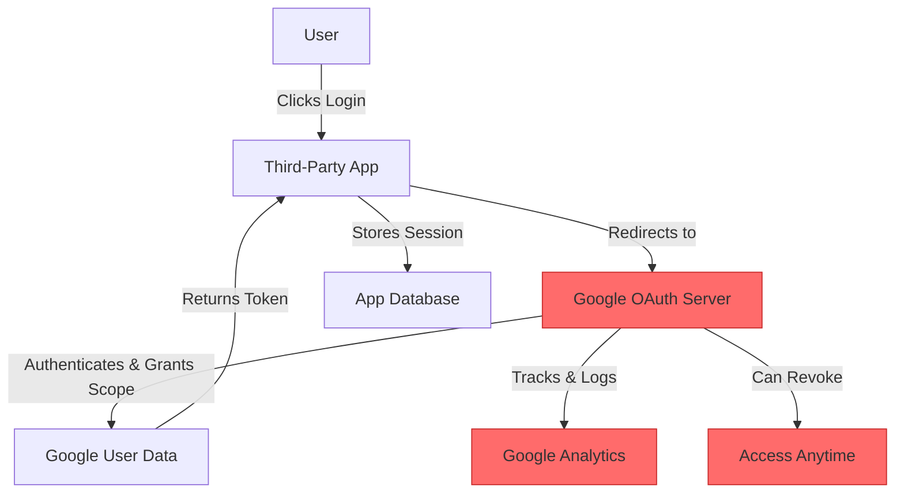
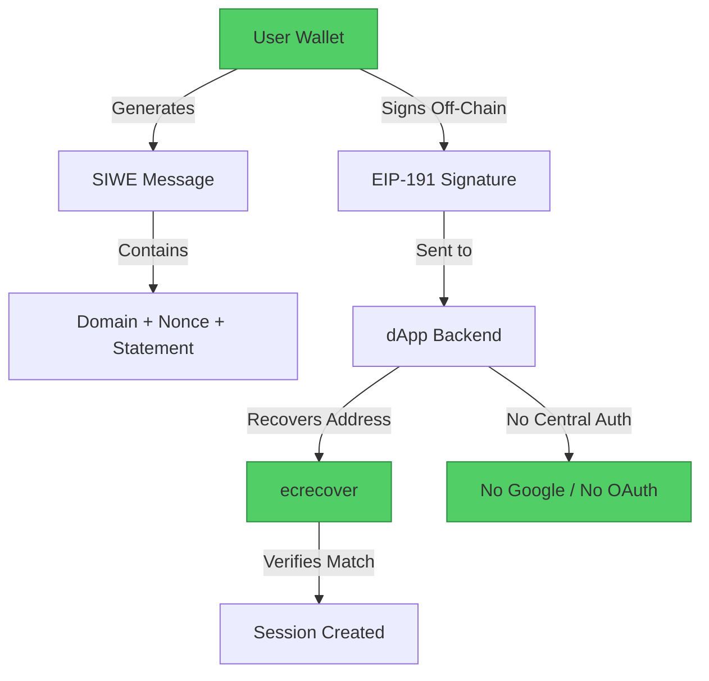

#  Google Login → SIWE (Sign-In with Ethereum) Migration Guide

> **Web2 Service:** Google Login / OAuth 2.0
> **Web3 Alternative:** SIWE (Sign-In with Ethereum - EIP-4361)
> **Difficulty:** ⭐⭐⭐ (Intermediate)
> **Time to Migrate:** 1-2 weeks for authentication system replacement

---

## 🎯 Overview

Google Login (OAuth 2.0) has become the de facto standard for web authentication, offering frictionless sign-in at the cost of total dependence on a single corporate gatekeeper. When you "Log in with Google," you are not just authenticating — you are delegating your identity, your email, your profile picture, and your session continuity to Alphabet Inc. If Google suspends your account, disables OAuth for your region, or decides to change its policies, you instantly lose access to every third-party service you've ever connected to. **SIWE (Sign-In with Ethereum)**, standardized as **EIP-4361**, shifts the paradigm from "trust Google with your identity" to "prove ownership of a cryptographic key." Your identity becomes self-sovereign, portable across every dApp, and completely independent of any central authority.

This guide shows you how to migrate from a centralized, OAuth-based authentication system to a decentralized, wallet-native, and self-sovereign identity stack using SIWE.

---

## ❌ The Web2 Problem: Google Login

### Key Issues

| Problem | Impact |
|---------|--------|
| **Single Point of Failure** | If Google disables your account, you lose access to every app you authenticated with Google Login |
| **Identity Ownership** | Your email, name, and profile picture belong to Google; they can modify, restrict, or delete them at will |
| **Privacy Erosion** | Google tracks every OAuth login, building a comprehensive map of your digital life across thousands of apps |
| **Regional Censorship** | Google can disable OAuth services in specific countries or for specific users based on compliance policies |
| **Platform Lock-in** | Your social graph, login history, and connected apps are trapped in Google's ecosystem |
| **Data Mining** | Google uses OAuth scopes to access your contacts, calendar, and emails, often without explicit user understanding |
| **Arbitrary Policy Changes** | Google can deprecate OAuth scopes, change token expiration rules, or ban third-party apps overnight |
| **No Portability** | You cannot take your "Google identity" to a competing platform; it's non-transferable |

### Real-World Example

In 2019, Google permanently disabled thousands of accounts in China and surrounding regions without warning, instantly cutting off users' access to third-party apps, services, and even their own purchased content. More recently, developers building on Google's OAuth have faced sudden deprecation of critical scopes (like Google+ API shutdown in 2019), forcing emergency migrations. In authoritarian regimes, governments routinely pressure Google to disable accounts of journalists and activists, which cascades into loss of access to all connected services.

---

## ✅ The Web3 Solution: SIWE (Sign-In with Ethereum)

### What is SIWE?

**SIWE (Sign-In with Ethereum)**, formalized as **EIP-4361**, is a standard for authenticating users via their Ethereum wallet. Instead of redirecting to Google's OAuth server, the dApp generates a structured message containing the domain, a nonce, and a statement. The user signs this message with their wallet (e.g., MetaMask). The backend verifies the signature against the Ethereum public key, confirming the user owns the address. No passwords, no email, no central authority — just cryptographic proof of key ownership.

### Key Benefits

| Benefit | How SIWE Solves It |
|---------|--------------------|
| **Self-Sovereign Identity** | You own your identity via your private key; no company can revoke it |
| **No Single Point of Failure** | Authentication works as long as you have your wallet; no Google servers involved |
| **Zero Privacy Leakage** | No email, name, or profile data is shared unless you explicitly choose to (e.g., via ENS) |
| **Universal Portability** | The same wallet address works across every SIWE-compliant dApp; no re-registration needed |
| **Censorship Resistance** | No central entity can block your login; the blockchain is permissionless |
| **No Passwords** | Eliminates phishing, credential stuffing, and password reuse vulnerabilities |
| **Composable Identity** | Your wallet address can be linked to ENS, Lens, Farcaster, and other Web3 identity layers |
| **No Gas Fees** | SIWE uses off-chain signatures (EIP-191); no blockchain transaction or gas is required |

---

## 🏗️ Architecture Comparison

### Google Login Architecture (Centralized)



### SIWE Architecture (Decentralized)



---

## 🛠️ Step-by-Step Migration

### Step 1: Install SIWE Libraries

Install the official `siwe` package for message generation and verification, along with `viem` (or `ethers`) for signature handling.

```javascript
// Install dependencies
npm install siwe viem express

// siwe handles message creation and verification
// viem handles wallet interactions and signature recovery
```

### Step 2: Generate a SIWE Message (Frontend)

The frontend constructs a SIWE message containing the domain, a unique nonce, and an optional statement. This message is presented to the user for signing.

```javascript
import { SiweMessage } from 'siwe';
import { createWalletClient, custom } from 'viem';
import { mainnet } from 'viem/chains';

async function initiateSIWELogin() {
  // 1. Fetch a nonce from your backend (prevents replay attacks)
  const nonceResponse = await fetch('https://your-api.com/api/auth/nonce');
  const { nonce } = await nonceResponse.json();

  // 2. Construct the SIWE message
  const message = new SiweMessage({
    domain: window.location.host,           // e.g., "mydapp.com"
    address: await getWalletAddress(),       // User's Ethereum address
    statement: 'Sign in with Ethereum to the app.',
    uri: window.location.origin,
    version: '1',
    chainId: 1,                              // Ethereum Mainnet (or any chain)
    nonce: nonce,                            // Unique per session
  });

  // 3. Prepare the message for signing
  const messageString = message.prepareMessage();
  console.log('📝 SIWE Message to sign:', messageString);

  return { message: messageString, siweMessage: message };
}

async function getWalletAddress() {
  const walletClient = createWalletClient({
    chain: mainnet,
    transport: custom(window.ethereum),
  });
  const [address] = await walletClient.getAddresses();
  return address;
}
```

### Step 3: Sign the Message with the Wallet

The user signs the SIWE message using their wallet. This is an **off-chain signature** (EIP-191), so it costs zero gas and is instant.

```javascript
async function signSIWEMessage(messageString) {
  const walletClient = createWalletClient({
    chain: mainnet,
    transport: custom(window.ethereum),
  });

  const [address] = await walletClient.getAddresses();

  // Request signature from the wallet
  const signature = await walletClient.signMessage({
    account: address,
    message: messageString,
  });

  console.log('✅ Message signed!');
  console.log(`Signature: ${signature}`);

  return signature;
}
```

### Step 4: Verify the Signature (Backend)

The backend receives the signed message and signature, then uses the `siwe` library to verify that the signature is valid and matches the claimed address.

```javascript
import { SiweMessage } from 'siwe';
import express from 'express';

const app = express();
app.use(express.json());

// In-memory nonce store (use Redis or DB in production)
const nonces = new Set();

// Endpoint to generate nonce
app.get('/api/auth/nonce', (req, res) => {
  const nonce = generateNonce(); // Use siwe's generateNonce()
  nonces.add(nonce);
  res.json({ nonce });
});

// Endpoint to verify SIWE signature
app.post('/api/auth/verify', async (req, res) => {
  try {
    const { message, signature } = req.body;

    // 1. Parse the SIWE message
    const siweMessage = new SiweMessage(message);

    // 2. Verify the signature
    const fields = await siweMessage.verify({
      signature,
      nonce: Array.from(nonces), // Check against stored nonces
    });

    // 3. Mark nonce as used (prevent replay)
    nonces.delete(siweMessage.nonce);

    // 4. Create a session (JWT or session cookie)
    const sessionToken = createJWT({
      address: fields.data.address,
      domain: fields.data.domain,
      nonce: fields.data.nonce,
    });

    console.log(`✅ User ${fields.data.address} authenticated!`);
    res.json({ token: sessionToken, address: fields.data.address });

  } catch (error) {
    console.error('❌ SIWE verification failed:', error);
    res.status(401).json({ error: 'Invalid signature or nonce' });
  }
});
```

### Step 5: Complete the Login Flow (Frontend)

The frontend sends the signed message and signature to the backend, receives the session token, and stores it for subsequent requests.

```javascript
async function completeSIWELogin() {
  try {
    // 1. Generate message
    const { message, siweMessage } = await initiateSIWELogin();

    // 2. Sign message
    const signature = await signSIWEMessage(message);

    // 3. Send to backend for verification
    const response = await fetch('https://your-api.com/api/auth/verify', {
      method: 'POST',
      headers: { 'Content-Type': 'application/json' },
      body: JSON.stringify({
        message: siweMessage.prepareMessage(),
        signature: signature,
      }),
    });

    const { token, address } = await response.json();

    // 4. Store session token
    localStorage.setItem('authToken', token);
    localStorage.setItem('userAddress', address);

    console.log(`🎉 Logged in as ${address}`);
    return { token, address };

  } catch (error) {
    console.error('❌ Login failed:', error);
  }
}
```

### Step 6: Protect Routes and Implement Logout

Use middleware to protect backend routes by verifying the JWT token. Logout simply clears the session — no need to "revoke" anything on-chain.

```javascript
import jwt from 'jsonwebtoken';

// Middleware to protect routes
function authenticateToken(req, res, next) {
  const token = req.headers['authorization']?.split(' ')[1];

  if (!token) {
    return res.status(401).json({ error: 'No token provided' });
  }

  try {
    const decoded = jwt.verify(token, process.env.JWT_SECRET);
    req.user = decoded; // { address, domain, nonce }
    next();
  } catch (error) {
    return res.status(403).json({ error: 'Invalid or expired token' });
  }
}

// Protected route example
app.get('/api/protected-data', authenticateToken, (req, res) => {
  res.json({
    message: `Hello, ${req.user.address}! This is protected data.`,
    address: req.user.address,
  });
});

// Logout endpoint (just clears the session)
app.post('/api/auth/logout', (req, res) => {
  // In a real app, you might blacklist the token
  console.log(`👋 User ${req.user?.address} logged out`);
  res.json({ message: 'Logged out successfully' });
});
```

---

## 📜 Full Migration Script

```javascript
// migrate-google-login-to-siwe.js
import { SiweMessage, generateNonce } from 'siwe';
import { createWalletClient, custom } from 'viem';
import { mainnet } from 'viem/chains';
import express from 'express';
import jwt from 'jsonwebtoken';

const app = express();
app.use(express.json());

class SIWEAuthSystem {
  constructor(jwtSecret) {
    this.jwtSecret = jwtSecret;
    this.nonces = new Set(); // Use Redis in production
    this.sessions = new Map(); // address -> session data
  }

  // Backend: Generate nonce
  generateNonce() {
    const nonce = generateNonce();
    this.nonces.add(nonce);
    return nonce;
  }

  // Backend: Verify SIWE signature
  async verify(messageString, signature) {
    try {
      const siweMessage = new SiweMessage(messageString);
      const fields = await siweMessage.verify({
        signature,
        nonce: Array.from(this.nonces),
      });

      // Mark nonce as used
      this.nonces.delete(siweMessage.nonce);

      // Create session
      const token = jwt.sign(
        {
          address: fields.data.address,
          domain: fields.data.domain,
          nonce: fields.data.nonce,
        },
        this.jwtSecret,
        { expiresIn: '7d' }
      );

      this.sessions.set(fields.data.address, {
        token,
        address: fields.data.address,
        createdAt: new Date().toISOString(),
      });

      return { success: true, token, address: fields.data.address };
    } catch (error) {
      return { success: false, error: error.message };
    }
  }

  // Backend: Authenticate middleware
  authenticate(req, res, next) {
    const token = req.headers['authorization']?.split(' ')[1];
    if (!token) return res.status(401).json({ error: 'No token' });

    try {
      const decoded = jwt.verify(token, this.jwtSecret);
      req.user = decoded;
      next();
    } catch {
      res.status(403).json({ error: 'Invalid token' });
    }
  }

  // Frontend: Full login flow
  async login() {
    // 1. Get nonce
    const nonceRes = await fetch('/api/auth/nonce');
    const { nonce } = await nonceRes.json();

    // 2. Get wallet address
    const walletClient = createWalletClient({
      chain: mainnet,
      transport: custom(window.ethereum),
    });
    const [address] = await walletClient.getAddresses();

    // 3. Create SIWE message
    const message = new SiweMessage({
      domain: window.location.host,
      address,
      statement: 'Sign in with Ethereum to the app.',
      uri: window.location.origin,
      version: '1',
      chainId: 1,
      nonce,
    });

    // 4. Sign message
    const messageString = message.prepareMessage();
    const signature = await walletClient.signMessage({
      account: address,
      message: messageString,
    });

    // 5. Verify with backend
    const verifyRes = await fetch('/api/auth/verify', {
      method: 'POST',
      headers: { 'Content-Type': 'application/json' },
      body: JSON.stringify({ message: messageString, signature }),
    });

    const result = await verifyRes.json();
    if (result.success) {
      localStorage.setItem('authToken', result.token);
      console.log(`✅ Logged in as ${result.address}`);
    }

    return result;
  }
}

// Usage
const auth = new SIWEAuthSystem(process.env.JWT_SECRET);

// Routes
app.get('/api/auth/nonce', (req, res) => {
  res.json({ nonce: auth.generateNonce() });
});

app.post('/api/auth/verify', async (req, res) => {
  const result = await auth.verify(req.body.message, req.body.signature);
  res.json(result);
});

app.get('/api/protected', auth.authenticate.bind(auth), (req, res) => {
  res.json({ message: `Welcome, ${req.user.address}!` });
});

// Frontend usage
// const auth = new SIWEAuthSystem();
// await auth.login();
```

---

## ⚖️ Trade-offs

| Aspect | Google Login (OAuth) | SIWE (EIP-4361) |
|--------|----------------------|-----------------|
| **User Experience** | One-click, familiar to billions | Requires wallet installation and understanding of signatures |
| **Setup Time** | 5 minutes (Google Cloud Console) | 1-2 hours (backend + frontend integration) |
| **Cost** | Free (but you pay with user data) | Free (no gas fees; off-chain signatures) |
| **Identity Ownership** | Google owns and controls your identity | You own your identity via your private key |
| **Privacy** | Google tracks all your logins | Zero data leakage; only your address is revealed |
| **Recovery** | Password reset via email/SMS | **No recovery** — lose seed phrase = lose identity |
| **Portability** | Locked to Google ecosystem | Works across every SIWE-compliant dApp |
| **Censorship** | Google can block you anytime | Permissionless; no one can block your login |
| **Adoption** | Universal (every website supports it) | Growing (mostly Web3-native apps) |
| **Phishing Resistance** | Moderate (OAuth redirect can be faked) | High (domain-bound signatures prevent phishing) |

---

## 🌍 Real-World Examples

### dApps Using SIWE
1. **Mirror.xyz**: Uses SIWE for all writer and reader authentication, tying publishing identity to ENS.
2. **Radicle**: Decentralized code collaboration platform using SIWE for developer identity.
3. **Spray Studio**: NFT minting platform using SIWE for wallet-native authentication.
4. **WalletConnect**: Uses SIWE-based standards for secure dApp connections.
5. **Snapshot**: Governance platform using SIWE for voter authentication.

### Migration Success Stories
- **Web3 Startups**: Replaced Google OAuth with SIWE to eliminate dependency on centralized identity providers, improving user trust and censorship resistance.
- **DAO Tooling**: Governance platforms migrated to SIWE to ensure that voting and proposal creation are tied to verifiable wallet addresses, not email accounts.
- **NFT Marketplaces**: Used SIWE to create seamless, wallet-native login experiences that align with the self-custodial ethos of NFT ownership.

---

## 🔒 Security Considerations

1. **Nonce Management**: Every SIWE message must include a unique, single-use nonce. Reusing nonces opens the door to replay attacks. Store nonces in Redis or a database with TTL.
2. **Domain Binding**: The `domain` field in the SIWE message must match the actual domain of the dApp. This prevents phishing sites from reusing signatures.
3. **Signature Verification**: Always use the official `siwe` library for verification. Custom implementations are prone to subtle bugs that can lead to authentication bypasses.
4. **Session Management**: SIWE only authenticates the initial login. You still need secure session management (JWT, HTTP-only cookies) for subsequent requests.
5. **Wallet Security**: The user's wallet is their identity. If their private key is compromised, an attacker can impersonate them on every SIWE-compliant dApp.
6. **Chain ID Validation**: Always validate the `chainId` in the SIWE message to prevent cross-chain replay attacks.
7. **Expiration**: SIWE messages should have an `expirationTime` to limit the window in which a signature can be used.

---

## 📚 Resources

### Official Documentation
- [EIP-4361: Sign-In with Ethereum](https://eips.ethereum.org/EIPS/eip-4361)
- [SIWE TypeScript Library](https://github.com/spruceid/siwe)
- [SIWE Official Website](https://login.xyz/)

### Developer Tools
- **siwe**: Official npm package for message creation and verification.
- **viem / ethers.js**: For wallet interactions and signature handling.
- **wagmi**: React hooks for SIWE integration in frontend apps.
- **Spruce ID**: Provides enterprise-grade SIWE solutions and consulting.

### Community
- [Ethereum Discord](https://discord.gg/ethereum)
- [Spruce ID Discord](https://discord.gg/spruce)
- [EIP-4361 Discussion](https://ethereum-magicians.org/t/eip-4361-sign-in-with-ethereum/7294)

---

## 🎓 Key Takeaways

1. **Identity sovereignty is fundamental**: SIWE gives users true ownership of their identity, eliminating dependence on Google or any other centralized provider.
2. **No gas, no friction**: SIWE uses off-chain signatures, so login is instant and free — just like OAuth, but without the privacy trade-offs.
3. **Nonce is critical**: Always generate and validate unique nonces to prevent replay attacks. This is the #1 security pitfall in SIWE implementations.
4. **Domain binding prevents phishing**: The `domain` field ensures that a signature created on `mydapp.com` cannot be reused on `mydapp-phishing.com`.
5. **Recovery is the trade-off**: Unlike Google Login, there is no "forgot password" in SIWE. Users must securely back up their seed phrase.
6. **Composable identity**: SIWE is the foundation for richer Web3 identity layers like ENS, Lens, and Verifiable Credentials.
7. **Hybrid is realistic**: For mainstream apps, offer both Google Login and SIWE. Let users choose based on their comfort level with Web3.

---

*Guide by [@Elvatar](https://github.com/Elvatar2) | Last updated: 2026*
*Part of the Web2 → Web3 Migration Guide series*