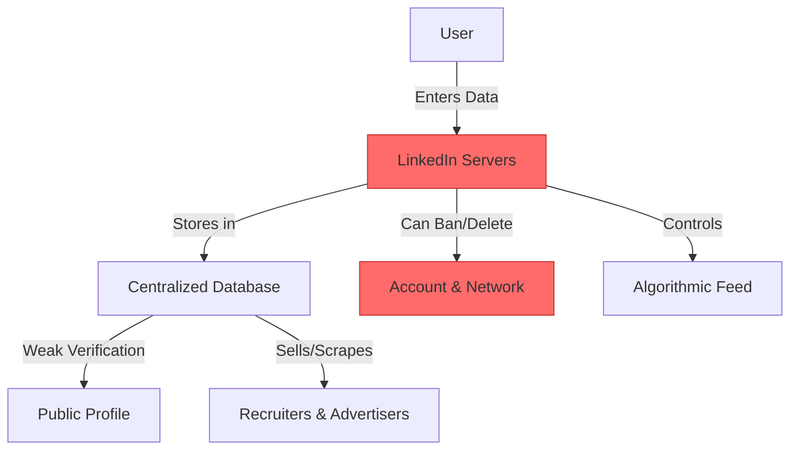
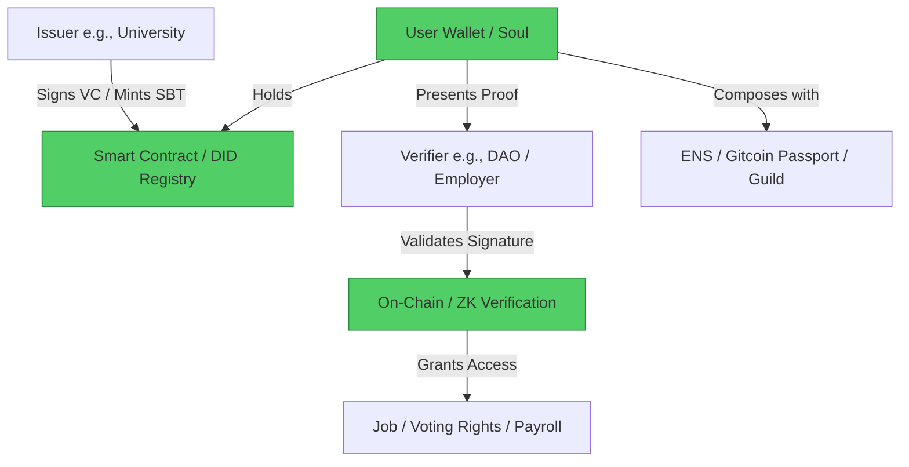

#  LinkedIn → SBT (Soulbound Tokens) & Decentralized Reputation Migration Guide

> **Web2 Service:** LinkedIn (Microsoft)
> **Web3 Alternative:** SBTs (Soulbound Tokens), Verifiable Credentials (VCs), & Decentralized Identity (DID)
> **Difficulty:** ⭐⭐⭐⭐ (Advanced)
> **Time to Migrate:** 4-8 weeks for credential mapping and network transition

---

## 🎯 Overview

LinkedIn is the dominant professional networking platform, but it operates as a centralized, easily gamified database. Users suffer from resume inflation, fake profiles, aggressive data scraping, and the constant risk of account suspension, which instantly erases years of professional networking. **Soulbound Tokens (SBTs)** and **Verifiable Credentials (VCs)** shift the paradigm by making professional achievements (degrees, work history, certifications) cryptographically verifiable, non-transferable, and permanently tied to a user's decentralized identity (DID).

This guide shows you how to migrate from a centralized, easily manipulated professional profile to a decentralized, trustless, and user-owned reputation system.

---

## ❌ The Web2 Problem: LinkedIn

### Key Issues

| Problem | Impact |
|---------|--------|
| **Resume Inflation & Fake Profiles** | Anyone can claim any title or company; verification is weak and easily bypassed |
| **Centralized Lock-in** | Your professional graph, endorsements, and messages are trapped in Microsoft's ecosystem |
| **Arbitrary Account Bans** | Automated algorithms frequently flag legitimate accounts as "fake," permanently deleting professional networks |
| **Data Scraping & Privacy** | LinkedIn aggressively scrapes and sells professional data; users have zero control over who views their detailed history |
| **Algorithmic Feed Manipulation** | Reach is throttled to push "LinkedIn Influencer" content and paid recruiter tools |
| **No Interoperability** | Your LinkedIn reputation cannot be natively used to apply for Web3 jobs, DAO roles, or DeFi undercollateralized loans |
| **Spam & Bot Networks** | Automated bots flood the platform with fake connection requests and irrelevant sales pitches |

### Real-World Example

In 2022, LinkedIn rolled out aggressive anti-bot measures that accidentally flagged and permanently banned thousands of legitimate users, including high-profile tech executives and recruiters. Affected users lost access to their entire network of 10,000+ connections and years of saved messages, with customer support offering no viable recovery path. Furthermore, the platform is routinely criticized for allowing users to falsely claim employment at major tech companies to game the algorithm.

---

## ✅ The Web3 Solution: SBTs & Decentralized Reputation

### What are SBTs and VCs?

**Soulbound Tokens (SBTs)**, proposed in EIP-5192, are non-transferable NFTs that represent commitments, credentials, or affiliations tied to a specific wallet ("Soul"). Combined with **Verifiable Credentials (VCs)** (W3C standard) and **Decentralized Identifiers (DIDs)**, they create a system where a trusted issuer (e.g., a university or former employer) cryptographically signs a credential. The user holds this credential in their wallet and can present it to anyone (or a Zero-Knowledge verifier) without relying on a central database.

### Key Benefits

| Benefit | How SBTs / VCs Solve It |
|---------|-------------------------|
| **Unforgeable Credentials** | Cryptographic signatures from issuers make fake degrees or job titles mathematically impossible |
| **True Ownership** | You hold your credentials in your wallet; no platform can delete or confiscate them |
| **Portable Reputation** | Your professional graph travels with you to any dApp, DAO, or Web3 job board |
| **Privacy-Preserving (ZK)** | Use Zero-Knowledge Proofs to prove you have a credential (e.g., "Over 18" or "Certified Developer") without revealing the underlying data |
| **Composability** | DAOs can automatically grant voting power or payroll access based on held SBTs |
| **Spam Resistance** | Require a minimum "reputation score" or specific SBT to interact, eliminating bot networks |
| **No Central Gatekeeper** | Issuers and holders interact directly via open protocols, bypassing LinkedIn's walled garden |

---

## 🏗️ Architecture Comparison

### LinkedIn Architecture (Centralized)



### SBT / Decentralized Reputation Architecture



---

## 🛠️ Step-by-Step Migration

### Step 1: Set Up Decentralized Identity (DID)

Establish your base identity using an ENS domain and a decentralized profile protocol like Ceramic or Lens, which will act as the anchor for your SBTs.

```javascript
// Install dependencies
npm install viem @ensdomains/ensjs

import { createWalletClient, custom } from 'viem';
import { mainnet } from 'viem/chains';

const walletClient = createWalletClient({
  chain: mainnet,
  transport: custom(window.ethereum)
});

async function setupProfessionalDID(ensName) {
  console.log(`Anchoring professional identity to: ${ensName}.eth`);
  // In production: Register ENS, set up Ceramic DID, link social accounts
  return `${ensName}.eth`;
}
```

### Step 2: Define a Verifiable Credential Schema

Define the structure of the professional credential (e.g., "Software Engineer at Company X"). This follows the W3C Verifiable Credential data model.

```javascript
const workExperienceSchema = {
  "@context": ["https://www.w3.org/2018/credentials/v1"],
  "type": ["VerifiableCredential", "EmploymentCredential"],
  "credentialSubject": {
    "type": "Employee",
    "jobTitle": "string",
    "company": "string",
    "startDate": "string",
    "endDate": "string"
  }
};
```

### Step 3: Issue and Mint the SBT (Issuer Side)

An authorized issuer (e.g., a company's HR wallet) mints a non-transferable SBT to the employee's wallet address.

```solidity
// SPDX-License-Identifier: MIT
pragma solidity ^0.8.20;

import "@openzeppelin/contracts/token/ERC721/ERC721.sol";

contract SoulboundCredential is ERC721 {
    // Mapping to track if a token is soulbound (non-transferable)
    mapping(uint256 => bool) public isSoulbound;

    constructor() ERC721("Professional Credential", "PROFCRED") {}

    // Only authorized issuer can mint
    function mintCredential(address to, uint256 tokenId, string memory uri) external {
        // Add require(isAuthorizedIssuer(msg.sender)) in production
        _mint(to, tokenId);
        isSoulbound[tokenId] = true;
        // In a real scenario, 'uri' points to the encrypted/signed VC metadata on IPFS
    }

    // Disable all transfers to enforce Soulbound property
    function _beforeTokenTransfer(address from, address to, uint256 tokenId, uint256 batchSize) internal pure override {
        require(from == address(0) || to == address(0), "Soulbound: Transfer not allowed");
        super._beforeTokenTransfer(from, to, tokenId, batchSize);
    }
}
```

### Step 4: Verify Credentials (Verifier Side)

A DAO or employer verifies that the user holds the required SBT before granting access to a job application portal or governance vote.

```javascript
import { createPublicClient, http } from 'viem';
import { mainnet } from 'viem/chains';

const publicClient = createPublicClient({
  chain: mainnet,
  transport: http(),
});

const sbtContractAddress = '0xYourSoulboundContractAddress';

async function verifyEmploymentCredential(userAddress, expectedTokenId) {
  // Check if the user actually owns the SBT
  const owner = await publicClient.readContract({
    address: sbtContractAddress,
    abi: [{ name: 'ownerOf', type: 'function', inputs: [{ name: 'tokenId', type: 'uint256' }], outputs: [{ name: '', type: 'address' }] }],
    functionName: 'ownerOf',
    args: [BigInt(expectedTokenId)],
  });

  if (owner.toLowerCase() === userAddress.toLowerCase()) {
    console.log(`✅ Credential verified! User holds SBT #${expectedTokenId}`);
    return true;
  } else {
    console.log(`❌ Verification failed. User does not own this SBT.`);
    return false;
  }
}
```

### Step 5: Add Zero-Knowledge Privacy (Optional but Recommended)

Allow users to prove they have a credential without revealing their exact employer or wallet address publicly, using ZK proofs (e.g., via Semaphore or ZK-Sync).

```javascript
// Conceptual: Using a ZK identity protocol like Semaphore
async function proveEmploymentWithoutRevealingCompany(userZkIdentity, groupId) {
  // Generate a proof that "I am a member of the 'Verified Tech Workers' group"
  // without revealing *which* specific company issued my SBT.
  const proof = await generateZKProof(userZkIdentity, groupId);
  console.log("🔒 ZK Proof generated. Privacy preserved.");
  return proof;
}
```

### Step 6: Migrate Your LinkedIn Network

1. **Export Data**: Use LinkedIn's "Data Export" feature to get your connections and experience CSV.
2. **Claim SBTs**: Partner with former employers or educational institutions to issue SBTs/VCs for your past roles. Alternatively, use platforms like **Guild.xyz** or **Galxe** to claim community-based reputation tokens.
3. **Update Profiles**: Add your ENS name and a link to your decentralized portfolio (e.g., a custom frontend reading your SBTs) to your remaining Web2 profiles.
4. **Incentivize Connections**: Offer a "Verified Connection" SBT to colleagues who connect with you on-chain, bootstrapping your decentralized graph.

---

## 📜 Full Migration Script

```javascript
// migrate-linkedin-to-sbt.js
import { createWalletClient, createPublicClient, custom, http } from 'viem';
import { mainnet } from 'viem/chains';
import fs from 'fs';

class LinkedInToSBTMigrator {
  constructor(issuerPrivateKey, sbtContractAddress) {
    this.account = issuerPrivateKey; // In production, use a secure KMS or Hardware Wallet
    this.sbtAddress = sbtContractAddress;

    this.walletClient = createWalletClient({
      account: this.account,
      chain: mainnet,
      transport: custom(window.ethereum) // Or HTTP for backend
    });

    this.publicClient = createPublicClient({
      chain: mainnet,
      transport: http()
    });
  }

  async issueCredential(employeeAddress, tokenId, ipfsUri) {
    console.log(`🎓 Issuing SBT to ${employeeAddress}...`);

    // Simplified contract interaction (requires actual ABI)
    const hash = await this.walletClient.writeContract({
      address: this.sbtAddress,
      abi: [{ name: 'mintCredential', type: 'function', inputs: [{name: 'to', type: 'address'}, {name: 'tokenId', type: 'uint256'}, {name: 'uri', type: 'string'}] }],
      functionName: 'mintCredential',
      args: [employeeAddress, BigInt(tokenId), ipfsUri],
      account: this.account,
    });

    console.log(`✅ SBT Minted! Tx: ${hash}`);
    return hash;
  }

  async processLinkedInExport(csvPath) {
    console.log(`\n📂 Processing LinkedIn export: ${csvPath}`);
    // In a real scenario, parse the CSV to extract verified past employers
    // and match them with known Web3 issuer addresses.

    const mockEmployees = [
      { address: '0xEmployee1...', tokenId: 1, role: 'Software Engineer', issuerUri: 'ipfs://Qm...' },
      { address: '0xEmployee2...', tokenId: 2, role: 'Product Manager', issuerUri: 'ipfs://Qm...' }
    ];

    for (const emp of mockEmployees) {
      await this.issueCredential(emp.address, emp.tokenId, emp.issuerUri);
    }

    console.log('🎉 Batch credential issuance complete!');
  }
}

// Usage
// const migrator = new LinkedInToSBTMigrator(process.env.ISSUER_PK, '0xSoulboundContract');
// migrator.processLinkedInExport('./linkedin_connections.csv');
```

---

## ⚖️ Trade-offs

| Aspect | LinkedIn | SBTs / Decentralized Reputation |
|--------|----------|---------------------------------|
| **User Experience** | Frictionless, familiar, rich UI | Requires wallet setup, understanding of VCs/SBTs |
| **Network Effects** | Massive (900M+ users), easy to find anyone | Nascent, requires bootstrapping within Web3/tech circles |
| **Verification** | Weak (self-reported, easily faked) | Cryptographically strong (issuer-signed, unforgeable) |
| **Privacy** | Low (data scraped, sold, and profile is public) | High (ZK proofs allow selective disclosure of credentials) |
| **Ownership** | Microsoft owns the graph and can delete it | User owns the credentials in their self-custodial wallet |
| **Interoperability** | None (walled garden) | High (composable with DAOs, DeFi, and Web3 job boards) |
| **Recovery** | Email/SMS password reset | **None** (loss of seed phrase = loss of all credentials) |
| **Cost** | Free for users (monetized via data/recruiters) | Gas fees for minting (can be subsidized by issuers via Account Abstraction) |

---

## 🌍 Real-World Examples

### Platforms & Protocols
1. **Guild.xyz**: Allows DAOs and communities to gate access based on token holdings, NFTs, or verified roles, acting as a decentralized reputation manager.
2. **Gitcoin Passport**: Aggregates various verifiable credentials (GH username, ENS, POAPs) into a single "trust score" to prevent Sybil attacks.
3. **BrightID**: A decentralized social identity network that verifies unique human users without relying on government IDs or corporate accounts.
4. **Spruce ID**: Provides tools for developers to integrate Sign-In with Ethereum (SIWE) and Verifiable Credentials into their applications.

### Migration Success Stories
- **Web3 Native Companies**: Projects like *Bankless* or *Ethereum Foundation* use SBTs (like POAPs or contributor badges) as the primary resume for hiring, valuing on-chain proof of work over a polished LinkedIn profile.
- **University Pilots**: Institutions like MIT and the University of Nicosia issue blockchain-based diplomas (VCs), allowing graduates to instantly prove their degree to employers without contacting the registrar.
- **Freelance Platforms**: Decentralized alternatives to Upwork use SBTs to verify a freelancer's past job completion ratings, making their reputation portable across different Web3 job boards.

---

## 🔒 Security Considerations

1. **Issuer Key Management**: The entity issuing SBTs must secure its private keys rigorously. If an issuer's key is compromised, attackers can mint fake credentials, destroying the issuer's reputation.
2. **Soulbound Enforcement**: Ensure the smart contract strictly overrides `_beforeTokenTransfer` (ERC721) or `_update` (ERC1155) to prevent the accidental or malicious transfer of the credential.
3. **Metadata Privacy**: Do not store sensitive personal data (PII) directly on-chain. Store a hash or a Zero-Knowledge proof on-chain, and keep the actual data encrypted on IPFS or with the user.
4. **Sybil Resistance**: The system is only as strong as its issuers. Implement robust KYC or cryptographic verification at the *issuance* stage to prevent fake SBTs.
5. **Phishing**: Users must be educated to only sign credential-claiming transactions from verified, official issuer domains.

---

## 📚 Resources

### Official Documentation
- [EIP-5192: Minimal Soulbound Tokens](https://eips.ethereum.org/EIPS/eip-5192)
- [W3C Verifiable Credentials Data Model](https://www.w3.org/TR/vc-data-model/)
- [Gitcoin Passport Docs](https://docs.passport.gitcoin.co/)

### Developer Tools
- **Spruce ID**: Best-in-class libraries for SIWE and Verifiable Credentials.
- **Guild.xyz API**: For easily managing role-based access and reputation gating.
- **Semaphore**: For building Zero-Knowledge identity and reputation proofs.
- **Ceramic Network**: For storing mutable, user-owned profile data linked to SBTs.

### Community
- [Ethereum Magicians (Identity)](https://ethereum-magicians.org/)
- [Spruce ID Discord](https://discord.gg/spruce)
- [Gitcoin Discord](https://discord.gg/gitcoin)

---

## 🎓 Key Takeaways

1. **Proof over Claims**: Web3 shifts professional reputation from "what you say on your profile" to "what you can cryptographically prove."
2. **Portability is Power**: Your credentials are no longer locked in Microsoft's database. You can take them to any DAO, job board, or DeFi protocol.
3. **Privacy via ZK**: You don't have to expose your entire work history to prove you are qualified. Zero-Knowledge proofs enable "proof of employment" without revealing the employer.
4. **Issuers hold the responsibility**: The trust model shifts from the platform (LinkedIn) to the issuer (University/Company). Secure key management for issuers is paramount.
5. **Network effects take time**: LinkedIn's value is its scale. Migrating requires actively building your decentralized graph through Web3-native communities first.
6. **Hybrid approach**: Maintain a basic LinkedIn profile for Web2 recruiters, but use your decentralized portfolio (ENS + SBTs) as the primary, verifiable source of truth for Web3 and forward-thinking tech companies.
7. **The future of work is composable**: Imagine applying for a loan or a job, and your dApp automatically reads your SBTs to approve you in milliseconds, without a human reviewer.

---

*Guide by [@Elvatar](https://github.com/Elvatar2) | Last updated: 2026*
*Part of the Web2 → Web3 Migration Guide series*