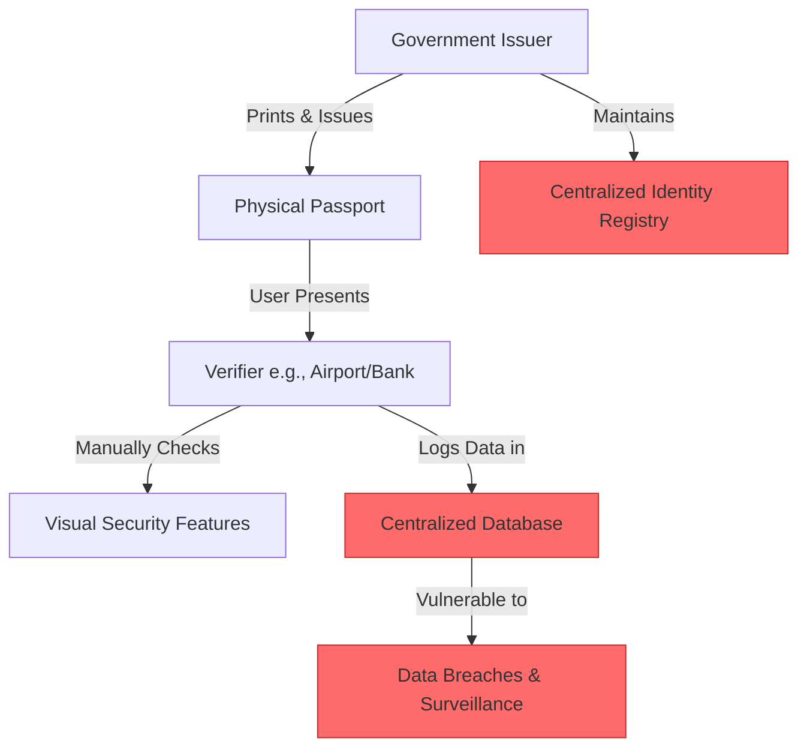
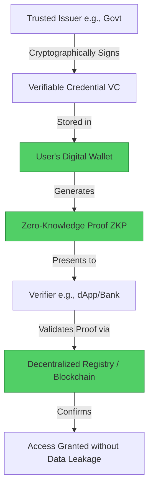

#  Traditional Passport → Decentralized Identity (DID) Migration Guide

> **Web2 Service:** Traditional Passport / National ID (Government-Issued Physical Documents)
> **Web3 Alternative:** Decentralized Identity (DID) & Verifiable Credentials (VCs) / Self-Sovereign Identity (SSI)
> **Difficulty:** ⭐⭐⭐⭐ (Advanced)
> **Time to Migrate:** 6-12 months for comprehensive digital identity setup and ecosystem adoption

---

## 🎯 Overview

Traditional passports and national IDs are the bedrock of modern identification, but they are fundamentally flawed: they are physical, easily lost or stolen, rely on centralized government databases vulnerable to breaches, and force users to expose excessive personal information (e.g., showing your full birthdate and address just to prove you are over 18). **Decentralized Identity (DID)** and **Verifiable Credentials (VCs)** shift the paradigm to Self-Sovereign Identity (SSI). In this model, you hold cryptographically signed credentials in a digital wallet. You can prove specific claims (like age or citizenship) using Zero-Knowledge Proofs (ZKPs) without revealing the underlying data, and no central authority can revoke your wallet or track your verification history.

This guide shows you how to migrate from a fragile, privacy-invasive, centralized identity model to a secure, private, and user-owned decentralized identity stack.

---

## ❌ The Web2 Problem: Traditional Passport / National ID

### Key Issues

| Problem | Impact |
|---------|--------|
| **Physical Vulnerability** | Passports can be lost, stolen, or damaged, leading to identity theft and costly, slow replacement processes |
| **Centralized Data Breaches** | Government databases (e.g., OPM hack, national ID leaks) expose millions of citizens' sensitive PII (Personally Identifiable Information) |
| **Over-Sharing of Data** | Proving you are over 18 requires handing over a card that also reveals your exact birthdate, address, and ID number |
| **Lack of Portability** | Cross-border verification is slow, requiring physical inspections, embassies, or centralized APIs (like ICAO PKD) |
| **Exclusion** | Over 1 billion people globally lack official ID, locking them out of banking, healthcare, and digital services |
| **Surveillance & Tracking** | Every time you scan your ID, a centralized log is created, enabling mass surveillance and profiling |
| **Single Point of Failure** | If the issuing authority's systems go down or your record is corrupted, you cease to "exist" digitally |

### Real-World Example

In 2015, the US Office of Personnel Management (OPM) breach exposed the sensitive data (including fingerprints and background check details) of 21.5 million federal employees. Similarly, in 2021, a massive leak in the Dominican Republic exposed the national ID data of nearly all citizens. In both cases, victims had no way to "rotate" their identity, leaving them permanently vulnerable to fraud.

---

## ✅ The Web3 Solution: Decentralized Identity (DID)

### What is DID and Verifiable Credentials?

A **Decentralized Identifier (DID)** is a globally unique, user-controlled identifier (e.g., `did:ethr:0x...`) that is not tied to any central registry. **Verifiable Credentials (VCs)** are the digital equivalent of physical credentials (like a passport or university degree), cryptographically signed by an issuer (e.g., a government or university). The user stores these VCs in a digital wallet. When a verifier (e.g., a bank or website) needs to check something, the user presents a **Zero-Knowledge Proof (ZKP)**, mathematically proving the claim (e.g., "I am over 18") without revealing the actual birthdate or the credential itself.

### Key Benefits

| Benefit | How DID / VCs Solve It |
|---------|------------------------|
| **Self-Sovereignty** | You own and control your identity data; no company or government can delete your wallet |
| **Minimal Disclosure (ZKP)** | Prove specific claims (age, citizenship) without revealing the underlying raw data |
| **Phishing Resistance** | Credentials are cryptographically bound to the issuer; they cannot be forged or photoshopped |
| **Global Portability** | DIDs and VCs are based on open W3C standards, working across borders and platforms instantly |
| **Privacy by Design** | Verifiers do not need to store your data; they only verify the cryptographic proof, eliminating honeypot databases |
| **Inclusivity** | Anyone with a smartphone can generate a DID, providing a foundational identity for the unbanked/unidentified |
| **Revocability without Tracking** | Issuers can revoke a credential (e.g., expired passport) via a decentralized registry without knowing *where* or *when* you used it |

---

## 🏗️ Architecture Comparison

### Traditional Passport Architecture (Centralized)



### Decentralized Identity Architecture (Self-Sovereign)



---

## 🛠️ Step-by-Step Migration

### Step 1: Generate a Decentralized Identifier (DID)

Create a self-sovereign identity. This can be tied to your Ethereum wallet (e.g., `did:ethr`) or a standalone cryptographic key pair managed by a secure mobile wallet.

```javascript
// Install didkit for DID and VC operations
npm install @spruceid/didkit-wasm

import * as DIDKit from '@spruceid/didkit-wasm';

async function generateDID() {
  // Generate a new Ed25519 keypair
  const key = await DIDKit.generateEd25519Key();

  // Derive the DID from the key
  const did = await DIDKit.keyToDID('key', key);
  const verificationMethod = await DIDKit.keyToVerificationMethod('key', key);

  console.log(`✅ DID Generated: ${did}`);
  console.log(`🔑 Verification Method: ${verificationMethod}`);

  // IMPORTANT: Securely store the 'key' (seed phrase/private key)
  return { did, key, verificationMethod };
}
```

### Step 2: Obtain a Verifiable Credential (VC)

Request a credential from a trusted issuer (e.g., a government portal, university, or KYC provider). The issuer signs the data with their private key.

```javascript
// Example: Simulating an issuer creating a VC for a user
async function issueAgeCredential(issuerDid, issuerKey, subjectDid, birthdate) {
  const credential = {
    "@context": ["https://www.w3.org/2018/credentials/v1"],
    "type": ["VerifiableCredential", "AgeVerificationCredential"],
    "issuer": issuerDid,
    "issuanceDate": new Date().toISOString(),
    "credentialSubject": {
      "id": subjectDid,
      "birthdate": birthdate
    }
  };

  // Sign the credential
  const proofOptions = JSON.stringify({ proofPurpose: "assertionMethod" });
  const signedVC = await DIDKit.issueCredential(
    JSON.stringify(credential),
    proofOptions,
    issuerKey
  );

  console.log("✅ Verifiable Credential Issued and Signed");
  return signedVC;
}
```

### Step 3: Store Credentials in a Secure Digital Wallet

The user receives the signed VC and stores it locally in their mobile or browser wallet (e.g., Polygon ID Wallet, Civic, or a custom DID wallet). It is *not* stored on a central server.

```javascript
// Conceptual: Saving VC to local secure storage (e.g., IndexedDB or Secure Enclave)
function storeCredentialInWallet(signedVC) {
  const walletDB = localStorage.getItem('did_wallet'); // Use secure storage in production
  const credentials = walletDB ? JSON.parse(walletDB) : [];
  credentials.push(JSON.parse(signedVC));
  localStorage.setItem('did_wallet', JSON.stringify(credentials));
  console.log("🔒 Credential securely stored in local wallet.");
}
```

### Step 4: Generate a Zero-Knowledge Proof (ZKP) for Verification

When a service needs to verify your age, you don't send the VC. You generate a ZKP proving the VC is valid and the claim (e.g., `age >= 18`) is true, without revealing the `birthdate`.

```javascript
// Conceptual ZKP generation (using a library like SnarkJS or Polygon ID)
async function generateAgeProof(signedVC, minimumAge) {
  console.log(`🔍 Generating ZK Proof: Age >= ${minimumAge}`);

  // 1. Verify the VC signature locally first
  const isValid = await DIDKit.verifyCredential(signedVC, JSON.stringify({ proofPurpose: "assertionMethod" }));
  if (isValid !== '{"checks":["proof"],"warnings":[],"errors":[]}') {
    throw new Error("Invalid Credential Signature");
  }

  // 2. Generate ZK Proof (Simplified representation)
  const zkProof = {
    proof: "0x1a2b3c4d...", // Cryptographic proof
    publicSignals: {
      isOver18: true,
      issuerDid: "did:ethr:0xIssuer..."
    }
  };

  console.log("✅ ZK Proof generated. No raw data exposed.");
  return zkProof;
}
```

### Step 5: Verify the Proof (Verifier Side)

The relying party (e.g., a Web3 dApp or traditional bank) verifies the ZKP against the decentralized registry to ensure the issuer is valid and the proof is authentic.

```javascript
async function verifyAgeProof(zkProof, trustedIssuers) {
  // 1. Check if the issuer is in the trusted list (e.g., via a smart contract registry)
  const isTrusted = trustedIssuers.includes(zkProof.publicSignals.issuerDid);

  if (!isTrusted) {
    throw new Error("Untrusted Issuer");
  }

  // 2. Verify the ZK proof mathematically (e.g., via a smart contract or local verifier)
  const isValidProof = await localZKVerifier.verify(zkProof.proof, zkProof.publicSignals);

  if (isValidProof && zkProof.publicSignals.isOver18) {
    console.log("✅ Access Granted: User is verified and over 18.");
    return true;
  } else {
    console.log("❌ Access Denied: Proof invalid or age requirement not met.");
    return false;
  }
}
```

### Step 6: Migrate Your Real-World Identity

1. **Identify Supported Issuers**: Check if your country, university, or employer supports W3C Verifiable Credentials (e.g., Switzerland's "E-ID", MIT's digital diplomas).
2. **Set Up a DID Wallet**: Install a self-custodial identity wallet (e.g., Polygon ID, Tangem, or Spruce).
3. **Request Digital Credentials**: Apply for digital versions of your existing IDs through official government or institutional portals.
4. **Use for Web3 & Web2 Services**: Start using your DID to log into Web3 dApps (via SIWE) and Web2 services that support passwordless, privacy-preserving login (e.g., using Civic or Worldcoin).

---

## 📜 Full Migration Script

```javascript
// migrate-passport-to-did.js
import * as DIDKit from '@spruceid/didkit-wasm';

class PassportToDIDMigrator {
  constructor() {
    this.userKey = null;
    this.userDid = null;
  }

  async initializeIdentity() {
    console.log("🔑 Generating Self-Sovereign Identity...");
    this.userKey = await DIDKit.generateEd25519Key();
    this.userDid = await DIDKit.keyToDID('key', this.userKey);
    console.log(`✅ Identity Created: ${this.userDid}`);
  }

  async simulateGovernmentIssuance(birthdate) {
    console.log("\n🏛️ Simulating Government Issuance of Age Credential...");
    const issuerKey = await DIDKit.generateEd25519Key();
    const issuerDid = await DIDKit.keyToDID('key', issuerKey);

    const credential = {
      "@context": ["https://www.w3.org/2018/credentials/v1"],
      "type": ["VerifiableCredential", "GovernmentID"],
      "issuer": issuerDid,
      "issuanceDate": new Date().toISOString(),
      "credentialSubject": {
        "id": this.userDid,
        "birthdate": birthdate,
        "nationality": "Global"
      }
    };

    const signedVC = await DIDKit.issueCredential(
      JSON.stringify(credential),
      JSON.stringify({ proofPurpose: "assertionMethod" }),
      issuerKey
    );

    console.log("✅ Credential signed and issued to user wallet.");
    return { signedVC, issuerDid };
  }

  async verifyAgeWithoutRevealingBirthdate(signedVC, issuerDid, minimumAge) {
    console.log(`\n🔍 User requesting access: Proving age >= ${minimumAge} without revealing birthdate...`);

    // 1. Verify VC integrity
    const verification = await DIDKit.verifyCredential(
      signedVC,
      JSON.stringify({ proofPurpose: "assertionMethod" })
    );

    if (verification.includes('"errors":[]')) {
      console.log("✅ Cryptographic signature is valid.");

      // 2. Conceptual ZK check (in production, use SnarkJS / Polygon ID)
      const vcData = JSON.parse(signedVC);
      const birthYear = new Date(vcData.credentialSubject.birthdate).getFullYear();
      const currentYear = new Date().getFullYear();
      const isOverAge = (currentYear - birthYear) >= minimumAge;

      if (isOverAge) {
        console.log("✅ ZK Proof validated: User is old enough. Access GRANTED.");
        console.log("🔒 Note: The verifier NEVER saw the actual birthdate.");
        return true;
      }
    }

    console.log("❌ Verification failed.");
    return false;
  }
}

// Usage
async function runMigration() {
  const migrator = new PassportToDIDMigrator();
  await migrator.initializeIdentity();

  const { signedVC, issuerDid } = await migrator.simulateGovernmentIssuance("1990-05-15");
  await migrator.verifyAgeWithoutRevealingBirthdate(signedVC, issuerDid, 18);
}

// runMigration();
```

---

## ⚖️ Trade-offs

| Aspect | Traditional Passport / National ID | Decentralized Identity (DID + VC) |
|--------|------------------------------------|-----------------------------------|
| **Ownership** | Issuing government owns the record | User owns the credential in their wallet |
| **Privacy** | Low (full data exposed on every scan) | High (Zero-Knowledge Proofs enable minimal disclosure) |
| **Security** | Vulnerable to physical theft and central DB breaches | Cryptographically secure; no central honeypot to hack |
| **Recovery** | In-person visit to government office with secondary ID | Complex; requires secure social recovery or multi-sig backup |
| **Global Acceptance** | Universal (ICAO standard) | Nascent (growing in Web3, specific Web2 enterprises, and pilot govt programs) |
| **Revocation** | Instant via central database flag | Requires decentralized status registries (e.g., smart contract revocation lists) |
| **Cost to User** | High (application fees, renewal fees, travel) | Low (one-time wallet setup, minimal gas fees for on-chain anchoring) |
| **Inclusivity** | Excludes ~1 billion unbanked/unidentified people | High (only requires a basic smartphone and internet) |

---

## 🌍 Real-World Examples

### Platforms & Protocols
1. **Polygon ID**: A privacy-preserving identity system using ZK-Smart Contracts, allowing users to prove credentials without revealing data.
2. **Worldcoin**: Uses biometric (iris) scanning to generate a unique `World ID` (a ZK-based proof of personhood), preventing Sybil attacks.
3. **Civic**: A long-standing identity verification platform that issues reusable, cryptographically sealed identity credentials to users' mobile wallets.
4. **Spruce ID**: Provides open-source tools (like `didkit`) to bridge Web2 identity providers with Web3 DIDs and Verifiable Credentials.
5. **Estonia e-Residency**: While not fully decentralized, it is the closest Web2 equivalent, using blockchain-backed KSI technology to secure digital identity and records.

### Migration Success Stories
- **University Diplomas**: MIT and the University of Nicosia issue blockchain-based VCs. Graduates can instantly prove their degree to employers globally without waiting for registrar verification.
- **DeFi Compliance**: Protocols like Aave or Uniswap are exploring DID/VC integrations to allow institutional users to prove they are not from sanctioned jurisdictions (via ZK proofs) without revealing their actual nationality or wallet balance.
- **Refugee Identity**: NGOs are piloting DID solutions to give refugees a portable, tamper-proof identity that survives border crossings, enabling access to banking and aid without relying on lost physical documents.

---

## 🔒 Security Considerations

1. **Key Management is Critical**: Losing your DID private key means losing your identity. Implement robust recovery mechanisms (e.g., Social Recovery, Multi-Party Computation (MPC), or hardware security modules).
2. **Issuer Trust**: A VC is only as trustworthy as the issuer. Relying parties must maintain a strict registry of trusted issuer DIDs (e.g., only accepting credentials from recognized government or institutional DIDs).
3. **ZK Implementation Flaws**: Custom Zero-Knowledge circuits can have mathematical vulnerabilities. Always use audited, standard libraries (like SnarkJS, Circom, or Polygon ID).
4. **Metadata Leakage**: Even if the credential data is hidden, the *act* of verification can leak metadata (e.g., IP address, timestamp). Use anonymizing networks (like Tor) or relay services for high-privacy use cases.
5. **Revocation Complexity**: Ensure the VC standard used supports efficient, privacy-preserving revocation (e.g., Status List 2021), so expired or compromised credentials are rejected.

---

## 📚 Resources

### Official Documentation
- [W3C Decentralized Identifiers (DID) v1.0](https://www.w3.org/TR/did-core/)
- [W3C Verifiable Credentials Data Model v1.1](https://www.w3.org/TR/vc-data-model/)
- [DIF (Decentralized Identity Foundation)](https://identity.foundation/)

### Developer Tools
- **SpruceID `didkit`**: The most comprehensive Rust/WASM library for DID and VC operations.
- **Polygon ID**: Complete SDK for issuing, holding, and verifying ZK-based credentials.
- **Veramo**: A modular framework for building decentralized identity agents and applications.
- **SnarkJS / Circom**: For building and verifying custom Zero-Knowledge circuits.

### Community
- [Decentralized Identity Foundation (DIF) Slack](https://identity.foundation/)
- [Ethereum Magicians (Identity & Privacy)](https://ethereum-magicians.org/)
- [Polygon ID Discord](https://discord.gg/polygonid)

---

## 🎓 Key Takeaways

1. **Self-Sovereignty is the end goal**: You should be the sole custodian of your identity, not a government database or a tech corporation.
2. **Zero-Knowledge is the killer feature**: Proving a fact without revealing the underlying data is the single biggest privacy advancement since encryption.
3. **Interoperability is mandated by design**: W3C standards ensure your DID and VCs work across different blockchains, apps, and even national borders.
4. **Recovery is the hardest problem**: Web3 identity shifts the burden of security to the user. Robust, user-friendly key recovery (like MPC or social recovery) is essential for mass adoption.
5. **Trust shifts to the Issuer**: The system doesn't eliminate trust; it decentralizes it. You must trust the issuer's key management and verification processes.
6. **Hybrid transition is inevitable**: Physical passports won't disappear overnight. The near future involves "Digital Wallets" on your phone that hold both government-issued VCs and traditional Web3 credentials.
7. **You are building the future of human coordination**: Migrating to DID isn't just a technical upgrade; it's a fundamental step toward a more private, inclusive, and user-centric digital society.

---

*Guide by [@Elvatar](https://github.com/Elvatar2) | Last updated: 2026*
*Part of the Web2 → Web3 Migration Guide series*
