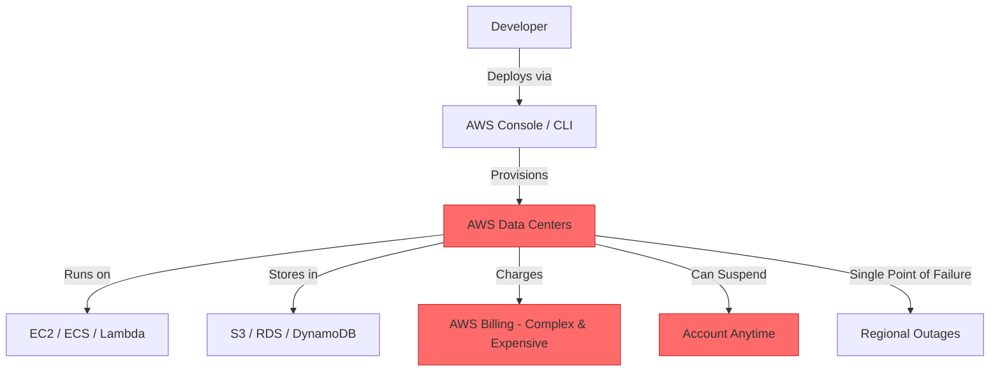
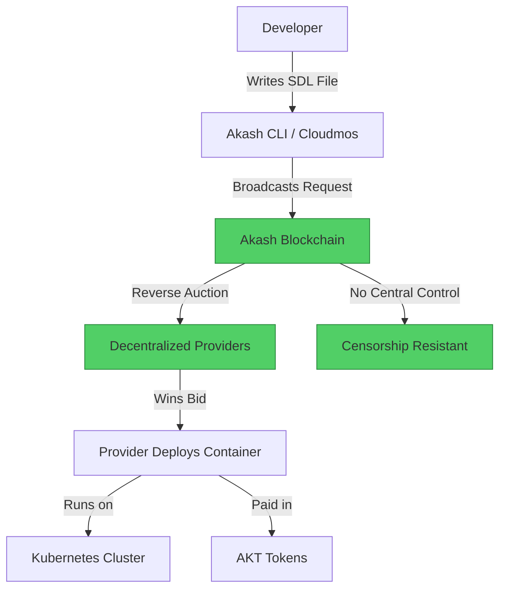

#  AWS → Akash Network Migration Guide

> **Web2 Service:** AWS (Amazon Web Services)
> **Web3 Alternative:** Akash Network (Decentralized Cloud Computing)
> **Difficulty:** ⭐⭐⭐⭐ (Advanced)
> **Time to Migrate:** 2-4 weeks for infrastructure migration and testing

---

## 🎯 Overview

AWS dominates cloud computing but operates as a centralized, expensive monopoly. Users face unpredictable billing, vendor lock-in, complex pricing tiers, and the constant risk of account suspension. **Akash Network** shifts the paradigm to a decentralized, open-source compute marketplace where anyone can rent out their spare computing power. By using Akash, you can deploy applications on a global network of independent data centers at 80-85% lower cost, with true censorship resistance and no single point of failure.

This guide shows you how to migrate from a centralized, proprietary cloud provider to a decentralized, permissionless, and dramatically cheaper compute infrastructure.

---

## ❌ The Web2 Problem: AWS

### Key Issues

| Problem | Impact |
|---------|--------|
| **Exorbitant Costs** | AWS charges premium prices with complex billing; egress fees alone can cost thousands monthly |
| **Vendor Lock-in** | Proprietary services (Lambda, DynamoDB, S3) make migration to other clouds nearly impossible |
| **Account Suspensions** | AWS can terminate your account for vague TOS violations, instantly taking down your entire infrastructure |
| **Centralized Failure** | Regional outages (e.g., us-east-1 downtime) can take down thousands of companies simultaneously |
| **Opaque Pricing** | Hidden costs for data transfer, API calls, and support make budgeting impossible |
| **Censorship Risk** | AWS can block access to your services based on government requests or internal policies |
| **Complexity** | Hundreds of services with steep learning curves; requires dedicated DevOps teams |
| **Environmental Impact** | Massive energy consumption concentrated in corporate data centers |

### Real-World Example

In 2017, AWS suspended the account of Parler (a social media platform) without warning, instantly taking the service offline. Similarly, in 2021, a major AWS outage in us-east-1 took down Netflix, Disney+, Slack, and thousands of other services for hours. Startups frequently report "bill shock" after accidentally leaving resources running, receiving invoices for tens of thousands of dollars overnight.

---

## ✅ The Web3 Solution: Akash Network

### What is Akash Network?

Akash is a **decentralized cloud computing marketplace** built on Cosmos. It connects users who need compute resources with providers who have spare capacity (data centers, mining farms, enterprises). You write a **Stack Definition Language (SDL)** file (similar to Docker Compose), and Akash's reverse auction system finds the cheapest provider matching your requirements. Payments are made in AKT tokens, and the entire system is permissionless and censorship-resistant.

### Key Benefits

| Benefit | How Akash Solves It |
|---------|---------------------|
| **80-85% Cost Reduction** | Decentralized marketplace drives prices down; no corporate overhead |
| **No Vendor Lock-in** | Open standards (Kubernetes, Docker); migrate to any provider instantly |
| **Censorship Resistance** | No central authority can suspend your account or block your deployment |
| **Global Distribution** | Deploy across hundreds of independent providers worldwide |
| **Transparent Pricing** | Reverse auction ensures you pay market rate; no hidden fees |
| **GPU Availability** | Access to decentralized GPU compute for AI/ML workloads at fraction of AWS cost |
| **Permissionless** | Anyone can become a provider or user; no KYC or approval process |
| **Open Source** | Fully auditable code; no proprietary black boxes |

---

## 🏗️ Architecture Comparison

### AWS Architecture (Centralized)



### Akash Network Architecture (Decentralized)



---

## 🛠️ Step-by-Step Migration

### Step 1: Install Akash CLI and Set Up Wallet

Install the Akash command-line tool and create a wallet to hold AKT tokens for deployment payments.

```bash
# Install Akash CLI
curl https://raw.githubusercontent.com/ovrclk/akash/master/install.sh | bash

# Verify installation
akash version

# Create a new Akash wallet
akash keys add my-wallet

# Fund your wallet with AKT tokens
# Purchase AKT from an exchange (Osmosis, KuCoin) and send to your address
akash keys show my-wallet -a
```

### Step 2: Write Your SDL (Stack Definition Language) File

Create an `deploy.yaml` file defining your application. This is similar to Docker Compose but optimized for Akash's decentralized marketplace.

```yaml
# deploy.yaml
---
version: "2.0"

services:
  web:
    image: nginx:latest
    expose:
      - port: 80
        as: 80
        to:
          - global: true

profiles:
  compute:
    web:
      resources:
        cpu:
          units: 0.5
        memory:
          size: 512Mi
        storage:
          size: 1Gi
  placement:
    akash:
      attributes:
        host: akash
      signedBy:
        anyOf:
          - <your-auditor-address>
      pricing:
        web:
          denom: uakt
          amount: 1000

deployment:
  web:
    akash:
      profile: web
      count: 1
```

### Step 3: Validate and Create Deployment

Validate your SDL file and create a deployment on the Akash network. This broadcasts your compute requirements to the marketplace.

```bash
# Set environment variables
export AKASH_KEY_NAME=my-wallet
export AKASH_KEYRING_BACKEND=file
export AKASH_CHAIN_ID=akashnet-2
export AKASH_NODE=https://rpc.akash.forbole.com:443

# Validate SDL file
akash deployment validate deploy.yaml

# Create deployment (this broadcasts to the blockchain)
akash tx deployment create deploy.yaml --from $AKASH_KEY_NAME --yes

# Get deployment details
akash deployment list
```

### Step 4: Wait for Bids and Select Provider

Providers will bid on your deployment. Review the bids and select the best one (cheapest price, best location, highest reputation).

```bash
# List available bids
akash provider leases list --owner $(akash keys show $AKASH_KEY_NAME -a) --dseq <deployment-sequence>

# Select a provider and create a lease
akash tx market lease create \
  --owner $(akash keys show $AKASH_KEY_NAME -a) \
  --dseq <deployment-sequence> \
  --gseq 1 \
  --oseq 1 \
  --provider <provider-address> \
  --from $AKASH_KEY_NAME --yes

# Wait for lease to be created
akash provider leases list --owner $(akash keys show $AKASH_KEY_NAME -a)
```

### Step 5: Upload Your Application

Once the lease is created, upload your container image to the selected provider.

```bash
# Get the provider's upload endpoint
akash provider lease-status \
  --owner $(akash keys show $AKASH_KEY_NAME -a) \
  --dseq <deployment-sequence> \
  --gseq 1 \
  --oseq 1 \
  --provider <provider-address>

# Upload your application (using Akash's manifest system)
akash provider send-manifest deploy.yaml \
  --owner $(akash keys show $AKASH_KEY_NAME -a) \
  --dseq <deployment-sequence> \
  --provider <provider-address>

# Check deployment status
akash provider lease-status \
  --owner $(akash keys show $AKASH_KEY_NAME -a) \
  --dseq <deployment-sequence> \
  --gseq 1 \
  --oseq 1 \
  --provider <provider-address>
```

### Step 6: Access Your Deployed Application

Retrieve the public endpoint for your deployed service and verify it's running correctly.

```bash
# Get the public endpoint
akash provider lease-status \
  --owner $(akash keys show $AKASH_KEY_NAME -a) \
  --dseq <deployment-sequence> \
  --gseq 1 \
  --oseq 1 \
  --provider <provider-address> \
  --output json | jq -r '.forwarded_ports.web[0].external_port'

# Your app is now live at:
# http://<provider-host>:<external-port>

# View logs
akash provider lease-logs \
  --owner $(akash keys show $AKASH_KEY_NAME -a) \
  --dseq <deployment-sequence> \
  --gseq 1 \
  --oseq 1 \
  --provider <provider-address>
```

---

## 📜 Full Migration Script

```bash
#!/bin/bash
# migrate-aws-to-akash.sh

set -e

# Configuration
export AKASH_KEY_NAME=my-wallet
export AKASH_KEYRING_BACKEND=file
export AKASH_CHAIN_ID=akashnet-2
export AKASH_NODE=https://rpc.akash.forbole.com:443

echo "🚀 Starting AWS to Akash Migration..."

# Step 1: Validate SDL
echo "📝 Validating SDL file..."
akash deployment validate deploy.yaml

# Step 2: Create Deployment
echo "📡 Broadcasting deployment to Akash network..."
DEPLOY_OUTPUT=$(akash tx deployment create deploy.yaml --from $AKASH_KEY_NAME --yes --output json)
DSEQ=$(echo $DEPLOY_OUTPUT | jq -r '.dseq')
echo "✅ Deployment created with DSEQ: $DSEQ"

# Step 3: Wait for Bids
echo "⏳ Waiting for provider bids (30 seconds)..."
sleep 30

# Step 4: List Bids
echo "📋 Listing available bids..."
akash provider bids list --owner $(akash keys show $AKASH_KEY_NAME -a) --dseq $DSEQ

# Step 5: Create Lease (select first provider for demo)
PROVIDER=$(akash provider bids list --owner $(akash keys show $AKASH_KEY_NAME -a) --dseq $DSEQ --output json | jq -r '.[0].bid_id.provider')
echo "🤝 Creating lease with provider: $PROVIDER"

akash tx market lease create \
  --owner $(akash keys show $AKASH_KEY_NAME -a) \
  --dseq $DSEQ \
  --gseq 1 \
  --oseq 1 \
  --provider $PROVIDER \
  --from $AKASH_KEY_NAME --yes

# Step 6: Wait for Lease
echo "⏳ Waiting for lease to be created (15 seconds)..."
sleep 15

# Step 7: Upload Manifest
echo "📤 Uploading application manifest..."
akash provider send-manifest deploy.yaml \
  --owner $(akash keys show $AKASH_KEY_NAME -a) \
  --dseq $DSEQ \
  --provider $PROVIDER

# Step 8: Get Status
echo "🔍 Checking deployment status..."
sleep 10
akash provider lease-status \
  --owner $(akash keys show $AKASH_KEY_NAME -a) \
  --dseq $DSEQ \
  --gseq 1 \
  --oseq 1 \
  --provider $PROVIDER

echo "🎉 Migration complete! Your app is now running on Akash Network."
echo "💰 Estimated cost: 80-85% less than AWS"
```

---

## ⚖️ Trade-offs

| Aspect | AWS | Akash Network |
|--------|-----|---------------|
| **Cost** | Expensive ($$$) | 80-85% cheaper (market-driven pricing) |
| **Setup Complexity** | Moderate (console, CLI, SDKs) | Higher (SDL files, blockchain transactions) |
| **Vendor Lock-in** | High (proprietary services) | Zero (open standards, Kubernetes) |
| **Censorship Resistance** | Low (can suspend accounts) | High (decentralized, permissionless) |
| **Reliability** | High (SLA guarantees) | Variable (depends on provider quality) |
| **Support** | 24/7 enterprise support | Community-driven (Discord, forums) |
| **Service Variety** | 200+ services (RDS, Lambda, etc.) | Basic compute/storage (growing ecosystem) |
| **Payment** | Credit card, invoicing | AKT tokens (crypto) |
| **Global Reach** | 30+ regions | 50+ independent providers worldwide |
| **Learning Curve** | Steep (hundreds of services) | Moderate (SDL, basic blockchain concepts) |

---

## 🌍 Real-World Examples

### Projects on Akash
1. **Decentralized AI Training**: Researchers rent GPU compute on Akash for machine learning workloads at 1/10th the cost of AWS.
2. **Web3 Infrastructure**: Protocols like Cosmos, Osmosis, and Secret Network run validator nodes on Akash.
3. **Indie Game Servers**: Multiplayer game developers deploy servers globally without AWS's egress fees.
4. **Decentralized Social Networks**: Projects like Mastodon instances run on Akash for censorship resistance.

### Migration Success Stories
- **Startups**: Reduced monthly cloud bills from $5,000 (AWS) to $800 (Akash) for identical workloads.
- **AI Researchers**: Access to decentralized GPU pools for training models, avoiding AWS's GPU scarcity and high prices.
- **Developers in Restricted Regions**: Deploy applications without fear of account suspension or government censorship.

---

## 🔒 Security Considerations

1. **Provider Trust**: While Akash is decentralized, you're still trusting the provider's hardware. Use encrypted volumes for sensitive data.
2. **Network Security**: Akash deployments are exposed to the public internet. Implement proper firewalls and security groups.
3. **Key Management**: Secure your Akash wallet private keys. Loss of keys = loss of deployment control.
4. **Smart Contract Risk**: The Akash protocol is audited, but always verify you're using the official CLI and tools.
5. **Data Persistence**: Akash containers are ephemeral. Use persistent storage volumes or external databases for critical data.

---

## 📚 Resources

### Official Documentation
- [Akash Documentation](https://docs.akash.network/)
- [SDL Reference](https://docs.akash.network/readme/sdl)
- [Akash CLI Guide](https://docs.akash.network/guides/cli)

### Developer Tools
- **Cloudmos**: Web-based UI for Akash deployments (easier than CLI)
- **Akash Console**: Official web interface for managing deployments
- **Docker Hub**: Compatible with all Docker images

### Community
- [Akash Discord](https://discord.gg/akash)
- [Akash Forum](https://forum.akash.network/)
- [Akash Telegram](https://t.me/akashnet)

---

## 🎓 Key Takeaways

1. **Cost savings are massive**: Akash typically costs 80-85% less than AWS for equivalent compute resources.
2. **No vendor lock-in**: Akash uses open standards (Kubernetes, Docker). You can migrate to any provider instantly.
3. **Censorship resistance**: No central authority can suspend your account or block your deployment.
4. **Learning curve is real**: Akash requires understanding SDL files and basic blockchain concepts, but the cost savings justify the effort.
5. **Not for everything**: Akash is excellent for compute workloads, but lacks AWS's managed services (RDS, Lambda, etc.). Use hybrid approaches.
6. **Provider quality varies**: Research providers before selecting. Use community reputation and uptime metrics.
7. **The future is decentralized**: As more providers join Akash, the ecosystem will mature, offering more services and better reliability.

---

*Guide by [@Elvatar](https://github.com/Elvatar2) | Last updated: 2026*
*Part of the Web2 → Web3 Migration Guide series*
