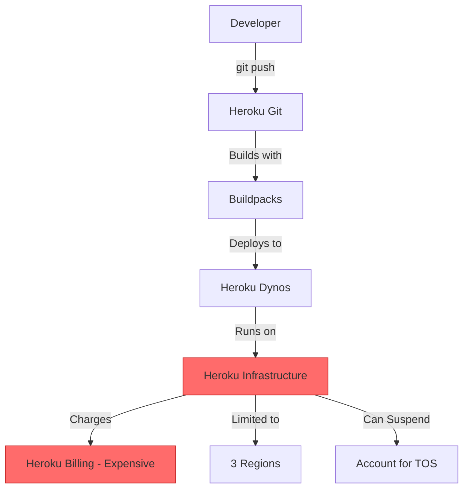
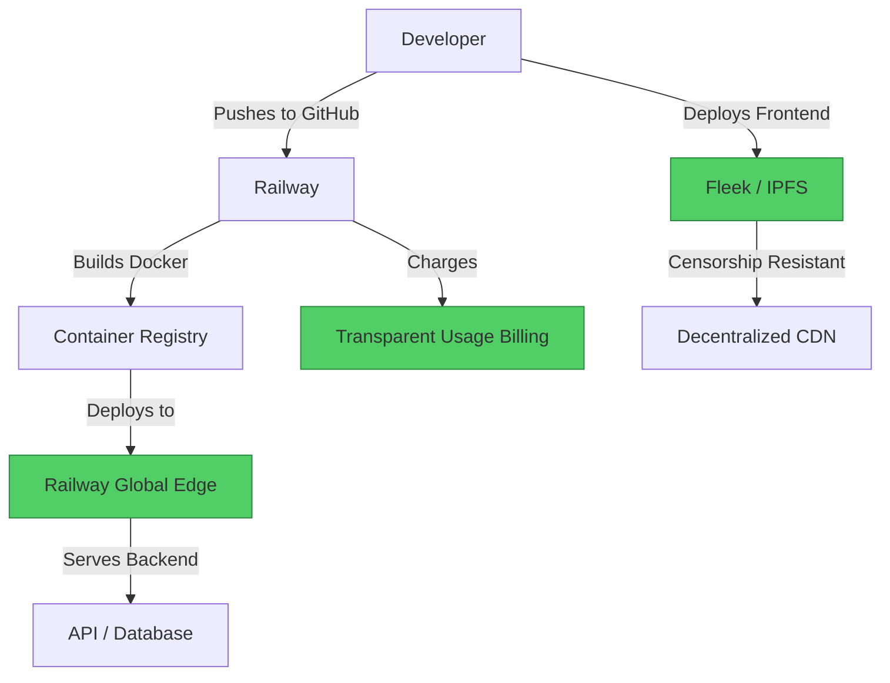

#  Heroku → Railway + Web3 Hosting Migration Guide

> **Web2 Service:** Heroku (Salesforce)
> **Web3 Alternative:** Railway (Modern PaaS) + Web3 Hosting (Fleek / Akash)
> **Difficulty:** ⭐⭐⭐ (Intermediate)
> **Time to Migrate:** 1-2 weeks for application migration

---

## 🎯 Overview

Heroku pioneered Platform-as-a-Service (PaaS) but has become increasingly expensive, limited free tiers, and suffers from vendor lock-in. Developers love Heroku's simplicity but hate the pricing and lack of control. **Railway** offers a modern, developer-friendly PaaS with transparent pricing and better performance. For true Web3 decentralization, combine Railway with **Fleek** (for static sites/IPFS hosting) or **Akash** (for backend compute) to achieve censorship resistance and cost savings.

This guide shows you how to migrate from Heroku's aging platform to a modern, cost-effective stack with optional Web3 decentralization.

---

## ❌ The Web2 Problem: Heroku

### Key Issues

| Problem | Impact |
|---------|--------|
| **Expensive Pricing** | Heroku's eco dynos cost $7-250/month; scaling is prohibitively expensive |
| **No Free Tier** | Heroku eliminated its free tier in 2022, alienating hobbyists and students |
| **Vendor Lock-in** | Heroku-specific buildpacks and add-ons make migration difficult |
| **Limited Control** | No root access, limited customization, can't run arbitrary Docker containers |
| **Slow Builds** | Build times can be slow; no caching control |
| **Regional Limitations** | Only 3 regions (US, EU, Dublin); no global edge deployment |
| **Outdated Stack** | Heroku's infrastructure feels dated compared to modern alternatives |
| **Salesforce Bloat** | Since Salesforce acquisition, Heroku has become more enterprise-focused, less developer-friendly |

### Real-World Example

In 2022, Heroku announced the removal of its free tier, causing mass exodus of developers to alternatives like Railway, Render, and Fly.io. Many startups reported Heroku bills exceeding $1,000/month for modest workloads that could run for $50 on modern platforms. The lack of Docker support (until recently) forced developers to use Heroku-specific buildpacks, creating lock-in.

---

## ✅ The Web3 Solution: Railway + Web3 Hosting

### What is Railway?

**Railway** is a modern, infrastructure-as-code platform that combines the simplicity of Heroku with the power of Docker and Kubernetes. It offers transparent pricing (pay for what you use), native Docker support, and global deployment. For Web3 decentralization, pair Railway with **Fleek** (for frontend hosting on IPFS) or **Akash** (for backend compute) to create a fully decentralized stack.

### Key Benefits

| Benefit | How Railway + Web3 Solves It |
|---------|------------------------------|
| **Transparent Pricing** | Pay per second of usage; no surprise bills |
| **Docker Native** | Deploy any Docker container; no buildpack lock-in |
| **Global Edge** | Deploy to 20+ regions worldwide |
| **Cost Effective** | 50-70% cheaper than Heroku for equivalent workloads |
| **Web3 Integration** | Easy integration with Fleek (IPFS), Akash (decentralized compute) |
| **Developer Experience** | Modern CLI, GitHub integration, preview environments |
| **No Vendor Lock-in** | Standard Docker; migrate to any platform instantly |
| **Censorship Resistance** | Combine with Fleek/IPFS for untakeable frontends |

---

## 🏗️ Architecture Comparison

### Heroku Architecture (Centralized)



### Railway + Web3 Architecture (Modern + Decentralized)



---

## 🛠️ Step-by-Step Migration

### Step 1: Set Up Railway Account

Create a Railway account and install the CLI. Railway uses GitHub for authentication and deployment.

```bash
# Install Railway CLI
npm install -g @railway/cli

# Login to Railway
railway login

# Link to your project
railway link
```

### Step 2: Containerize Your Application

Create a `Dockerfile` for your application. Railway natively supports Docker, unlike Heroku's buildpacks.

```dockerfile
# Dockerfile
FROM node:18-alpine

WORKDIR /app

COPY package*.json ./
RUN npm ci --only=production

COPY . .

EXPOSE 3000

CMD ["npm", "start"]
```

### Step 3: Deploy to Railway

Push your code to GitHub and Railway will automatically deploy it. Alternatively, use the CLI for manual deployments.

```bash
# Initialize Railway project
railway init

# Set environment variables
railway variables set DATABASE_URL=postgres://...
railway variables set REDIS_URL=redis://...

# Deploy
railway up

# View logs
railway logs

# Open the app
railway open
```

### Step 4: Set Up Database (Railway Native)

Railway provides managed databases (PostgreSQL, MySQL, Redis) with one click.

```bash
# Add a PostgreSQL database
railway add
# Select "PostgreSQL" from the menu

# Get the connection string
railway variables get DATABASE_URL
```

### Step 5: Deploy Frontend to Fleek (Web3 Hosting)

For censorship-resistant frontend hosting, deploy your static site to IPFS via Fleek.

```bash
# Install Fleek CLI
npm install -g @fleekhq/fleek-cli

# Login to Fleek
fleek login

# Initialize Fleek project
fleek init

# Deploy to IPFS
fleek deploy

# Your site is now at:
# https://<hash>.ipfs.dweb.link
```

### Step 6: Configure Custom Domain

Set up a custom domain for your Railway deployment.

```bash
# Add custom domain in Railway dashboard
# Or via CLI:
railway domain set myapp.com

# Configure DNS
# Point CNAME to Railway's load balancer
```

### Step 7: Migrate Data from Heroku

Export your Heroku database and import it to Railway's managed database.

```bash
# Export from Heroku
heroku pg:backups:capture
heroku pg:backups:download

# Import to Railway
railway run psql $DATABASE_URL < latest.dump
```

---

## 📜 Full Migration Script

```bash
#!/bin/bash
# migrate-heroku-to-railway.sh

set -e

echo "🚀 Starting Heroku to Railway Migration..."

# Step 1: Export Heroku data
echo "📦 Exporting Heroku database..."
heroku pg:backups:capture
heroku pg:backups:download -o heroku-backup.dump

# Step 2: Set up Railway
echo "🛤️ Setting up Railway project..."
railway init
railway link

# Step 3: Deploy application
echo "📤 Deploying to Railway..."
railway up

# Step 4: Set environment variables
echo "🔧 Configuring environment variables..."
railway variables set NODE_ENV=production
# Add other variables as needed

# Step 5: Import database
echo "🗄️ Importing database to Railway..."
railway run psql $DATABASE_URL < heroku-backup.dump

# Step 6: Deploy frontend to Fleek (optional)
echo "🌐 Deploying frontend to IPFS via Fleek..."
cd frontend
fleek deploy
cd ..

echo "🎉 Migration complete!"
echo "🔗 Railway app: $(railway domain)"
echo "🌍 IPFS frontend: https://<hash>.ipfs.dweb.link"
echo "💰 Estimated savings: 50-70% vs Heroku"
```

---

## ⚖️ Trade-offs

| Aspect | Heroku | Railway + Web3 |
|--------|--------|----------------|
| **Cost** | Expensive ($$$) | 50-70% cheaper |
| **Free Tier** | None | $5 free credit/month |
| **Docker Support** | Limited (recently added) | Native, first-class |
| **Build Speed** | Slow | Fast (cached layers) |
| **Global Regions** | 3 regions | 20+ regions |
| **Database** | Add-ons (expensive) | Native managed DBs |
| **Vendor Lock-in** | High (buildpacks) | Zero (Docker standard) |
| **Web3 Integration** | None | Native (Fleek, Akash) |
| **Censorship Resistance** | Low | High (with IPFS) |
| **Learning Curve** | Low | Low-Moderate |

---

## 🌍 Real-World Examples

### Projects on Railway
1. **Web3 dApps**: Decentralized applications use Railway for backend APIs and Fleek for frontend hosting.
2. **SaaS Startups**: Migrated from Heroku to Railway, reducing monthly bills by 60%.
3. **Open Source Projects**: Use Railway's free tier for hobby projects and documentation sites.

### Migration Success Stories
- **E-commerce Platforms**: Reduced hosting costs from $800/month (Heroku) to $250/month (Railway) while improving performance.
- **API Services**: Migrated from Heroku to Railway for better Docker support and global edge deployment.
- **Web3 Projects**: Combined Railway (backend) + Fleek (frontend) for fully decentralized, censorship-resistant applications.

---

## 🔒 Security Considerations

1. **Environment Variables**: Store secrets in Railway's encrypted environment variables, not in code.
2. **Database Security**: Use Railway's managed databases with automatic backups and encryption.
3. **IPFS Privacy**: Remember that IPFS is public. Encrypt sensitive data before deploying to Fleek.
4. **Access Control**: Use Railway's team features to manage access and permissions.
5. **Domain Security**: Enable HTTPS and configure proper DNSSEC for custom domains.

---

## 📚 Resources

### Official Documentation
- [Railway Documentation](https://docs.railway.app/)
- [Fleek Documentation](https://docs.fleek.xyz/)
- [Railway CLI Reference](https://docs.railway.app/develop/cli)

### Developer Tools
- **Railway Dashboard**: Web UI for managing deployments
- **Fleek CLI**: For IPFS deployments
- **GitHub Integration**: Automatic deployments on push

### Community
- [Railway Discord](https://discord.gg/railway)
- [Fleek Discord](https://discord.gg/fleek)
- [Railway Twitter](https://twitter.com/Railway_App)

---

## 🎓 Key Takeaways

1. **Railway is the modern Heroku**: Same simplicity, better performance, lower cost, and Docker-native.
2. **Cost savings are immediate**: Expect 50-70% reduction in hosting costs compared to Heroku.
3. **Docker is the standard**: No more buildpack lock-in. Deploy any containerized application.
4. **Web3 integration is easy**: Combine Railway (backend) with Fleek (frontend) for decentralized hosting.
5. **Migration is straightforward**: Export Heroku data, import to Railway, update DNS. Done.
6. **Global edge matters**: Railway's 20+ regions provide better performance than Heroku's 3 regions.
7. **Hybrid approach works**: Use Railway for dynamic backends and Fleek/IPFS for static frontends.

---

*Guide by [@Elvatar](https://github.com/Elvatar2) | Last updated: 2026*
*Part of the Web2 → Web3 Migration Guide series*
