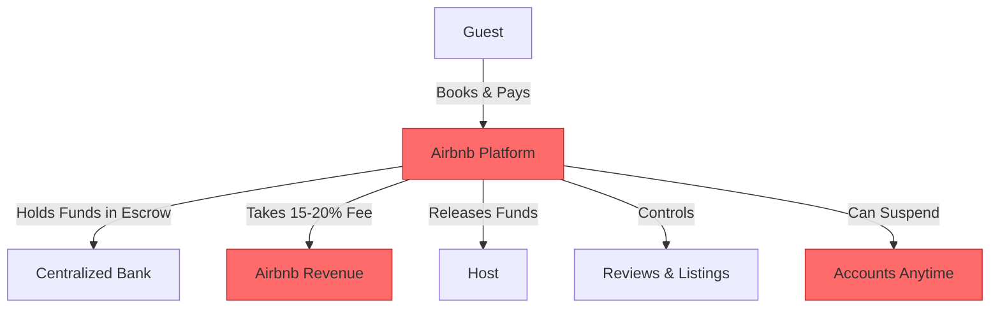
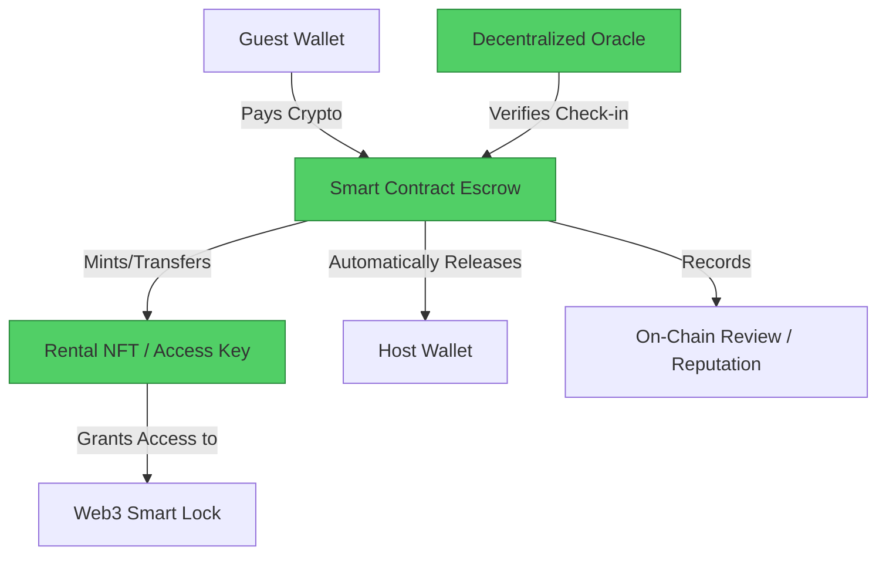

#  Airbnb → Web3 Real Estate Migration Guide

> **Web2 Service:** Airbnb
> **Web3 Alternative:** Decentralized Real Estate Protocols (Propy, RealT, Winding Tree) + Smart Contracts
> **Difficulty:** ⭐⭐⭐⭐ (Advanced)
> **Time to Migrate:** 4-8 weeks for legal structuring, smart contract deployment, and dApp integration

---

## 🎯 Overview

Airbnb revolutionized short-term rentals but operates as a centralized intermediary that extracts massive value. Hosts and guests face combined service fees of 15-20%, arbitrary account suspensions, payment holds, and opaque review systems. **Web3 Real Estate** shifts the paradigm by using smart contracts and Non-Fungible Tokens (NFTs) to facilitate peer-to-peer property rentals and fractional ownership. By tokenizing rental agreements or property shares, hosts can automate escrow, eliminate middleman fees, and grant access via cryptographic keys, creating a trustless, transparent, and globally accessible rental market.

This guide shows you how to migrate from a centralized, high-fee booking platform to a decentralized, smart-contract-driven real estate ecosystem.

---

## ❌ The Web2 Problem: Airbnb

### Key Issues

| Problem | Impact |
|---------|--------|
| **Exorbitant Fees** | Combined host (3%) and guest (14-20%) service fees drain value from both parties |
| **Arbitrary Delisting** | Airbnb can suspend hosts or remove properties overnight due to automated algorithmic flags |
| **Payment Holds** | Funds are often held for 24-48 hours after check-in, creating cash flow issues for hosts |
| **Opaque Review System** | Reviews can be manipulated, and hosts have no recourse against unfair guest ratings |
| **Data Monopolization** | Airbnb owns the guest-host relationship; hosts cannot easily export or directly contact their past guests |
| **Dynamic Pricing Manipulation** | Airbnb's "Smart Pricing" often underprices properties to maximize platform booking volume, not host revenue |
| **Regulatory Friction** | Centralized platforms are easy targets for local government bans or heavy taxation |

### Real-World Example

During the 2020 pandemic, Airbnb faced massive backlash when it allowed hosts to cancel reservations with full refunds, citing "extenuating circumstances," leaving guests stranded. Conversely, hosts frequently report sudden account deactivations due to minor, automated "policy violations," locking them out of their income and guest communication channels with no human support available.

---

## ✅ The Web3 Solution: Decentralized Real Estate

### What is Web3 Real Estate?

Web3 real estate leverages **smart contracts** to automate bookings, payments, and security deposits. Properties or rental periods are represented as **NFTs** (e.g., a "7-day rental pass" for a specific property). Platforms like **Propy** handle tokenized property sales, while protocols like **Winding Tree** or **RealT** enable decentralized booking and fractional ownership. Access to the property can be granted via smart locks integrated with the user's Web3 wallet, eliminating the need for physical key exchanges or centralized property managers.

### Key Benefits

| Benefit | How Web3 Solves It |
|---------|--------------------|
| **Near-Zero Fees** | Smart contracts automate the process, reducing platform fees to <1% (just network gas fees) |
| **Trustless Escrow** | Funds are locked in a smart contract and released automatically upon verified check-in or time expiration |
| **Censorship Resistance** | No central authority can delist your property or freeze your earnings |
| **True Ownership of Relationships** | Hosts can build their own decentralized guest databases (e.g., via ENS or Lens Protocol) |
| **Fractional Liquidity** | Properties can be tokenized, allowing global investors to buy shares and earn proportional rental yield |
| **Transparent Reviews** | On-chain, verifiable reviews that cannot be arbitrarily deleted or manipulated by a platform |
| **Automated Access** | Integration with Web3-enabled smart locks grants access only to the wallet holding the valid rental NFT |

---

## 🏗️ Architecture Comparison

### Airbnb Architecture (Centralized)



### Web3 Real Estate Architecture (Decentralized)



---

## 🛠️ Step-by-Step Migration

### Step 1: Legal Structuring and Wallet Setup

Before tokenizing real-world assets, establish a legal entity (e.g., an LLC or SPV) to hold the property title, ensuring compliance with local real estate and securities laws. Set up a secure, multi-sig Web3 wallet (e.g., Safe) to manage the property's treasury.

```javascript
// Install Safe SDK for multi-sig treasury management
npm install @safe-global/safe-core-sdk

import { SafeFactory } from '@safe-global/safe-core-sdk';

async function setupPropertyTreasury(owners, threshold) {
  const safeFactory = await SafeFactory.create({ ethAdapter });
  const safeSdk = await safeFactory.deploySafe({ 
    owners: owners, // e.g., ['0xHost', '0xCoHost', '0xLawyer']
    threshold: threshold // e.g., 2 of 3 signatures required
  });
  console.log(`✅ Property Treasury Created: ${safeSdk.getAddress()}`);
  return safeSdk;
}
```

### Step 2: Tokenize the Rental Agreement (NFT)

Instead of a traditional booking confirmation, mint a dynamic NFT or Soulbound Token (SBT) that represents the right to occupy the property for a specific time frame.

```solidity
// SPDX-License-Identifier: MIT
pragma solidity ^0.8.20;

import "@openzeppelin/contracts/token/ERC721/ERC721.sol";
import "@openzeppelin/contracts/access/Ownable.sol";

contract RentalPass is ERC721, Ownable {
    struct Rental {
        uint256 checkIn;
        uint256 checkOut;
        string propertyId;
        bool isActive;
    }

    mapping(uint256 => Rental) public rentals;
    uint256 public nextTokenId;

    constructor() ERC721("Decentralized Rental Pass", "DRP") {}

    function mintRentalPass(
        address guest,
        string memory _propertyId,
        uint256 _checkIn,
        uint256 _checkOut
    ) external onlyOwner {
        uint256 tokenId = nextTokenId++;
        _mint(guest, tokenId);
        
        rentals[tokenId] = Rental({
            checkIn: _checkIn,
            checkOut: _checkOut,
            propertyId: _propertyId,
            isActive: true
        });
    }

    function isValidRental(uint256 tokenId) public view returns (bool) {
        Rental memory r = rentals[tokenId];
        return r.isActive && block.timestamp >= r.checkIn && block.timestamp <= r.checkOut;
    }
}
```

### Step 3: Implement Smart Contract Escrow for Bookings

Create a booking contract that holds the guest's payment in escrow and automatically releases it to the host after a successful check-in, or refunds the guest if the host cancels.

```solidity
contract RentalEscrow {
    address public host;
    uint256 public price;
    bool public isBooked;
    bool public isCompleted;

    event Booked(address guest, uint256 amount);
    event Released(address host, uint256 amount);
    event Refunded(address guest, uint256 amount);

    constructor(address _host, uint256 _price) {
        host = _host;
        price = _price;
    }

    function book() external payable {
        require(!isBooked, "Already booked");
        require(msg.value == price, "Incorrect payment amount");
        isBooked = true;
        emit Booked(msg.sender, msg.value);
    }

    // Called by a trusted oracle or multi-sig upon successful check-in
    function completeRental() external {
        require(isBooked && !isCompleted, "Invalid state");
        isCompleted = true;
        payable(host).transfer(address(this).balance);
        emit Released(host, address(this).balance);
    }

    function cancelAndRefund() external {
        require(isBooked && !isCompleted, "Invalid state");
        isCompleted = true;
        // In production, implement a dispute resolution mechanism (e.g., Kleros)
        payable(msg.sender).transfer(address(this).balance);
        emit Refunded(msg.sender, address(this).balance);
    }
}
```

### Step 4: Integrate Web3 Smart Locks

Connect the rental NFT to a physical smart lock (e.g., via IoT APIs). The lock's backend verifies if the guest's wallet holds a valid, active rental NFT for that specific property before unlocking the door.

```javascript
// Conceptual: Backend verification for smart lock
async function verifyAccess(walletAddress, propertyId) {
  const rentalPassContract = new ethers.Contract(RENTAL_PASS_ADDRESS, RentalPassABI, provider);
  
  // Find the token ID owned by this wallet
  const balance = await rentalPassContract.balanceOf(walletAddress);
  if (balance === 0n) return { access: false, reason: "No rental pass found" };

  // Check if any owned token is valid for this property right now
  for (let i = 0; i < balance; i++) {
    const tokenId = await rentalPassContract.tokenOfOwnerByIndex(walletAddress, i);
    const rental = await rentalPassContract.rentals(tokenId);
    
    if (rental.propertyId === propertyId && rental.isActive) {
      const now = Math.floor(Date.now() / 1000);
      if (now >= Number(rental.checkIn) && now <= Number(rental.checkOut)) {
        return { access: true, reason: "Access granted" };
      }
    }
  }
  
  return { access: false, reason: "Rental period not active" };
}
```

### Step 5: Build a Decentralized Booking Frontend

Create a dApp where guests can browse properties, connect their wallets, and book directly via the smart contract, bypassing Airbnb's UI entirely.

```javascript
import { useState } from 'react';
import { useContractWrite, useWaitForTransaction } from 'wagmi';

function BookProperty({ escrowAddress, priceInWei }) {
  const { write, data, isLoading } = useContractWrite({
    address: escrowAddress,
    abi: RentalEscrowABI,
    functionName: 'book',
    value: priceInWei,
  });

  const { isLoading: isConfirming } = useWaitForTransaction({ hash: data?.hash });

  return (
    <button 
      onClick={() => write()} 
      disabled={isLoading || isConfirming}
      className="web3-book-btn"
    >
      {isLoading || isConfirming ? 'Processing...' : `Book for ${priceInWei / 1e18} ETH`}
    </button>
  );
}
```

### Step 6: Migrate Your Airbnb Audience

1. **Incentivize Direct Booking**: Add a link to your Web3 booking dApp in your Airbnb description (where allowed) or communicate with past guests via email, offering a 15% discount for booking directly via crypto (passing the saved Airbnb fees to them).
2. **Onboard Past Guests**: Help loyal guests set up a simple Web3 wallet (e.g., Coinbase Wallet) and airdrop them a "Loyal Guest" NFT that grants them permanent priority booking or discounts.
3. **List on Web3 Directories**: Submit your property to decentralized travel directories like Winding Tree or specialized Web3 real estate platforms.

---

## 📜 Full Migration Script

```javascript
// migrate-airbnb-to-web3.js
import { ethers } from 'ethers';
import fs from 'fs';

class AirbnbToWeb3Migrator {
  constructor(providerUrl, hostPrivateKey, propertyDetails) {
    this.provider = new ethers.JsonRpcProvider(providerUrl);
    this.wallet = new ethers.Wallet(hostPrivateKey, this.provider);
    this.property = propertyDetails;
  }

  async deployRentalContracts() {
    console.log(`🚀 Deploying contracts for: ${this.property.name}`);

    // 1. Deploy Rental Pass NFT
    const RentalPassFactory = new ethers.ContractFactory(RentalPassABI, RentalPassBytecode, this.wallet);
    const rentalPass = await RentalPassFactory.deploy();
    await rentalPass.waitForDeployment();
    console.log(`✅ Rental Pass NFT deployed at: ${await rentalPass.getAddress()}`);

    // 2. Deploy Escrow Contract
    const priceWei = ethers.parseEther(this.property.pricePerNight.toString());
    const EscrowFactory = new ethers.ContractFactory(RentalEscrowABI, RentalEscrowBytecode, this.wallet);
    const escrow = await EscrowFactory.deploy(this.wallet.address, priceWei);
    await escrow.waitForDeployment();
    console.log(`✅ Rental Escrow deployed at: ${await escrow.getAddress()}`);

    // Save deployment addresses
    const deploymentInfo = {
      propertyName: this.property.name,
      rentalPassAddress: await rentalPass.getAddress(),
      escrowAddress: await escrow.getAddress(),
      hostAddress: this.wallet.address
    };
    
    fs.writeFileSync(`deployment-${this.property.id}.json`, JSON.stringify(deploymentInfo, null, 2));
    console.log('💾 Deployment info saved.');
    
    return deploymentInfo;
  }

  async simulateBooking(guestWalletAddress, nights) {
    console.log(`\n📅 Simulating booking for ${nights} nights...`);
    const escrow = new ethers.Contract(this.property.escrowAddress, RentalEscrowABI, this.wallet);
    const totalCost = ethers.parseEther((this.property.pricePerNight * nights).toString());

    // In a real scenario, the guest would sign this transaction from their wallet
    console.log(`💰 Guest sending ${ethers.formatEther(totalCost)} ETH to escrow...`);
    
    // Simulate transaction
    const tx = await escrow.book({ value: totalCost });
    const receipt = await tx.wait();
    console.log(`✅ Booking confirmed in block ${receipt.blockNumber}`);
    
    // Simulate minting the rental pass
    const rentalPass = new ethers.Contract(this.property.rentalPassAddress, RentalPassABI, this.wallet);
    const checkIn = Math.floor(Date.now() / 1000) + 86400; // Tomorrow
    const checkOut = checkIn + (nights * 86400);
    
    const mintTx = await rentalPass.mintRentalPass(guestWalletAddress, this.property.id, checkIn, checkOut);
    await mintTx.wait();
    console.log(`🔑 Rental Pass NFT minted to guest: ${guestWalletAddress}`);
  }
}

// Usage
// const migrator = new AirbnbToWeb3Migrator(
//   process.env.RPC_URL,
//   process.env.HOST_PRIVATE_KEY,
//   { id: 'PROP-001', name: 'Beachfront Villa', pricePerNight: 0.05, escrowAddress: '...', rentalPassAddress: '...' }
// );
// const deployed = await migrator.deployRentalContracts();
// await migrator.simulateBooking('0xGuestAddress...', 3);
```

---

## ⚖️ Trade-offs

| Aspect | Airbnb | Web3 Real Estate |
|--------|--------|------------------|
| **Fees** | 15-20% combined (Host + Guest) | <1% (Network gas fees only) |
| **User Experience** | Extremely polished, familiar to billions | Requires Web3 wallet, crypto literacy, and gas management |
| **Trust Model** | Trust in Airbnb's brand and customer support | Trust in audited smart contracts and code |
| **Dispute Resolution** | Centralized customer service (biased, slow) | Decentralized arbitration (e.g., Kleros) or multi-sig |
| **Liquidity & Reach** | Massive global audience of travelers | Niche, growing audience of Web3 natives and crypto travelers |
| **Censorship** | High (arbitrary delisting, regional bans) | Resistant (smart contracts run permissionlessly) |
| **Legal Compliance** | Handled (partially) by platform's TOS | Host's responsibility (KYC/AML, local property laws, taxes) |
| **Payment Speed** | 24-48 hours after check-in | Instant (upon smart contract trigger) |

---

## 🌍 Real-World Examples

### Platforms & Protocols
1. **Propy**: A leading platform for tokenizing real estate, enabling end-to-end property sales and title transfers on the blockchain.
2. **RealT**: Allows fractional ownership of real estate properties via tokenization, distributing daily rental yield directly to token holders' wallets.
3. **Winding Tree**: A decentralized, open-source travel distribution ecosystem that connects hotels and property owners directly with travelers, cutting out OTAs (Online Travel Agencies) like Airbnb.
4. **Landshare**: A platform that tokenizes real-world properties, allowing users to invest in real estate with as little as $50 and earn rental yields.

### Migration Success Stories
- **Independent Hosts**: Boutique villa owners in crypto-friendly jurisdictions (e.g., Portugal, Bali) now accept direct USDC bookings via smart contracts, saving thousands in OTA fees and building a direct, token-gated community of repeat guests.
- **Fractional Investment Groups**: DAOs pooling capital to purchase vacation properties via Propy or RealT, distributing ownership and rental income transparently on-chain without traditional property management companies.

---

## 🔒 Security Considerations

1. **Smart Contract Audits**: Rental escrow contracts hold real value. They must be rigorously audited by firms like OpenZeppelin or Trail of Bits to prevent reentrancy or logic flaws.
2. **Legal & Regulatory Compliance**: Tokenizing real estate or rental income may classify the tokens as securities in certain jurisdictions. Consult legal counsel to structure the SPV correctly.
3. **Oracle Risk**: If the smart contract relies on an oracle to confirm "check-in" (e.g., from a smart lock), ensure the oracle is decentralized or multi-sig controlled to prevent spoofing.
4. **Private Key Management**: The host's wallet controls the property's revenue and access rights. Use a multi-sig wallet (e.g., Safe) and hardware wallets for maximum security.
5. **Guest Privacy**: While blockchain is transparent, avoid storing guests' real-world PII (Personally Identifiable Information) on-chain. Use ZK-proofs or off-chain encrypted storage (IPFS) for sensitive data.

---

## 📚 Resources

### Official Documentation
- [Propy Documentation](https://propy.com/)
- [RealT Platform](https://realt.co/)
- [Winding Tree Docs](https://windingtree.com/)
- [OpenZeppelin Contracts](https://docs.openzeppelin.com/contracts/)

### Developer Tools
- **Hardhat / Foundry**: For developing and testing rental smart contracts.
- **Safe (Gnosis)**: For secure, multi-signature treasury management.
- **Kleros**: Decentralized dispute resolution protocol for handling booking conflicts.
- **Wagmi / Ethers.js**: For building the frontend booking dApp.

### Community
- [Propy Discord](https://discord.gg/propy)
- [Real Estate DAO Communities](https://discord.gg/realestatedao)
- [Winding Tree Telegram](https://t.me/windingtree)

---

## 🎓 Key Takeaways

1. **Disintermediation saves money**: Removing the 15-20% middleman fee creates immediate value that can be shared between host and guest.
2. **Code is the new property manager**: Smart contracts automate trust, escrow, and access, reducing the need for manual coordination.
3. **Legal structuring is mandatory**: Web3 does not bypass real-world law. Proper SPV/LLC formation is crucial before tokenizing real estate assets.
4. **NFTs are access keys**: A rental NFT is more than a receipt; it's a programmable key that can integrate with IoT smart locks for seamless check-in.
5. **Audience migration takes effort**: You must actively incentivize your existing Airbnb guests to transition to your Web3 booking channel.
6. **Start hybrid**: Keep your Airbnb listing for discovery, but offer a significant discount for guests who book directly through your Web3 dApp.
7. **The future is fractional**: Tokenization unlocks global liquidity, allowing anyone to invest in real estate and earn yield, democratizing a historically exclusive asset class.

---

*Guide by [@Elvatar](https://github.com/Elvatar2) | Last updated: 2026*  
*Part of the Web2 → Web3 Migration Guide series*