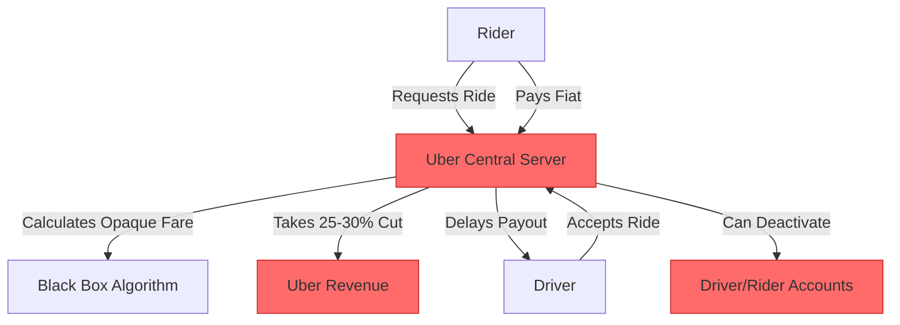
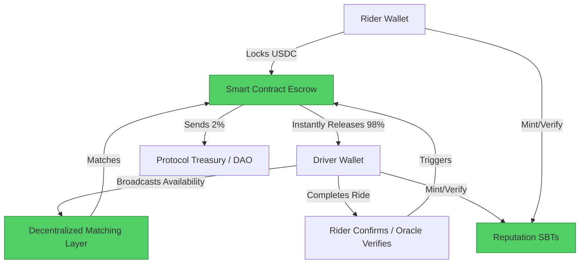

#  Uber → Decentralized Ride-Sharing Migration Guide

> **Web2 Service:** Uber / Lyft
> **Web3 Alternative:** Decentralized Ride-Sharing Protocols (Drife, Arcade City, Teleport) + Smart Contracts
> **Difficulty:** ⭐⭐⭐⭐ (Advanced)
> **Time to Migrate:** 8-12 weeks for mobile dApp integration, smart contract deployment, and driver onboarding

---

## 🎯 Overview

Uber revolutionized urban mobility but operates as a highly extractive centralized intermediary. Drivers face commission rates of 25-30%, arbitrary account deactivations, opaque "surge pricing" algorithms that often benefit the platform more than the driver, and delayed weekly payouts. Riders face dynamic pricing spikes and have no direct relationship with their favorite drivers. **Decentralized Ride-Sharing** shifts the paradigm to a peer-to-peer (P2P) mobility marketplace. By using smart contracts for fare escrow, stablecoins for instant settlements, and Soulbound Tokens (SBTs) for decentralized reputation, drivers can keep 95-99% of their earnings, and riders can enjoy transparent, community-governed pricing.

This guide shows you how to migrate from a centralized, high-commission ride-hailing platform to a decentralized, driver-first, and trustless mobility ecosystem.

---

## ❌ The Web2 Problem: Uber

### Key Issues

| Problem | Impact |
|---------|--------|
| **Exorbitant Commissions** | Uber takes 25-30% (or more) of every fare, severely limiting driver income |
| **Arbitrary Deactivation** | Drivers can be permanently banned due to automated algorithmic flags or single unfair rider ratings, with no human appeal |
| **Opaque Surge Pricing** | Dynamic pricing algorithms are black boxes; drivers often don't see the full fare the rider pays |
| **Delayed Payouts** | Drivers must wait for weekly payouts or pay extra fees for "Instant Pay", creating cash flow strain |
| **Data Monetization** | Uber collects and monetizes detailed location, travel, and behavioral data of both drivers and riders |
| **No Direct Relationships** | The platform actively prevents drivers and riders from connecting directly to avoid disintermediation |
| **Regulatory Vulnerability** | Centralized platforms are frequent targets for strikes, lawsuits, and restrictive local regulations |

### Real-World Example

In multiple cities globally, Uber drivers have protested against sudden, unexplained pay cuts and algorithmic changes that reduced their hourly earnings below minimum wage. Furthermore, thousands of drivers report being "deactivated" overnight due to minor, automated policy violations (e.g., a rider falsely claiming a safety issue), instantly cutting off their livelihood with a generic, automated email and no recourse.

---

## ✅ The Web3 Solution: Decentralized Ride-Sharing

### What is Decentralized Ride-Sharing?

Decentralized ride-sharing protocols (like **Drife** or **Arcade City**) replace the central matching server with open, permissionless smart contracts and decentralized applications (dApps). Riders request a ride, and the fare is locked in a smart contract escrow in stablecoins (e.g., USDC). Nearby drivers receive the request, and upon acceptance and completion of the ride, the smart contract instantly releases the funds to the driver's wallet, minus a tiny protocol fee (e.g., 1-2%). Both parties earn or verify **Soulbound Tokens (SBTs)** for positive interactions, building a portable, tamper-proof reputation that replaces Uber's opaque 5-star system.

### Key Benefits

| Benefit | How Web3 Solves It |
|---------|--------------------|
| **Maximized Driver Earnings** | Protocol fees are typically 1-2%, allowing drivers to keep 98%+ of the fare |
| **Instant, Borderless Payouts** | Funds settle in seconds directly to the driver's wallet, 24/7, in stablecoins |
| **Censorship Resistance** | No central authority can arbitrarily deactivate a driver's account |
| **Transparent Pricing** | Open-source algorithms ensure riders and drivers agree on fares transparently |
| **Portable Reputation** | SBTs prove a driver's safety record and a rider's reliability across *any* Web3 mobility app |
| **Direct P2P Relationships** | Riders can tip or pre-book their favorite drivers directly via their wallet addresses |
| **Community Governance** | Token holders (drivers and riders) can vote on protocol upgrades, fee structures, and dispute resolution |

---

## 🏗️ Architecture Comparison

### Uber Architecture (Centralized)



### Decentralized Ride-Sharing Architecture



---

## 🛠️ Step-by-Step Migration

### Step 1: Set Up Web3 Wallets and Decentralized Identity (DID)

Both drivers and riders need a non-custodial wallet (e.g., MetaMask, Rainbow). Drivers should also set up a DID to anchor their reputation.

```javascript
// Install dependencies
npm install viem @spruceid/didkit-wasm

import { createWalletClient, custom } from 'viem';
import { polygon } from 'viem/chains';

// Initialize Wallet Client
const walletClient = createWalletClient({
  chain: polygon, // Low fees, high speed
  transport: custom(window.ethereum)
});

async function setupDriverIdentity() {
  const [address] = await walletClient.getAddresses();
  console.log(`✅ Driver Wallet Connected: ${address}`);
  
  // In production: Link this address to a DID and fetch existing reputation SBTs
  return address;
}
```

### Step 2: Create a Ride Request and Lock Fare in Escrow

The rider creates a ride request and deposits the agreed-upon fare (in USDC) into a smart contract escrow. This guarantees the driver will be paid.

```solidity
// SPDX-License-Identifier: MIT
pragma solidity ^0.8.20;

import "@openzeppelin/contracts/token/ERC20/IERC20.sol";

contract RideEscrow {
    IERC20 public usdcToken;
    
    struct Ride {
        address rider;
        address driver;
        uint256 fare;
        bool isCompleted;
        bool isDisputed;
    }
    
    mapping(bytes32 => Ride) public rides;
    
    // Event for matching
    event RideRequested(bytes32 indexed rideId, address rider, uint256 fare);
    event RideAccepted(bytes32 indexed rideId, address driver);
    event RideCompleted(bytes32 indexed rideId, address driver, uint256 amount);

    constructor(address _usdcToken) {
        usdcToken = IERC20(_usdcToken);
    }

    function requestRide(bytes32 rideId, uint256 fare) external {
        require(fare > 0, "Fare must be > 0");
        require(usdcToken.transferFrom(msg.sender, address(this), fare), "Transfer failed");
        
        rides[rideId] = Ride({
            rider: msg.sender,
            driver: address(0),
            fare: fare,
            isCompleted: false,
            isDisputed: false
        });
        
        emit RideRequested(rideId, msg.sender, fare);
    }

    function acceptRide(bytes32 rideId) external {
        Ride storage ride = rides[rideId];
        require(ride.driver == address(0), "Already accepted");
        require(!ride.isCompleted, "Ride completed");
        
        ride.driver = msg.sender;
        emit RideAccepted(rideId, msg.sender);
    }

    function completeRide(bytes32 rideId) external {
        Ride storage ride = rides[rideId];
        require(msg.sender == ride.rider || msg.sender == ride.driver, "Unauthorized");
        require(!ride.isCompleted, "Already completed");
        
        ride.isCompleted = true;
        uint256 protocolFee = ride.fare * 2 / 100; // 2% fee
        uint256 driverPayout = ride.fare - protocolFee;
        
        usdcToken.transfer(ride.driver, driverPayout);
        // Transfer protocolFee to DAO treasury (omitted for brevity)
        
        emit RideCompleted(rideId, ride.driver, driverPayout);
    }
}
```

### Step 3: Decentralized Matching (Off-Chain / Geo-Hashing)

While the escrow is on-chain, real-time matching is best handled off-chain via a decentralized peer-to-peer network (like Waku or a specialized geo-hashing protocol) to avoid blockchain latency and gas costs for every ping.

```javascript
// Conceptual: Listening for nearby ride requests via a decentralized pub/sub network
async function listenForRideRequests(driverLocation) {
  console.log("📡 Listening for nearby ride requests...");
  
  // In production: Connect to Waku or a protocol-specific matching node
  // Filter requests within a 5km radius of driverLocation
  
  const mockRequest = {
    rideId: '0xabc123...',
    rider: '0xRiderAddress...',
    fare: 15.00, // USDC
    pickup: { lat: 40.7128, lng: -74.0060 },
    destination: { lat: 40.7580, lng: -73.9855 }
  };

  console.log(`🚗 New Request: ${mockRequest.fare} USDC`);
  return mockRequest;
}
```

### Step 4: Mint Reputation SBTs Post-Ride

After a successful ride, the protocol mints a Soulbound Token (SBT) to both the driver and the rider, building a verifiable, portable reputation.

```javascript
// Conceptual: Minting a "Verified Safe Driver" SBT after 100 successful rides
async function mintReputationSBT(driverAddress, rideCount) {
  if (rideCount >= 100) {
    console.log(`🏆 Minting 'Safe Driver' SBT to ${driverAddress}`);
    // Call SBT contract: sbtContract.mint(driverAddress, tokenURI)
    console.log("✅ Reputation permanently recorded on-chain.");
  }
}
```

### Step 5: Build or Integrate with a Web3 Mobility dApp

Instead of building from scratch, drivers and riders can migrate to existing decentralized mobility apps that handle the UI/UX, while the backend runs on open smart contracts.

1. **Download a Web3 Ride App**: e.g., Drife, Teleport, or Arcade City.
2. **Connect Wallet**: Link the driver/rider wallet.
3. **Stake (Optional)**: Some protocols require a small, refundable token stake to prevent spam requests or no-shows.
4. **Go Online**: Toggle "Available" to start receiving P2P ride requests.

---

## 📜 Full Migration Script

```javascript
// migrate-uber-to-web3-ride.js
import { createWalletClient, createPublicClient, custom, http, parseUnits } from 'viem';
import { polygon } from 'viem/chains';

class UberToWeb3RideMigrator {
  constructor(userPrivateKey, role) {
    this.account = userPrivateKey;
    this.role = role; // 'driver' or 'rider'
    this.usdcAddress = '0x2791Bca1f2de4661ED88A30C99A7a9449Aa84174'; // USDC on Polygon
    this.escrowAddress = '0xYourRideEscrowContractAddress';
    
    this.walletClient = createWalletClient({
      account: this.account,
      chain: polygon,
      transport: custom(window.ethereum) // Or HTTP for backend simulation
    });

    this.publicClient = createPublicClient({
      chain: polygon,
      transport: http()
    });
  }

  async simulateRideLifecycle() {
    const rideId = '0x' + Math.random().toString(16).substr(2, 8).padEnd(64, '0');
    const fareUSDC = 15.00;
    const fareWei = parseUnits(fareUSDC.toString(), 6);

    console.log(`\n🚀 Starting Decentralized Ride Simulation...`);
    console.log(`Role: ${this.role} | Ride ID: ${rideId}`);

    if (this.role === 'rider') {
      console.log(`1️⃣ Rider requesting ride and locking ${fareUSDC} USDC in escrow...`);
      // Simulate approval and transfer to escrow
      console.log(`✅ Ride Requested. Waiting for driver...`);
    } else if (this.role === 'driver') {
      console.log(`1️⃣ Driver accepting ride request...`);
      // Simulate acceptRide transaction
      console.log(`✅ Ride Accepted. Heading to pickup...`);
    }

    // Simulate ride completion
    console.log(`2️⃣ Ride completed. Triggering smart contract settlement...`);
    // Simulate completeRide transaction
    
    console.log(`💰 Driver instantly received ${fareUSDC * 0.98} USDC.`);
    console.log(`🏛️ Protocol received ${fareUSDC * 0.02} USDC fee.`);
    console.log(`🏅 Both parties awarded positive Reputation SBTs.`);
    console.log(`🎉 Decentralized ride successful! No middleman, no delays.`);
  }
}

// Usage
// const rider = new UberToWeb3RideMigrator(process.env.RIDER_PK, 'rider');
// const driver = new UberToWeb3RideMigrator(process.env.DRIVER_PK, 'driver');
// await rider.simulateRideLifecycle();
// await driver.simulateRideLifecycle();
```

---

## ⚖️ Trade-offs

| Aspect | Uber / Lyft | Decentralized Ride-Sharing |
|--------|-------------|----------------------------|
| **Driver Earnings** | 70-75% of fare (25-30% platform cut) | 98-99% of fare (1-2% protocol fee) |
| **Payout Speed** | Weekly, or instant for a fee | Instant, upon ride completion (seconds) |
| **User Experience** | Highly polished, seamless, ubiquitous | Requires Web3 wallet, slightly steeper learning curve |
| **Network Effects** | Massive (millions of drivers/riders) | Nascent, growing in specific crypto-friendly cities |
| **Dispute Resolution** | Centralized support (often favors riders) | Decentralized arbitration (e.g., Kleros) or community voting |
| **Censorship** | High (arbitrary deactivations) | Zero (permissionless, code-enforced rules) |
| **Pricing Transparency** | Opaque, algorithmic surge pricing | Transparent, agreed upon upfront or via open formulas |
| **Safety/KYC** | Centralized background checks | Decentralized identity, SBT reputation, or optional ZK-KYC |

---

## 🌍 Real-World Examples

### Platforms & Protocols
1. **Drife**: A blockchain-based ride-hailing platform that charges 0% commission for the first year and uses a decentralized governance model for drivers and riders.
2. **Arcade City**: One of the earliest decentralized ride-sharing cooperatives, allowing drivers and riders to negotiate fares directly via chat and smart contracts.
3. **Teleport**: A Web3 mobility protocol focusing on decentralized mapping, routing, and ride-hailing infrastructure.
4. **Dimo**: While focused on vehicle data, it integrates with the broader Web3 mobility ecosystem, allowing drivers to monetize their car's data to offset ride costs.

### Migration Success Stories
- **Fleet Operators in Emerging Markets**: In regions with high inflation, drivers use stablecoin-based ride apps to protect their daily earnings from local currency devaluation, receiving instant USDC instead of volatile fiat.
- **Driver Cooperatives**: Groups of former Uber drivers have pooled resources to launch local, Web3-powered ride-sharing networks, retaining 100% of the profits within their community.

---

## 🔒 Security Considerations

1. **Smart Contract Audits**: Escrow contracts hold user funds. They must be rigorously audited to prevent reentrancy, oracle manipulation, or fund-locking bugs.
2. **Oracle/Verification Risk**: The system relies on accurate ride completion signals. Malicious actors could try to fake completions. Mitigation: Require dual-signature (rider + driver) or use decentralized dispute resolution (Kleros) for conflicts.
3. **Wallet Security**: Drivers' wallets hold their daily earnings. Use hardware wallets or secure mobile wallet enclaves (e.g., Safeheron, Coinbase Wallet MPC) to prevent theft.
4. **Physical Safety & KYC**: While decentralization protects against censorship, physical safety is paramount. Protocols are increasingly integrating **Zero-Knowledge KYC** (e.g., verifying a valid driver's license without revealing the actual document on-chain).
5. **Stablecoin De-peg Risk**: Use highly liquid, audited stablecoins (USDC, DAI) for fares to ensure drivers receive stable value.

---

## 📚 Resources

### Official Documentation
- [Drife Documentation](https://docs.drife.io/)
- [Kleros Dispute Resolution](https://kleros.io/)
- [W3C Decentralized Identifiers (DID)](https://www.w3.org/TR/did-core/)

### Developer Tools
- **Waku / Whisper**: Decentralized messaging protocols for real-time, P2P ride matching.
- **Hardhat / Foundry**: For developing and testing ride escrow smart contracts.
- **Polygon ID / World ID**: For privacy-preserving, ZK-based identity and reputation verification.
- **Wagmi / Ethers.js**: For building the mobile/web dApp frontend.

### Community
- [Drife Discord](https://discord.gg/drife)
- [Web3 Mobility Alliance](https://web3mobility.org/)
- [Ethereum Discord](https://discord.gg/ethereum)

---

## 🎓 Key Takeaways

1. **Disintermediation empowers workers**: Shifting from a 25% corporate take rate to a 1% protocol fee fundamentally changes the economics of gig work, putting money back into drivers' pockets.
2. **Instant settlement is a game-changer**: Drivers no longer need to rely on predatory cash-advance apps; they own their earnings the second the ride ends.
3. **Reputation is portable**: An SBT-based driving record belongs to the driver, not the platform. If they switch apps or cities, their trusted status moves with them.
4. **UX is the primary hurdle**: Onboarding non-crypto-native riders and drivers requires seamless, abstracted wallet experiences (e.g., Account Abstraction / ERC-4337).
5. **Hybrid models win early adoption**: Successful Web3 ride apps often start by subsidizing rides or offering massive driver bonuses to pull supply away from Uber, gradually decentralizing as the network matures.
6. **Safety must be reimagined**: Decentralization doesn't mean anonymity in physical spaces. ZK-proofs for background checks are the missing link for mainstream regulatory approval.
7. **The future of mobility is cooperative**: Web3 enables true platform cooperatives, where the drivers and riders who create the network's value also govern and own it.

---

*Guide by [@Elvatar](https://github.com/Elvatar2) | Last updated: 2026*  
*Part of the Web2 → Web3 Migration Guide series*