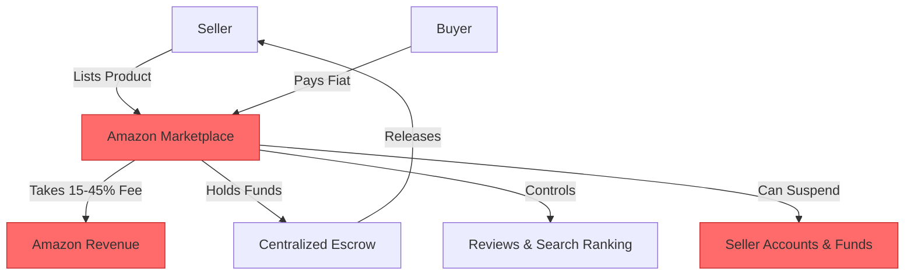
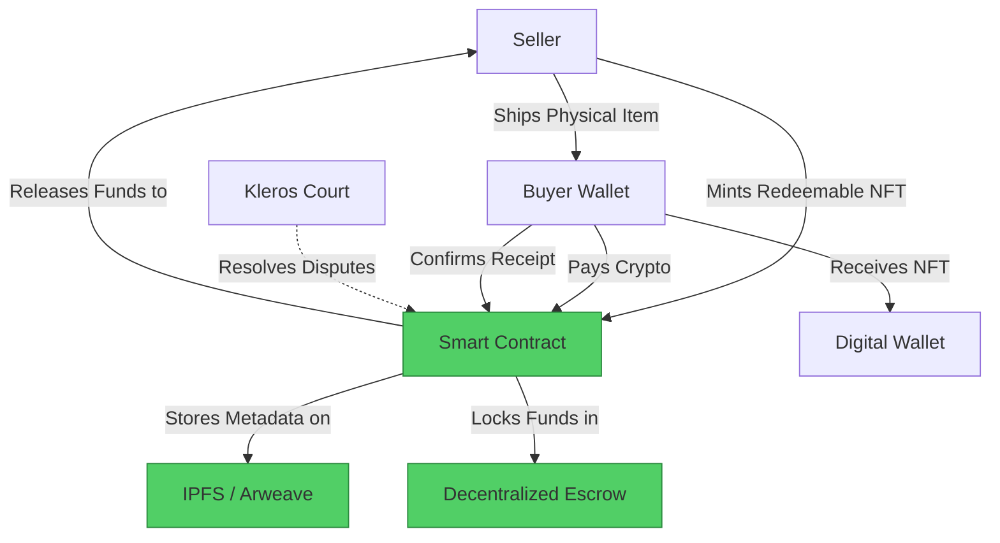

#  Amazon → Decentralized Commerce Migration Guide

> **Web2 Service:** Amazon
> **Web3 Alternative:** Decentralized Commerce Protocols (Boson Protocol, Origin Protocol/Dshop) + IPFS
> **Difficulty:** ⭐⭐⭐⭐ (Advanced)
> **Time to Migrate:** 6-10 weeks for storefront setup, smart contract integration, and supply chain mapping

---

## 🎯 Overview

Amazon dominates global e-commerce but operates as a highly centralized, extractive monopoly. Sellers face commission fees up to 15-45%, arbitrary account suspensions, suppressed product rankings, and complete loss of direct customer relationships. Buyers face counterfeit goods, manipulated reviews, and aggressive data harvesting. **Decentralized Commerce (DeCommerce)** shifts the paradigm by using smart contracts, redeemable NFTs, and decentralized storage to facilitate peer-to-peer trade. Protocols like **Boson** and **Origin Protocol** allow sellers to create independent, censorship-resistant storefronts, automate escrow, and resolve disputes via decentralized arbitration, keeping 100% of their profits and true ownership of their brand.

This guide shows you how to migrate from a centralized, high-fee marketplace to a decentralized, trustless, and seller-owned e-commerce ecosystem.

---

## ❌ The Web2 Problem: Amazon

### Key Issues

| Problem | Impact |
|---------|--------|
| **Exorbitant Fees** | Referral fees (8-15%), FBA fees, and advertising costs can consume 30-50% of a seller's revenue |
| **Arbitrary Account Suspension** | Amazon can freeze seller accounts and withhold funds for months due to automated, opaque policy violations |
| **Customer Data Lock-in** | Sellers cannot access buyer emails or build direct relationships; Amazon owns the customer |
| **Review Manipulation** | Fake reviews and algorithmic suppression of organic rankings force sellers into expensive "Pay-to-Play" advertising |
| **Counterfeit & Hijacking** | Bad actors can hijack listings or sell counterfeit versions of a brand's product, damaging reputation |
| **Supply Chain Opacity** | Buyers have no verifiable proof of a product's origin, authenticity, or ethical sourcing |
| **Censorship & Delisting** | Products can be removed overnight due to shifting corporate policies or external political pressure |

### Real-World Example

Thousands of third-party Amazon sellers have reported sudden, unexplained account deactivations right before peak seasons (like Black Friday). Amazon freezes all funds for up to 90 days to "investigate," effectively bankrupting small businesses that rely on that cash flow to pay suppliers. Furthermore, legitimate brands frequently find their listings hijacked by counterfeiters who undercut prices, while Amazon's support remains unresponsive.

---

## ✅ The Web3 Solution: Decentralized Commerce

### What is DeCommerce?

Decentralized commerce replaces Amazon's centralized marketplace with open protocols. **Origin Protocol (Dshop)** allows merchants to deploy customizable, self-hosted storefronts where payments go directly to their wallets. **Boson Protocol** pioneers the concept of "redeemable NFTs," where a digital token represents a commitment to exchange a physical item. Smart contracts handle the escrow of funds, and decentralized arbitration networks (like **Kleros**) resolve any disputes, eliminating the need for a central corporate referee. Product data and images are stored permanently on **IPFS**.

### Key Benefits

| Benefit | How DeCommerce Solves It |
|---------|--------------------------|
| **Near-Zero Platform Fees** | Sellers keep 95-99% of revenue, paying only minimal network gas fees or tiny protocol royalties |
| **True Customer Ownership** | Buyers connect via wallets or optional email, allowing sellers to build direct, portable communities |
| **Censorship Resistance** | No central authority can delist your products or freeze your storefront |
| **Verifiable Authenticity** | Products are tied to NFTs, providing an immutable, on-chain provenance and anti-counterfeit guarantee |
| **Trustless Escrow** | Funds are locked in smart contracts and only released when the buyer confirms receipt (or via arbitration) |
| **Transparent Reviews** | On-chain, verified purchase reviews that cannot be deleted or manipulated by the platform |
| **Global, Borderless Trade** | Accept crypto payments from anywhere in the world without currency conversion or banking restrictions |

---

## 🏗️ Architecture Comparison

### Amazon Architecture (Centralized)



### Decentralized Commerce Architecture



---

## 🛠️ Step-by-Step Migration

### Step 1: Set Up Web3 Wallet and Storefront

Create a secure business wallet (e.g., Safe multi-sig) and deploy a decentralized storefront using a protocol like Origin Protocol's Dshop or a custom Boson Protocol integration.

```javascript
// Install dependencies
npm install @bosonprotocol/core @origin/dshop

import { Dshop } from '@origin/dshop';

// Initialize a decentralized storefront
const myStore = new Dshop({
  name: "My Decentralized Brand",
  description: "Authentic, verifiable goods directly from the creator.",
  theme: "modern-dark",
  cryptoPaymentsEnabled: true,
  fiatOnRampEnabled: true // e.g., via Moonpay integration for mainstream buyers
});

console.log(`✅ Storefront deployed at: ${myStore.url}`);
```

### Step 2: Tokenize Products as Redeemable NFTs

Instead of a traditional database entry, each product (or batch of products) is minted as an ERC-1155 or ERC-721 token. The token's metadata (stored on IPFS) contains product details, and the token itself acts as a voucher redeemable for the physical item.

```javascript
import { create } from 'ipfs-http-client';
const ipfs = create({ url: 'https://api.pinata.cloud/ipfs/api/v0' });

async function listProduct(name, description, priceUSDC, supply) {
  // 1. Upload product images and details to IPFS
  const metadata = {
    name: name,
    description: description,
    image: "ipfs://QmProductImageHash...",
    attributes: [
      { trait_type: "Material", value: "Organic Cotton" },
      { trait_type: "Origin", value: "Verified Fair Trade" }
    ]
  };
  
  const ipfsResult = await ipfs.add(JSON.stringify(metadata));
  const tokenURI = `ipfs://${ipfsResult.cid.toString()}`;

  // 2. Mint Redeemable NFT via Boson Protocol or custom contract
  console.log(`🏷️ Minting ${supply} units of "${name}" with URI: ${tokenURI}`);
  // In production: call bosonContract.mintVoucher(sellerAddress, priceUSDC, tokenURI, supply)
  
  return tokenURI;
}
```

### Step 3: Implement Decentralized Escrow for Orders

When a buyer purchases an item, they don't pay the seller directly. They pay the smart contract, which locks the funds. The seller is incentivized to ship the item to get paid.

```solidity
// Simplified Escrow Logic for Physical Goods
pragma solidity ^0.8.20;

import "@openzeppelin/contracts/token/ERC20/IERC20.sol";

contract CommerceEscrow {
    IERC20 public stablecoin;
    uint256 public disputePeriod = 7 days;
    
    struct Order {
        address buyer;
        address seller;
        uint256 amount;
        bool shipped;
        bool completed;
        uint256 shipmentTimestamp;
    }
    
    mapping(uint256 => Order) public orders;
    uint256 public nextOrderId;

    function purchase(uint256 productId, uint256 amount) external {
        stablecoin.transferFrom(msg.sender, address(this), amount);
        orders[nextOrderId] = Order({
            buyer: msg.sender,
            seller: getProductIdSeller(productId),
            amount: amount,
            shipped: false,
            completed: false,
            shipmentTimestamp: 0
        });
        nextOrderId++;
    }

    function markShipped(uint256 orderId) external {
        require(msg.sender == orders[orderId].seller, "Only seller can mark shipped");
        orders[orderId].shipped = true;
        orders[orderId].shipmentTimestamp = block.timestamp;
    }

    function confirmReceipt(uint256 orderId) external {
        require(msg.sender == orders[orderId].buyer, "Only buyer can confirm");
        orders[orderId].completed = true;
        stablecoin.transfer(orders[orderId].seller, orders[orderId].amount);
    }
}
```

### Step 4: Integrate Decentralized Dispute Resolution

If a buyer claims the item never arrived or is defective, the smart contract pauses the fund release. Either party can escalate the issue to a decentralized court like **Kleros**, where anonymous, incentivized jurors review the evidence (e.g., shipping tracking, photos) and vote on the outcome.

```javascript
// Conceptual: Escalating a dispute to Kleros
async function escalateDispute(orderId, evidenceURI) {
  console.log(`⚖️ Escalating Order #${orderId} to decentralized arbitration...`);
  
  // In production: interact with Kleros Badgeholder / Court contract
  // klerosContract.dispute(orderId, evidenceURI);
  
  console.log(`📦 Evidence (tracking info, photos) uploaded to IPFS: ${evidenceURI}`);
  console.log(`⏳ Awaiting juror verdict. Funds remain locked in escrow.`);
}
```

### Step 5: Build a Direct Community (Web3 CRM)

Instead of relying on Amazon's hidden customer data, incentivize buyers to connect their wallets or subscribe to your decentralized newsletter (e.g., via Paragraph or Lens Protocol).

```javascript
// Offer a "Loyalty NFT" airdrop to past buyers
async function rewardPastBuyers(buyerAddresses) {
  console.log(`🎁 Airdropping 'VIP Customer' SBT to ${buyerAddresses.length} wallets...`);
  // This SBT grants them lifetime 10% discounts on your Dshop
  // and early access to new product drops.
}
```

### Step 6: Migrate Your Amazon Audience

1. **Insert Web3 Call-to-Action**: Include a QR code or link in your physical Amazon product packaging: "Scan to join our Web3 community, verify your product's authenticity, and get 15% off your next direct order."
2. **Offer Direct Discounts**: Since you save 15-30% on Amazon fees, pass 10% of those savings to the customer as a discount for buying directly from your Dshop with crypto or stablecoins.
3. **Highlight Authenticity**: Market the NFT redeemable voucher as a premium feature that guarantees the product is 100% authentic and ethically sourced, something Amazon cannot verify.

---

## 📜 Full Migration Script

```javascript
// migrate-amazon-to-decommerce.js
import { create } from 'ipfs-http-client';
import { ethers } from 'ethers';
import fs from 'fs';

class AmazonToDeCommerceMigrator {
  constructor(sellerPrivateKey, usdcAddress, escrowAddress) {
    this.provider = new ethers.JsonRpcProvider(process.env.RPC_URL);
    this.wallet = new ethers.Wallet(sellerPrivateKey, this.provider);
    this.usdcAddress = usdcAddress;
    this.escrowAddress = escrowAddress;
    this.ipfs = create({ url: 'https://api.pinata.cloud/ipfs/api/v0' });
  }

  async migrateProductListing(amazonProductData) {
    console.log(`\n📦 Migrating Product: ${amazonProductData.title}`);

    // 1. Prepare Metadata
    const metadata = {
      name: amazonProductData.title,
      description: amazonProductData.description,
      image: `ipfs://${amazonProductData.imageCid}`,
      price: amazonProductData.price,
      sku: amazonProductData.sku
    };

    // 2. Upload to IPFS
    const ipfsResult = await this.ipfs.add(JSON.stringify(metadata));
    const tokenURI = `ipfs://${ipfsResult.cid.toString()}`;
    console.log(`✅ Metadata stored on IPFS: ${tokenURI}`);

    // 3. Mint Redeemable Voucher (Simplified)
    const escrowContract = new ethers.Contract(
      this.escrowAddress,
      ['function mintVoucher(string memory uri, uint256 price, uint256 supply) external'],
      this.wallet
    );

    const tx = await escrowContract.mintVoucher(
      tokenURI,
      ethers.parseUnits(amazonProductData.price.toString(), 6), // USDC 6 decimals
      amazonProductData.initialSupply
    );
    await tx.wait();
    
    console.log(`🏷️ Redeemable NFTs minted. Tx: ${tx.hash}`);
    return tokenURI;
  }

  async runMigration(productCsvPath) {
    console.log("🚀 Starting Amazon to DeCommerce Migration...");
    const products = JSON.parse(fs.readFileSync(productCsvPath, 'utf-8'));
    
    for (const product of products) {
      await this.migrateProductListing(product);
    }
    
    console.log("\n🎉 Migration complete! Your products are now on-chain and censorship-resistant.");
    console.log("💡 Next step: Share your Dshop URL and incentivize direct purchases.");
  }
}

// Usage
// const migrator = new AmazonToDeCommerceMigrator(
//   process.env.SELLER_PK,
//   '0x2791Bca1f2de4661ED88A30C99A7a9449Aa84174', // USDC on Polygon
//   '0xYourEscrowContractAddress'
// );
// migrator.runMigration('./amazon-product-export.json');
```

---

## ⚖️ Trade-offs

| Aspect | Amazon | Decentralized Commerce |
|--------|--------|------------------------|
| **Fees** | 15-45% (Referral, FBA, Ads) | 1-3% (Protocol fees + minimal gas) |
| **Traffic/Discovery** | Massive built-in audience (Billions) | Requires self-driven marketing and community building |
| **Fulfillment** | FBA handles storage, shipping, returns | Seller must manage logistics or use decentralized 3PL networks |
| **Customer Data** | Hidden by Amazon | Fully owned by the seller (wallet addresses, opt-in emails) |
| **Trust/Disputes** | Amazon A-to-z Guarantee (favors buyers) | Decentralized arbitration (Kleros), transparent and balanced |
| **Censorship** | High (arbitrary delisting, account bans) | Zero (storefronts and listings are on-chain/IPFS) |
| **Payment Speed** | 14 days (or more) | Instant upon buyer confirmation or dispute resolution |
| **Setup Complexity** | Low (guided UI) | Moderate to High (requires Web3 wallet, smart contract understanding) |

---

## 🌍 Real-World Examples

### Platforms & Protocols
1. **Boson Protocol**: The leading infrastructure for decentralized commerce, enabling the exchange of physical goods via redeemable NFTs and decentralized dispute resolution.
2. **Origin Protocol (Dshop)**: Allows anyone to spin up a beautiful, standalone e-commerce store that accepts crypto and connects directly to the seller's wallet.
3. **Shopify Web3 Integrations**: While not fully decentralized, Shopify's integration with token-gating and crypto payments serves as a bridge for traditional brands entering Web3.
4. **KYVE Network**: Used for verifying and validating supply chain data, ensuring that a product's journey from factory to buyer is immutably recorded.

### Migration Success Stories
- **Independent Fashion Brands**: Streetwear labels use token-gated Dshops to drop limited-edition clothing. Buyers receive an NFT that acts as both a receipt and a membership pass for future drops, completely bypassing Amazon's fees and counterfeit issues.
- **Artisanal & Fair-Trade Sellers**: Coffee and craft producers use Boson Protocol to sell directly to global consumers, using on-chain metadata to prove ethical sourcing, commanding a premium price that Amazon's race-to-the-bottom pricing destroys.
- **High-Value Collectibles**: Sellers of rare sneakers or electronics use redeemable NFTs to guarantee authenticity, drastically reducing return fraud and counterfeit hijacking.

---

## 🔒 Security Considerations

1. **Smart Contract Audits**: Escrow and minting contracts handle real money. They must be audited by reputable firms to prevent fund-draining exploits.
2. **Private Key Management**: The seller's wallet controls the store's revenue. Use a multi-sig wallet (e.g., Safe) and hardware wallets for cold storage of bulk funds.
3. **Oracle/Shipping Verification**: The smart contract needs to know when an item is shipped. Relying on a centralized shipping API (like FedEx) introduces a central point of failure. Mitigation: Use decentralized oracle networks or require buyer confirmation within a time limit.
4. **IPFS Pinning**: Ensure product metadata and images are pinned reliably (e.g., via Pinata or a decentralized pinning network) so storefronts don't display broken images.
5. **Regulatory Compliance**: Selling physical goods still requires adherence to local consumer protection laws, taxes, and shipping regulations. Web3 does not exempt sellers from real-world legal obligations.

---

## 📚 Resources

### Official Documentation
- [Boson Protocol Documentation](https://docs.bosonprotocol.io/)
- [Origin Protocol / Dshop Docs](https://docs.originprotocol.com/)
- [Kleros Dispute Resolution](https://kleros.io/)
- [IPFS Documentation](https://docs.ipfs.tech/)

### Developer Tools
- **Hardhat / Foundry**: For developing and testing commerce smart contracts.
- **Thirdweb**: Pre-built, audited smart contracts for e-commerce and NFT minting.
- **Pinata**: Reliable IPFS pinning and management for product metadata.
- **Wagmi / RainbowKit**: For seamless wallet connection and transaction handling in the storefront frontend.

### Community
- [Boson Protocol Discord](https://discord.gg/bosonprotocol)
- [Origin Protocol Discord](https://discord.gg/jnnxpWx)
- [Web3 E-commerce Telegram Groups](https://t.me/web3commerce)

---

## 🎓 Key Takeaways

1. **Own your customer relationship**: The most valuable asset in e-commerce is the buyer's contact info. DeCommerce gives this back to the seller.
2. **Fees fund your growth, not a monopoly**: Saving 30% on platform fees allows you to either increase your profit margin or offer better prices to your customers.
3. **Authenticity is a premium feature**: Redeemable NFTs provide cryptographic proof of origin, a powerful marketing tool against counterfeiters.
4. **Traffic requires effort**: Amazon brings the customers; DeCommerce requires you to build your own audience via social media, Web3 communities, and email/newsletter lists.
5. **Dispute resolution is fairer**: Decentralized courts like Kleros evaluate evidence objectively, unlike Amazon's notoriously seller-unfriendly A-to-z guarantee.
6. **Start hybrid**: Keep your Amazon listing for discovery and credibility, but use packaging inserts to funnel loyal, repeat customers to your decentralized, higher-margin Dshop.
7. **The future of retail is composable**: Your product NFTs can be integrated into metaverse galleries, decentralized loyalty programs, and cross-brand collaborations in ways Amazon's walled garden will never allow.

---

*Guide by [@Elvatar](https://github.com/Elvatar2) | Last updated: 2026*  
*Part of the Web2 → Web3 Migration Guide series*
