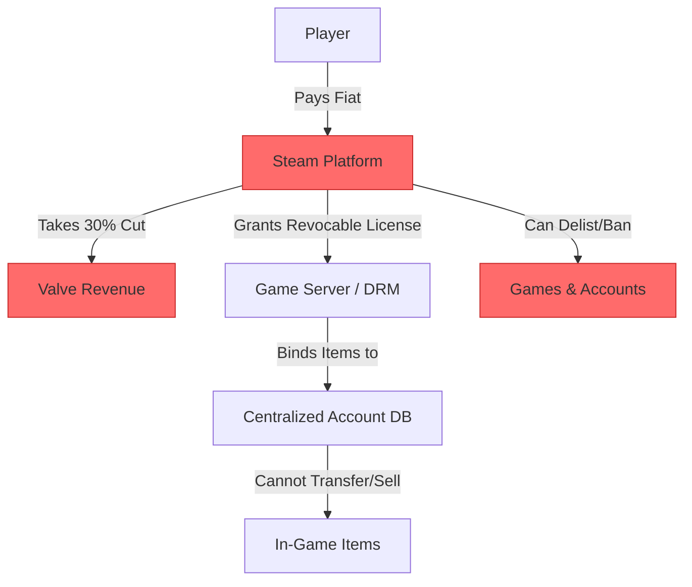
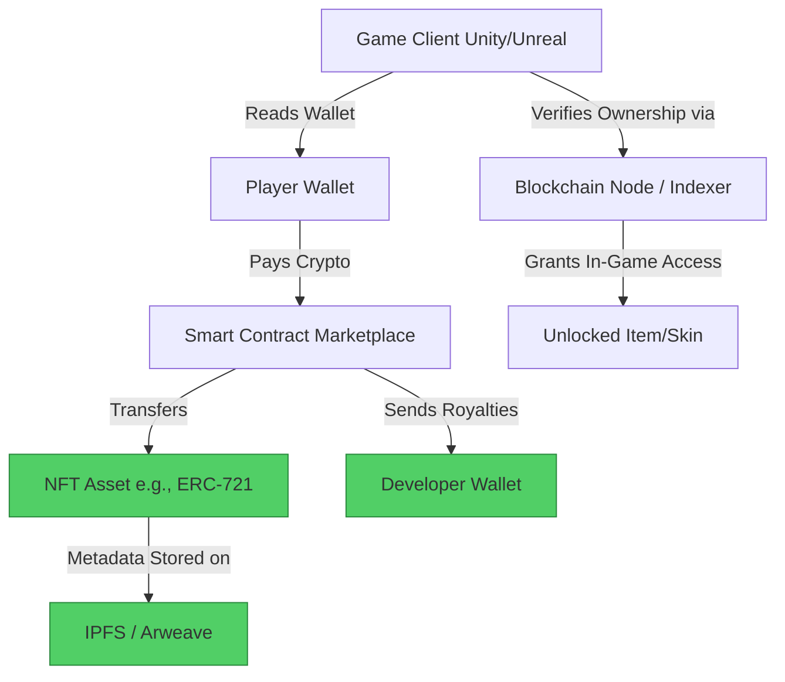

#  Steam → Web3 Gaming Migration Guide

> **Web2 Service:** Steam (Valve Corporation)
> **Web3 Alternative:** Web3 Gaming Protocols (Immutable X, Ronin, Gala Games) + True Digital Ownership
> **Difficulty:** ⭐⭐⭐⭐ (Advanced)
> **Time to Migrate:** 4-8 weeks for asset tokenization, engine integration, and community transition

---

## 🎯 Overview

Steam is the dominant PC gaming platform, but it operates as a centralized walled garden. Developers surrender 30% of their revenue, have no control over pricing or regional restrictions, and are subject to arbitrary delisting (Valve famously bans blockchain games entirely). Crucially, **players do not own their in-game items**; they merely purchase revocable licenses that vanish if the server shuts down or the account is banned. **Web3 Gaming** shifts the paradigm to true digital ownership. By representing in-game assets as NFTs on scalable Layer 2 networks (like Immutable X or Ronin), players truly own their items, can trade them on open marketplaces, and developers earn ongoing royalties from secondary sales, creating sustainable, player-driven economies.

This guide shows you how to migrate from a centralized, extractive storefront to a decentralized, player-owned gaming ecosystem with verifiable asset ownership.

---

## ❌ The Web2 Problem: Steam

### Key Issues

| Problem | Impact |
|---------|--------|
| **Exorbitant Revenue Cut** | Valve takes a flat 30% cut of all game and DLC sales, severely impacting indie developer margins |
| **No True Ownership** | Players buy "licenses," not assets. Items are locked to the account and cannot be sold or transferred |
| **Arbitrary Delisting** | Valve can remove games overnight for vague policy violations, destroying developer revenue and player libraries |
| **Zero Secondary Market Revenue** | If a rare in-game item sells for thousands on third-party sites, the developer sees $0 of that value |
| **Closed Ecosystem** | Assets are trapped within a single game; no interoperability or cross-game utility |
| **Regional Pricing Restrictions** | Developers are forced into Steam's rigid regional pricing tiers, limiting global monetization potential |
| **Server Dependency** | If Steam servers go down or a game is delisted, single-player games with DRM can become unplayable |

### Real-World Example

In 2023, Valve explicitly updated its policies to ban any game featuring "NFTs or cryptocurrency that allow for the issuance or exchange of value." This forced Web3 game developers to completely abandon the platform. Conversely, when popular games like *Battlefield 2142* or older MMOs shut down, players permanently lost all their purchased digital items, highlighting the fragility of centralized "ownership."

---

## ✅ The Web3 Solution: Web3 Gaming Protocols

### What is Web3 Gaming?

Web3 gaming leverages blockchain technology (specifically high-throughput, gas-free Layer 2s like **Immutable X** or app-chains like **Ronin**) to tokenize in-game assets as NFTs (ERC-721 or ERC-1155). Developers integrate Web3 SDKs directly into game engines (Unity, Unreal). Players connect non-custodial wallets, truly owning their swords, skins, or characters. These assets can be traded on decentralized marketplaces (like TokenTrove or OpenSea), with smart contracts automatically routing a percentage of every secondary sale back to the developer.

### Key Benefits

| Benefit | How Web3 Gaming Solves It |
|---------|---------------------------|
| **True Digital Ownership** | Assets are held in the player's wallet, independent of the game's servers or the developer's survival |
| **Sustainable Developer Revenue** | Earn 5-10% royalties on *every* secondary market trade, creating a recurring revenue stream |
| **Lower Platform Fees** | Web3 marketplaces charge 0-2%, compared to Steam's 30% cut |
| **Censorship Resistance** | Once deployed, smart contracts and IPFS metadata cannot be arbitrarily deleted by a platform |
| **Interoperability** | Assets can potentially be used across multiple games within the same ecosystem or metaverse |
| **Player-Driven Economies** | Players can earn real value through gameplay (Play-to-Earn / Play-and-Earn), increasing retention |
| **Global, Borderless Access** | Anyone with a wallet can participate, bypassing regional banking restrictions |

---

## 🏗️ Architecture Comparison

### Steam Architecture (Centralized)



### Web3 Gaming Architecture (Decentralized)



---

## 🛠️ Step-by-Step Migration

### Step 1: Choose a Web3 Gaming Infrastructure

Select a scalable, low-fee blockchain designed for gaming. **Immutable X** (gas-free NFT minting/trading on Ethereum) and **Ronin** (Ethereum sidechain built by Sky Mavis) are the industry standards.

```javascript
// Install Immutable X SDK (Example)
npm install @imtbl/sdk

import { ImmutableXClient, minting } from '@imtbl/sdk';

// Initialize the client
const imxClient = new ImmutableXClient({
  baseUri: 'https://api.x.immutable.com/v1',
});
```

### Step 2: Tokenize In-Game Assets as NFTs

Define your game items (e.g., weapons, skins, characters) as NFT metadata and mint them. Use ERC-1155 for fungible/semi-fungible items (like gold or common potions) and ERC-721 for unique items.

```javascript
import { create } from 'ipfs-http-client';
const ipfs = create({ url: 'https://api.pinata.cloud/ipfs/api/v0' });

async function tokenizeGameAsset(itemName, itemStats, imageUrl) {
  // 1. Upload image to IPFS
  const imageRes = await ipfs.add(imageUrl);
  
  // 2. Create Metadata
  const metadata = {
    name: itemName,
    description: "A legendary Web3 gaming asset",
    image: `ipfs://${imageRes.cid.toString()}`,
    attributes: itemStats // e.g., [{ trait_type: "Damage", value: "150" }]
  };

  // 3. Upload Metadata to IPFS
  const metaRes = await ipfs.add(JSON.stringify(metadata));
  const tokenUri = `ipfs://${metaRes.cid.toString()}`;

  console.log(`✅ Asset Metadata created: ${tokenUri}`);
  return tokenUri;
}
```

### Step 3: Mint Assets with Royalty Enforcement

Mint the NFT and embed the EIP-2981 royalty standard, ensuring the developer automatically receives a cut of all future secondary market sales.

```javascript
async function mintAssetWithRoyalties(playerWallet, tokenUri, collectionAddress) {
  const mintRequest = {
    minter: playerWallet, // Or developer wallet for initial distribution
    tokenUri: tokenUri,
    collectionAddress: collectionAddress,
    royalties: [
      {
        recipient: '0xDeveloperWalletAddress',
        percentage: 5.0 // 5% royalty on all secondary sales
      }
    ]
  };

  // On Immutable X, this is gas-free for the user
  const result = await imxClient.mint(mintRequest);
  console.log(`🏆 Asset minted successfully! Token ID: ${result.token_id}`);
  return result;
}
```

### Step 4: Integrate Web3 SDK into Game Engine (Unity/Unreal)

Use the official Web3 SDKs to allow the game client to read the player's wallet and verify asset ownership before rendering the item in-game.

```csharp
// Example: Unity C# script to verify NFT ownership
using UnityEngine;
using System.Threading.Tasks;
using ImmutableSDK; // Hypothetical Unity SDK wrapper

public class AssetVerifier : MonoBehaviour
{
    public string collectionAddress = "0xYourCollectionAddress";
    public string tokenId = "1001";

    public async Task<bool> VerifyOwnership(string playerWalletAddress)
    {
        // Query the indexer to check if the wallet owns the specific NFT
        var balance = await ImmutableSDK.GetTokenBalance(playerWalletAddress, collectionAddress, tokenId);
        
        if (balance > 0)
        {
            Debug.Log("✅ Ownership verified. Unlocking item in-game.");
            UnlockItemInGame();
            return true;
        }
        else
        {
            Debug.Log("❌ Player does not own this asset.");
            return false;
        }
    }

    private void UnlockItemInGame()
    {
        // Logic to equip skin, add weapon to inventory, etc.
    }
}
```

### Step 5: Build a Decentralized Marketplace Storefront

Instead of relying on the Steam Community Market, embed or link to a decentralized marketplace where players can buy, sell, and trade assets, with royalties automatically routed to you.

```javascript
// Embed an Immutable X marketplace widget or build a custom one
function MarketplaceWidget({ collectionAddress }) {
  return (
    <div className="web3-marketplace">
      <h2>Trade Official Game Assets</h2>
      <iframe 
        src={`https://market.immutable.com/collections/${collectionAddress}`}
        width="100%" 
        height="600px"
        style={{ border: 'none', borderRadius: '8px' }}
      />
      <p>⚡ Gas-free trading. 5% of all sales support the developers directly!</p>
    </div>
  );
}
```

### Step 6: Migrate Your Steam Community

1. **Airdrop Founder Assets**: Identify your most dedicated Steam players (via Discord or community forums) and airdrop them a "Founder's Edition" NFT, granting them early access or exclusive cosmetics in the Web3 version.
2. **Dual-Release Strategy**: If possible, maintain a non-Web3 version on alternative stores (like Epic Games Store or GOG, which are more Web3-friendly than Steam) while promoting the Web3 version as the "ultimate owner's edition."
3. **Incentivize Wallet Creation**: Offer in-game currency or exclusive items for players who connect a wallet for the first time, smoothing the onboarding process.

---

## 📜 Full Migration Script

```javascript
// migrate-steam-to-web3-gaming.js
import { create } from 'ipfs-http-client';
import { ImmutableXClient } from '@imtbl/sdk';
import fs from 'fs';

class SteamToWeb3GamingMigrator {
  constructor(collectionAddress, developerWallet) {
    this.ipfs = create({ url: 'https://api.pinata.cloud/ipfs/api/v0' });
    this.imxClient = new ImmutableXClient({ baseUri: 'https://api.x.immutable.com/v1' });
    this.collectionAddress = collectionAddress;
    this.developerWallet = developerWallet;
  }

  async migrateGameAssets(assetJsonPath) {
    console.log("🚀 Starting Steam Asset to Web3 NFT Migration...");
    const assets = JSON.parse(fs.readFileSync(assetJsonPath, 'utf-8'));
    const mintedAssets = [];

    for (const asset of assets) {
      console.log(`\n🎮 Processing: ${asset.name}`);

      // 1. Upload Image
      const imageRes = await this.ipfs.add(fs.readFileSync(asset.imagePath));
      
      // 2. Create Metadata
      const metadata = {
        name: asset.name,
        description: asset.description,
        image: `ipfs://${imageRes.cid.toString()}`,
        attributes: asset.stats || []
      };

      // 3. Upload Metadata
      const metaRes = await this.ipfs.add(JSON.stringify(metadata));
      const tokenUri = `ipfs://${metaRes.cid.toString()}`;

      // 4. Mint with Royalties
      const mintResult = await this.imxClient.mint({
        minter: this.developerWallet,
        tokenUri: tokenUri,
        collectionAddress: this.collectionAddress,
        royalties: [{ recipient: this.developerWallet, percentage: 5.0 }]
      });

      mintedAssets.push({
        steamId: asset.steamId,
        name: asset.name,
        tokenId: mintResult.token_id,
        tokenUri: tokenUri
      });

      console.log(`✅ Minted: ${asset.name} (Token ID: ${mintResult.token_id})`);
    }

    fs.writeFileSync('web3-asset-manifest.json', JSON.stringify(mintedAssets, null, 2));
    console.log("\n🎉 Migration complete! Asset manifest saved.");
  }
}

// Usage
// const migrator = new SteamToWeb3GamingMigrator('0xYourCollectionAddress', '0xDevWallet');
// migrator.migrateGameAssets('./steam-items-export.json');
```

---

## ⚖️ Trade-offs

| Aspect | Steam | Web3 Gaming Protocols |
|--------|-------|-----------------------|
| **Revenue Cut** | 30% flat fee | 0-2% marketplace fee + optional 5-10% secondary royalties |
| **Asset Ownership** | Revocable license, locked to account | True ownership, held in player's wallet, tradable |
| **User Experience** | Frictionless, ubiquitous, 1-click install | Requires wallet setup, seed phrase management, slight learning curve |
| **Discovery** | Massive built-in storefront (130M+ MAU) | Requires external marketing, Discord, and Web3 community building |
| **Censorship** | High (Valve bans Web3 games, can delist any title) | Resistant (smart contracts and IPFS are permissionless) |
| **Transaction Speed/Cost** | Instant, free (centralized DB) | Near-instant, near-zero cost (on L2s like Immutable X or Ronin) |
| **Secondary Market** | Restricted, Valve takes cut, no dev royalties | Open, permissionless, automated dev royalties via smart contracts |
| **Interoperability** | None (walled garden) | High potential (assets can be used across compatible games/metaverses) |

---

## 🌍 Real-World Examples

### Platforms & Protocols
1. **Immutable X**: The leading Ethereum Layer 2 for gaming, offering gas-free minting and trading, used by major titles.
2. **Ronin Network**: An EVM-compatible sidechain built specifically for gaming, famous for powering *Axie Infinity* and *Pixels*.
3. **Gala Games**: A node-based decentralized gaming ecosystem where players own their nodes and in-game assets.
4. **Enjin**: Provides a comprehensive suite of tools, SDKs, and an EVM blockchain specifically designed for tokenizing gaming assets.

### Migration Success Stories
- **Gods Unchained**: A trading card game that allows players to truly own their cards as NFTs, trade them on open marketplaces, and earn from secondary sales, creating a thriving player-driven economy impossible on Steam.
- **Illuvium**: An AAA open-world RPG builder that uses Immutable X to ensure all captured creatures (Illuvials) and in-game items are player-owned, tradable assets.
- **Indie Developers**: Small studios have bypassed Steam's 30% cut entirely by launching on Web3 platforms, using secondary royalties to fund ongoing game development long after the initial sale.

---

## 🔒 Security Considerations

1. **Smart Contract Audits**: Minting and marketplace contracts must be rigorously audited. A vulnerability could allow attackers to mint infinite items or drain the royalty pool.
2. **Metadata Centralization**: If NFT metadata is hosted on a centralized server (like AWS), the developer can still alter or delete the asset's appearance. Always use IPFS or Arweave for true decentralization.
3. **Wallet Phishing**: Gamers are prime targets for phishing. Educate your community to never share seed phrases and to only interact with official, verified marketplace links.
4. **Regulatory Compliance**: Ensure your in-game economy does not inadvertently classify your tokens as unregistered securities in certain jurisdictions. Consult legal counsel on "Play-to-Earn" mechanics.
5. **Key Management for Devs**: The developer wallet controlling the collection and royalty streams must be secured with multi-sig (e.g., Safe) and hardware wallets.

---

## 📚 Resources

### Official Documentation
- [Immutable X Documentation](https://docs.immutable.com/)
- [Ronin Network Docs](https://docs.roninchain.com/)
- [Gala Games Developer Docs](https://docs.gala.games/)
- [Enjin Developer Portal](https://docs.enjin.io/)

### Developer Tools
- **Unity / Unreal Web3 SDKs**: Official plugins for integrating wallet connections and asset verification into game engines.
- **Pinata / NFT.Storage**: Reliable IPFS pinning services for game asset metadata.
- **OpenSea / TokenTrove**: Major decentralized marketplaces for listing and trading gaming NFTs.

### Community
- [Immutable Discord](https://discord.gg/immutablex)
- [Ronin Discord](https://discord.gg/ronin)
- [Web3 Gaming Alliance](https://web3gamingalliance.com/)

---

## 🎓 Key Takeaways

1. **Ownership drives engagement**: When players truly own their assets, their emotional and financial investment in the game increases dramatically.
2. **Secondary royalties are a game-changer**: Shift from a one-time purchase model to a sustainable, ongoing revenue stream that funds live-service development.
3. **L2s are mandatory**: Never build a game economy on Ethereum Mainnet due to gas fees. Use purpose-built gaming chains like Immutable X or Ronin for a seamless, free experience.
4. **Steam's ban is an opportunity**: Valve's hostility toward Web3 creates a vacuum. Alternative distribution (Epic, GOG, direct-to-consumer via Web3) is becoming increasingly viable.
5. **UX abstraction is key**: Use features like Account Abstraction (ERC-4337) or email-linked wallets to hide the complexity of Web3 from mainstream gamers.
6. **Metadata must be decentralized**: True ownership means nothing if the image or stats can be changed by a centralized server. Pin everything to IPFS.
7. **Community first**: Web3 gaming thrives on strong, aligned communities. Reward your earliest Steam supporters with exclusive NFTs to bootstrap your new ecosystem.

---

*Guide by [@Elvatar](https://github.com/Elvatar2) | Last updated: 2026*  
*Part of the Web2 → Web3 Migration Guide series*