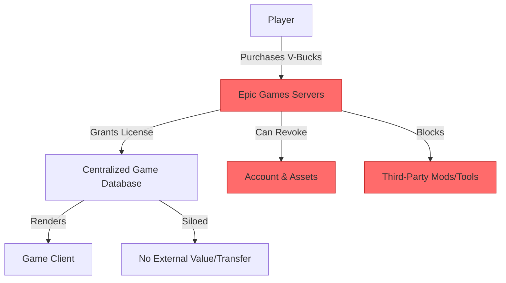
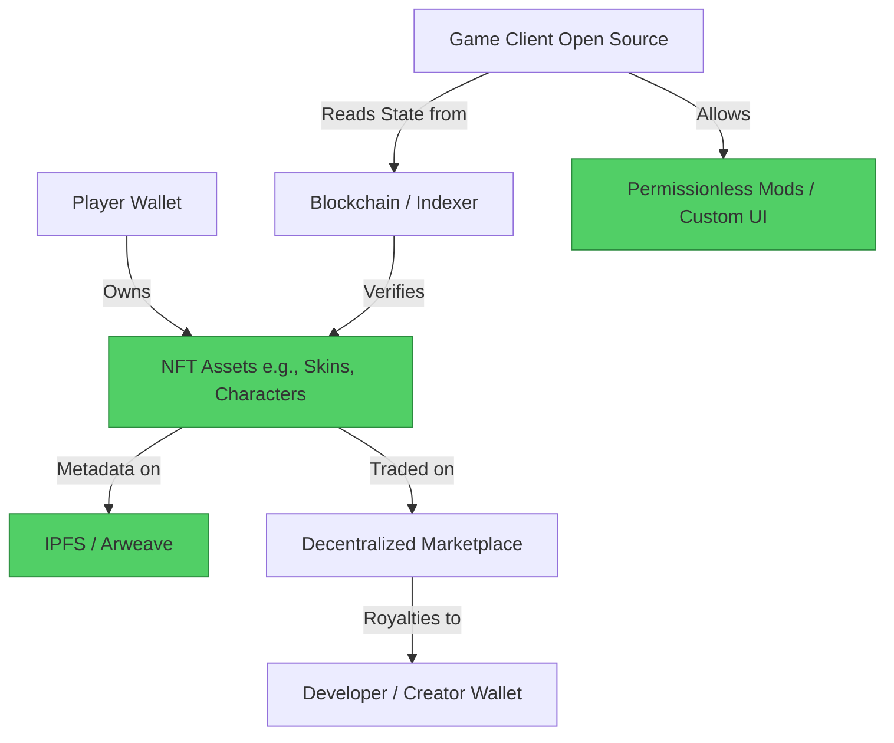

#  Fortnite → On-Chain Games Migration Guide

> **Web2 Service:** Fortnite (Epic Games)
> **Web3 Alternative:** Fully On-Chain Games (FOCG) & Web3 Gaming Ecosystems (MUD, Dojo, Immutable X)
> **Difficulty:** ⭐⭐⭐⭐⭐ (Expert)
> **Time to Migrate:** 3-6 months for game logic refactoring, asset tokenization, and engine integration

---

## 🎯 Overview

Fortnite revolutionized the battle royale and live-service gaming model, but it operates as a strictly centralized, closed ecosystem. Players spend billions on "V-Bucks" and cosmetic skins, yet they only purchase revocable licenses. These assets are trapped within Epic Games' servers, cannot be traded, hold no real-world value, and vanish if the account is banned or the game eventually shuts down. Furthermore, the game's code and rules are entirely controlled by the developer, preventing community modding or interoperability. **On-Chain Games** (and hybrid Web3 games) shift this paradigm by moving game assets—and in some cases, core game logic—onto the blockchain. This grants players true ownership of their digital items, enables permissionless modding, and allows assets to be traded on open markets or used across multiple games.

This guide shows you how to migrate from a centralized, walled-garden live-service game to a decentralized, player-owned, and composable on-chain gaming ecosystem.

---

## ❌ The Web2 Problem: Fortnite

### Key Issues

| Problem | Impact |
|---------|--------|
| **Illusory Ownership** | Players buy "licenses" for skins, not assets. Epic Games can revoke access at any time per their Terms of Service |
| **Zero Liquidity** | In-game items cannot be sold, traded, or transferred. Money spent is a sunk cost with no resale value |
| **Closed Ecosystem** | Assets are strictly siloed. A Fortnite skin cannot be used in another game, nor can community members create and monetize their own mods |
| **Arbitrary Bans** | Account bans result in the total, permanent loss of all purchased digital goods and progress |
| **Centralized Server Dependency** | If Epic Games shuts down the servers, the game becomes unplayable, and all digital history is erased |
| **Opaque Monetization** | The "gacha" or battle pass model is designed to maximize psychological engagement and extraction, with no revenue sharing with the community |
| **No Interoperability** | Your identity, friends list, and inventory are locked to Epic Games' proprietary database |

### Real-World Example

In 2023, Epic Games banned thousands of Fortnite accounts for "unauthorized purchasing" or minor TOS violations, instantly wiping out players' inventories worth thousands of dollars. Additionally, when older online games like *Club Penguin* or *Minecraft Earth* were shut down, players lost all their digital purchases permanently, highlighting the fragility of centralized digital ownership.

---

## ✅ The Web3 Solution: On-Chain Games

### What are On-Chain Games?

On-chain games (or hybrid Web3 games) utilize blockchain technology to represent in-game assets as NFTs (ERC-721/ERC-1155) and, in the case of Fully On-Chain Games (FOCG), store the game's state and logic directly in smart contracts. Frameworks like **MUD** (by Lattice) or **Dojo** (by Realms) enable developers to build high-performance games where the blockchain acts as the single source of truth. Players connect non-custodial wallets, truly own their cosmetics, characters, and currency, and can trade them on decentralized marketplaces. 

### Key Benefits

| Benefit | How On-Chain Games Solve It |
|---------|-----------------------------|
| **True Digital Ownership** | Assets are held in the player's wallet. Even if the game shuts down, the NFT and its metadata persist on-chain/IPFS |
| **Open Marketplaces & Liquidity** | Players can buy, sell, or trade skins and items on open markets (e.g., OpenSea, Magic Eden), recouping or growing their investment |
| **Permissionless Modding & Composability** | Open-source game clients allow the community to build custom mods, UI overlays, or entirely new games using the same on-chain assets |
| **Censorship Resistance** | No central authority can arbitrarily ban a wallet from holding or trading its own assets |
| **Interoperability** | Assets can be designed to be recognized across multiple games within the same ecosystem (e.g., using a skin in Game A and Game B) |
| **Community Revenue Share** | Smart contracts can route a percentage of secondary sales or marketplace fees back to the creators or community treasury |
| **Verifiable Scarcity** | The total supply of any cosmetic item is cryptographically guaranteed and publicly auditable |

---

## 🏗️ Architecture Comparison

### Fortnite Architecture (Centralized)



### On-Chain Game Architecture (Decentralized)



---

## 🛠️ Step-by-Step Migration

### Step 1: Choose an On-Chain Game Engine

Building a fully on-chain game requires specialized frameworks to handle state and performance. **MUD** (Ethereum) and **Dojo** (Starknet) are the leading engines for FOCG. For hybrid models, **Immutable X** or **Ronin** are ideal for asset tokenization without on-chain logic bottlenecks.

```bash
# Install MUD CLI (Example for Ethereum FOCG)
npm install -g @latticexyz/cli@latest

# Create a new MUD project
npx create-mud-app@latest my-onchain-game
cd my-onchain-game
```

### Step 2: Define and Tokenize Game Assets (NFTs)

Define your cosmetics (skins, emotes, weapons) as ERC-1155 tokens. This standard is gas-efficient and perfect for semi-fungible game items with varying quantities.

```solidity
// SPDX-License-Identifier: MIT
pragma solidity ^0.8.20;

import "@openzeppelin/contracts/token/ERC1155/ERC1155.sol";
import "@openzeppelin/contracts/access/Ownable.sol";
import "@openzeppelin/contracts/token/ERC1155/extensions/ERC1155Supply.sol";

contract GameCosmetics is ERC1155, ERC1155Supply, Ownable {
    // Royalty info for secondary sales (EIP-2981)
    uint96 public royaltyBps = 500; // 5%

    constructor() ERC1155("https://game-metadata.example.com/api/item/{id}.json") Ownable(msg.sender) {}

    function mintCosmetic(address account, uint256 id, uint256 amount, bytes memory data) public onlyOwner {
        _mint(account, id, amount, data);
    }

    function setURI(string memory newuri) public onlyOwner {
        _setURI(newuri);
    }

    // EIP-2981 Royalty implementation
    function royaltyInfo(uint256, uint256 salePrice) external view returns (address, uint256) {
        return (owner(), (salePrice * royaltyBps) / 10000);
    }

    function _update(address from, address to, uint256[] memory ids, uint256[] memory values)
        internal
        override(ERC1155, ERC1155Supply)
    {
        super._update(from, to, ids, values);
    }
}
```

### Step 3: Store Asset Metadata Decentralized

Never rely on centralized servers for NFT metadata. Upload images and JSON metadata to IPFS to ensure the assets remain visible even if the game's official website goes offline.

```javascript
import { create } from 'ipfs-http-client';
import fs from 'fs';

const ipfs = create({ url: 'https://api.pinata.cloud/ipfs/api/v0' });

async function uploadCosmeticMetadata(name, description, imagePath, attributes) {
  const imageFile = fs.readFileSync(imagePath);
  const imageRes = await ipfs.add(imageFile);
  
  const metadata = {
    name: name,
    description: description,
    image: `ipfs://${imageRes.cid.toString()}`,
    attributes: attributes // e.g., [{ trait_type: "Rarity", value: "Legendary" }]
  };

  const metaRes = await ipfs.add(JSON.stringify(metadata));
  console.log(`✅ Metadata pinned to IPFS: ipfs://${metaRes.cid.toString()}`);
  return metaRes.cid.toString();
}
```

### Step 4: Integrate Wallet Connection and Asset Verification

Modify the game client (e.g., Unity, Unreal, or a web-based Phaser/Three.js client) to connect to the player's wallet and verify asset ownership before rendering the cosmetics.

```javascript
// Example: Web-based game client verifying ERC-1155 ownership
import { createPublicClient, http } from 'viem';
import { mainnet } from 'viem/chains';

const client = createPublicClient({ chain: mainnet, transport: http() });

async function equipSkin(playerAddress, skinId) {
  const contractAddress = '0xYourGameCosmeticsContract';
  const abi = [{ name: 'balanceOf', type: 'function', inputs: [{name: 'account', type: 'address'}, {name: 'id', type: 'uint256'}], outputs: [{name: '', type: 'uint256'}] }];

  const balance = await client.readContract({
    address: contractAddress,
    abi,
    functionName: 'balanceOf',
    args: [playerAddress, BigInt(skinId)]
  });

  if (balance > 0n) {
    console.log(`✅ Skin ${skinId} verified. Equipping in-game...`);
    // renderSkin(skinId);
    return true;
  } else {
    console.log(`❌ Player does not own Skin ${skinId}.`);
    return false;
  }
}
```

### Step 5: Enable Permissionless Modding and Composability

Release the game client's rendering logic or asset pipeline as open source. Allow the community to build custom UI mods, alternative game modes, or new clients that read the same on-chain state.

```javascript
// Conceptual: A community-built alternative client reading the same on-chain state
async function loadCustomClient(playerAddress) {
  console.log("🛠️ Loading community mod...");
  // Fetch the player's on-chain inventory
  const inventory = await fetchOnChainInventory(playerAddress);
  
  // Render using a completely different game engine or UI framework
  renderAlternativeUI(inventory);
  console.log("✅ Custom mod loaded successfully using official on-chain data.");
}
```

### Step 6: Migrate the Player Community

1. **Airdrop Founder Skins**: Reward early Web3 adopters or loyal players from the Web2 version with exclusive, soulbound (non-transferable) or rare NFT cosmetics.
2. **Incentivize Wallet Creation**: Use Account Abstraction (ERC-4337) to allow players to log in with an email, with the wallet created seamlessly in the background.
3. **Open Marketplace**: Launch an official, low-fee marketplace for players to trade their earned or purchased items, highlighting the ability to recoup value.

---

## 📜 Full Migration Script

```javascript
// migrate-fortnite-assets-to-onchain.js
import { create } from 'ipfs-http-client';
import { ethers } from 'ethers';
import fs from 'fs';

class FortniteToOnChainMigrator {
  constructor(developerPrivateKey, contractAddress) {
    this.provider = new ethers.JsonRpcProvider(process.env.RPC_URL);
    this.wallet = new ethers.Wallet(developerPrivateKey, this.provider);
    this.contractAddress = contractAddress;
    this.ipfs = create({ url: 'https://api.pinata.cloud/ipfs/api/v0' });
  }

  async tokenizeCosmetic(cosmeticData) {
    console.log(`\n🎨 Tokenizing: ${cosmeticData.name}`);

    // 1. Upload Image
    const imageRes = await this.ipfs.add(fs.readFileSync(cosmeticData.imagePath));
    
    // 2. Create Metadata
    const metadata = {
      name: cosmeticData.name,
      description: cosmeticData.description,
      image: `ipfs://${imageRes.cid.toString()}`,
      attributes: cosmeticData.attributes || []
    };

    // 3. Upload Metadata
    const metaRes = await this.ipfs.add(JSON.stringify(metadata));
    console.log(`📦 Metadata URI: ipfs://${metaRes.cid.toString()}`);

    // 4. Mint to Player/Treasury
    const contract = new ethers.Contract(
      this.contractAddress,
      ['function mintCosmetic(address account, uint256 id, uint256 amount, bytes memory data) external'],
      this.wallet
    );

    const tx = await contract.mintCosmetic(
      cosmeticData.recipientAddress,
      BigInt(cosmeticData.id),
      BigInt(cosmeticData.amount),
      '0x'
    );
    await tx.wait();

    console.log(`✅ Minted ${cosmeticData.amount}x ${cosmeticData.name} to ${cosmeticData.recipientAddress}`);
    return metaRes.cid.toString();
  }

  async runMigration(cosmeticsJsonPath) {
    console.log("🚀 Starting Fortnite-style Asset to On-Chain Migration...");
    const cosmetics = JSON.parse(fs.readFileSync(cosmeticsJsonPath, 'utf-8'));
    
    for (const item of cosmetics) {
      await this.tokenizeCosmetic(item);
    }
    
    console.log("\n🎉 Migration complete! Assets are now truly owned by players.");
  }
}

// Usage
// const migrator = new FortniteToOnChainMigrator(
//   process.env.DEV_PRIVATE_KEY,
//   '0xYourGameCosmeticsContractAddress'
// );
// migrator.runMigration('./game-cosmetics-export.json');
```

---

## ⚖️ Trade-offs

| Aspect | Fortnite (Web2) | On-Chain Games (Web3) |
|--------|-----------------|-----------------------|
| **Asset Ownership** | Revocable license, zero real-world value | True ownership, tradable, holds market value |
| **Monetization** | 100% of revenue to developer (after platform cuts) | Primary sales + 5-10% automated secondary royalties |
| **Performance** | Flawless, 60-120 FPS, centralized servers | Varies; FOCG faces latency limits, hybrid models perform like Web2 |
| **User Experience** | Frictionless, 1-click login, no crypto knowledge | Requires wallet setup (mitigated by Account Abstraction) |
| **Modding** | Strictly prohibited, anti-cheat bans modders | Permissionless, open-source clients encourage community mods |
| **Censorship** | High (arbitrary bans, TOS enforcement) | Resistant (assets live in user wallets, not dev servers) |
| **Development Cost** | High (massive centralized server infrastructure) | High initial smart contract/engine learning curve, lower server costs |
| **Interoperability** | None (walled garden) | High potential (assets can be ported to other compatible games) |

---

## 🌍 Real-World Examples

### Platforms & Engines
1. **MUD (by Lattice)**: A reactive, on-chain game engine enabling fully on-chain games like *OPCraft* (a Minecraft-like voxel game on Ethereum).
2. **Dojo (by Realms)**: A provable game engine built on Starknet, designed for high-performance, fully on-chain games like *Autonomys* and *Loot Survivor*.
3. **Immutable X**: The leading hybrid Web3 gaming layer, powering games like *Gods Unchained* and *Illuvium* with gas-free NFT trading.
4. **Parallel**: A sci-fi card game that successfully bridges high-quality Web2 game design with true Web3 asset ownership.

### Migration Success Stories
- **OPCraft**: Demonstrated that a fully on-chain, Minecraft-like world can be built, modded permissionlessly by the community, and owned entirely by the players, with no central server to shut it down.
- **Pixels**: Migrated from a simple web game to the Ronin network, introducing true asset ownership and a player-driven economy, resulting in hundreds of thousands of daily active users.
- **Community Modders**: In Web3 gaming ecosystems, community members have built alternative clients and UI overlays for existing on-chain games, enhancing the experience without fear of DMCA takedowns.

---

## 🔒 Security Considerations

1. **Smart Contract Vulnerabilities**: On-chain game logic and asset contracts are prime targets for hackers. Rigorous auditing (e.g., by Trail of Bits or OpenZeppelin) is non-negotiable.
2. **Metadata Centralization**: If the NFT metadata points to a centralized AWS server, the developer can still change or delete the asset's appearance. Always use IPFS or Arweave.
3. **Phishing & Wallet Drainers**: Gamers are heavily targeted by fake "free skin" links. Educate the community and implement in-game warnings about official domains.
4. **Regulatory Scrutiny**: Ensure in-game economies and tokenomics do not inadvertently classify assets as unregistered securities. Consult legal experts on "Play-and-Earn" mechanics.
5. **Private Key Management**: Players must be educated on securing their seed phrases. Consider integrating Account Abstraction (ERC-4337) for social recovery and gasless transactions to improve safety and UX.

---

## 📚 Resources

### Official Documentation
- [MUD Documentation](https://mud.dev/)
- [Dojo Book](https://book.dojoengine.org/)
- [Immutable X Developer Docs](https://docs.immutable.com/)
- [OpenZeppelin ERC-1155 Guide](https://docs.openzeppelin.com/contracts/4.x/erc1155)

### Developer Tools
- **Foundry / Hardhat**: For developing and testing on-chain game logic.
- **Pinata / NFT.Storage**: For decentralized, reliable IPFS pinning of game assets.
- **Thirdweb**: Pre-built, audited smart contracts and Unity/Unreal SDKs for Web3 gaming.
- **Biconomy / Safe**: For Account Abstraction and gasless, seamless player onboarding.

### Community
- [MUD Discord](https://discord.gg/latticexyz)
- [Dojo Discord](https://discord.gg/dojoengine)
- [Immutable Discord](https://discord.gg/immutablex)

---

## 🎓 Key Takeaways

1. **Ownership changes player psychology**: When players know they truly own an asset and can sell it, their engagement, retention, and willingness to invest in the game increase significantly.
2. **Hybrid is the pragmatic present**: Fully on-chain games are cutting-edge but face performance limits. Most successful migrations start with a hybrid model (Web2 gameplay + Web3 asset ownership).
3. **Composability is the endgame**: The ultimate vision is not just owning a skin, but using that skin across multiple games, metaverses, and community-built mods.
4. **Account Abstraction is mandatory for mass adoption**: Mainstream gamers will not manage seed phrases. ERC-4337 (smart contract wallets) is the key to hiding Web3 complexity.
5. **Metadata must be decentralized**: True ownership is an illusion if the developer can remotely change or delete the asset's image. IPFS/Arweave is required.
6. **Community over corporation**: By open-sourcing parts of the client or asset pipeline, you turn your player base into active co-creators and evangelists.
7. **The walled garden is cracking**: As players become more aware of digital rights, the demand for true ownership will force the gaming industry to adapt or lose market share to Web3 alternatives.

---

*Guide by [@Elvatar](https://github.com/Elvatar2) | Last updated: 2026*  
*Part of the Web2 → Web3 Migration Guide series*