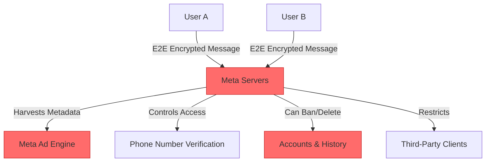
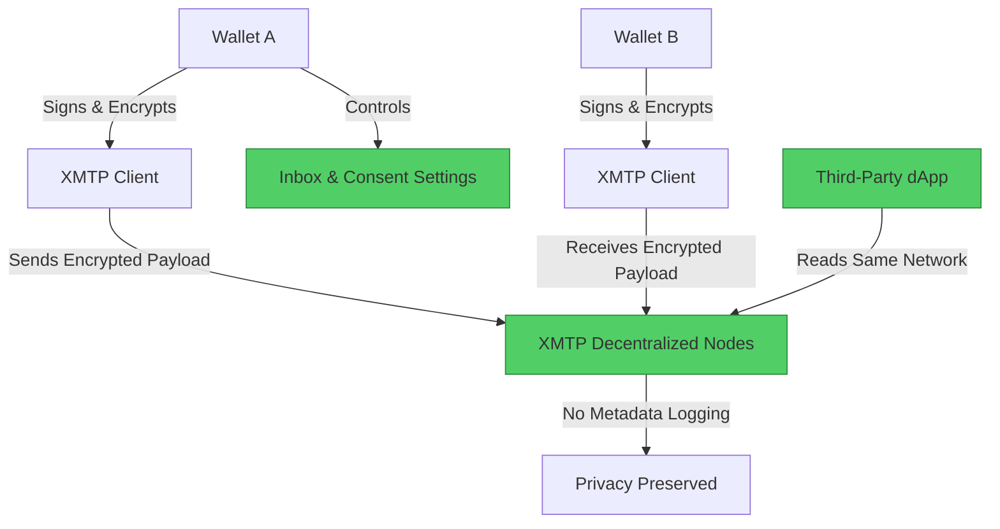

#  WhatsApp → XMTP Migration Guide

> **Web2 Service:** WhatsApp (Meta)
> **Web3 Alternative:** XMTP (Extensible Message Transport Protocol)
> **Difficulty:** ⭐⭐⭐ (Intermediate)
> **Time to Migrate:** 2-4 weeks for dApp integration and user onboarding

---

## 🎯 Overview

WhatsApp is the world's most popular messaging app, but it operates as a centralized, closed ecosystem controlled by Meta. While it offers end-to-end encryption for message content, Meta still harvests extensive metadata (who you talk to, when, and from where), reserves the right to arbitrarily ban accounts (wiping all chat history), and completely locks users into its proprietary network. **XMTP (Extensible Message Transport Protocol)** shifts the paradigm to decentralized, wallet-to-wallet messaging. It provides a secure, interoperable, and user-owned communication layer where your inbox is tied to your cryptographic identity, not a phone number or a corporate server.

This guide shows you how to migrate from a centralized, metadata-harvesting messaging app to a decentralized, interoperable, and self-sovereign communication protocol.

---

## ❌ The Web2 Problem: WhatsApp

### Key Issues

| Problem | Impact |
|---------|--------|
| **Metadata Harvesting** | Meta collects extensive metadata (contacts, timestamps, location, device info) to build advertising profiles |
| **Arbitrary Account Bans** | Automated systems frequently ban accounts for false positives, permanently locking users out of their entire chat history |
| **Closed Ecosystem** | Messages are trapped in WhatsApp; you cannot message a user on Signal, Telegram, or a Web3 dApp from WhatsApp |
| **Phone Number Dependency** | Ties your digital identity to a centralized telecom provider, making anonymity and privacy difficult |
| **Centralized Server Dependency** | If Meta's servers go down or your country blocks WhatsApp, communication ceases entirely |
| **No Developer Composability** | Developers cannot build custom clients, bots, or integrations without strict, restrictive, and easily revoked API access |
| **Backup Vulnerabilities** | Cloud backups (iCloud/Google Drive) are often unencrypted or held by third parties, creating a weak link in the security chain |

### Real-World Example

In 2021, WhatsApp updated its privacy policy, forcing users to agree to extensive data sharing with Meta or lose access to the app. Furthermore, thousands of users, including journalists and activists, have reported sudden, unexplained account bans. Because WhatsApp ties identity to a phone number and stores chat history locally (or in vulnerable cloud backups), a ban effectively erases years of critical communication with no appeal process.

---

## ✅ The Web3 Solution: XMTP

### What is XMTP?

**XMTP (Extensible Message Transport Protocol)** is an open, decentralized messaging protocol that enables secure, wallet-to-wallet communication. Instead of routing messages through Meta's servers, XMTP uses a network of decentralized nodes to relay encrypted messages. Your identity is your Ethereum (or other EVM) wallet address. XMTP provides native end-to-end encryption, user-controlled inboxes, and "consent modes" to prevent spam, while allowing any developer to build interoperable messaging clients (dApps, wallets, or standalone apps) that can all talk to each other.

### Key Benefits

| Benefit | How XMTP Solves It |
|---------|--------------------|
| **True Identity Ownership** | Your inbox is tied to your wallet address, not a phone number or corporate account |
| **Interoperability** | Message seamlessly across different apps (e.g., from a Web3 wallet to a Lens Protocol profile) |
| **Metadata Minimization** | Decentralized nodes relay encrypted payloads without building centralized advertising profiles |
| **Censorship Resistance** | No central authority can ban your wallet address or delete your message history |
| **Developer Composability** | Open protocol allows anyone to build custom clients, notification bots, or community chat interfaces |
| **Spam Protection** | Native "consent mode" requires recipients to accept messages from unknown senders, keeping inboxes clean |
| **Portable History** | Chat history is encrypted and can be backed up or accessed from any XMTP-compatible client using your wallet keys |

---

## 🏗️ Architecture Comparison

### WhatsApp Architecture (Centralized)



### XMTP Architecture (Decentralized)



---

## 🛠️ Step-by-Step Migration

### Step 1: Install XMTP SDK

Add the official XMTP JavaScript/TypeScript SDK to your project. This library handles key generation, encryption, and network communication.

```javascript
// Install XMTP SDK and a wallet library (e.g., viem or ethers)
npm install @xmtp/xmtp-js viem

import { Client } from '@xmtp/xmtp-js';
import { createWalletClient, custom } from 'viem';
import { mainnet } from 'viem/chains';

// Initialize wallet client
const walletClient = createWalletClient({
  chain: mainnet,
  transport: custom(window.ethereum)
});
```

### Step 2: Initialize the XMTP Client

Create an XMTP client instance by signing a message with the user's wallet. This proves ownership of the address and generates the encryption keys for the inbox.

```javascript
async function initializeXMTPClient() {
  const [address] = await walletClient.getAddresses();
  
  console.log(`🔑 Initializing XMTP client for ${address}...`);
  
  // The create method will prompt the user to sign a message to authenticate
  const xmtp = await Client.create(walletClient, {
    env: 'production', // Use 'dev' for testing
  });

  console.log(`✅ XMTP Client ready. Inbox ID: ${xmtp.address}`);
  return xmtp;
}
```

### Step 3: Start a Conversation and Send a Message

XMTP automatically handles the encryption and key exchange. You simply specify the recipient's wallet address (or ENS name) and send the payload.

```javascript
async function sendMessage(xmtpClient, recipientAddress, messageText) {
  console.log(`📩 Starting conversation with ${recipientAddress}...`);
  
  // XMTP handles the invitation and key exchange seamlessly
  const conversation = await xmtpClient.conversations.newConversation(recipientAddress);
  
  // Send the encrypted message
  const message = await conversation.send(messageText);
  
  console.log(`✅ Message sent! ID: ${message.id}`);
  return message;
}
```

### Step 4: Stream and Receive Messages

Instead of polling a central server, use XMTP's streaming capabilities to listen for new messages in real-time, similar to a WebSocket connection.

```javascript
async function listenForMessages(xmtpClient) {
  console.log('👂 Listening for new messages...');
  
  // Stream all new conversations
  for await (const conversation of xmtpClient.conversations.stream()) {
    console.log(`🗨️ New conversation started with: ${conversation.peerAddress}`);
    
    // Stream messages within this specific conversation
    for await (const message of conversation.streamMessages()) {
      console.log(`📨 New message from ${message.senderAddress}: ${message.content}`);
    }
  }
}
```

### Step 5: Implement Consent and Spam Protection

XMTP includes a built-in consent system. You can check if a user has allowed or denied messages from a specific address, preventing spam.

```javascript
async function checkConsent(xmtpClient, peerAddress) {
  const state = await xmtpClient.contacts.isAllowed(peerAddress);
  
  if (state === 'allowed') {
    console.log('✅ Sender is allowed. Messages will be delivered to the main inbox.');
  } else if (state === 'denied') {
    console.log('⛔ Sender is denied. Messages will be blocked.');
  } else {
    console.log('⚠️ Unknown sender. Message will go to the message requests folder.');
  }
  
  return state;
}

// To explicitly allow a sender:
// await xmtpClient.contacts.allow([peerAddress]);
```

### Step 6: Migrate Your Contacts and Community

1. **Map Phone Numbers to Wallets**: Encourage your existing WhatsApp contacts to link their ENS names or wallet addresses to their social profiles (e.g., on Lens or Farcaster).
2. **Deploy a Custom Client**: Build or use an existing XMTP-compatible chat interface (like **Converse**) and share the link with your community.
3. **Incentivize the Switch**: Offer exclusive access, NFT drops, or community roles to users who send their first message via your XMTP-integrated dApp.

---

## 📜 Full Migration Script

```javascript
// migrate-whatsapp-to-xmtp.js
import { Client } from '@xmtp/xmtp-js';
import { createWalletClient, custom } from 'viem';
import { mainnet } from 'viem/chains';

class WhatsAppToXMTPMigrator {
  constructor() {
    this.walletClient = createWalletClient({
      chain: mainnet,
      transport: custom(window.ethereum)
    });
    this.xmtpClient = null;
  }

  async initialize() {
    const [address] = await this.walletClient.getAddresses();
    console.log(`🚀 Initializing XMTP for ${address}...`);
    this.xmtpClient = await Client.create(this.walletClient, { env: 'production' });
    console.log('✅ XMTP Client initialized.');
  }

  async broadcastToCommunity(communityWallets, message) {
    if (!this.xmtpClient) throw new Error('Client not initialized');

    console.log(`\n📢 Broadcasting message to ${communityWallets.length} contacts...`);
    
    for (const address of communityWallets) {
      try {
        // Check consent first to respect user inbox preferences
        const consent = await this.xmtpClient.contacts.isAllowed(address);
        
        if (consent === 'denied') {
          console.log(`⛔ Skipped ${address}: User has denied messages.`);
          continue;
        }

        const conversation = await this.xmtpClient.conversations.newConversation(address);
        await conversation.send(message);
        console.log(`✅ Message delivered to ${address}`);
        
        // Small delay to avoid rate limiting
        await new Promise(r => setTimeout(r, 500));
      } catch (error) {
        console.error(`❌ Failed to send to ${address}:`, error.message);
      }
    }
    console.log('🎉 Broadcast complete!');
  }

  async startListening() {
    console.log('\n👂 Starting real-time message listener...');
    for await (const conversation of this.xmtpClient.conversations.stream()) {
      console.log(`\n🗨️ New conversation with: ${conversation.peerAddress}`);
      
      for await (const message of conversation.streamMessages()) {
        console.log(`📨 [${new Date(message.sent).toLocaleTimeString()}] ${message.senderAddress}: ${message.content}`);
      }
    }
  }
}

// Usage
// const migrator = new WhatsAppToXMTPMigrator();
// await migrator.initialize();
// await migrator.broadcastToCommunity(
//   ['0xRecipient1...', '0xRecipient2...'], 
//   'Hey! We have migrated our community chat to XMTP. Reply here to confirm!'
// );
// migrator.startListening();
```

---

## ⚖️ Trade-offs

| Aspect | WhatsApp | XMTP |
|--------|----------|------|
| **User Experience** | Extremely polished, ubiquitous, zero-setup | Requires wallet connection; UX is improving but still Web3-native |
| **Identity** | Tied to phone number (centralized telecom) | Tied to wallet address / ENS (self-sovereign) |
| **Privacy** | Content encrypted, but heavy metadata harvesting | Content encrypted, minimal metadata, decentralized routing |
| **Interoperability** | None (walled garden) | High (any XMTP client can message any other XMTP client) |
| **Censorship** | High (account bans, number blocking) | Resistant (wallet-based, no central authority to ban) |
| **Spam Control** | Centralized reporting and blocking | Native consent modes (allow/deny lists) |
| **Backup & Recovery** | iCloud/Google Drive (vulnerable to subpoenas) | Key-based; recovery depends on wallet seed phrase or smart contract recovery |
| **Developer Access** | Restricted, expensive Business API | Open, permissionless, free to integrate |

---

## 🌍 Real-World Examples

### Apps & Integrations
1. **Converse**: A fast, native mobile messaging app built entirely on XMTP, offering a WhatsApp-like experience but with wallet-based identity.
2. **Coinbase Wallet**: Integrated XMTP to allow users to securely message each other directly from their crypto wallets.
3. **Lens Protocol & Farcaster**: Both decentralized social networks use XMTP under the hood to power direct messages (DMs) between users, ensuring social graphs remain portable.
4. **XMTP Inbox**: A web-based reference implementation showing how developers can build custom chat interfaces.

### Migration Success Stories
- **Web3 Communities**: DAOs and NFT projects have migrated their core team communications and high-value member chats from WhatsApp/Telegram to XMTP to prevent phishing, SIM-swapping, and centralized takedowns.
- **DeFi Protocols**: Used XMTP to send secure, verifiable, and encrypted transaction alerts or governance proposals directly to users' wallet inboxes, bypassing insecure email or SMS.
- **Independent Developers**: Built custom customer support bots that interact with users directly through their Web3 wallets, eliminating the need for third-party chat widgets.

---

## 🔒 Security Considerations

1. **Wallet Security is Paramount**: Since your XMTP inbox is tied to your wallet, a compromised private key means an attacker can read your messages and impersonate you. Use hardware wallets for high-value accounts.
2. **Metadata Leakage**: While XMTP encrypts content, sophisticated traffic analysis on decentralized nodes could theoretically infer communication patterns. For extreme threat models, combine XMTP with a VPN or Tor.
3. **Phishing via Messages**: Attackers may use XMTP to send malicious links. Always verify the sender's wallet address or ENS name before clicking links, and utilize the consent mode to block unknown senders.
4. **Key Rotation**: If a wallet is compromised, XMTP supports key rotation, but you must proactively manage this to revoke the attacker's access to future messages.
5. **Client-Side Vulnerabilities**: Ensure the frontend client you use to access XMTP is from a trusted, open-source repository to prevent malicious code from intercepting messages before encryption.

---

## 📚 Resources

### Official Documentation
- [XMTP Official Documentation](https://xmtp.org/docs)
- [XMTP JavaScript SDK Reference](https://xmtp.org/docs/build/javascript)
- [XMTP Consent & Spam Management](https://xmtp.org/docs/concepts/consent)

### Developer Tools
- **@xmtp/xmtp-js**: The core JavaScript/TypeScript SDK for building XMTP clients.
- **Viem / Ethers.js**: For handling the wallet signing required for XMTP authentication.
- **Converse App**: A reference mobile client to test and experience XMTP firsthand.
- **XMTP React Components**: Pre-built UI components for quickly adding chat features to Web3 dApps.

### Community
- [XMTP Discord](https://discord.gg/xmtp)
- [XMTP Community Forum](https://community.xmtp.org/)
- [Build on XMTP GitHub](https://github.com/xmtp)

---

## 🎓 Key Takeaways

1. **Identity is the foundation**: Moving from phone numbers to wallet addresses shifts messaging from a telecom-controlled model to a user-owned model.
2. **Interoperability is a superpower**: XMTP breaks down walled gardens. A message sent from a wallet can be received in a dApp, a social protocol, or a standalone chat app.
3. **Consent is built-in**: XMTP's native allow/deny lists solve the Web3 spam problem, giving users control over who can enter their inbox.
4. **Metadata matters**: Even if content is encrypted, who you talk to is valuable data. XMTP's decentralized architecture minimizes this risk compared to Meta's centralized harvesting.
5. **UX abstraction is critical**: For mass adoption, wallet connections and message signing must be made seamless (e.g., via Account Abstraction or session keys).
6. **Developer freedom**: Anyone can build a better chat interface, add custom features, or integrate messaging into their game or dApp without asking for permission.
7. **Hybrid transition**: You don't have to delete WhatsApp today. Start by migrating high-value, Web3-native community communications to XMTP to build familiarity and trust.

---

*Guide by [@Elvatar](https://github.com/Elvatar2) | Last updated: 2026*  
*Part of the Web2 → Web3 Migration Guide series*