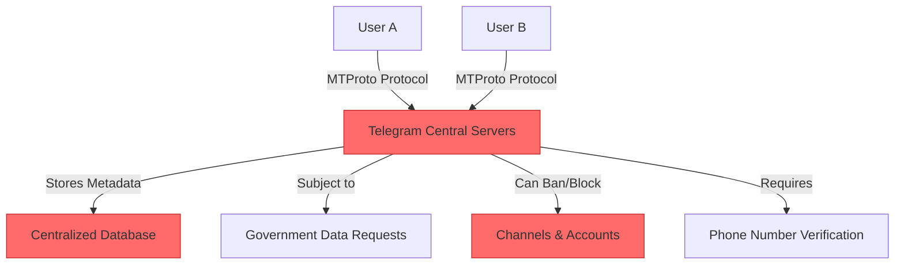
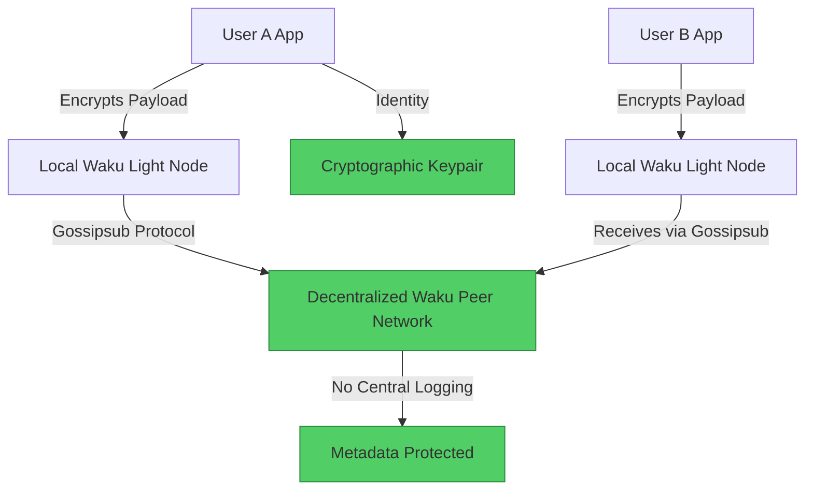

#  Telegram → Waku Migration Guide

> **Web2 Service:** Telegram
> **Web3 Alternative:** Waku Protocol (Decentralized, libp2p-based Messaging)
> **Difficulty:** ⭐⭐⭐⭐ (Advanced)
> **Time to Migrate:** 3-6 weeks for dApp integration, node setup, and community transition

---

## 🎯 Overview

Telegram is renowned for its speed and feature-rich messaging, but it remains a fundamentally centralized platform. It relies on proprietary servers, requires a phone number for identity, and is ultimately controlled by a single corporate entity. This centralization makes it vulnerable to government data requests, arbitrary channel bans, and complete service blackouts in certain regions. **Waku** shifts the paradigm to a fully decentralized, peer-to-peer (P2P) messaging protocol. Built on `libp2p` (the same networking stack as IPFS), Waku enables censorship-resistant, anonymous, and metadata-protected communication without relying on any central servers or phone numbers.

This guide shows you how to migrate from a centralized, phone-bound messaging app to a decentralized, privacy-preserving, and resilient P2P communication network.

---

## ❌ The Web2 Problem: Telegram

### Key Issues

| Problem | Impact |
|---------|--------|
| **Centralized Infrastructure** | All messages (except Secret Chats) and group data are routed through and stored on Telegram's centralized servers |
| **Phone Number Dependency** | Ties your digital identity to a centralized telecom provider, enabling surveillance and making anonymity difficult |
| **Arbitrary Censorship** | Telegram can and does ban channels, groups, or entire accounts based on regional government pressure or internal policy shifts |
| **Metadata Harvesting** | While content may be encrypted, Telegram collects extensive metadata (IP addresses, contact graphs, timestamps) |
| **Single Point of Failure** | If Telegram's servers are blocked by an ISP or experience a global outage, communication ceases entirely |
| **Proprietary Protocol** | MTProto is closed-source in parts, and third-party clients are often restricted or lack feature parity |
| **Data Handovers** | Telegram has a documented history of handing over user IP addresses and phone numbers to authorities in response to legal requests |

### Real-World Example

During various geopolitical conflicts and protests, Telegram has been completely blocked by national ISPs, cutting off vital communication for citizens and journalists. Furthermore, in 2021, Telegram updated its privacy policy to explicitly state it would hand over user IP addresses and phone numbers to authorities in response to valid legal requests, shattering the illusion of total privacy for many users.

---

## ✅ The Web3 Solution: Waku Protocol

### What is Waku?

**Waku** is a decentralized, permissionless messaging protocol designed as the communication layer for Web3. It is an evolution of the Whisper protocol, built on `libp2p`. Instead of sending messages to a central server, Waku nodes gossip messages across a decentralized peer-to-peer network. It supports **content topics** (pub/sub), **sharding** (to reduce bandwidth and protect metadata), and **payload encryption**. Your identity is a cryptographic keypair, not a phone number, ensuring true anonymity and censorship resistance.

### Key Benefits

| Benefit | How Waku Solves It |
|---------|--------------------|
| **No Central Servers** | Messages are relayed peer-to-peer; there is no central entity to shut down or subpoena |
| **True Anonymity** | No phone numbers or emails required. Identity is an ephemeral or persistent cryptographic keypair |
| **Metadata Protection** | Network sharding and decentralized routing make it extremely difficult to map who is talking to whom |
| **Censorship Resistance** | Messages propagate through a mesh of independent nodes; blocking requires taking down the entire P2P network |
| **Interoperability** | Any application (wallets, dApps, games) can embed a Waku node and communicate natively without proprietary APIs |
| **Payload Encryption** | End-to-end encryption is built into the protocol, ensuring only the intended recipient can read the message |
| **Open Source** | Fully open-source stack (`js-waku`, `go-waku`), allowing community auditing and custom client development |

---

## 🏗️ Architecture Comparison

### Telegram Architecture (Centralized)



### Waku Architecture (Decentralized)



---

## 🛠️ Step-by-Step Migration

### Step 1: Install Waku SDK

Add the official JavaScript Waku SDK to your project. This allows your application to run a lightweight Waku node directly in the browser or Node.js environment.

```javascript
// Install Waku SDK and libp2p crypto utilities
npm install @waku/sdk @waku/utils @noble/secp256k1

import { createLightNode, waitForRemotePeer, Protocols } from '@waku/sdk';
import { generatePrivateKey, getPublicKey } from '@noble/secp256k1';
```

### Step 2: Initialize a Waku Light Node

Create a Waku node instance. A "light node" is designed for browsers and mobile apps; it connects to full "relay nodes" to send and receive messages without storing the entire network history.

```javascript
async function initializeWakuNode() {
  console.log('🚀 Initializing Waku Light Node...');
  
  const node = await createLightNode({
    defaultBootstrap: true, // Connects to known Waku bootstrap peers
  });

  // Wait until the node is connected to the network and ready
  await waitForRemotePeer(node, [Protocols.LightPush, Protocols.Filter]);
  
  console.log('✅ Waku Node is connected and ready!');
  return node;
}
```

### Step 3: Generate a Decentralized Identity

Instead of a phone number, generate a secp256k1 keypair. This keypair will be used to sign and encrypt your messages, serving as your anonymous, self-sovereign identity.

```javascript
function generateWakuIdentity() {
  // Generate a random private key
  const privateKey = generatePrivateKey();
  const publicKey = getPublicKey(privateKey, true);
  
  // Convert to hex strings for easy handling
  const privHex = Buffer.from(privateKey).toString('hex');
  const pubHex = Buffer.from(publicKey).toString('hex');
  
  console.log(`🔑 Identity Generated. Public Key: 0x${pubHex}`);
  console.log('⚠️  Keep the private key secure! It is your only way to decrypt messages.');
  
  return { privateKey: privHex, publicKey: `0x${pubHex}` };
}
```

### Step 4: Send an Encrypted Message

Define a "content topic" (similar to a Telegram channel or group ID) and push an encrypted message to the network.

```javascript
import { bytesToUtf8, utf8ToBytes } from '@waku/utils';
import { createEncoder } from '@waku/sdk';

// Define a unique content topic for your community (e.g., /my-dapp/1/chat/proto)
const CONTENT_TOPIC = '/my-community/1/chat/protobuf';

const encoder = createEncoder({ contentTopic: CONTENT_TOPIC });

async function sendMessage(node, messageText, myPublicKey) {
  console.log(`📩 Sending message to topic: ${CONTENT_TOPIC}`);
  
  // In a production app, encrypt the payload using the recipient's public key
  // For this example, we use a simple UTF-8 encoding (Waku also supports symmetric encryption)
  const payload = utf8ToBytes(JSON.stringify({
    sender: myPublicKey,
    text: messageText,
    timestamp: Date.now()
  }));

  await node.lightPush.send(encoder, { payload });
  console.log('✅ Message pushed to the Waku network!');
}
```

### Step 5: Subscribe and Listen for Messages

Instead of polling a central API, your Waku node will listen to the gossipsub network and filter messages matching your content topic.

```javascript
async function listenForMessages(node, myPrivateKey) {
  console.log(`👂 Listening for messages on ${CONTENT_TOPIC}...`);

  const decoder = createEncoder({ contentTopic: CONTENT_TOPIC }); // Decoder uses same topic config

  // Use the Filter protocol for efficient, targeted message retrieval
  for await (const message of node.filter.subscribe(decoder)) {
    if (message.payload) {
      try {
        const decodedString = bytesToUtf8(message.payload);
        const data = JSON.parse(decodedString);
        
        console.log(`📨 [${new Date(data.timestamp).toLocaleTimeString()}] ${data.sender}: ${data.text}`);
        
        // In production: Decrypt payload here using myPrivateKey if asymmetric encryption is used
      } catch (error) {
        console.error('Failed to parse message:', error);
      }
    }
  }
}
```

### Step 6: Migrate Your Telegram Community

1. **Create a Migration Bot/Announcement**: Post a final message in your Telegram channel with a link to your new Waku-powered dApp or a Web3-native chat client (like Status).
2. **Distribute Connection Info**: Share the `CONTENT_TOPIC` and instructions on how to connect (e.g., "Paste this topic into our open-source chat UI").
3. **Incentivize Early Adopters**: Reward the first 100 users who send a message on the Waku network with a POAP or a community NFT, verifying their successful migration.

---

## 📜 Full Migration Script

```javascript
// migrate-telegram-to-waku.js
import { createLightNode, waitForRemotePeer, Protocols, createEncoder } from '@waku/sdk';
import { bytesToUtf8, utf8ToBytes } from '@waku/utils';
import { generatePrivateKey, getPublicKey } from '@noble/secp256k1';

class TelegramToWakuMigrator {
  constructor(contentTopic) {
    this.contentTopic = contentTopic;
    this.node = null;
    this.identity = null;
  }

  async initialize() {
    console.log('🚀 Starting Waku Node Initialization...');
    this.node = await createLightNode({ defaultBootstrap: true });
    await waitForRemotePeer(this.node, [Protocols.LightPush, Protocols.Filter]);
    
    this.identity = {
      privateKey: Buffer.from(generatePrivateKey()).toString('hex'),
      publicKey: `0x${Buffer.from(getPublicKey(generatePrivateKey(), true)).toString('hex')}`
    };
    
    console.log(`✅ Node ready. Identity: ${this.identity.publicKey}`);
  }

  async broadcastAnnouncement(messageText) {
    const encoder = createEncoder({ contentTopic: this.contentTopic });
    const payload = utf8ToBytes(JSON.stringify({
      sender: this.identity.publicKey,
      text: messageText,
      timestamp: Date.now()
    }));

    console.log(`📢 Broadcasting to ${this.contentTopic}...`);
    await this.node.lightPush.send(encoder, { payload });
    console.log('✅ Announcement sent to the decentralized network.');
  }

  async startListening() {
    const decoder = createEncoder({ contentTopic: this.contentTopic });
    console.log(`👂 Listening on ${this.contentTopic}...`);

    for await (const message of this.node.filter.subscribe(decoder)) {
      if (message.payload) {
        const data = JSON.parse(bytesToUtf8(message.payload));
        console.log(`📨 [${new Date(data.timestamp).toLocaleTimeString()}] ${data.sender.substring(0, 10)}...: ${data.text}`);
      }
    }
  }
}

// Usage
async function runMigration() {
  const migrator = new TelegramToWakuMigrator('/my-community/1/chat/protobuf');
  await migrator.initialize();
  
  await migrator.broadcastAnnouncement(
    '🚨 We have migrated from Telegram to Waku! This message is decentralized, censorship-resistant, and requires no phone number. Reply here to join the new network.'
  );
  
  await migrator.startListening();
}

// runMigration();
```

---

## ⚖️ Trade-offs

| Aspect | Telegram | Waku Protocol |
|--------|----------|---------------|
| **User Experience** | Instant, polished, feature-rich (voice, video, bots) | Text-focused, requires basic Web3 literacy, slightly higher latency |
| **Identity** | Phone number (tied to real-world identity) | Cryptographic keypair (fully anonymous/pseudonymous) |
| **Infrastructure** | Centralized servers (fast, but single point of failure) | Decentralized P2P mesh (resilient, censorship-resistant) |
| **Privacy** | Metadata harvested; Secret Chats are opt-in | Metadata protected via sharding; payload encryption by design |
| **Censorship** | Vulnerable to regional blocks and account bans | Highly resistant; no central entity to target |
| **Storage** | Cloud chat history stored on Telegram servers | Ephemeral by default; history requires local client-side storage or decentralized store nodes |
| **Development** | Closed/proprietary API, restrictive bot rules | Open-source, permissionless, fully composable with Web3 apps |
| **Bandwidth** | Optimized centralized delivery | Higher client-side bandwidth (running a light node and gossipsub) |

---

## 🌍 Real-World Examples

### Platforms & Integrations
1. **Status**: A secure messaging app and Web3 browser that uses Waku as its underlying decentralized communication layer, proving its viability for mainstream use.
2. **Nim Network**: Utilizes Waku for decentralized, metadata-resistant communication between nodes and users.
3. **Decentraland**: Explored Waku for in-world, proximity-based chat that doesn't rely on centralized servers.
4. **Web3 Wallets**: Several wallets are integrating Waku to allow secure, direct, wallet-to-wallet transaction notes and support chats without exposing email or phone numbers.

### Migration Success Stories
- **Activist & Journalist Networks**: Groups operating in restrictive regimes have migrated from Telegram to Waku-based clients to avoid ISP-level blocking and government metadata surveillance.
- **DAO Governance**: Decentralized communities use Waku for secure, internal coordination, ensuring that sensitive strategy discussions cannot be scraped or subpoenaed from a central server.
- **Gaming Guilds**: Web3 gaming communities use Waku for in-game chat, preventing the account bans and censorship that frequently occur on traditional platforms when discussing crypto topics.

---

## 🔒 Security Considerations

1. **Private Key Management**: Your Waku identity is your private key. If lost, you lose your identity and ability to decrypt past messages. If stolen, an attacker can impersonate you. Use secure enclaves or hardware wallets where possible.
2. **Bootstrap Node Trust**: Light nodes rely on bootstrap peers to join the network. Ensure you are connecting to a diverse, trusted set of bootstrap nodes to prevent eclipse attacks.
3. **Payload Encryption**: While Waku provides transport-level privacy, application-layer end-to-end encryption (E2EE) is highly recommended for sensitive 1-on-1 messages to ensure nodes cannot read the payload.
4. **Sybil Attacks**: Because joining is permissionless, bad actors can spin up thousands of nodes to spam a content topic. Implement application-layer rate limiting or token-gating (e.g., requiring an NFT to post) to mitigate spam.
5. **Metadata Leakage**: Although Waku sharding protects metadata, sending messages at highly predictable intervals or using highly unique content topics can still leak information. Use common topics and padding for advanced threat models.

---

## 📚 Resources

### Official Documentation
- [Waku Protocol Specification](https://rfc.vac.dev/spec/)
- [Waku JavaScript SDK Docs](https://js.waku.org/)
- [libp2p Documentation](https://docs.libp2p.io/)

### Developer Tools
- **@waku/sdk**: The official, modular JavaScript SDK for building Waku applications.
- **js-libp2p**: The underlying networking stack for advanced customization.
- **Waku Connect**: A managed service providing reliable Waku node infrastructure for developers who don't want to run their own relay nodes.

### Community
- [Waku Discord](https://discord.gg/waku)
- [Vac (Versatile Active Community) Forum](https://forum.vac.dev/)
- [Waku GitHub Organization](https://github.com/waku-org)

---

## 🎓 Key Takeaways

1. **Decentralization equals resilience**: By removing the central server, you eliminate the single point of failure that makes Telegram vulnerable to outages and censorship.
2. **Anonymity is a feature, not a bug**: Tying identity to cryptographic keys rather than phone numbers protects users from real-world surveillance and SIM-swapping attacks.
3. **Metadata protection is critical**: Waku's sharding and P2P routing ensure that *who* you talk to is just as private as *what* you say.
4. **Composability unlocks new UX**: Because Waku is an open protocol, your chat can be natively embedded inside a dApp, a game, or a wallet, creating seamless Web3 experiences.
5. **Spam requires new solutions**: Without a central moderator, you must use protocol-level (consent) or application-level (token-gating) mechanisms to keep communities clean.
6. **Hybrid onboarding works**: Use user-friendly, Web2-like frontends (like Status) that abstract the complexity of Waku, making it accessible to non-technical Telegram refugees.
7. **The future of communication is open**: Migrating to Waku is a vote for an internet where communication is a public good, not a proprietary product controlled by a single corporation.

---

*Guide by [@Elvatar](https://github.com/Elvatar2) | Last updated: 2026*  
*Part of the Web2 → Web3 Migration Guide series*
