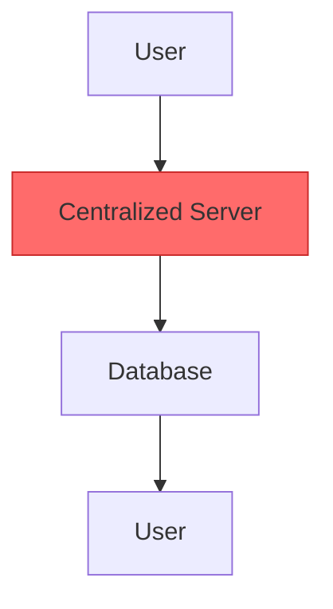
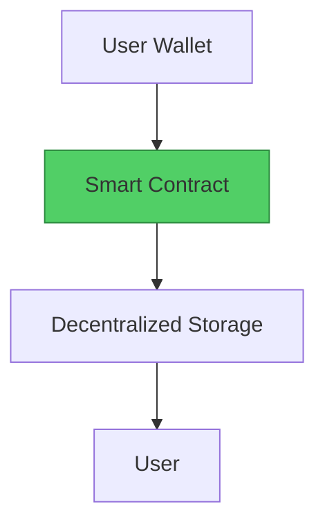

# Migration Template

> Use this template when creating a new migration guide.

---

## 🎯 Overview

**Web2 Service:** [Service Name]
**Web3 Alternative:** [Protocol/Platform Name]
**Difficulty:** ⭐⭐ (Beginner/Intermediate/Advanced)
**Time to Migrate:** [Estimated time]

---

## ❌ The Web2 Problem

### Key Issues

| Problem | Impact |
|---------|--------|
| [Issue 1] | [Impact] |
| [Issue 2] | [Impact] |
| [Issue 3] | [Impact] |

### Real-World Example

[Describe a real incident that highlights the problem]

---

## ✅ The Web3 Solution

### What is [Web3 Alternative]?

[Brief description of the Web3 alternative]

### Key Benefits

| Benefit | How It Solves the Problem |
|---------|---------------------------|
| [Benefit 1] | [Solution] |
| [Benefit 2] | [Solution] |
| [Benefit 3] | [Solution] |

---

## 🏗️ Architecture Comparison

### Web2 Architecture



### Web3 Architecture



---

## 🛠️ Step-by-Step Migration

### Step 1: [First Step]

[Description and code example]

### Step 2: [Second Step]

[Description and code example]

### Step 3: [Third Step]

[Description and code example]

### Step 4: [Fourth Step]

[Description and code example]

### Step 5: [Fifth Step]

[Description and code example]

---

## 💻 Code Examples

```javascript
// Add relevant code examples here
```

---

## ⚖️ Trade-offs

| Aspect | Web2 | Web3 |
|--------|------|------|
| [Aspect 1] | [Web2] | [Web3] |
| [Aspect 2] | [Web2] | [Web3] |
| [Aspect 3] | [Web2] | [Web3] |

---

## 🌍 Real-World Examples

- [Example 1]
- [Example 2]
- [Example 3]

---

## 🔒 Security Considerations

1. [Security concern 1]
2. [Security concern 2]
3. [Security concern 3]

---

## 📚 Resources

- [Resource 1](#)
- [Resource 2](#)
- [Resource 3](#)

---

## 🎓 Key Takeaways

1. [Takeaway 1]
2. [Takeaway 2]
3. [Takeaway 3]

---

*Guide by [@Elvatar](https://github.com/Elvatar2) | Last updated: 2026*
*Part of the Web2 → Web3 Migration Guide series*
